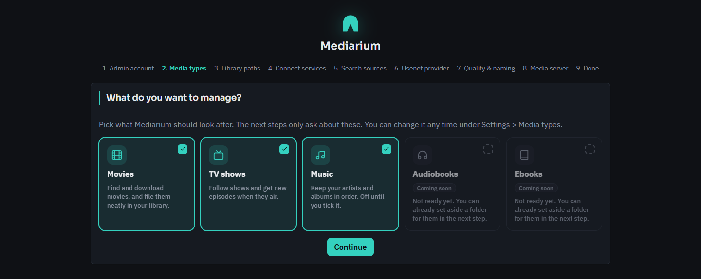
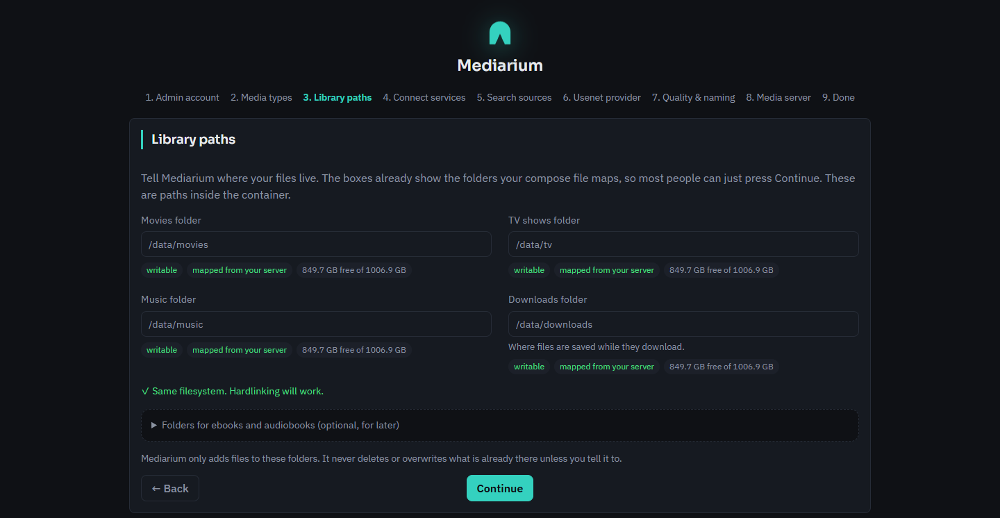
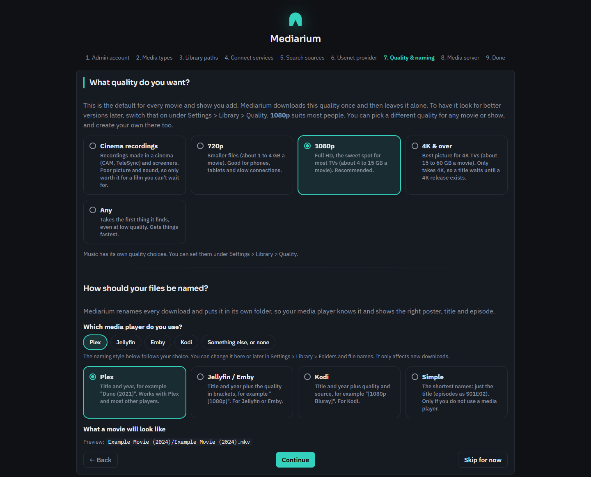
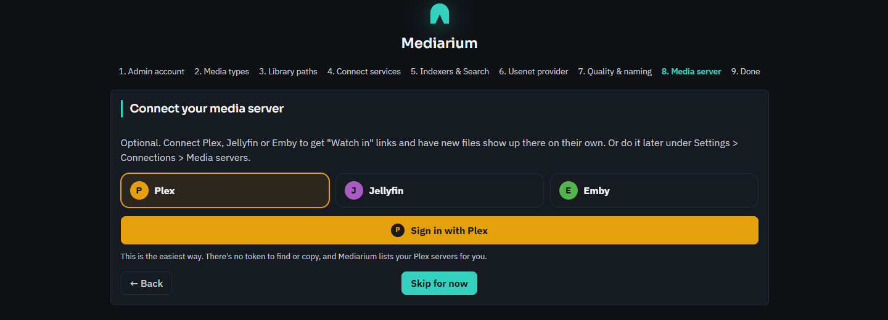
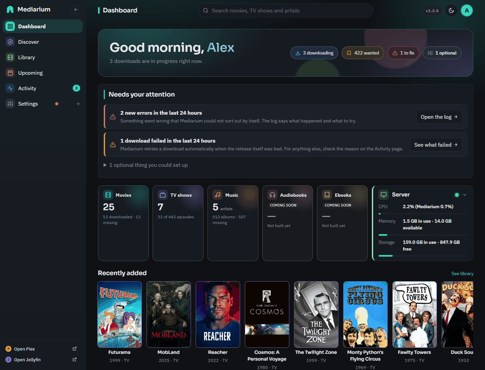
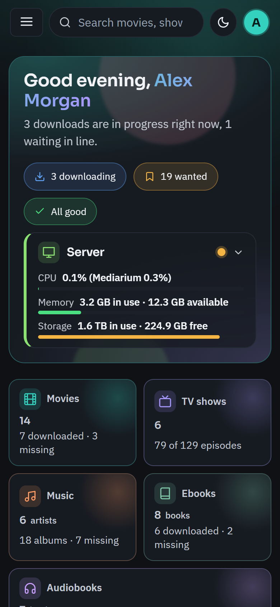
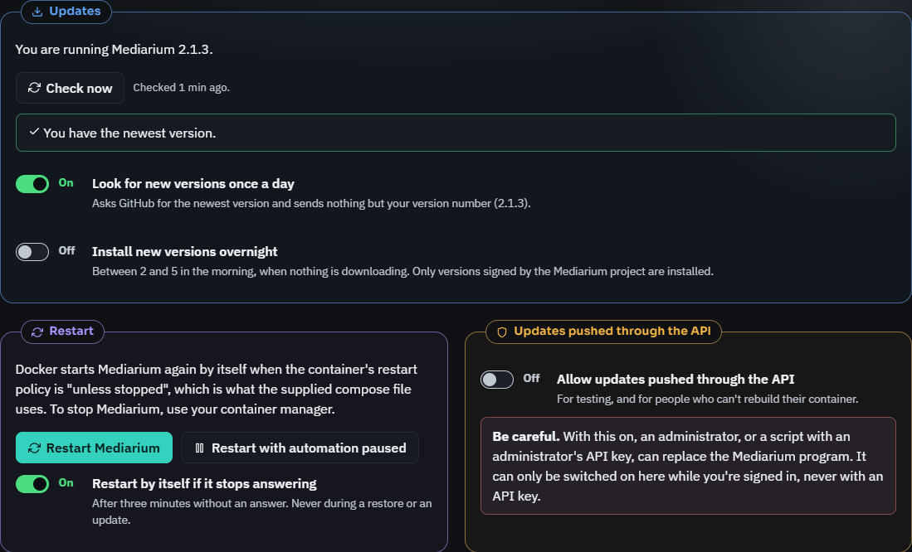

# Installing Mediarium

Mediarium runs in **Docker**, and it is one image for every platform. It works on any 64-bit Linux computer or NAS (Intel/AMD `amd64` or ARM `arm64`, including a Raspberry Pi 3, 4 or 5 with a 64-bit system), and on a Windows PC or a Mac through Docker Desktop. There are no separate installers or app-store entries: see [What runs where](./PLATFORMS.md).

It takes about ten minutes. You don't need to know Docker well: you copy one file, change a few lines, and run one command.

Using a NAS? There are step-by-step guides for [Synology](./synology.md) (including running it next to Radarr, Sonarr and SABnzbd), [Unraid](./unraid.md) and [QNAP](./qnap.md). Plain Linux: [linux.md](./linux.md).

**On a NAS, create every folder you map before you start Mediarium.** If a mapped folder doesn't exist, Docker stops with an error like `Bind mount failed: '/volume1/Media/downloads' does not exist`. A library folder on a share that isn't connected when Mediarium runs is not written into: imports wait and Health says which folder it is (see [When a drive isn't connected](./library.md#when-a-drive-isnt-connected)).

Mediarium does not host or provide any content. See [LEGAL.md](./LEGAL.md).

## Contents

1. [Quick start](#quick-start)
2. [The compose file](#the-compose-file)
3. [Choosing your folders](#choosing-your-folders)
4. [Why one /data folder? (hardlinks)](#why-one-data-folder-hardlinks)
5. [PUID, PGID and TZ](#puid-pgid-and-tz)
6. [Ports](#ports)
7. [Other environment variables](#other-environment-variables)
8. [Running under a sub-path (URL base)](#running-under-a-sub-path-url-base)
9. [Secrets from files (Docker secrets)](#secrets-from-files-docker-secrets)
10. [The setup wizard](#the-setup-wizard)
11. [Optional: getting past Cloudflare checks](#optional-getting-past-cloudflare-checks)
12. [Everyday commands](#everyday-commands)
13. [Updating](#updating)
14. [Updating without rebuilding the container](#updating-without-rebuilding-the-container)
15. [Backup and restore](#backup-and-restore)
16. [Monitoring with Prometheus](#monitoring-with-prometheus)
17. [Uninstalling](#uninstalling)
18. [One command instead: docker run](#one-command-instead-docker-run)
19. [Using a Docker app (Portainer, Container Manager, Container Station...)](#using-a-docker-app)
20. [Troubleshooting](#troubleshooting)
21. [Building from source](#building-from-source)

---

## Quick start

1. **Install Docker** with the Compose plugin: follow [docs.docker.com/engine/install](https://docs.docker.com/engine/install/) for your system. Check it works with `docker compose version`. (On a NAS, use its own Docker app instead: see the NAS guides above.)
2. **Make a folder for Mediarium** and go into it:
   ```bash
   mkdir mediarium
   cd mediarium
   ```
3. **Create a file called `docker-compose.yml`** in that folder and paste in [the compose file](#the-compose-file) below. Change the lines marked `CHANGE`. The defaults are fine for a first try.
4. **Start it:**
   ```bash
   docker compose up -d
   ```
   The first start downloads the image, which takes a minute.
5. **Open `http://<your-server-ip>:8264`** in your browser (for example `http://192.168.1.20:8264`, or `http://localhost:8264` on the same machine) and follow the [setup wizard](#the-setup-wizard).

That's it. With the file exactly as below, Mediarium keeps its settings in `mediarium/config` and your downloads, movies and TV in `mediarium/data`. To use folders you already have, read [Choosing your folders](#choosing-your-folders).

## The compose file

This is the same file as [`docker/docker-compose.yml`](../docker/docker-compose.yml) in the repository.

```yaml
# Mediarium: movies, TV shows and music, from search to your library, in one app.
#
# How to use this file
#   1. Put it in an empty folder, for example "mediarium".
#   2. Change the lines marked CHANGE. The defaults work for a quick try.
#   3. In that folder run:   docker compose up -d
#   4. Open http://<your-server-ip>:8264 and follow the setup steps.
#
# On a NAS? Create every folder you map BEFORE you start it, or Docker stops
# with "Bind mount failed ... does not exist". A Synology example is at the
# bottom of this file.
#
# Full guide: https://github.com/rdborg/Mediarium/blob/main/docs/INSTALL.md

services:
  mediarium:
    # For sites behind a Cloudflare check, use ghcr.io/rdborg/mediarium:latest-full
    # instead (bigger, but has the helper built in). See docs/INSTALL.md.
    image: ghcr.io/rdborg/mediarium:latest
    container_name: mediarium
    restart: unless-stopped
    # Nothing running in the container can gain more privileges than it starts with.
    security_opt:
      - no-new-privileges:true
    # Keeps Docker's log file for this container from growing without end:
    # three files of 10 MB, the oldest is dropped.
    logging:
      driver: json-file
      options:
        max-size: "10m"
        max-file: "3"
    ports:
      # The web page. To use another port, change only the LEFT number,
      # for example "8300:8264", then open http://<your-server-ip>:8300.
      - "8264:8264"
      # Optional: the torrent port (TCP and UDP). Torrents work without it, but
      # with it you find more peers and can seed. Delete these two lines if you
      # only use Usenet.
      - "58264:58264/tcp"
      - "58264:58264/udp"
    environment:
      # CHANGE: the user and group that own your media folders.
      # On the server, run "id" and use the uid and gid numbers it prints.
      # (On a Synology, copy them from another container's Environment tab.)
      - PUID=1000
      - PGID=1000
      # CHANGE: your timezone, for example Europe/London or America/New_York.
      - TZ=Etc/UTC
      # Where movies, TV and downloads are inside the /data folder mapped
      # below. Only change them if your folders have other names (capital
      # letters count).
      - DOWNLOADS_DIR=/data/downloads
      - MOVIES_DIR=/data/movies
      - TV_DIR=/data/tv
      # OPTIONAL folders for music, ebooks and audiobooks. Take off the # to
      # use one. Keep them inside /data and there is nothing more to map:
      # - MUSIC_DIR=/data/music
      # - EBOOKS_DIR=/data/ebooks
      # - AUDIOBOOKS_DIR=/data/audiobooks
    volumes:
      # CHANGE the left side of each line (the right side must stay as it is).
      # Mediarium's own settings and database. Keep it on a local disk and back it up.
      - ./config:/config
      # ONE folder that holds downloads, movies and TV. With a single mapping,
      # finished downloads move into your library instantly and use no extra
      # space (hardlinks).
      - ./data:/data
      # OPTIONAL: a folder somewhere else gets its own line. Keep the right
      # side as it is and you don't need a *_DIR line for it.
      # - /path/to/music:/music
      # - /path/to/ebooks:/ebooks
      # - /path/to/audiobooks:/audiobooks

  # Optional: only needed for torrent sites that show a Cloudflare
  # "checking your browser" page. Start everything with:
  #   docker compose --profile cloudflare up -d
  # then enter http://flaresolverr:8191 in Mediarium under Settings > Indexers & Search.
  flaresolverr:
    image: ghcr.io/flaresolverr/flaresolverr:latest
    restart: unless-stopped
    profiles: ["cloudflare"]
    environment:
      - TZ=Etc/UTC

# -----------------------------------------------------------------------------
# NAS EXAMPLE (Synology)
#
# The shared folder "Media" holds four folders: Movies, tv, Music and
# downloads. Create them first in File Station, and a "docker/mediarium" folder
# for Mediarium's settings. Then use these lines in place of the environment
# and volumes above:
#
#     environment:
#       - PUID=1026
#       - PGID=101
#       - TZ=Europe/London
#       - DOWNLOADS_DIR=/data/downloads
#       - MOVIES_DIR=/data/Movies
#       - TV_DIR=/data/tv
#       - MUSIC_DIR=/data/Music
#     volumes:
#       - /volume1/docker/mediarium:/config
#       - /volume1/Media:/data
#
# Step by step: https://github.com/rdborg/Mediarium/blob/main/docs/synology.md
```

In a `volumes` line, the part **before** the colon is the folder on your server and the part **after** it is where Mediarium sees it. Only ever change the part before the colon.

## Choosing your folders

Mediarium needs two folders on your server:

| Mapped as | What it is | Tips |
|---|---|---|
| `/config` | Mediarium's own settings, database and encryption key. Small. | Keep it on a local disk (an SSD is nice), never on a network share. Back it up. |
| `/data` | **One** folder that contains your downloads, movies and TV. | Put all three inside it, so finished downloads can be [hardlinked](#why-one-data-folder-hardlinks). |

Music, ebooks and audiobooks are optional and have folders of their own (see [Optional folders](#optional-folders-music-ebooks-and-audiobooks) below). The setup wizard asks only for the kinds of media you choose.

A good layout looks like this:

```
/your/storage/data/            ->  mapped as /data
├── downloads/                     DOWNLOADS_DIR=/data/downloads
│   ├── incomplete/                (Mediarium creates these two)
│   └── complete/
├── movies/                        MOVIES_DIR=/data/movies
├── tv/                            TV_DIR=/data/tv
└── music/                         MUSIC_DIR=/data/music     (optional)

/your/storage/mediarium-config/ ->  mapped as /config
```

- **Brand-new setup:** if the `data` folder and the three folders in it don't exist yet, Mediarium creates them on first start, owned by your `PUID`/`PGID` user.
- **You already have a library:** map the folder *above* your movies and TV as `/data`, and set `MOVIES_DIR`, `TV_DIR` and `DOWNLOADS_DIR` to match what is inside it. For example, a layout of `/volume1/data/media/movies`, `/volume1/data/media/tv` and `/volume1/data/downloads` becomes:
  ```yaml
      environment:
        - DOWNLOADS_DIR=/data/downloads/mediarium
        - MOVIES_DIR=/data/media/movies
        - TV_DIR=/data/media/tv
      volumes:
        - /volume1/docker/mediarium:/config
        - /volume1/data:/data
  ```
  Folder names are case sensitive (`Movies` is not `movies`). You can add what is already in your library, and Mediarium never deletes or overwrites existing files on its own.
- **Other download apps use the same downloads folder?** (SABnzbd, NZBGet, qBittorrent, Transmission...) Give Mediarium a folder of its own inside it, like `DOWNLOADS_DIR=/data/downloads/mediarium` above. Mediarium tidies up leftover files in its own `incomplete` folder, so it must not share that folder with another app. Hardlinks still work, because it is all inside `/data`.
- **Want the unfinished downloads on a fast drive?** Map one more folder, for example `- /mnt/cache/mediarium-temp:/temp-downloads`, create it on the host first, and enter `/temp-downloads` under **Settings > Downloading > Download rules > Temporary download folder**. See [Temporary download folder](downloads.md#temporary-download-folder).
- **Use full paths** on a real server (`/srv/data`, `/volume1/data`, `/mnt/user/data`). The `./config` and `./data` in the example mean "next to the compose file", which is handy for a first try.
- **Disk format:** the disk must support hardlinks. ext4, XFS, Btrfs, ZFS and NTFS all do; exFAT and FAT (common on USB sticks) do not.
- Moving over from Radarr, Sonarr, Prowlarr or SABnzbd? Use the same folders they use: see [Move from Radarr, Sonarr, Prowlarr, SABnzbd and other apps](./migrate.md).

### Optional folders: music, ebooks and audiobooks

Each kind of media has its own folder setting. You only need the ones you use.

| Media | Environment variable | Default | Notes |
|---|---|---|---|
| Music | `MUSIC_DIR` | `/music` | Works today. Switch it on under Settings > Media types ([music.md](./music.md)). |
| Ebooks | `EBOOKS_DIR` | `/ebooks` | Works today. Switch it on under Settings > Media types ([books.md](./books.md)). |
| Audiobooks | `AUDIOBOOKS_DIR` | `/audiobooks` | Works today. Switch it on under Settings > Media types ([books.md](./books.md)). |

There are two ways to give one of them a folder:

- **Inside `/data` (nothing more to map).** Create the folder next to `movies` and `tv`, and add one line to `environment`, for example `- MUSIC_DIR=/data/music`.
- **A folder somewhere else.** Add a line to `volumes`, for example `- /path/to/music:/music`. If you keep `/music` on the right, you don't need the `MUSIC_DIR` line.

The compose file above has these as commented lines you can switch on. After changing the file, run `docker compose up -d`.

### Adding music, ebooks or audiobooks later

1. Create the folder on your server (on a NAS, before the next step).
2. Add the `environment` line or the `volumes` line as described above, then run `docker compose up -d`. In a NAS app, stop the project, rebuild it and start it again.
3. In Mediarium, switch the type on under **Settings > Media types** (music today) and check the folder under **Settings > Library > Folders**. The page shows the folder Mediarium really uses and whether it is **Mapped to your device**.

## Why one /data folder? (hardlinks)

When a download finishes, Mediarium puts it in your library with a **hardlink**: a second name for the same file. It is instant and uses no extra space, and the download can keep seeding from its original place.

A hardlink only works inside **one** mapped folder. If you map `downloads`, `movies` and `tv` as three separate `volumes` lines, each one is a separate mount inside the container and Mediarium has to **copy** every file instead, which is slower and uses extra space while both copies exist. This is true even when all three folders are on the same disk.

Copying is not a disaster, just less tidy. Usenet downloads are deleted once they are copied, so you only lose a little time. Torrents keep seeding from the downloads folder, so a copied file takes double the space until it is done seeding. The setup wizard tells you which case you're in, under the folder boxes.

So: one parent folder, mapped once as `/data`, with `downloads`, `movies` and `tv` inside it. Also keep that parent on one disk, one share or one dataset (on Synology one shared folder, on TrueNAS one dataset, on Unraid one share).

To check after your first download: on the server run `stat -c '%h %n' /your/storage/data/movies/*/*.mkv`. A `2` at the start of a line means that file is hardlinked. A `1` means it was copied (or the download has since been deleted).

### What Mediarium never does to your folders

- **Folders inside your library made by another app** may belong to a different user (an older Sonarr or Radarr with another PUID, for example). Mediarium checks the folders inside Movies and TV, each title and its season folders, and warns in setup, in Settings > Library > Folders and on the dashboard when some can't be written to, with an example path. Give the user Mediarium runs as write access to them, or run Mediarium with the same `PUID`/`PGID` as that app.
- It never changes the owner or permissions of your existing media folders (only of its own `/config`). The one exception is a brand-new, empty folder that Docker made for you because the folder you mapped did not exist: that one folder is handed to your `PUID`/`PGID` user so Mediarium can write to it.
- It never replaces a file that is already in your library unless you say so. **If a file already exists** (Settings > Library > File names and importing) can skip the new file (the default), ask you each time, always overwrite, or overwrite only if the new file is better. With the default, a title that looks for better versions (**Look for better versions** is on for it) still takes a better file in place of the old one, because otherwise the better file would be downloaded and then turned away; a file that is not better, or a title set to leave its file alone, is skipped. That holds when the new release has another file name than the one in your library too (names in the Radarr and Sonarr "TRaSH" style, with the quality in brackets, are read for their quality): a release that may not take the place of the file you have is not added next to it, and the file you have stays the one Mediarium points at. A file whose quality can't be told from its record or its name is never counted as worse than a new release. Whatever the setting, a download never replaces a file that belongs to another movie or episode (two titles can get the same file name, such as a remake with the same title and year): it fails with a reason instead, and two files of one season pack never overwrite each other. A replacement is written next to the original first and then swapped in, so a failure can't destroy the original. If the new file has a different name (another quality tag or file type), the old one is removed too, together with the subtitles and other files named after it, but only when the new file may take its place (you chose to overwrite, or it is a better version and the title may be upgraded) and only inside your library folder. The old files go to the recycle bin while it is on. A release you pick yourself is a different matter. Under **Choose a release**, when the movie or episode already has a file, Mediarium asks first: *This will replace <the file you have, with its quality and size> with <the release, with its quality and size>*. For a season pack it says how many episodes already have a file. If you press **Replace**, that download takes the old file's place even when the title is set to **Leave what I have alone** or the release is not better, and only for that title: the **If a file already exists** setting itself does not change. It is swapped the careful way described above (the new file is written next to the old one and swapped in only when it is complete, and if anything goes wrong the old file stays), and the old file and the files named after it go to the recycle bin, or are deleted when the recycle bin is off. A file that belongs to another movie or episode is still never touched. Searches Mediarium starts by itself keep following the settings. For scripts, add `"replace": true` to `POST /api/movies/{id}/grab` or `POST /api/series/{id}/grab`; without it a grab behaves as before. The release list also tells you in advance: a release the import would turn away for an automatic download is not marked **Best match** and says *Not picked automatically: this title is set to leave what you have alone. You can still pick it by hand and replace the file.* A same-quality release with a higher custom-format score counts as a better version in the list and at the import alike. A file copied to another drive is written under a temporary name (`.mediarium-tmp`) until the copy is complete, so Plex, Jellyfin or Emby never see half a movie.
- It only deletes library files when you remove a title with its delete-files box ticked, or when a new version replaces a file and **If a file already exists** is set to overwrite. **Also delete everything on disk** starts unticked and shows how many files and how much space would go. The same goes for **Also delete the files of all ... from the disk** when you remove several titles at once. Through the API, files are only deleted when the request says `deleteFiles=true`. Even then they wait in the recycle bin (`.mediarium-trash` in the library folder) for 7 days before they are deleted for good.
- It only tidies up its own working folder (`incomplete` inside its downloads folder). Torrent data is kept while it seeds.

## PUID, PGID and TZ

Mediarium writes files as the user and group you give it, so that you (and Plex, Jellyfin or Emby) can use them normally.

- **PUID and PGID:** the numbers of the user that owns your media folders. On the server, run `id yourusername`. It prints something like `uid=1000(you) gid=1000(you) ...`: the `uid` is your `PUID` and the `gid` is your `PGID`.
  - Unraid usually uses `PUID=99` and `PGID=100`.
  - Synology and QNAP: whatever `id` prints for the user that owns your shared folders (see the [Synology guide](./synology.md#2-find-your-user-numbers)).
  - Already running Radarr, Sonarr or SABnzbd in Docker? Use the same `PUID` and `PGID` as those containers.
  - Advanced: you can instead start the container as a user directly (`user: "1000:1000"` in the compose file). `PUID` and `PGID` are then ignored, and the folders must already be writable by that user.
- **UMASK** (optional): the permissions new files and folders get, the same variable the linuxserver.io images use. `022` gives files `644` and folders `755` (only you can write); `002` gives `664` and `775` (your group can write too). It works by taking permissions away from `666` for files and `777` for folders, so it is not the same as `chmod`. Left out, the container keeps its own `022`. A value that is not one to four octal digits is ignored, with a note in the container log. To give the files Mediarium puts in your library exact permissions whatever the umask, use [Settings > Library > Folders](./library.md#file-permissions).
- **TZ:** your timezone, from the [list of tz names](https://en.wikipedia.org/wiki/List_of_tz_database_time_zones), for example `Europe/London`, `Europe/Berlin` or `America/New_York`. It sets the time in logs and schedules.

Mediarium changes the owner of its own `/config` folder, and of a media folder only when that folder is brand new, empty and made by Docker (see above). It never changes the owner or permissions of your existing media folders. If it cannot write to one, the container log says `WARNING: /data/... is not writable by uid ...` and the dashboard shows it; fix the folder on the server, or change `PUID`/`PGID`.

## Ports

| Port | What it is for | Notes |
|---|---|---|
| `8264` | The web page | Change the **left** number to use another port, for example `"8300:8264"`. |
| `58264` TCP and UDP | Torrent peers connecting to you | Optional. Without it torrents still download, but with it you find more peers and can seed. Keep both numbers the same, and the same as the **Listen port** under Settings > Downloading > Usenet. Forward it on your router for peers from the internet. It isn't used while the built-in VPN is connected. |

Mediarium serves plain HTTP. **Do not open port 8264 to the internet.** To reach it from outside your home, use a VPN into your network (Tailscale, WireGuard) or a reverse proxy with HTTPS; [security.md](./security.md) has the checklist and examples for Nginx Proxy Manager, Traefik, Caddy, Cloudflare Tunnel and Synology.

## Other environment variables

Most settings live under **Settings**. Besides the folders, `PUID`, `PGID` and `TZ`, these are the container-level ones you may meet. Every variable is listed in [reference/environment.md](./reference/environment.md).

| Variable | What it does |
|---|---|
| `UMASK` | The permissions new files and folders get, for example `002` (see [PUID, PGID and TZ](#puid-pgid-and-tz)). Left out, the container keeps `022`. |
| `APP_PORT` | The port the web page listens on inside the container (default `8264`). To use another port on your server, change the left number of the `ports` line instead. |
| `CONFIG_DIR` | Where `app.db` and `secret.key` live (default `/config`). Leave it alone in Docker. |
| `TRUSTED_PROXIES`, `ALLOWED_ORIGINS` | For a reverse proxy: see [security.md](./security.md#trusted_proxies). |
| `URL_BASE` | Set it when your reverse proxy serves Mediarium under a sub-path, for example `/mediarium`. Empty (the default) means the root. See [Running under a sub-path](#running-under-a-sub-path-url-base). |
| `NAME_FILE` | Any variable above can be given as a file instead, like `URL_BASE_FILE=/run/secrets/x`. See [Secrets from files](#secrets-from-files-docker-secrets). |
| `MEDIARIUM_PAUSE_AUTOMATION` | Set to `1` to start in **safe mode**: nothing searches, downloads, refreshes, checks connections or looks for new versions by itself. Downloads waiting in line come back paused. You can still search and download by hand, and the dashboard says "Safe mode is on". Remove it to go back to normal. See [Troubleshooting](#troubleshooting). |
| `MEDIARIUM_DISABLE_SSO` | Set to `1` as a way back in if single sign-on or directory sign-in locked people out: both are switched off and password sign-in is on, whatever is saved in Settings. Remove it to use the saved settings again. See [accounts.md](./accounts.md#if-you-are-locked-out). |
| `MEDIARIUM_SUPERVISED` | Set to `1` only for a program you run yourself when a service manager other than Docker, systemd or launchd starts it again after it exits. It lets the Restart buttons work. |
| `MEDIARIUM_SKIP_INSTALLED_UPDATE` | Set to any value to make the Docker entrypoint ignore an [installed update](#update-now-docker-image) and start the program inside the image. |

The Docker images set `BUNDLED_FLARESOLVERR` (the `-full` image only) and `MEDIARIUM_IMAGE_VERSION` themselves. Don't set those two.

## Running under a sub-path (URL base)

Most people give Mediarium its own address, like `https://media.example.com`. If you would rather put it under a path of a domain you already use, like `https://home.example.com/mediarium`, set `URL_BASE`:

```yaml
environment:
  - URL_BASE=/mediarium
```

Restart the container and Mediarium answers under that path: the pages, the API, the Radarr, Sonarr and Lidarr addresses for [other apps](./other-apps.md) (`https://home.example.com/mediarium/radarr`), the metrics, the "Add to home screen" files, push notifications, and the addresses for e-readers (the OPDS catalogue and the Kobo address on your profile page both include the path). You don't rebuild anything; the same program works under any path. Leave `URL_BASE` empty (or don't set it) and nothing changes.

Rules for the value: a path with letters, numbers, dashes, underscores and dots, like `/mediarium` or `/tools/media`. A slash at the start and end doesn't matter. It can't start with a name Mediarium already uses (`api`, `radarr`, `sonarr`, `lidarr`, `settings`, `library`, `help`, `apps`, `opds`, `kobo` and the other page names); the container then stops with a message saying so.

Your proxy has to send the path on to Mediarium. Both of these work, so use whichever your proxy does by default: pass the path along unchanged, or remove it before passing the request on. Examples:

```
# Nginx: no path after the address, so /mediarium stays on the request
location /mediarium/ {
    proxy_pass http://127.0.0.1:8264;
    proxy_set_header Host $host;
    proxy_set_header X-Forwarded-For $proxy_add_x_forwarded_for;
    proxy_set_header X-Forwarded-Proto $scheme;
    client_max_body_size 1g;
}

# Caddy
handle /mediarium/* {
    reverse_proxy mediarium:8264
}
```

In Traefik, route `PathPrefix(`/mediarium`)` to the service and don't add a strip-prefix middleware. In Nginx Proxy Manager, use a custom location `/mediarium` pointing at Mediarium; no rewrite is needed.

Things that follow the path:

- The sign-in cookie is limited to it, so other apps on the same domain never get it.
- Open `https://home.example.com/mediarium` (with or without the last slash). The bare domain `https://home.example.com/` is for your proxy or another app.
- Put the full address, path included, in **Link in messages** under [Notifications](./notifications.md#the-link) so the buttons in messages open the right page.
- Calendar feed addresses and the address shown on the Other apps page include the path.
- Anything that talked to Mediarium before (a bookmark, an app with the old address) needs the new one. An address without the path still reaches the program directly (for example `http://server:8264`), but the page it shows points everything at the path.
- The container health check keeps working; it uses the plain address inside the container.

If pages come up blank or "not found", the proxy is usually dropping or doubling the path. Open `https://home.example.com/mediarium/api/version`: it should answer with the version number.

## Secrets from files (Docker secrets)

Instead of putting a value in the compose file, you can keep it in a file and give Mediarium the file's path. Add `_FILE` to the variable's name:

```yaml
services:
  mediarium:
    environment:
      - URL_BASE_FILE=/run/secrets/mediarium_base
    secrets:
      - mediarium_base

secrets:
  mediarium_base:
    file: ./mediarium_base.txt
```

Mediarium reads the file when it starts and uses what is in it, without the spaces and line breaks around it. This works for every variable on the [environment reference](./reference/environment.md) that the app reads (not `PUID`, `PGID` and `TZ`, which the container script reads). If the plain variable is also set, it wins. A file that can't be read is mentioned in the container log (`docker logs mediarium`) and the variable is treated as not set. The log shows the file's path, never what is in it.

Today none of those variables is a password or a key: indexers, Usenet logins, API keys, notification tokens and the like are set inside the app and stored encrypted in `/config`, which is why there is nothing secret to put in the compose file. `_FILE` is there so that, if you do keep any value out of the compose file, it works the way Docker expects.

## The setup wizard

Open `http://<your-server-ip>:8264`. The first time, a short wizard walks you through:

1. **Admin account.** The first account you make is the administrator. From outside your home network (through a reverse proxy, or on a server), and also when you open it on the same computer Docker runs on (Docker hands those visits over from its own gateway address), the page also asks for a one-time setup code. Find it in the log: `docker logs mediarium`, look for `setup_code`. You also tick that you have read the responsible-use notice ([LEGAL.md](./LEGAL.md)).
2. **Media types.** Pick movies, TV shows, music, ebooks and audiobooks. At least one has to stay on. Later steps only ask about what you picked.
3. **Library paths.** One box for each kind you picked, plus downloads. They show the folders your compose file maps (from `MOVIES_DIR`, `TV_DIR`, `DOWNLOADS_DIR`, `MUSIC_DIR` and so on) and check each one live: whether it exists, whether Mediarium can write to it, whether it is **Mapped to your device**, and the free space. A folder that isn't mapped shows the exact line to add to your compose file. When your folders share one mapped folder such as `/data`, the wizard suggests a folder inside it (for example `/data/Ebooks`) and can create it for you.
4. **Connect services.** Movie and show details, subtitles and lists come from TMDB, OpenSubtitles and Trakt. The official image has these built in, so there is usually nothing to do. If a key is needed, the wizard explains how to get a free one. Subtitles are switched on later, under Settings > Info, lists and subtitles > Subtitles.
5. **Indexers** (where Mediarium looks for releases) and **Usenet provider** (your Usenet provider's login; skip it if you only use torrents).
6. **Quality & naming.** The default quality, and the media player you use (Plex, Jellyfin, Emby, Kodi or something else), which picks the matching file naming style.
7. **Media server** (optional). Sign in to Plex, Jellyfin or Emby so "Watch in" links work and the server refreshes when something new arrives.
8. **VPN** (optional). If you will use the built-in VPN, you can turn on **UDP trackers and DHT through the VPN**. It stays off until you do. The VPN connection itself is added later under Settings > Downloading > VPN and proxy, where the switch can be changed.



*Step 2, Media types.*



*Step 3, Library paths. Each folder is checked as you look at it.*



*Step 6, Quality & naming. The media player you pick chooses the naming style.*



*Step 7, Media server. It is optional.*

Indexers, Usenet provider, Quality & naming, Media server and VPN have **Skip for now**, and everything can be changed later under **Settings**. If a check fails, the wizard says what to fix. The last screen checks what you set up. If there is no indexer or download provider, it lists what is missing, each with a button to the right settings page (a media server is listed as optional). **Open Mediarium** is there either way. Until those are added, the dashboard shows a **Getting started** card with the same list. It goes away when everything is set up, or when you close it with the x (your browser remembers that).

When the wizard is done you land on the dashboard, which also works on a phone:



*The dashboard after setup: what is downloading, wanted and needs attention, one card per kind of media, and the Server card.*

<p align="center"></p>

*The same dashboard on a phone.*

## Optional: getting past Cloudflare checks

Some torrent sites show a Cloudflare "checking your browser" page that only a real browser can pass. You only need one of these fixes if a site you use tells you it is behind a Cloudflare check.

**Easiest: use the `-full` version of Mediarium.** It has the helper (FlareSolverr) built in and started for you, in the same container. In your compose file, change the image line to:

```yaml
image: ghcr.io/rdborg/mediarium:latest-full
```

Then run `docker compose pull && docker compose up -d`. Nothing else to set up: **Settings > Indexers & Search** shows "Built in and running". You can switch between `latest` and `latest-full` at any time. Your settings and library stay.

The `-full` download is about 300 MB instead of about 20 MB, takes about 1.2 GB on disk and uses about 250 MB of memory when idle (more for a moment when it opens a page). The helper only listens inside the container, so nothing on your network can reach it. The image is rebuilt every week, so browser fixes arrive quickly.

**Or run FlareSolverr as its own container.** It is already in the compose file, switched off:

```bash
docker compose --profile cloudflare up -d
```

Then in Mediarium go to **Settings > Indexers & Search** and enter `http://flaresolverr:8191`. More in [indexers.md](./indexers.md).

## Everyday commands

Run these in the folder with your `docker-compose.yml`:

| To... | Run |
|---|---|
| See the log | `docker compose logs -f mediarium` (Ctrl+C to stop watching) |
| Stop Mediarium | `docker compose stop` |
| Start it again | `docker compose start` |
| Apply changes to the compose file | `docker compose up -d` |
| Reset a forgotten password | `docker exec -it -u 1000:1000 mediarium /app/app reset-password yourusername` (use your own `PUID:PGID` instead of `1000:1000`; on the `-full` image the program is `/opt/mediarium/app`) |
| Carry on after losing `secret.key` | Stop Mediarium, then `docker run --rm -it -v /your/config:/config ghcr.io/rdborg/mediarium:latest /app/app reset-key` (see [When `secret.key` is lost](#when-secretkey-is-lost)), then start it again |

## Using it as an app on a phone, tablet or computer

Mediarium installs like an app. In Chrome, Edge or Safari on a computer, choose **Install** in the address bar; on an Android phone or tablet, **Add to Home screen** (or **Install app**); on an iPhone or iPad, Share > **Add to Home Screen**. It then opens in its own window, with its own icon, and a long press on the icon (or a right click) offers shortcuts to Activity, Calendar, Library and Discover. Installing needs an https address (or `localhost`), for example through a reverse proxy.

- The menu fits tablets (a narrower menu on a tablet in landscape, a wider drawer in portrait, bigger touch targets on a screen you press) and foldable phones.
- When the server can't be reached (you are away from the home network and the VPN is off, or the server is down), the installed app shows a short "Mediarium can't be reached" page with a **Try again** button instead of the browser's error. There is no offline mode: Mediarium shows nothing from memory, so it never shows stale data.
- The same small background program (`push-sw.js`) also receives [push notifications](./notifications.md#push-to-this-device). It saves only that one page.

## Updating

```bash
docker compose pull
docker compose up -d
```

That downloads the newest image and restarts Mediarium with it. Your settings and library stay put, and the database updates itself on start. Nothing updates on its own unless you switch on **Install new versions overnight** (see below). A restart pauses running downloads; press **Resume** in Activity.

- Read the [changelog](../CHANGELOG.md) first, and [back up](#backup-and-restore) `/config` before a big update. There is no way back to an older version once the database has been updated, except restoring a backup. When an update is going to change the database, Mediarium first saves a copy next to it (`pre-migration-<number>-<date>-<time>.db` in `/config`, the newest two are kept); that is the file to put back as `app.db` if an update goes wrong. From 3.1.3 on, if that version or a later one is started on a database that a newer version already changed, it still starts, but writes a warning to the log and to Health that says so. Versions before 3.1.3 don't check this and start without any warning.
- `:latest` always follows the newest release. To stay on a version, use its number instead. Each release has these tags (add `-full` for the [Cloudflare helper version](#optional-getting-past-cloudflare-checks)):

  | Tag | Moves when |
  |---|---|
  | `ghcr.io/rdborg/mediarium:3.0.0` (`:3.0.0-full`) | never |
  | `ghcr.io/rdborg/mediarium:3.0` (`:3.0-full`) | a bug-fix release of 3.0 comes out (3.0.1, 3.0.2...) |
  | `ghcr.io/rdborg/mediarium:latest` (`:latest-full`) | any new release |

  A pre-release (for example `3.1.0-beta.1`) only gets its exact tag. What the numbers mean: [RELEASING.md](./RELEASING.md#what-the-version-numbers-mean).

### Knowing when there is a new version

Once a day Mediarium asks GitHub for the newest release (the first time about two minutes after it starts, and again in an hour after a failed try). If yours is older, administrators see a card on the dashboard and in the **Updates** box under **Settings > General**. It shows what is new and the steps for your kind of install (Synology Container Manager, Unraid or Docker Compose, plus a note for the `-full` image; a program you run yourself gets its own steps). The card has **Hide until the next version**. If a [notification](./notifications.md) target has **New version** ticked, you also get one message per new version. A pre-release is only offered to someone already running one.

- **What it sends:** one plain web request to `api.github.com` with the program name and version (`Mediarium/3.0.0`) and nothing else: no account, no library, no settings. GitHub sees your address, as any website does.
- **Turning it off:** untick **Look for new versions once a day** in the Updates box (stored as `updates.check`). Then Mediarium never contacts GitHub by itself. **Check now** still works when you press it.
- If GitHub cannot be reached or is limiting requests, the card says "Couldn't check just now." with the reason (for example that GitHub is limiting requests, or that the address could not be found), and Mediarium tries again later. A failed check (other than one held back by GitHub's limit) is also listed under Settings > System > Logs and errors. Nothing else is affected.



*Updates and the pushed-updates switch on General, and Restart on Server. This one shows an up-to-date install.*

### What's new after an update

The first time you open Mediarium after it moves to a newer version, a short note lists the highlights, with a link to every change. It shows once in each browser and not at all on a fresh install.

### Update now (Docker image)

If the release is signed by the Mediarium project, the card and the Updates box also have an **Update now** button. It asks you to confirm first. Mediarium then downloads the program for your system from the GitHub release, checks the signature of the checksum list against the public key built into your copy, checks the download against that list, starts the new program once to see that it answers as Mediarium, and restarts into it. It takes about a minute. Running downloads are paused, so press **Resume** afterwards. If any step fails, nothing is installed and the card says why (it is also under Settings > System > Logs and errors). A release without a signature never gets the button, so update the way you installed Mediarium.

- The new program is kept in `/config/update/`, next to your database, and the previous one is kept beside it. Your image is not changed. **If you later recreate the container from a newer image, Mediarium starts whichever is newer, the image's or the installed one.** So updating this way and updating the image later work together.
- **Going back:** the Updates box shows what is installed and has **Go back to the image's version**. That removes the installed program; Mediarium uses the version inside the image again after a restart. If you change your mind again, press Update now.
- **A bad update cannot stop Mediarium from starting.** If an installed program stops within 20 seconds of starting, three times in a row, the container's next start puts it aside (as `/config/update/app.failed`) and starts the program in the image instead. The card tells you when that happened, and has **Remove it** to delete the put-aside file.
- **Overnight:** the switch **Install new versions overnight** installs a new signed release between 2 and 5 in the morning (server time), when nothing is downloading. It does nothing in safe mode.
- **Restart:** the restart at the end needs Docker to start Mediarium again by itself, which the `restart: unless-stopped` line in the supplied compose files does. Without a restart policy Mediarium stops after installing, and the installed version runs the next time you start the container.
- **Only in the Docker images, on Linux.** A program you run yourself has no entrypoint to start the new file, so it shows the steps instead.

### Restarting Mediarium

The **Restart** box under **Settings > System > Server** has **Restart Mediarium** and **Restart with automation paused**. The second one starts Mediarium once in [safe mode](#other-environment-variables) (no automatic searching, downloading or refreshing) so the pages load and you can fix a setting. The next restart is normal. Both ask you to confirm and pause running downloads (press **Resume** in Activity afterwards). Both need something that starts Mediarium again after it exits. Docker, systemd and launchd are found automatically (in Docker that means a restart policy such as the `restart: unless-stopped` line in the supplied compose file), and `MEDIARIUM_SUPERVISED=1` covers any other service manager. Where nothing would start it again, the box says "Restart is not available here. Start Mediarium again yourself." and, on a program you run yourself, offers **Shut down** instead. To stop a container, use your container manager.

Mediarium also watches itself. Every 30 seconds it checks that its database and web server answer. If either fails for three minutes in a row it restarts itself (never during a restore, an update or a move from another app). The next start says so in the Updates box, under Logs and errors and in the support report. Switch this off with **Restart by itself if it stops answering**. The Docker images also have a health check on `/api/version`, so Docker, Synology and other tools show healthy or unhealthy.

## Updating without rebuilding the container

This is for testing, and for people who can't rebuild their container. An administrator sends a new program file to the running Mediarium, which restarts into it. It needs no Docker socket and no extra privileges. Leave it off unless you use it: [security.md](./security.md#updating-the-program) explains what it allows.

1. As an administrator, switch on **Allow updates pushed through the API** in **Advanced: updates pushed through the API** under **Settings > General**. It asks you to confirm. This can only be switched on here, while you are signed in, never with an API key.
2. Create an administrator API key under **Settings > Account & Access > Security > API keys**.
3. Send the file:

   ```bash
   sha=$(sha256sum mediarium | cut -d ' ' -f 1)
   curl -X POST "http://your-server:8264/api/system/update" \
        -H "X-API-Key: $MEDIARIUM_API_KEY" -H "X-Update-SHA256: $sha" \
        -H "Content-Type: application/octet-stream" --data-binary @mediarium
   ```

   The body is the raw Linux program (at most 200 MB) and `X-Update-SHA256` is required. Mediarium refuses the file unless its SHA-256 matches, it is a Mediarium program for the same system (it is started once with `--version-check`, which only prints its version and exits), and its version is newer than the running one. Add `?force=true` to allow the same or an older version, for example to go back; the checksum is still required. A version older than the one inside the image is never accepted, because the image's entrypoint would ignore it. The answer is `202` with `{"version": "...", "restartingIn": 2}`, then Mediarium exits and Docker's restart policy starts it again.
4. `GET /api/system/update` shows what is running and what is installed. `DELETE /api/system/update` removes the installed program (add `?restart=true` to restart at once); Mediarium then uses the image's own version. Removing works even while pushing is switched off.

Maintainers can use `tools/push-update.sh`, which builds the program from the committed source in Docker, works out the checksum and uploads it: see [RELEASING.md](./RELEASING.md#pushing-a-test-build). The user interface is part of the program, so a pushed program brings its new pages; the browser is told to re-check the page every time, so it never keeps showing the old ones.

**If something goes wrong,** the installed program lives in `/config/update/`. Deleting the `update` folder (with Mediarium stopped) goes back to the image. Starting the container with `MEDIARIUM_SKIP_INSTALLED_UPDATE=1` ignores an installed program without deleting it.

## Backup and restore

Everything that is not a media file lives in `/config`. The two files that matter are `app.db` (settings, library, history, accounts) and `secret.key`. **Keep the two together:** `secret.key` unlocks the passwords and keys saved in `app.db`. If `app.db` holds saved passwords, keys or accounts and `secret.key` is missing, Mediarium won't start (it would only write a new key that can't open anything). Put the old `secret.key` back; if it is gone for good, move `app.db` away to start again from scratch. If the `secret.key` is there but belongs to another `app.db` (for example you copied only the database to a new install), Mediarium says so in the log and on Health, and an indexer whose saved key can't be read is named on Health and left out of searches while the others keep working: open it and enter the key again. The same goes for a Usenet server (password), a VPN connection (keys), a media server (token), a notification target (passwords) and the keys saved in other settings (the debrid key, the download client password, the OpenSubtitles login and so on): the one that can't be read is marked on its Settings page and named on Health (and in the log at start, never with its value), it is not used, and everything else keeps working. What is stored is never replaced by an empty value when you save something else, so putting the old `secret.key` back brings it all back; to carry on without it, enter the password or key again. If the `secret.key` is gone for good, see [When `secret.key` is lost](#when-secretkey-is-lost). The folder also holds caches (for example music covers and the list of torrent sites) and, if you use one, the `update` folder.

**From the app (easiest):** administrators can download a backup zip with **Download a backup** on **Settings > System > Backup and restore**. It is safe to make while downloads are running. The zip holds `app.db`, `secret.key` and a small note about the version, and no media files. It contains your encryption key, so keep it as private as a password. To restore, choose the zip in the **Restore** box on the same page and press **Restore this backup**: Mediarium checks it (a backup made by a newer version of Mediarium than yours is refused; a backup can be up to 1 GB), restarts, and keeps your previous files in a `before-restore-<date>` folder inside `/config`. After the restart you sign in again (with an account from the backup), and the sign-in page says the backup was restored. Restoring needs something that starts Mediarium again, like `restart: unless-stopped`; otherwise start it yourself and the restore is applied then.

**Automatic backups:** every night, and just before every update, Mediarium saves the same zip in `/config/backups` and keeps the newest 7 (change it to 3, 5, 14 or 30 in the **Backup** box). The box lists them with the time and size, each with **Download**, and has **Back up now**. To restore one, download it and choose it under **Restore**. Switch the nightly backup off with **Save a backup every night** (stored as `backup.auto`; how many are kept is `backup.keep`). The files sit next to your database, so also keep a copy somewhere else: switch on [cloud backups](#cloud-backups), or copy one by hand now and then. A backup on the same disk does not help if that disk fails. A backup that was cut short (the container was stopped while it was being written) leaves no file behind: half-written files are removed at the next start. If a nightly backup can't be saved, it is listed in Logs and errors. Scripts: `GET /api/system/backups`, `POST /api/system/backups` and `GET /api/system/backups/{name}` (the last two need a signed-in administrator, not an API key, because a backup holds every stored secret).

### When `secret.key` is lost

The passwords and keys saved in `app.db` can only be opened with the `secret.key` they were saved with. The best fix is to put that file back, from a backup zip or a cloud copy (both hold it). If it is gone for good, you don't have to start from scratch: your library, accounts, history and settings stay, and only the passwords and keys have to be typed in again.

1. Stop Mediarium (`docker compose stop`).
2. Run `reset-key` with the same `/config` folder: `docker run --rm -it -v /your/config:/config ghcr.io/rdborg/mediarium:latest /app/app reset-key`. Use your own folder and image name; with the program on your path it is just `app reset-key`.
3. It lists every saved password and key that can't be read (by name, never by value) and waits for you to type `yes`. `--yes` skips the question.
4. First it saves a copy of the database as `app.db.before-reset-key-<date>` and, if there is one, of the old key as `secret.key.before-reset-key-<date>`, both in `/config`. If the copy fails, nothing is changed.
5. Then it clears the ones that can't be read: indexers, Usenet servers, media servers, notification targets, import lists and IRC connections stay but are switched off (enter the key or password again, then switch them on), VPN connections and similar entries that are useless without their key are removed (add them again), and an account's two-step sign-in is switched off so the account isn't locked out. A saved setting is cleared (the TMDB key, a debrid key, the OpenSubtitles login and so on). Everything is done in one go: if anything fails, nothing is cleared.
6. If there is no `secret.key` (or it is damaged) it makes a new one. A `secret.key` that is there and works is kept, and only what it can't read is cleared.
7. Start Mediarium. The Health list on the dashboard shows what is still missing.

Stop Mediarium first: a running Mediarium keeps the old key in memory and would save new passwords with it.

### Cloud backups

A backup on the same disk doesn't help if the disk dies or the NAS is stolen. **Cloud backups** in **Settings > System > Backup and restore** copy each nightly backup somewhere else. It is off until you set it up.

- **What's copied:** the same zip as the nightly backup: settings, library, accounts and history (`app.db`) and `secret.key`. Never media files, so a copy is usually a few megabytes.
- **Locked before it leaves.** Each copy is locked with a passphrase you choose (scrypt and AES-256-GCM) on your server, so the storage company only holds data it can't read. **Write the passphrase down somewhere away from the server.** Without it a cloud copy can't be opened by anyone, you included. Changing the passphrase only affects copies made from then on.
- **Where it can go:**
  - **S3-style storage:** Backblaze B2, Wasabi, Cloudflare R2, Amazon S3, MinIO, Synology C2 Object Storage and others. You need the endpoint address (for example `https://s3.eu-central-003.backblazeb2.com`), the region (empty means `us-east-1`; R2 uses `auto`), the bucket, and an access key and secret key that can write to it. Keep **Bucket name in the path** on for everything except Amazon S3 itself. Copies go in a folder inside the bucket, `mediarium/` unless you change it.
  - **A WebDAV folder:** Nextcloud, ownCloud, Synology WebDAV Server, QNAP, or anything served with `rclone serve webdav`. Enter the folder's full address (Nextcloud: `https://cloud.example.com/remote.php/dav/files/<you>/Mediarium/`), a user name and a password (an app password if your server has them). The last folder in the address is created if it doesn't exist.
- **Test** saves a tiny file there, lists the folder and deletes it again, without saving your settings. **Copy a backup now** copies the newest backup straight away (it makes one first if the newest is more than an hour old).
- **How many are kept:** the newest 14 by default (7, 14, 30, 60 or 90). Only files named like `mediarium-backup-<date>.zip.enc` are ever deleted, whatever else is in the folder.
- If a copy fails, the box says why and it's listed in Logs and errors (`backup.cloud_failed`). The local backup is saved either way.

**To restore a cloud copy**, download the `.zip.enc` file from your storage, choose it under **Restore**, and type the passphrase in the box that appears. On a new server, finish the first-run setup, then restore the same way.

The storage keys, password and passphrase are saved encrypted with the rest of your settings (stored as `backup.cloud`) and are never sent back to the page. Leaving them empty keeps the saved ones, but only while the storage kind, endpoint, folder address and bucket stay the same: point the backups somewhere else and you type them again, so the saved ones are never sent to a new place. Like downloading a backup, everything here needs a signed-in administrator, not an API key. Scripts: `GET` and `PUT /api/system/backups/cloud`, `POST /api/system/backups/cloud/test`, `POST /api/system/backups/cloud/upload` and `GET /api/system/backups/cloud/list`.

**By hand:**

```bash
docker compose stop
cp -a ./config ./config-backup-$(date +%F)
docker compose start
```

While Mediarium runs, its newest changes sit in two small files next to the database, `app.db-wal` and `app.db-shm`. They belong to `app.db`, so only copy `app.db` on its own with Mediarium stopped. Copying the whole `config` folder as above, or using the in-app backup, always gets everything.

To restore by hand: stop Mediarium, put the backup folder back in place of `config`, start it again.

## Monitoring with Prometheus

Mediarium has a page of numbers for [Prometheus](https://prometheus.io) and Grafana, at `/metrics` (also `/api/metrics`; with a [URL base](#running-under-a-sub-path-url-base) it is `/mediarium/metrics`). It is for administrators only, so it is never open: a request needs an administrator's API key, sent as `Authorization: Bearer <key>` (what Prometheus sends) or as the `X-API-Key` header. Make the key with **Make a key for other apps** on Settings > Connections > Other apps, or under **Settings > Account & Access > Security > API keys**. A basic account's key is refused.

Put the key in a file and tell Prometheus where it is. This is a complete scrape config:

```yaml
scrape_configs:
  - job_name: mediarium
    metrics_path: /metrics          # /mediarium/metrics with a URL base
    scrape_interval: 60s
    authorization:
      type: Bearer
      credentials_file: /etc/prometheus/mediarium.key   # a file holding only the key
    static_configs:
      - targets: ['mediarium:8264']
    # scheme: https                 # if you scrape through your reverse proxy
```

Check it by hand with `curl -H "Authorization: Bearer <key>" http://mediarium:8264/metrics`. Without a key the answer is `401`.

What you get (all gauges, names start with `mediarium_`):

| Metric | Labels | What it counts |
|---|---|---|
| `up` | | 1 while the program answers |
| `build_info` | `version` | Always 1; the label is the running version |
| `start_time_seconds` | | When it started |
| `library_movies_total` | `status` (missing, downloading, downloaded) | Movies |
| `library_series` | | Shows |
| `library_episodes` | `status` (downloaded, missing) | Episodes |
| `library_music_artists`, `library_music_albums` | `status` on albums | Music |
| `library_books` | `format` (ebook, audiobook), `status` | Books |
| `library_size_bytes` | `kind` (movies, tv) | Size of the files |
| `wanted_missing` | `kind` (movie, episode, album, ebook, audiobook) | What the Wanted page lists as missing |
| `queue_items_total` | `status` (queued, downloading, importing, paused, stopped, completed, failed, conflict) | The download queue |
| `downloads_active` | | Downloads running now |
| `health_warnings` | `level` (error, warn, info) | Problems on the dashboard |
| `disk_free_bytes`, `disk_total_bytes` | `kind`, `path` | Space on the drive of each library and download folder |
| `indexer_up` | `indexer` | 1 if the last check of the indexer worked, 0 if it failed |
| `usenet_server_up` | `server` | The same for Usenet logins |
| `indexers` | `state` (enabled, disabled) | Indexers set up |
| `service_limit_hits` | `service` (tmdb, trakt, simkl, opensubtitles) | Times a service said "too many requests" in the last 24 hours |

`indexer_up` and `usenet_server_up` come from the [connection watch](./notifications.md#connection-watch), so they appear after its first check and stay missing while that is switched off. The wanted counts and the health numbers are worked out at most every 30 seconds, so a faster scrape does not make Mediarium work harder. The older names `library_movies_total` and `queue_items_total` are unchanged.

## Uninstalling

```bash
docker compose down
docker image rm ghcr.io/rdborg/mediarium:latest
```

This removes the container and the image. Your folders stay on disk:

- Delete the `config` folder to remove Mediarium's settings and database for good.
- Your `data` folder holds your downloads, movies and TV. It is yours: keep it, or delete only what you no longer want.

## One command instead: docker run

If you prefer not to use a compose file, this does the same in one command. Replace the two `/path/to/...` folders and the `PUID`, `PGID` and `TZ` values:

```bash
docker run -d --name mediarium --restart unless-stopped \
  -p 8264:8264 -p 58264:58264/tcp -p 58264:58264/udp \
  -e PUID=1000 -e PGID=1000 -e TZ=Etc/UTC \
  -e DOWNLOADS_DIR=/data/downloads -e MOVIES_DIR=/data/movies -e TV_DIR=/data/tv \
  -v /path/to/mediarium/config:/config \
  -v /path/to/data:/data \
  ghcr.io/rdborg/mediarium:latest
```

For the optional folders, add for example `-e MUSIC_DIR=/data/music` (and `EBOOKS_DIR`, `AUDIOBOOKS_DIR`) for a folder inside `/data`, or `-v /path/to/music:/music` for one somewhere else.

To update: `docker pull ghcr.io/rdborg/mediarium:latest`, then `docker rm -f mediarium` and run the same command again (your folders are kept).

## Using a Docker app

Many NAS systems and servers have an app for Docker. The same compose file works in all of them: paste it, change the folders, start it.

| Tool | Where to paste the compose file |
|---|---|
| Synology Container Manager (DSM 7.2+) | Project → Create. Full guide: [synology.md](./synology.md) |
| QNAP Container Station 3 | Applications → Create. Guide: [qnap.md](./qnap.md) |
| Unraid | Docker tab → Add Container (a form, not compose). Guide: [unraid.md](./unraid.md) |
| Portainer | Stacks → Add stack → Web editor, then Deploy the stack |
| TrueNAS SCALE 24.10 or newer | Apps → Discover Apps → the menu next to Custom App → Install via YAML |
| CasaOS / ZimaOS | App Store → the **+** menu → Install a customized app → Import, then paste |
| OpenMediaVault (with omv-extras) | Services → Compose → Files → Add |

Mediarium is one image for all of them, so there is nothing to wait for: pasting the compose file (or filling in the same fields) is the install. See [What runs where](./PLATFORMS.md).

**Docker Desktop on Windows or Mac** can run Mediarium too, which is fine for trying it out. For a machine that runs day and night, a NAS or Linux server is the better home: sharing Windows or macOS folders with Docker is slower, and hardlinks may not work there.

## Troubleshooting

**The page does not open.**
Check that it is running: `docker compose ps` should show `mediarium` as running, and `docker compose logs mediarium` should show a line that starts with `Mediarium listening on :8264`. Then check that your server's or NAS's firewall allows port 8264, and that no other app is already using it (if one is, change the left number of `8264:8264`).

**"not writable" in the log, or a folder warning on the dashboard.**
`PUID`/`PGID` do not match the owner of that folder. Find the owner's numbers with `ls -ln /your/storage/data`, then either set `PUID`/`PGID` to them and run `docker compose up -d`, or give that user write access on the server (on a NAS: the shared folder's permissions page).

**"Finished downloads will be copied, not moved" in the wizard, or disk use doubles.**
Usually `downloads`, `movies` and `tv` are mapped as separate `volumes` lines, or they sit on different disks, shares or datasets. Use one `/data` folder: see [Why one /data folder?](#why-one-data-folder-hardlinks).

**`Bind mount failed: ... does not exist` when starting.**
A folder on the left side of a `volumes` line isn't there. Create it on your server with exactly that name (capital letters count) and start again.

**The wizard shows `/movies`, `/tv` and `/downloads`, or "This folder isn't mapped to your server yet".**
The `DOWNLOADS_DIR`, `MOVIES_DIR` and `TV_DIR` lines are missing, or you changed the file after the first start. Fix `environment`, then run `docker compose up -d`. For a folder that isn't mapped, the wizard shows the line to add.

**"is not mapped to a folder on your host" in the log, or the wizard shows up again after a restart.**
That folder only exists inside the container, so it is lost when the container is recreated. Check the `volumes` lines, and that `DOWNLOADS_DIR`, `MOVIES_DIR` and `TV_DIR` point inside `/data`.

**Search finds nothing, or downloads never start.**
Add at least one indexer under Settings > Indexers & Search and press its **Test** button. For Usenet, add your provider under Settings > Downloading > Usenet and press **Test connection**. More in [indexers.md](./indexers.md) and [downloads.md](./downloads.md).

**A download finished but was not imported.**
Open the title and look at its activity log: it says what happened in plain words ([activity.md](./activity.md)). Password-protected or damaged releases are blocklisted and the next one is tried.

**Pages do not load, or say "Reconnecting to Mediarium".**
Update to the newest version first. Then check that the settings folder (`/config`) is on a disk inside your server, not on a network share: the dashboard says so when it isn't. Mediarium logs any database call that takes more than three seconds, and a page that waits more than ten seconds shows "Mediarium is taking longer than usual to answer" with a **Try again** button. If the pages still won't open, start in safe mode: add `MEDIARIUM_PAUSE_AUTOMATION=1` under `environment` and run `docker compose up -d`. Nothing searches, downloads, refreshes or checks connections by itself, so the pages load and you can pause things or read the log. Remove the line and run `docker compose up -d` again to go back to normal. If the pages do open, **Restart with automation paused** (see [Restarting Mediarium](#restarting-mediarium)) does the same for one start.

**The time in the log is wrong.**
Set `TZ` and run `docker compose up -d`.

**Still stuck?** First look at **Settings > System > Logs and errors**: it lists what went wrong, in plain words, with what to try ([Logs and errors](./logs-and-errors.md)). If the pages open, press **Copy for support** on the same page. It copies your version, how the database is doing, the setup warnings, the latest problems from Logs and errors and the last 500 lines of the log, with passwords, keys and tokens left out. Paste it into an [issue](https://github.com/rdborg/Mediarium/issues/new/choose) together with how you installed Mediarium. If the pages do not open, use the log instead (`docker compose logs mediarium`) and remove API keys, passwords and VPN keys before pasting anything.

## Building from source

For people working on Mediarium itself. You need Docker and a copy of the source:

```bash
git clone https://github.com/rdborg/Mediarium.git
cd Mediarium
cp docker/.env.example .env
docker compose up -d --build
```

[`docker/docker-compose.dev.yml`](../docker/docker-compose.dev.yml) builds the image from the source (the frontend and the Go program are built inside Docker, so you need nothing else installed) and uses `config`, `downloads`, `movies`, `tv` and `music` folders in the top folder of the repository (with commented lines for ebooks and audiobooks folders). The `.env` file (copied from `docker/.env.example`) points Docker at that file and sets the port and other values. Or build the image alone with `docker build -t mediarium:local .` and use `image: mediarium:local` in your compose file.

Optional build arguments `TMDB_API_KEY`, `OPENSUBTITLES_API_KEY`, `TRAKT_CLIENT_ID` and `SIMKL_CLIENT_ID` build in app-wide keys; without them the wizard asks for your own. Coding conventions and running the tests: [CONTRIBUTING.md](../.github/CONTRIBUTING.md).

---

See also: [What runs where](./PLATFORMS.md) · [Synology](./synology.md) · [Unraid](./unraid.md) · [QNAP](./qnap.md) · [Linux](./linux.md) · [Features](./FEATURES.md) · [Legal](./LEGAL.md)
