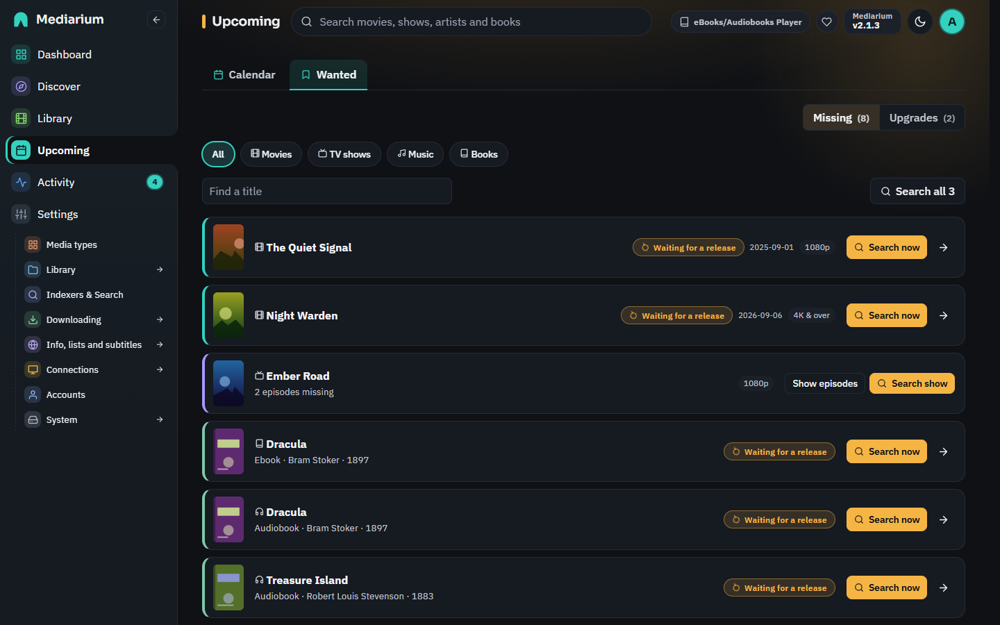
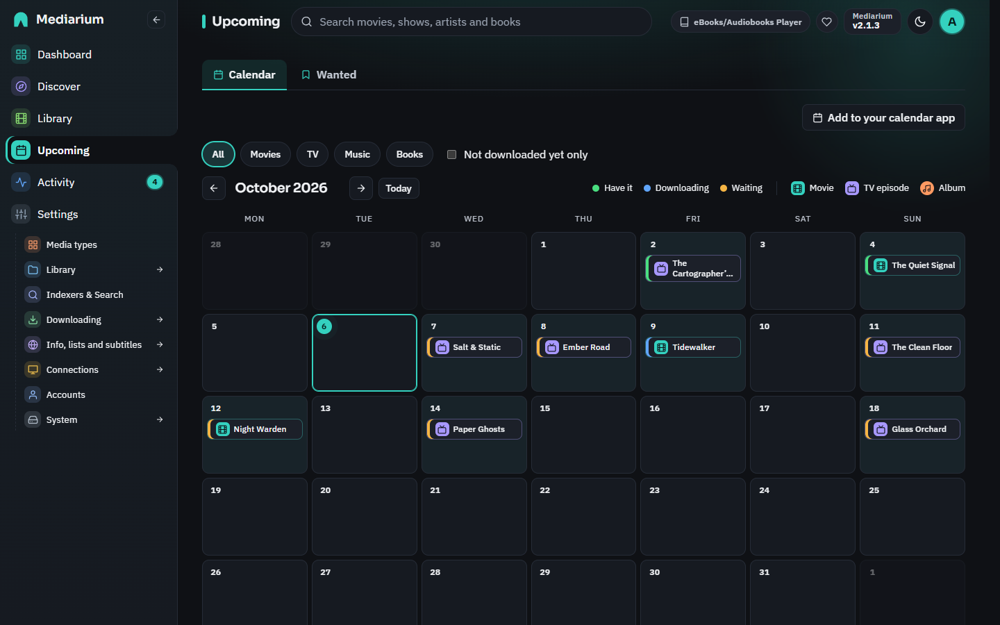
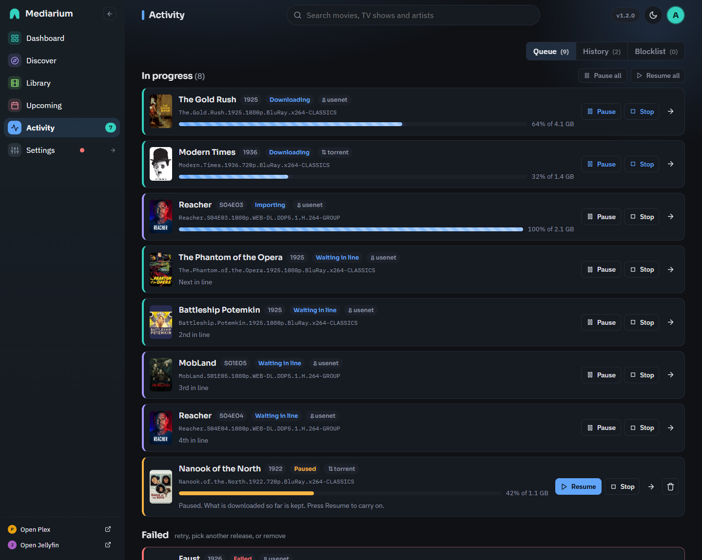
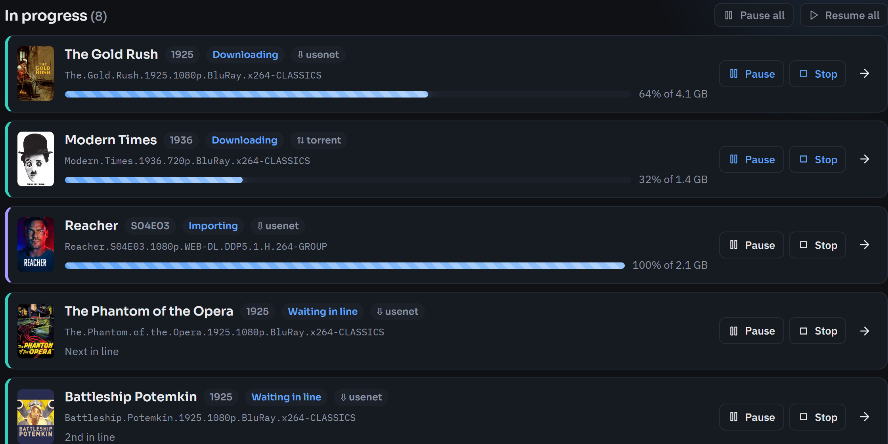

# Activity per title, pausing downloads, one download at a time, retries

## When a download fails

A failed download stays in the Queue tab with the reason. **Why did this happen, and what can I do?** under it explains the reason in plain words and lists what to try. For a release that is no longer complete on your Usenet provider (the most common failure), that is: **Blocklist & search again** to try the next release (automatic searching does this by itself), a quality profile that accepts more qualities so there are more releases to pick from, and a second Usenet provider from a different company. Once the movie or episode has been downloaded another way, its earlier failed tries are removed from the list by themselves.

## Requests and Reports

Two more tabs belong to the request portal; see [accounts.md](./accounts.md#requests) for how to set it up.

- **Requests** lists the titles accounts asked for. Admins approve or decline them. Someone who has to ask sees their own requests and, when a limit is set, how many they have left ("3 of 5 requests left this week"). A request for the 4K copy has a **4K** tag.
- **Reports** shows once an admin has switched on problem reports (or you already made one). It lists the problems people reported with a movie or show: the title (a link to its page), what is wrong, who reported it, and the answer once there is one. Admins press **Resolve**, write an optional comment and the person is told; **Reopen** takes it back, and the bin removes a report. Everyone else sees only their own.

## Import a file by hand

**Activity > Import a file by hand** (administrators) lists the video files in a folder, biggest first, with what each file's name suggests ("looks like Heat (1995)", the quality). For each one, choose **Movie** or **Episode**, pick the title from your library (the best guess is already chosen when the name matches), and for an episode the season and episode number, then press **Import**. Mediarium names the file and puts it in your library as it does for a download, marks the title as downloaded and tells your media server. The title must already be in your library. A file already at the destination is never overwritten.

- **Folder to look in.** It starts as the downloads folder. Type any folder (the path as Mediarium sees it inside its container) and press **Look here**, or press **Choose a folder** to walk to it: the folders you pick from start at the downloads and library folders, and **Up** goes one level higher. It can be any folder the container can read, so a drive that holds videos you collected elsewhere needs to be mapped into the container first. If Mediarium can't read the folder, or it doesn't exist, the page says so. The system's own folders (`/proc`, `/sys`, `/dev`, `/etc` and the like) and the top of the filesystem are refused, and so is a file outside the chosen folder, also through a link. The last folder you looked in is remembered in this browser; **Downloads folder** goes back to the default.
- **What is listed.** Subfolders are searched too. Files smaller than 20 MB, hidden folders, sample clips (a file called sample, or one in a `Sample` folder) and files a download program is still writing (`.part`, `.!qB`, `.crdownload`, `.tmp`) are left out. Files inside a folder called `incomplete` (qBittorrent's folder for unfinished downloads), and SABnzbd's `_UNPACK_` folders, are hidden as well, and the page says so. Turn on **Show incomplete downloads** to list them anyway; each is marked as possibly not finished. A very large folder is only searched in part (the page says "more files here than the list shows").
- **How it comes in.** **Hardlink** (the default) is what every import does: no extra space, the original stays, and on another drive it is copied. **Copy** always makes a separate copy, so the original stays and the library file does not depend on it. **Move** is the same as a hardlink, and then the original is removed once the file is in your library (it is never removed if it is the file in the library itself, and if it can't be removed the page says so). Your choice and the incomplete switch are remembered in this browser.
- The copy left in the downloads folder by a hardlink or copy is removed by the daily clean-up; a file in any other folder is never touched except by a move.

Scripts: `GET /api/manual-import?folder=/some/folder&incomplete=1` (both optional; the answer has `folder`, `downloadsFolder`, `files`, `more` and `hiddenIncomplete`), `GET /api/manual-import/folders?path=/some/folder` (the folders inside it, for a folder chooser) and `POST /api/manual-import` with `{"folder": "/some/folder", "path": "...", "mode": "link", "movieId": 12}` or `{"path": "...", "seriesId": 4, "season": 2, "episode": 5}`. `path` is relative to `folder` (the downloads folder when it is left out), `mode` is `link` (the default), `copy` or `move`, and `incomplete: true` allows a file from an incomplete folder. The answer has `path` and `sourceKept` (true when a move couldn't remove the original).

## Add a download by hand

**Activity > Add a download by hand** (administrators) puts an NZB or a torrent you already have into the download line for a title in your library. Use it for a release you got somewhere else, or one an indexer couldn't find.

1. Choose **Movie** or **Episode or season**, search your library and pick the title. For a show, pick the season and then one episode, or **The whole season**. The title has to be in your library already; add it first if it isn't.
2. Give Mediarium the release in one of these ways:
   - **A file:** an `.nzb` or a `.torrent` file (up to 32 MB for an NZB, 16 MB for a torrent).
   - **An address or magnet link:** the web address of an NZB or `.torrent` file (`http://` or `https://`), or a `magnet:` link. Mediarium fetches an address once, right away, and keeps the file, so the address (which can hold a key) isn't stored.
3. Optionally type a **release name**. Without one, the name comes from the file name, the torrent or the address. The name matters a little: Mediarium reads the quality and the season and episode from it.
4. Press **Add download**.

The download then goes into the [download line](#the-download-line) like one you picked from a search, with the same checks, repair, unpacking and import. It goes before what the automatic searches added.

Mediarium checks the input before it accepts it, and tells you in plain words if something is wrong:

- An NZB has to be a readable NZB with at least one file, and a torrent a readable `.torrent` with at least one file. A web page, a zip file or a file that was cut off is refused.
- A magnet link has to contain the torrent's hash. Spaces in it (sites often copy the name part, `&dn=`, with plain spaces) are written as `%20` for you.
- The content decides what a file is, not its name.
- Addresses only go to `http://` or `https://` places, and never to the addresses cloud servers keep their credentials on (the same rule as for indexer addresses).
- If the release name says another season or episode than the one you picked ("S01E02" when you picked episode 1, or a season pack when you picked one episode), nothing is added. A pack of several seasons ("S01-S03") never counts as one season or one of its episodes.
- A release with programs or scripts in its file list (`.exe`, `.scr`, `.bat` and so on) is refused while [Reject releases that contain programs or scripts](downloads.md#checks-on-releases) is on.
- NZBs need a Usenet provider (Settings > Downloading > Usenet), torrents need the torrent client, a download client or a debrid service to be switched on.
- Like any download you start by hand, it is refused while another download for the same movie or episode is still running.

The files you upload are kept in the `uploads` folder next to the database (`/config/uploads`) until the download is gone from the list; the daily clean-up removes the ones nothing refers to any more after a day.

Scripts: `POST /api/downloads/manual` (administrators), a `multipart/form-data` form with `movieId`, or `seriesId` with `season` and `episode` (`0` or left out is the whole season; season `0` is the specials), and either a `file` part or a `url` field, and optionally `name`. It answers `202` with `{"queueId", "releaseTitle", "protocol", "sizeBytes"}`.

## The Wanted page

**Upcoming > Wanted** lists what Mediarium is still looking for (**Missing**) and what is below the quality you asked for (**Upgrades**). Episodes of the same show are folded into one line ("12 episodes missing") with **Show episodes** and **Search show**. **Find a title** narrows the list, the first 50 are shown with **Show more** for the rest, and **Search all** searches every title in the list now, one after another (one search per movie, one per show). Above 25 titles it asks first, because many indexers allow only so many searches a day.

A title whose release is being held back by a delay profile (see "Wait for a better protocol" in [quality-profiles.md](./quality-profiles.md)) shows "Waiting for a better protocol until 14:20" here instead of "Waiting for a release".

On a big TV library the list can hold hundreds of thousands of episodes, so the page loads it a page at a time: one line per movie and per show, 50 lines first and more with **Show more**. A show's episodes are only read when you press **Show episodes**. **Find a title** and the media chips ask the server for the matching lines, and **Search all** reads the rest of the list before it starts.

For scripts, `GET /api/wanted?kind=missing` (or `kind=cutoff`) still answers the whole list, every movie and every episode, as before. Add these to get it in pages instead:

- `group=1`: one row per movie and per show, movies first, newest added first. A show row has `"kind": "show"`, the show's id as `id` and `seriesId`, and `episodes` (how many of its episodes are listed). A show with only one episode listed comes as that episode. The answer is `{"rows": [...], "total": 412, "movies": 37, "episodes": 9120, "offset": 0, "limit": 50}`, where `total`, `movies` and `episodes` count the whole list, not just the page.
- `limit` (default 50, at most 500, `0` for only the totals) and `offset`, with `group=1`.
- `media=movie` or `media=tv`, and `q=` (words in the title), with `group=1`.
- `series=ID`: just that show's episodes, as a plain list like the full one.

## The series page

A show's seasons start folded, except the one that needs attention (the latest with missing episodes, or else the latest season). The row of season buttons at the top opens a season and jumps to it; a dot marks seasons with missing episodes. **Missing episodes only** shows just the episodes that have aired and are not downloaded. **Open all** and **Close all** do what they say. The facts at the top include the **Next episode** and the day it airs.

## A title's own activity log

Every movie, show and album keeps its own log of what happened to it, newest first. It tells you why a title hasn't downloaded yet, without digging through server logs.

- `GET /api/movies/{id}/events` `GET /api/series/{id}/events` and `GET /api/music/albums/{id}/events` (every account can read them) return a list of at most 200 events, newest first: `[{"at": "2026-09-29T08:30:00.000Z", "kind": "searched", "message": "...", "level": "info"}]`. `level` is `info`, `warn` or `error`. A show's log covers all its episodes.

*Upcoming > Wanted lists what Mediarium is still looking for. Each row shows the state (Waiting for a release), the release date and quality, and a Search now button. The arrow opens the title and its activity log.*

*Upcoming > Calendar: releases and episode air dates on their day. The stripe on each entry says whether you have it (green), it's downloading (blue) or it's waiting (yellow). The badge says what it is: a film for a movie, a TV for an episode, a note for an album.*

What is recorded (`kind`):

| kind | when | example |
|---|---|---|
| `searched` | each automatic search (the scheduled search, **Search now**, the search after adding a title, the retry after a bad release) | `Searched: 12 releases, none acceptable: 8 CAM/TeleSync, 4 other years` (warn), or `Searched: 5 releases, 2 acceptable; picked "..." from MyIndexer with the "1080p" profile` |
| `grabbed` | a release was queued, by hand or automatically. A grab that only a fallback profile accepted says which profile it used | `Grabbed "..." for ...` |
| `download` | the download started, was paused, resumed or stopped, was interrupted by a restart of Mediarium, and finished (post-processing starts) | `Download started: <release>`, `Mediarium was restarted while this was downloading, so it is paused: <release>` (warn) |
| `postprocess` | PAR2 verify or repair, unpacking, and their failures | `Repairing 3 missing articles with PAR2: <release>`, `Unpacking failed (...): <release>` (error) |
| `imported`, `failed`, `conflict` | the end of a download, with the plain reason when it failed. Network and file errors are put in plain words (for example "The address could not be found"). The exact error text is kept in [Logs and errors](logs-and-errors.md) under **Technical detail** | `The Film: Couldn't get the NZB file. The address could not be found. Check the address and your internet connection.` (error) |
| `blocklisted` | a release was blocklisted, automatically (its own fault: corrupt, incomplete, holding programs or scripts) or by you | |
| `skipped` | a download was left out because the same release was already in the queue or downloaded (see [Checks on releases](downloads.md#checks-on-releases)) | `Skipped "...": "..." is already in the queue or downloaded.` |
| `retry` | after a blocklisted release, why no other release was taken right away | `No other acceptable release; will try again at the next scheduled search` (warn) |
| `retried` | **Retry** on a failed download, and whether it reused the files already downloaded | `Retrying from the files already downloaded: <release>` |
| `waiting` | an album's files are downloaded but MusicBrainz would not give its track list, so the import waits (see [Music](music.md)) | `Artist – Album: MusicBrainz is busy. The downloaded files are kept and Mediarium will try the import again later.` (warn) |
| `removed` | a download was removed from the download list | |
| `kept` | a download finished but the file already in your library was kept, because **If a file already exists** said so (or you pressed **Skip**), including when the new release would have had a different file name than the one you have. It is a decision, not a failure: the row says "Kept the file you already have." and no "failed" notification is sent A second line in the title's own log says what became of the downloaded files: *The downloaded files of <release> were deleted.*, *The release <release> is still seeding, so its downloaded files stay until seeding is done.* or *The release <release> stays in your download client, which keeps its files.* The download's row in Activity shows the kept file and the same information under **Details** (**Kept file**, **Downloaded files**); `GET /api/queue` has `keptFile` and `keptData` (`deleted`, `seeding` or `client`) on such an item, and members only get the file's name. | `The Film: a file is already at /movies/The Film (2001)/The Film (2001).mkv, so Mediarium kept it and did not import <release>.` |

A search can skip a release for these reasons: `blocklisted`, a downloader the title doesn't use (`from torrent sites (this title uses Usenet only)`), `other films` (a different movie), `other years`, `for another show`, `not this episode`, `not a season pack`, a quality no profile in the title's chain accepts (its tier, such as `CAM/TeleSync`, or `unknown quality`), `excluded by the profile's release terms`, `in another language`, `older than your Usenet retention of <n> days`, and for upgrade searches `not an upgrade over <tier>`. Indexers that didn't answer are named too.

A search with the same outcome as a recent one (the scheduled search finding the same releases again) moves that event's time forward instead of adding another. The detailed events (`searched`, `download`, `postprocess`, `retry`, `retried`, `removed`) show only on the title's own log. The global activity feed (`GET /api/activity`, shown on the History tab) keeps showing grabs, imports, failures, blocklisting and the like. Each title keeps its latest 300 detailed events.

*Activity, Queue tab: what's running, waiting in line and paused comes first, then failed downloads, then the titles still waiting for a release. History and Blocklist are the other two tabs.*

## The Queue tab, top to bottom

The Queue tab always reads in the same order, and rows don't move while they download:

1. **In progress.** Downloading and importing first (the one that started first on top), then the downloads **waiting in line** in the order they'll start, then paused ones. **Pause all** and **Resume all** sit at the top of this list.
2. **Failed.** The newest failure first. Each one has **Retry**, **Blocklist & search again** (administrators only) and a remove button.
3. **Needs your decision.** A file already exists and you chose to be asked. Administrators pick **Overwrite** or **Skip**, and members see "Waiting for an admin". **Skip** keeps the file that is there (the row moves to History as "Kept the file you already have."): a title that still has its file stays downloaded, so it isn't searched for again. Overwrite is refused when the file belongs to another movie or episode. Then **Stopped**.
4. **Waiting for a release.** Monitored titles with nothing downloaded yet, with what the last search found. Each is a tile with its poster and year; a show is one tile however many of its episodes are missing ("6 episodes waiting"). The search note is cut short on the tile and reads in full when you point at it. A title that's already downloaded never shows up here. It lists the first 20, and a button opens the rest in Upcoming > Wanted. Activity reads only the first titles of that list, not all of it, so it stays quick however many episodes are missing.

Under each movie or show download's name there are small tags for what the release name says it is: the picture size (1080p, 2160p), the source (WEB-DL, BluRay), the video codec (x264, x265) and the audio language. They are read from the name, so a release that doesn't say (no language, for example) simply has no tag for it. `GET /api/queue` has them as `resolution`, `source`, `codec` and `language`.

While a download runs, its row shows the speed and the time left, worked out from how far it got between two refreshes of the page (so it takes a few seconds to appear, and only while the page is open). **Details** under a row opens the release name, the indexer it came from, the source, the size, when it was added and finished, where it goes, and what happened to it, from the title's own history. `GET /api/queue` carries `indexerName` for the indexer. Long release and file names that have no spaces wrap inside the row on a phone instead of running off the card.

The queue refreshes every 3 seconds while a download is waiting, downloading or importing, and every 10 seconds when nothing is. Finished downloads are on the **History** tab, with **Clear finished** to empty that list. `GET /api/queue` returns the items in this order.

## Download clients

Administrators have a **Download clients** tab next to Queue. It is the one place to see and control every downloader, the ones built into Mediarium and any you connected, without opening another program.

**Built in.** At the top, **Side by side**, **Usenet** and **Torrents** choose what to show: both downloaders as two cards next to each other (they stack on a phone or a narrow window), or just one of them. Mediarium remembers the choice on that device. The two cards are the **Usenet downloader** and the **Torrent client**. Each says whether it is ready ("needs your provider" for Usenet until you add a provider, "waiting for the VPN" or "off" for torrents), sums up what it is doing (for example "2 downloading · 1 waiting in line · 4.2 GB to go") and lists its own downloads, newest work first. Every download has the same controls as on the Queue tab: **Pause**, **Resume**, **Stop**, **Retry**, **Blocklist & search again** and **Remove from this list**, with its details underneath. **Pause all** and **Resume all** in the heading act only on that downloader, so you can hold the torrents and let Usenet carry on, or the other way round. Finished downloads are on the History tab.

**Connected clients.** Inside the torrent card, under the built-in client, a section for each client you set up under **Settings > Downloading > Torrents > Use your own torrent client** (qBittorrent, RDT-Client or Decypharr) and for your **debrid** account (Real-Debrid or TorBox):

- **Torrent client:** each torrent has its state in words (Downloading, Waiting for peers, Checking the files, Paused, Seeding, Finished, Problem), a progress bar, the speed down and up, the time left, how many seeds and peers are connected and how many the swarm has, the ratio, when it was added and its size. A torrent that has moved no data for 30 minutes says so ("No data for 2 h. It may be dead.").
- **Added by Mediarium** shows the torrents Mediarium put in the client (its category, `mediarium` unless you changed it, or the category you set for that kind of download); **Everything in qBittorrent** shows all of them, yours too, marked with their own category. Next to the number of downloads, the heading of each client adds up what is in the list below it: the speed it is downloading at and how much is left to download.
- **Buttons:** **Pause** and **Resume**, **Check the files again**, **Remove, keep the files** and **Remove and delete the files** (both ask first). On a torrent Mediarium added, **Give up and search again** stops that download, puts the release on the [blocklist](#when-a-release-turns-out-to-be-bad), removes the torrent and its files and looks for another release.
- **Debrid:** the torrents on the account with their state, progress, speed and seeders, and a button to remove one.
- **SABnzbd or NZBGet:** when you [send Usenet releases to one](downloads.md#sabnzbd-and-nzbget), the Usenet card says "not in use" for the built-in downloader and a section for the downloader sits under it. Each download shows its state (Downloading, Waiting in line, Paused, Checking and unpacking, Finished, Problem), a progress bar, the speed, the time left, when it was added and its size, with **Pause**, **Resume**, **Remove, keep the files**, **Remove and delete the files** and, on one Mediarium sent, **Give up and search again**. **Added by Mediarium** shows the downloads in its categories and the ones Mediarium is still importing; **Everything in SABnzbd** shows all running ones and the last 20 finished. Scripts: `GET /api/usenet-client/jobs?scope=mine|all` and `POST /api/usenet-client/jobs/{id}/pause|resume|remove|remove-files`.

The page refreshes by itself every few seconds. Nothing here changes torrents you didn't ask about.

Scripts (administrators): `GET /api/download-client/torrents?scope=mine|all`, `POST /api/download-client/torrents/{hash}/pause|resume|recheck|remove|remove-files`, `GET /api/debrid/torrents` and `POST /api/debrid/torrents/{id}/remove`. A client that can't be reached answers 200 with a plain `error`. `POST /api/queue/pause-all` and `/resume-all` take `?protocol=usenet` or `?protocol=torrent` to act on one built-in downloader only.

Torrents the built-in client runs show the peers and seeds it is connected to in **Details** on the Queue tab (`peers` and `seeds` in `GET /api/queue`). Administrators also find the controls of that torrent there: download in order, its own speed limits and a list of its files to tick on and off. A torrent filed under a category shows the category name next to the word torrent (`category` in `GET /api/queue`). The torrent client card has the options for all torrents and shows whether the router opened its port. All of it is described in [Downloads](downloads.md#controls-of-the-built-in-torrent-client).

## History

The **History** tab lists the newest 100 events. **Show older lines** loads 200 more each time, and **Find in the history** narrows it to lines that contain the words you type. A line about a movie, show or album links to its page. Scripts: `GET /api/activity?limit=500&q=heat` (at most 2000 lines); each line has a `link` when it is about a title.

The **Blocklist** tab (administrators) shows the newest 100 blocked releases, newest first, with the total in the tab name. **Show more** adds 100. Scripts: `GET /api/blocklist` is still the plain list of everything; with `?limit=100&offset=0` it answers one page as `{items, total, limit, offset}` (at most 500 per page).

## The calendar

**Upcoming > Calendar** shows releases, episode air dates, album releases and book releases on their day. Movies and episodes start 30 days back, so a big library's old releases don't fill it (movies further ahead are all shown). Chips at the top show only movies, TV, music or books (when more than one is switched on), and **Not downloaded yet only** hides what you already have.

A monitored movie with a digital release date on a different day from its cinema date is on the calendar twice, marked **Cinema** and **Digital**, so you can see when it can first be downloaded. Both dates are the ones of your country (see [Discover](./discover.md)). TMDB gives them one title at a time, so Mediarium reads them slowly in the background, a few every few minutes, and a movie gets its second marker once it has been read. In `GET /api/calendar` the two entries have `release` set to `cinema` or `digital`.

The arrows on either side of the month's name go back and forward a month. **Today**, the small button next to them, comes back to this month (it is greyed out when you are already on it). **Posters** shows the month with a big poster in each day and the name in a frosted bubble over it; a day with more than one release has a **+n more** button that opens the whole day as a window of posters. **Backdrops** is the same, but each release is a wide still from the film or show with its logo over it. Mediarium fetches those from TMDB slowly in the background, a few every few minutes and only for what is on the calendar, so a title shows its poster until its picture has arrived (it can take a while the first time with a big calendar). **Month** shows the whole month as a grid, with a small poster for each release (titles show when there's room; point at a poster to read it). Today's square is lit. **Agenda** lists only the days that have something on, each with its date on a ticket stub and the releases as cards with their poster, episode code and status. On a phone all four views work too, drawn to fit: **Month** is a small grid with a dot for each release, and tapping a day lists it underneath; **Posters** and **Backdrops** give each day its own block of posters or wide stills; **Agenda** is the plain list. The calendar remembers which view you picked in this browser.

Each release is in its kind's colour and frame (a ticket for movies, a TV screen for episodes, a sleeve with its record for albums, a book, or a cover wearing headphones for audiobooks). A solid card means you have it, a bright line along the bottom means it's downloading, and a dashed outline means it's still wanted. A wanted release whose day has passed also glows. The legend under the calendar shows all of this.

**Add to your calendar app** gives you a private address (an `.ics` link) to subscribe to in Google Calendar (*Other calendars > From URL*), on an iPhone (*Settings > Calendar > Accounts > Add Subscribed Calendar*) or in Outlook. Releases then show up in your own calendar and update by themselves. The address works without signing in, so anyone who has it can see your calendar: keep it to yourself. **Make a new address** replaces it (the old one stops working) and **Turn it off** removes it. Each account has its own. The calendar app must be able to reach Mediarium, so for an app on your phone outside your home this needs your reverse proxy. Scripts: `GET`, `POST` and `DELETE /api/calendar/feed`; the feed itself is `GET /api/calendar/feed/{token}.ics`.

## The download line

Downloads run in a line, and only **one** runs at a time (Usenet and torrents together). Allow up to five under **Settings > Downloading > Download rules > Downloads at the same time**. See [Downloads](downloads.md#downloads-at-the-same-time-the-download-line).

*The top of the Queue tab. Every running or waiting download has Pause and Stop. A paused one has Resume.*

A download that has to wait shows **Waiting in line** with its place: **Next in line**, **2nd in line**, **3rd in line** and so on. The place is the order downloads will start in, so it changes as things ahead of it finish:

- What you started yourself (**Choose release**, **Search now**, adding a title with a search, a bulk search, **Retry**) goes before what the automatic searches added. Inside each group it's first come, first served.
- A download keeps its place from the first byte until the file is repaired, unpacked and moved into your library. Then the next one starts. If it fails, it stays in **Failed** for you to retry, and the next one starts anyway.
- A torrent that's only seeding doesn't hold a place.
- **Pause** and **Stop** work on a waiting download too. A paused or stopped one is out of the line, and **Resume** puts it back at the front of its group. **Pause all** and **Resume all** keep the order.
- **To the front** (on a waiting download, administrators): starts it before the others that are waiting, including ones you started by hand. A download that's already running or paused can't be moved; a paused one goes to the front of its group when you resume it.
- A waiting download can't be removed until you stop it.

## Pause, resume and stop

Every download in progress, Usenet or torrent, has **Pause** and **Stop**. Only administrators can use them (members can still retry).

| Button | What it does |
|---|---|
| **Pause** | Stops the transfer at once and keeps the download in the list as **Paused**. The part already downloaded stays in the downloads folder, and the movie or episode stays reserved, so nothing else is grabbed for it. |
| **Resume** | Carries on from what is saved. A Usenet download asks the news server only for the articles it doesn't have yet. A torrent is added to the torrent engine again and checks the pieces already on disk. |
| **Stop** | Cancels the download. The movie or episode goes back to waiting for a release. A question asks whether to **also delete the partly downloaded files** (ticked). Only the download's own folder inside the downloads folder is deleted, never anything in your movie, TV or music folders. |
| **Retry** | On a failed or stopped download: tries the same release again. If its files are still there (a partial download too), it carries on from them. An album that was only waiting for MusicBrainz (see [Music](music.md)) is not downloaded again at all: its import runs again from the downloaded files. |
| **Retry now** | On an album marked **Waiting for MusicBrainz**: tries the import at once instead of waiting for the next try (every 15 minutes). |
| **Remove** | Takes a completed, failed, stopped, paused or file-conflict download off the list. Removing a paused or conflict one stops it first (its movie goes back to missing, or downloaded if the old file is still there), and asks whether to delete its partial files. A torrent still seeding for the entry stops with it. |
| **Pause all** / **Resume all** | Do the same for every download at once. |
| **Pick** (the small box on a download's picture) | Pick several downloads (in progress, failed or stopped), then use the bar that appears above the list: **To the front**, **Pause**, **Resume**, **Stop**, **Retry**, **Blocklist** or **Remove** for all of them, **Pick all**, **Pick paused**, **Pick problems** (the failed and stopped ones; the **Failed** heading has the same button), or **Clear**. **Blocklist** asks first, then never uses those releases again and looks for another release for each title. **Retry** tries again only the picked downloads that failed or were stopped, as **Retry** does on each one, so **Pick all** then **Retry** leaves what is running alone. A pick of more than 200 is sent in batches. **Remove** takes the picked downloads off the list (a running one, or one waiting in line, is refused and named: pause or stop it first). One that can't be changed (pausing a download that's already paused, say) is named in the message, and the rest still go through. Picked downloads keep the order they're shown in when you send them to the front. |

A download that's importing pauses or stops when the current step ends. The row says **Pausing…** or **Stopping…** until then. One that's unpacking stops the unpacking at once: the file that was being written is removed, and unpacking starts over when you resume.

While archives are being unpacked, the row says **Unpacking** and shows how much is done, for example `Unpacking: 31.2 GB of 75.0 GB`, with the speed and the time left. The bar and the percentage follow the unpacking too, instead of sitting at 100%. With more than one archive in the download the line names the one being unpacked (`Unpacking archive 2 of 3: ...`).

### After a restart

A paused download is still paused after Mediarium restarts, whatever the mode. That includes safe mode (`MEDIARIUM_PAUSE_AUTOMATION`).

A download that was only **waiting in line** is still waiting after a restart, in the same order, and starts about a minute after Mediarium starts when a place is free. In safe mode it comes back paused instead, because safe mode starts nothing by itself.

A download that was running when Mediarium stopped (an update, a crash, the NAS switching off) comes back as **Partly downloaded, stopped**, with the saved part kept. By default the Usenet and built-in torrent downloads that were **downloading** then carry on by themselves: about 15 seconds after the start, one at a time, a few seconds apart, and only when there is a free place in the line. Their activity line says **Resumed after a restart**. Usenet carries on from the articles it already has, a torrent from its files (it checks what is there first).

They stay stopped, and you press **Resume** yourself (or **Stop**, or the remove button), when:

- **Resume interrupted downloads after a restart** is off (Settings > Downloading > Download rules);
- Mediarium started in safe mode;
- the download uses an outside download client or a debrid service, was unpacking or importing, or you had paused it;
- it is a torrent and your VPN isn't up after 10 minutes (with the kill switch, or a VPN switched on). It waits for the VPN, it never goes out without it.

With **Pause downloads while someone is watching** on, and someone watching, they are held with the other paused downloads and come back when nobody is.

At every start Mediarium also fixes titles that got stuck. A movie, episode or album marked "downloading" with no download behind it goes back to downloaded (if its file is there) or missing. A movie or episode marked missing whose file is on disk is marked downloaded. A waiting download for a title that's downloaded and set to **Leave what I have alone** is removed.

### Turning off better versions

Setting a title to **Leave what I have alone**, or stopping monitoring it, removes its downloads that are only waiting (in line, or partly downloaded and stopped by a restart), together with their partial files. A download you paused yourself, or one that's downloading, is left alone. The Library page can do the same for many titles at once: see [What you can do to the selection](library.md#what-you-can-do-to-the-selection).

### Routes

All administrator-only: `POST /api/queue/{id}/pause`, `POST /api/queue/{id}/resume`, `POST /api/queue/{id}/stop` (body `{"deleteFiles": true}`), `POST /api/queue/pause-all`, `POST /api/queue/resume-all`, `POST /api/queue/{id}/front` (send a waiting download to the front of the line), `POST /api/queue/bulk` (body `{"ids": [1, 2], "action": "pause|resume|stop|retry|front|remove", "deleteFiles": false}`, at most 200 ids; the answer lists `done` and the `failed` ones), and `DELETE /api/queue/{id}?deleteFiles=1`. `POST /api/queue/{id}/retry` (the **Retry** button) works for administrators and for members whose account may retry downloads (Settings > Accounts). The full list is in the [API reference](reference/api.md).

In `GET /api/queue`, `status` can also be `paused` or `stopped`, and `queued` means waiting in line: such an item carries `queuePosition` (1 is next). A paused item may carry `interrupted: true` (nobody paused it), `pending` (`pausing` or `stopping` while it winds down) and `keptFiles`.

## One download per title

A movie, or an episode, never has two downloads running at once:

- Automatic searches skip a movie or episode that's already waiting in line, downloading, being post-processed or paused.
- A grab by hand (from a title's release list, the search page, or **Retry**) is refused with `409` and the message `Already downloading: <release>. Cancel it first to pick another.` For a paused download the message says to resume it or stop it first.
- When a movie's or show's release list refuses a grab for that reason, the message shows the download in the way (its progress and size) and a **Cancel it and grab this one** button. After a question (*Cancel the running download and grab this release instead?*) it stops that download, deletes its partly downloaded files, takes it off the list and grabs the release you picked, in one step. The request for it is the usual grab (`POST /api/movies/{id}/grab` or `POST /api/series/{id}/grab`) with `replaceQueueId` set to the download's id. The `409` answer carries that download as `blocking` (`id`, `title`, `progress`, `sizeBytes`, `paused`). Only the download that is really in the way is cancelled: any other id is refused with the same `409`, and nothing is cancelled. If nothing is in the way any more, the grab simply goes ahead.
- A release you pick yourself for a title that already has a file asks before it downloads: *This will replace <the file you have> with <the release>*, with **Replace** and **Cancel**. After **Replace** the request carries `"replace": true` and the queue item remembers it, also after a restart, so the import swaps the new file in whatever **Better versions** and **If a file already exists** say, with the old file going to the recycle bin (see the installation guide, under *If a file already exists*). Without `replace` (searches Mediarium starts by itself, scripts, older apps) the settings decide as before, and a release they turn away ends as *Kept the file you already have.*
- A season pack covers every episode of its season. While a pack is downloading, you can't grab a single episode of that season or another pack of the same season.

## Retry without downloading again

**Retry** on a failed or stopped Usenet download whose files were all downloaded and are still in its working folder (the failure came later: PAR2 repair, unpacking or the import) doesn't download them again. It checks them with PAR2 again and repeats post-processing (repair, unpack, import). Only when the files are gone, or fail the PAR2 check, is the release downloaded again.

If only part of a Usenet download was saved (it was paused, stopped or cut off), the working folder holds a small file, `.mediarium-progress`, listing the articles already saved. **Resume** and **Retry** fetch only the rest. A torrent that's retried starts again. A torrent that's resumed checks the pieces it already has.

## When a release turns out to be bad

When an automatic download fails because of the release itself (corrupt or incomplete: PAR2 can't repair it, the archive can't be unpacked, no video file in it, or it holds programs or scripts), the release is blocklisted and Mediarium searches once more for another acceptable release. If there's none, the title's log says `No other acceptable release; will try again at the next scheduled search`, and the regular search (see [Automatic searching](./quality-profiles.md#automatic-searching)) keeps looking. If more than a few releases for the same title failed within a day, the immediate retry is skipped (and the log says so) until the next scheduled search. Books follow the same daily limit, counted for each format.

**Blocklist & search again** also works on a paused download or one waiting for your decision: the title is freed first (so the new search can pick it up) and the download's partly downloaded files are deleted. The blocklist entry keeps why the release was bad and says it was you: "Blocklisted by you: archive is password protected", for example. For a release that was already on the blocklist by itself, the reason it was put there is the one kept.
