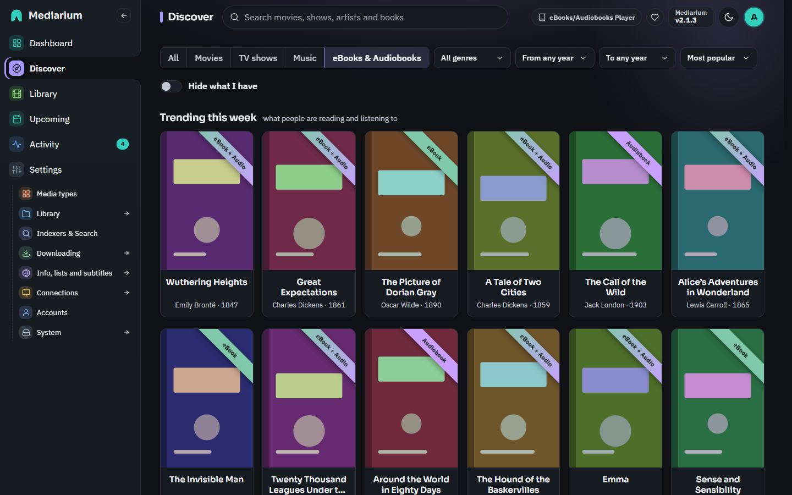
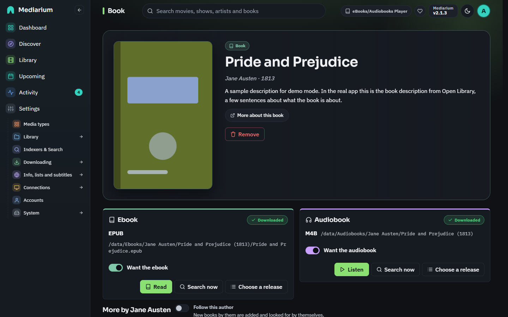
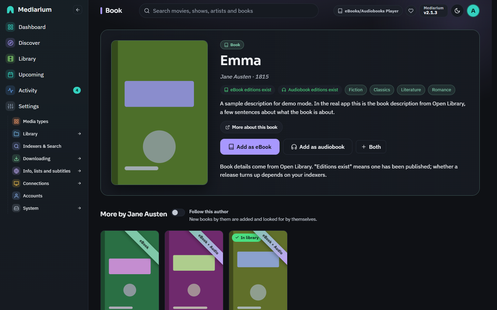
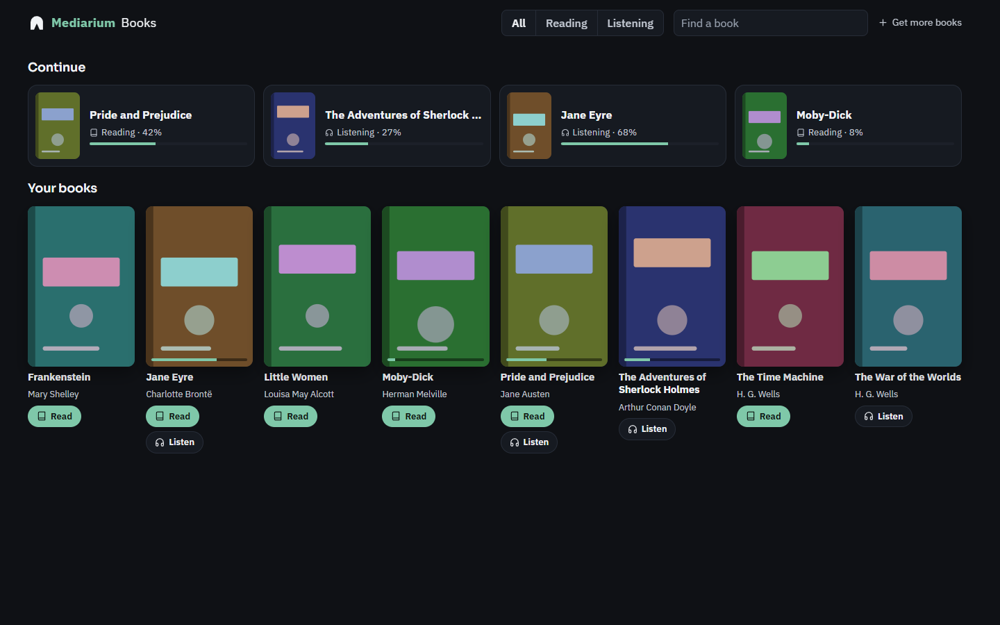
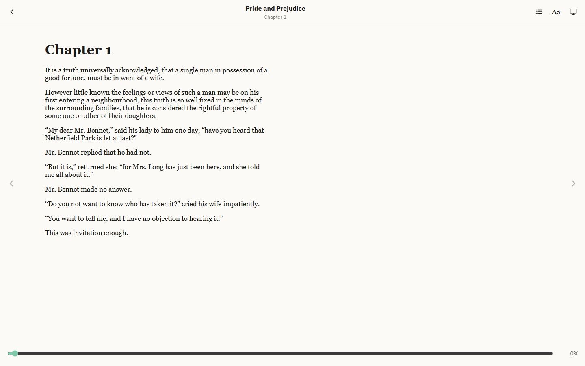
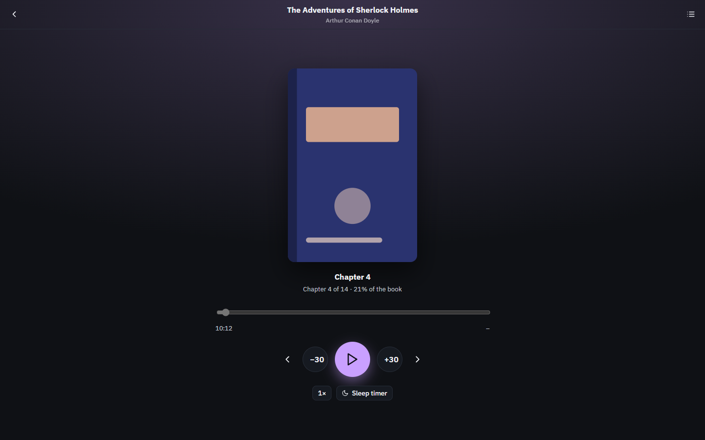

# Ebooks and audiobooks

Mediarium can look after books too: as an ebook, an audiobook or both. Each format is its own switch under **Settings > Media types**, and both are off on a new install.

## Switching them on

1. Open **Settings > Media types** and switch on **Ebooks**, **Audiobooks** or both.
2. Open **Settings > Library > Folders** and check the **Ebooks folder** and **Audiobooks folder**. They start from `EBOOKS_DIR` and `AUDIOBOOKS_DIR` (`/ebooks` and `/audiobooks` by default). The folder has to be mapped into the container; see [modules.md](./modules.md#adding-music-ebooks-or-audiobooks-later).
3. Make sure at least one of your indexers carries books. Ebooks are searched in the Newznab categories 7000 and 7020, audiobooks in 3030.

You can also pick them in the first-run wizard, on the **What do you want to manage?** step.

## Adding a book

Open **Library**, then the **Ebooks** or **Audiobooks** tab, and press **Add**. Type a title or an author's name. The results come from [Open Library](https://openlibrary.org), with their covers. When a Hardcover token is saved (Settings > Info, lists and subtitles), the same search also asks [Hardcover](https://hardcover.app) and uses its cover for a book Open Library has no picture of. A book only Hardcover knows is listed too, and can be added, after the Open Library results. That one saved token is what every account's search uses. Google Books is asked after those two, with no API key, and only for a few seconds. It fills in a missing cover or description, and a book neither of the others lists is added with Google's title, author, year, description and cover. A key on that same settings page is optional, for when you reach Google's limit. If Open Library can't read what you typed (it answers 422 to text such as an unclosed bracket or quote, or a lone colon), Mediarium searches again with just the words, and if that is refused too the search box says "Open Library couldn't read that search" instead of showing an empty list. Press **Add** on the right one.

- From the Ebooks tab the book is added as an ebook, from the Audiobooks tab as an audiobook. When the other format is switched on too, tick **Get the audiobook too** (or **Get the ebook too**) to want both.
- Mediarium starts looking for it straight away. After that, the automatic search tries again on its usual schedule for every book still missing.
- A book that is already in your library shows **In your library** instead of **Add**.

## Importing the books you already have

Administrators see an **Import** button on the Ebooks and Audiobooks tabs. Press **Start import** and Mediarium reads that folder, looks each book up on Open Library, and adds what it recognises to your library as downloaded, **where it is**. Nothing is moved, renamed or changed. For an audiobook that Open Library does not have, Mediarium asks Audible (through Audnexus) before giving up, and adds the book with the narrator, length, series and release date Audible has. Such a book has no "More about this book" link, because there is no Open Library page for it.

- It understands the usual layouts: `Author/Title/book.epub` (Mediarium, Calibre), `Author/Title.epub`, `Author - Title.epub`, and for audiobooks `Author/Title/` or `Author/Series/Title/` with the audio files inside. `CD 1` or `Disc 2` folders count as part of the book above them. A year like `(2021)`, Calibre's `(123)` and notes like `[Unabridged]` are ignored, and so are series numbers like `1 - `.
- Titles are compared the forgiving way: accents and apostrophes don't matter (`L'Etranger` finds *L’étranger*), a number counts the same as the number written out (`George Orwell - 1984.epub` finds *Nineteen Eighty-Four*), and a name with the title first (`1984 - George Orwell.epub`) is tried that way round too. The author always has to match.
- An ebook folder with the same book in several formats counts once, with the best format.
- When it's done you see how many were added, already there and not found. The list shows the ones not found, with the path on disk and how the name was read, so you can rename the folder and run it again. **Show all** lists everything.
- Running it again is safe: books already in the library are skipped.
- The ebook and audiobook imports keep their own results. Importing audiobooks doesn't clear the list of ebooks that weren't found, so **Find it myself** is still there for them. Only one import runs at a time.
- **Run the ... not found again** looks only at the books the last import did not find (or could not save), without reading the folders again. It is for when Open Library or Audible did not answer the first time (the message says so). If you renamed a folder to fix a name, use **Import again** instead, so the folders are read again. Scripts: `POST /api/books/import/retry`.
- **Find it myself** (next to each book that was not found) opens a small search with a **Title** box and an **Author** box, filled in with what was read from the name on disk. Books by that author are listed first. Change either box, pick the right book from the results (cover, title, author, year) and it is attached to that file, the same as an automatic match. Tick **Rename the file to match** to also move the file (or the audiobook's folder) to where Mediarium puts a book it downloads, `Author/Title (Year)`. It is off by default, nothing is overwritten, and if the new place is taken the book is added and the file stays where it is. Only administrators can do this. Scripts: `POST /api/books/import/match`.
- It pauses briefly between lookups to go easy on Open Library, so a big folder takes a few minutes. You can leave the page; it carries on.

## Finding books on Discover

**Discover** has an **eBooks & Audiobooks** tab (and a section on the All tab) while ebooks or audiobooks are on. It shows what people are reading on Open Library: **Trending this week** and **Popular this year**, then the most read **Classics**, **Fantasy**, **Science fiction**, **Mystery and thrillers**, **Biography and memoir** and **Self-help**. A book already shown in a row higher up is left out of the rows below it.

- **A banner across each cover** says which editions have been published: **eBook**, **Audiobook** or **eBook + Audio** (no banner when Open Library lists neither). It comes from Open Library's list of editions, so it says a version exists, not that your indexers have it.
- **Add** lights up as soon as you point at a cover. The add window starts with the formats that exist (of those switched on), and you can change them.
- **Click a cover** to open the book's info page: cover, description, subjects, which editions exist, **Add as eBook** / **Add as audiobook**, and more by the same author. A book already in your library opens its own page instead. The search box at the top opens the same info page.
- Pick a **Genre**, a year range or an **Order** (most popular, highest rated, newest, oldest) to browse everything that matches instead.
- **Hide what I have** leaves out books already in your library.
- The lists are kept for an hour, so moving around Discover doesn't ask Open Library again each time.



## The book page

A book page from Discover or the Library has its own cover, blown up, blurred and faded into the background behind the title, since a book has no wide picture like a film does.

Each book has a page with its cover, author, year and description, and a panel for each format that is switched on:

- **Where it stands**: downloaded (with the file type and where the file is), downloading, or waiting for a release.
- **Want the ebook / Want the audiobook**: switch a format off to stop looking for it, or on to start.
- **Search now** looks for that format straight away and downloads the best release it finds.
- **Choose a release** lists what your indexers have for the book, best first, so you can pick one yourself. Under each release is the category number the indexer filed it in (for example 7020 or a German books category), so you can tell apart releases that look alike.
- **Change cover** gives the book a cover of your own. See below.
- **Remove** (administrators) takes the book out of your library. Tick **Also delete its files** to remove the ebook file and the audiobook folder as well. They go to the recycle bin first when it is on.

### Changing a cover

Open Library has no cover for some books, and for others it only has one for a different edition, so the book is added with a blank cover. **Change cover** (on the book's page, for administrators and for accounts that may manage books) fixes that. It opens a small window with three ways:

- **Upload a picture**: choose a JPEG, PNG or WebP file of up to 8 MB. Anything else is refused. A WebP picture is converted to JPEG in your browser before it is sent.
- **Paste a link**: paste the address of a picture, starting with `http://` or `https://`. Mediarium downloads it once, with the same size limit. It only fetches from the public internet: a link to this machine or to your home network (a `192.168.x.x` address, for example) is refused, so download the picture and upload it instead.
- **Other editions**: when Open Library lists more than one cover for the book, they are shown here as small pictures. Click the one you want. This is skipped for a book Open Library has only one cover for.

Mediarium opens every picture to make sure it really is one (the file name and the type the site claims don't count), shrinks it to at most 800 by 1200 pixels, and keeps its own copy as a JPEG inside the database, so it is part of your backups. The cover shows everywhere the book does: the Library, Discover, the calendar, Activity, and on an e-reader through OPDS and Kobo sync.

A cover you chose is kept apart from the automatic one, so nothing that looks the book up again can replace it. **Remove my cover** (in the same window, shown once you have chosen one) takes your choice away and brings the automatic cover back.





## Series

When a book is part of a series, its page (and its info page from Discover) shows **Book 2 of Harry Potter** with every book of the series in reading order, each with **Add**. Books you already have say so. A book that isn't out yet shows the day it comes out.

Switch on **Follow this series** and Mediarium:

- adds the books of the series you don't have yet, in the formats that are switched on (ebook first), and starts looking for the ones that are out;
- checks the series twice a day and adds new books as they appear;
- waits for a book's release date before it looks for it. Until then the book page says when it comes out.

Books with a release date show up on **Upcoming > Calendar** with their cover in a lilac book frame (orange with headphones for an audiobook) and in the calendar feed, from 30 days back to 120 days ahead. Clicking one opens the book. On **Upcoming > Wanted**, a book that isn't out yet says **Out** and the day, without a Search now button. Release dates mostly come from Hardcover (see below); Open Library rarely knows them.

Only whole books count: a novella in between (book 2.5), box sets and collections are left out, but you can still add them by hand. Switching **Follow this series** off keeps the books you have.

**Where series come from.** Out of the box, from Open Library. It knows most big series, but not all of them, and rarely knows a book before it is out. For more series and release dates, and for covers Open Library doesn't have, connect **Hardcover** under **Settings > Info, lists and subtitles**: make a free account at [hardcover.app](https://hardcover.app), copy your token from Settings, Hardcover API, and paste it there. Mediarium checks it before saving and keeps it encrypted. A Hardcover token belongs to your own account and can't be shared, which is why none comes built in. The one token saved there is used for every account's series lookups and book searches. If Hardcover doesn't know a book, is slow, or is down, Open Library is used instead.

## Audiobook details

For a book you want as an audiobook, Mediarium looks up who reads it and how long it runs, and shows it in the audiobook panel ("Read by Ray Porter · 16 h 10 min") and in the Mediarium Books player. The details come from [Audnexus](https://audnex.us), which reads Audible's catalogue; Audible's public search finds the book first. When there are several editions it takes the full, unabridged reading, not a translation or a short dramatisation. It is looked up once per book, when you add it or first open its page. If Audnexus knows the series and Mediarium didn't, the book gets it too, and an audiobook that isn't out yet waits for its release day. Nothing needs setting up.

## Authors

A book's page ends with **More by** its author: their other books on Open Library, the most read first, each with **Add**. Box sets, collections and summaries are left out.

Switch on **Follow this author** there and their new books are added by themselves, and looked for straight away. Mediarium checks the authors you follow twice a day. It adds a book first published in or after the year you started following, that has a cover on Open Library, and that isn't already in your library (also under another Open Library entry with the same title). New books are wanted as an ebook while ebooks are on, otherwise as an audiobook. Switch it off on any of their books' pages; the books already added stay.

## Which release is picked

Mediarium searches for the author and title together, and when that finds nothing, for the title alone (some indexers don't index authors). The second search leaves out any indexer that failed or timed out in the first one, since it would only take as long again.

Only the indexers that can do books are asked. A site added from the site list says in its definition which categories it has, so one that lists no books (a movie or TV site) is not asked for an ebook, and one with no audio is not asked for an audiobook; an audio site counts as able to hold audiobooks. Newznab and Torznab indexers are always asked, because Mediarium does not keep their capabilities. The release list names the indexers that were left out ("2 indexers that don't do books or audiobooks were skipped: ..."), and says so when none of your indexers lists books. The same filter keeps album searches away from sites without audio.

When you press **Choose a release**, the search stops after 25 seconds and shows what the quicker indexers found by then, with a note naming the ones that did not answer, instead of failing after 30 seconds with nothing. Both searches share those 25 seconds. Either way, a release has to name the book's title and the author's surname. Small words like "the" and "of" don't count, so "Tolkien - Hobbit" still matches *The Hobbit*. A release of another book by the same author, or the other format, is left out.

Among the matches, the file type decides:

| Format | Preferred, best first |
|---|---|
| Ebook | EPUB, AZW3, MOBI, PDF |
| Audiobook | M4B, M4A, MP3 or FLAC, OGG or Opus |

A release that doesn't say its type comes after those that do. When two are equal, the indexer priority and then Usenet over torrents decide. Releases you blocklisted are skipped.

## Where the files go

Books are filed by author:

```
<Ebooks folder>/<Author>/<Title (Year)>/<Title>.epub
<Audiobooks folder>/<Author>/<Title (Year)>/<the audiobook's own files>
```

An ebook download keeps only the best ebook file in it. An audiobook keeps all of its audio files with their own names, so the chapters stay in order. When a book comes in several folders with the same file names (`CD1/Track 01.mp3` and `CD2/Track 01.mp3`), the folder name goes in front of the file name (`CD1 - Track 01.mp3`), so no part replaces another. A download with no ebook (or no audio) in it is marked as a bad release, blocklisted, and the next best one is tried.

Downloading a better ebook later (an EPUB after a PDF) replaces the file. A worse one doesn't.

## Reading and listening: Mediarium Books

**Mediarium Books** is a reader and an audiobook player built in, made to feel like an app of its own. Open it from the book button at the bottom of the sidebar, the **Read** or **Listen** button on a downloaded book's cover in the Library, or **Read** / **Listen** on a downloaded book's page. It opens in a window of its own, with no Mediarium menus, at `/bookshelf/`.

- **Install it as its own app.** In Chrome or Edge, open Mediarium Books and choose **Install** in the address bar (on a phone: **Add to Home screen**). It gets its own icon, named Mediarium Books, separate from Mediarium. Safari on iPhone: **Share > Add to Home Screen**.
- **The shelf** shows **Continue** (what you were reading or listening to, with how far you got) and every downloaded book, with **Read** and **Listen**. **Reading** and **Listening** narrow it to ebooks or audiobooks.
- **Your place is kept on the server**, per account, so a book opens where you stopped on any device.



### The reader

- EPUB books are shown a page at a time (two side by side on a wide screen). Turn pages with the arrows at the sides, the arrow keys, Page Up / Page Down or the space bar, or by swiping on a touch screen.
- **Contents** (the list button) jumps to a chapter. The slider at the bottom jumps to any place in the book and shows how far through you are. The first time a book is opened the percentages take a moment to work out; they're kept in that browser after that.
- **Aa** sets the text size, the page colour (light, sepia or dark), the font (book or plain) and how a page turn looks: **Slide** (the page slides out and the next slides in), **Fade** or **None**, with a **Turn speed** (fast, normal or slow). The turn animation is switched off by itself when your device is set to reduce motion. Your choice is remembered in that browser. The screen button goes full screen.
- PDF books open in the browser's own PDF viewer.
- Kindle books (MOBI, AZW and AZW3) open in the reader too. Mediarium turns them into EPUB with its own converter the first time (in well under a second, one book at a time) and keeps that copy in its cache folder (`/config/cache/epub`), so your library folder is never changed and your e-reader or Kavita see no extra files. A freshly downloaded Kindle book is converted straight away in the background. Copies nobody opens for 90 days are removed. Books locked with DRM can't be converted; the reader says so and offers the original as a download.
- Scripts inside a book never run.



### The player

- An audiobook's files play in order as its chapters (named after the files, with "01 - " and the like left off). A whole book in one M4B file uses the chapter marks stored inside it instead, with their own titles; the slider and the time left are then for the chapter, not the whole file. The list button shows them all.
- **−30** and **+30** skip half a minute; the arrows go to the previous or next chapter. Space plays and pauses, and the arrow keys skip.
- The speed button goes round 0.8×, 1×, 1.2×, 1.5×, 1.75× and 2× (remembered in that browser).
- **Sleep timer** goes round 15, 30, 45 and 60 minutes, **End of chapter** (also inside a one-file M4B), and off.
- On a phone, the lock screen and headphone buttons work, with the cover showing.
- How far through the book you are is worked out from the files' sizes, so it's close rather than exact.



### Other apps

You can also read and listen in an app made for it, and connect it under **Settings > Connections > Media servers**:

- **Audiobookshelf** for audiobooks (and ebooks), with apps for iPhone and Android that remember where you got to.
- **Kavita** for ebooks and comics, read in the browser on any device.

Once connected, a new book shows up there right after it's downloaded, and the book's page has a **Listen in Audiobookshelf** or **Read in Kavita** link. Point the app's library at the same folder as Mediarium's Audiobooks or Ebooks folder. See [media-servers.md](./media-servers.md#audiobookshelf-and-kavita-books).

## Reading on an e-reader

Your ebooks can also go to an e-reader. There are two ways, and both are off until you turn them on from your own profile page (**Profile > Read on an e-reader**). Each account has its own, and each only lets the e-reader read books: it can't add, change or delete anything.

Both need **Ebooks** switched on under **Settings > Media types**, and an account that is allowed to read books (the **Play** permission under **Settings > Account & Access**; administrators always are). Books reach an e-reader whichever way they got into the library: downloaded by Mediarium, imported from a folder, or put there by another tool such as Shelfmark.

### Reading apps: the OPDS catalogue

OPDS is the catalogue format most reading apps understand. Mediarium serves OPDS 1.2 at `/opds/` and OPDS 2.0 at `/opds/v2/`.

1. Open **Profile > Read on an e-reader** and press **Make an e-reader password**. Copy it straight away: it is shown once. It is not your sign-in password, and it can't be used to sign in to Mediarium.
2. In your app, add a catalogue. Use the address from the profile page (for example `https://books.example.com/opds/`), your user name and the e-reader password.

It works with KOReader, Moon+ Reader, Librera, Marvin, Foliate and other OPDS apps. What the apps show:

- **Recently added**, **All books** (by title), **Authors** and **Series**, 50 books to a page.
- Search by title, author or series (apps that read the OpenSearch description, which these do).
- Covers and small cover pictures. A cover comes from the book file itself when it has one, otherwise from Open Library.
- The download is the book's own file (EPUB, MOBI, AZW3 or PDF), exactly as it is in your library.

Only ebooks are listed, not audiobooks. Making a new password stops the old one; **Turn it off** removes it.

Big libraries stay quick: Mediarium keeps the pages it has already built in memory (a few megabytes at most) and builds them again only when a book is added, removed or changed. Saving your reading place does not count as a change. The Kobo sync uses the same list. Nothing is stored on disk, and a restart simply starts with an empty cache.

The app sends the password with every request, so if you reach Mediarium from outside your home network, use an `https` address (through your reverse proxy). Over plain `http` on your own network it is fine.

If someone tries too many wrong passwords, Mediarium makes them wait about 15 minutes. That counter is separate from the web sign-in, so it can't lock you out of the page.

### Kobo sync

A Kobo can fetch your ebooks from Mediarium over Wi-Fi, with covers, and your reading place is kept in step with Mediarium Books. You tell the Kobo about Mediarium by changing one line in a file on the Kobo. Nothing else on the Kobo changes, and you can put the old line back at any time.

**Before you start**

- Set the Kobo up as you normally would, including signing in to your Kobo account. Mediarium passes the Kobo's own store traffic on to Kobo (see below), which is why that matters.
- Mediarium has to be reachable from the Kobo: on the same Wi-Fi network, or from outside through your reverse proxy. A reverse proxy must pass on the `Host` and `X-Forwarded-Proto` headers (the web page needs the same).
- Make a copy of the file you are about to edit.

**Steps**

1. In Mediarium open **Profile > Read on an e-reader**, and under **Kobo sync** press **Make my Kobo address**. Mediarium shows the line to use, which looks like `api_endpoint=https://books.example.com/kobo/…`. Press **Copy**.
2. Connect the Kobo to your computer with its USB cable and open it as a drive.
3. Open the hidden folder `.kobo`, then `Kobo`, and open the file `Kobo eReader.conf` in a plain text editor (Notepad is fine; don't use Word).
4. Find the section `[OneStoreServices]`. If it already has a line starting with `api_endpoint=` (usually `api_endpoint=https://storeapi.kobo.com`), replace that whole line with the line from Mediarium. If it has none, add the line under the section name. There must be only one `api_endpoint` line. Save the file.
5. Eject the Kobo safely, unplug it, and tap the sync button on the Kobo (the circular arrows).

To go back to Kobo's own store, put the old `api_endpoint` line back.

**What to expect**

- The first sync brings every ebook that Mediarium has as an EPUB, MOBI, AZW or AZW3 file. They show up as books on the Kobo with their covers, title, author and series.
- Mediarium turns each book into Kobo's own format (KEPUB) the first time the Kobo downloads it, and keeps that copy in the cache folder (`/config/cache/kepub`). The files in your library are never changed. Kindle books are turned into EPUB first. A book locked with DRM can't be converted and fails to download; the rest are not affected.
- A book that unpacks to something huge (over 1 GB in total, a single file over 512 MB, or more than 20,000 files inside) is not converted. The Kobo gets the plain EPUB instead.
- PDFs are not sent. Put those on the Kobo by cable.
- Each sync sends 100 books at most; the Kobo asks again by itself until it has them all.
- **Your place in each book goes both ways.** When you read on the Kobo, the next sync saves the percentage and the finished state to your Mediarium account, so Mediarium Books opens the book at about the same place (it jumps to that percentage). When you read in Mediarium Books, the Kobo gets the new percentage on its next sync. The Kobo's exact place in the book can only be used by the Kobo, so after you've read on in Mediarium Books the Kobo goes by the percentage until you read on it again.
- A book that is added to Mediarium later arrives on the next sync. A book whose ebook is removed from Mediarium is taken off the Kobo.
- If a book's file is replaced in Mediarium later (a better format came in), the Kobo keeps the copy it already has. To get the new one, remove the book on the Kobo, press **Send everything again** and sync.
- A book you take off the Kobo yourself (**Remove** on the device) stays off. To bring it back, or after a factory reset of the Kobo, press **Send everything again** on the profile page and sync.
- Collections you make on the Kobo stay on the Kobo; Mediarium does not sync them.
- Books you buy in the Kobo store still show up, because Mediarium adds what Kobo's store has to its own answer.

**Passing the Kobo's own traffic on.** Once the Kobo points at Mediarium, it sends all its store traffic there too: signing in, store pages, books bought in the store. Mediarium doesn't handle those. It passes them on unchanged to Kobo's servers (`storeapi.kobo.com`) and gives the Kobo the answer. What is passed on is only what the Kobo itself sent, and it is not saved or logged. Your Mediarium address and token are never sent to Kobo. If Kobo's servers can't be reached, the Kobo gets an empty answer for those calls and your Mediarium library still works.

**Keep the address private.** The address contains a long secret that works like a password for reading your books, so anyone who has it can download them. It is kept encrypted, and you can see it again on your profile page. **Make a new address** stops the old one at once (you then have to change the line on the Kobo again), and **Turn it off** removes it. Wrong guesses are counted: after about 20 from one address, Mediarium answers "too many tries" for 15 minutes. The address and the token are never written to the log.

**If it doesn't work**

- *Nothing happens on sync.* Check the line was saved exactly, with one `api_endpoint` line. A wrong or turned-off address gets "unknown token" (401).
- *Books arrive without covers.* The Kobo fetches covers from the host name in the address. If you use a reverse proxy, make sure it passes on the `Host` and `X-Forwarded-Proto` headers. Some Kobo firmware leaves the port off a host name; if your address has a port (like `:8264`) and covers are missing, put a reverse proxy in front so the address has no port.
- *My edit was undone.* Some newer Kobo models and firmware versions put the file back after a restart or an update. Edit it again after the update.
- *A book fails to download.* The reason is in Mediarium's log (with the book's number, never the address). A DRM-locked Kindle book can't be converted. Anything else is worth reporting.
- *The Kobo asks me to sign in again.* Sign in on the Kobo as usual; Mediarium passes that on to Kobo.

**Not tested on a real Kobo yet.** Mediarium's Kobo sync follows the way Kobo's store talks to a device, as the open source servers that already do this (Calibre-Web, Komga) have worked out. It is tested here with a program that plays the part of a Kobo and replays those requests, not on a physical Kobo, because none was at hand. If you try it on yours, please say how it went on Mediarium's GitHub page, with the model and firmware version.

## Comics

Comics are books that are a pile of pictures: a `.cbz` (a ZIP of pages), a `.cbr` (a RAR) or a `.cb7` (a 7z). Put them in the ebooks folder, in any layout, and press **Import** (see [Importing the books you already have](#importing-the-books-you-already-have)).

- A comic is added as it is: Mediarium doesn't look it up on Open Library. A `.cbz` that has a `ComicInfo.xml` inside (most comic tools write one) is named from it: the series, the number and the title ("Night Harbour #3: Origins"), with the writer as the author, the year and the series and issue number in the book's page. Without one, the file name is the name.
- A folder with several comic files in it, the usual layout (`Batman/Batman (2016)/Batman 001.cbr`, `Batman 002.cbr`...), gives one book per file. The series and issue number are read from the file name (`Batman 001`, `Batman #12`, `Batman Issue 4`, `Saga v3`), and a file that is only a number (`001.cbz`) takes the folder's name as its series. The year in the folder name keeps two runs of a series apart.
- The first page is the cover.
- It opens in the reader like any book. You turn pages with the arrows, a swipe, a tap on the side of the page, Space or the slider. The view (**View** at the top) can be one page or two pages side by side (the cover stays alone), fitted to the whole page or to the width (scroll down the page), left to right or right to left. A comic marked as manga (`Manga` in its `ComicInfo.xml`) is read right to left by itself (**Automatic**); you can force either way. The page-turn animation is the same as in the ebook reader (**Slide**, **Fade** or **None**, and its speed).
- Where you are is kept (page number), and a Kobo, OPDS app or another browser of yours finds the comic like any other book.
- Mediarium goes by what the file really is, not its name: plenty of `.cbr` files are really ZIPs, and some `.cbz` files are RARs. A ZIP is read page by page from the file. A RAR or 7z can't be read that way, so Mediarium unpacks it once into its cache folder (`/config/cache/comics`, with the same size and path checks as a download) the first time you open it. A copy is removed after three weeks without it being opened, and when all the copies together take more than 2 GB, the ones opened longest ago go first (never one that is being read). A comic with a password, or with more than 20,000 files in it, isn't opened.
- Downloading comics from indexers is not part of Mediarium. It reads and keeps the comics you have.

## Search, Wanted, the dashboard and Activity

The search box at the top of every page finds books too (under **Books**, after movies, shows and artists). A book you have opens its page; one you don't opens the add window.

Pressing Enter in the search box opens the full results page (`/search?q=...`). While ebooks or audiobooks are switched on it has a **Books** tab next to **Movies and shows** and **Releases**, with the number of books found in its name (**Books (12)**). It lists the same Open Library results as the box, with the cover, author and year, the edition banner, and the same **Add** button (books you already have are listed first under **In your library** and open their page). The tab is in the address (`/search?q=dune&tab=books`), so a link or a reload comes back to it, and the tab is not there at all when both ebooks and audiobooks are off. With movies and TV both switched off, the page opens on the Books tab.

**Upcoming > Wanted** lists every book still missing in a format you want, with **Search now**, and a **Books** filter chip. Books have no upgrades, so they only show under **Missing**.

The dashboard has an **Ebooks** and an **Audiobooks** card with how many books you have in each format and how many are missing, and the missing ones count in the greeting card's **wanted** number. A card is dimmed with "Off" while its format is switched off. Book downloads show in **Activity** like everything else, named after the book with "Ebook" or "Audiobook" and the author underneath.

## For developers

- `GET /api/book-works/{key}/series?title=&author=` is the series a book is in (`{"series": null}` when none is known), with `source` (`openlibrary` or `hardcover`), `key`, `name`, the book's `position`, whether it is `followed`, and its `entries` (`position`, `releaseDate`, `libraryId`...).
- `PUT /api/book-series/{source}/{key}/follow` with `{"name", "ebook", "audiobook"}` follows a series and answers how many books were `added`; `DELETE` on the same address stops following. `GET /api/book-series` lists the series followed.
- `GET`/`PUT /api/settings/hardcover` (administrators) shows whether a Hardcover token is saved, and saves one (`{"token": "..."}`, empty to remove) after checking it. Stored as `books.hardcover_token`.
- A book's `seriesName`, `seriesPosition` and `releaseDate` are part of `GET /api/books`.
- `GET /api/books/{id}/tracks` gives each audio file's `chapters` (`title`, `start` in seconds) when the file (an M4B or M4A) carries two or more chapter marks, read from its QuickTime chapter track or Nero chapter list.
- `GET /api/books/{id}/read?as=epub` answers a Kindle book (MOBI, AZW, AZW3) as an EPUB copy, made once and cached; `422` with a reason when it can't be converted (DRM, an unusual compression). Without `as=epub`, or with `download=1`, the original file is sent.
- A book's `narrators`, `runtimeMin` and `asin` (its Audible id) are part of `GET /api/books` once looked up.
- `GET /api/calendar` lists books with a release date in the window as `kind: "book"` entries with a `bookId`, while ebooks or audiobooks are on.

| Method | Path | What it does |
|---|---|---|
| GET | `/api/books` | Every book in the library |
| POST | `/api/books` | Add a book: `{"olKey", "title", "author", "authorKey", "year", "coverId", "hardcoverId", "ebook": bool, "audiobook": bool, "searchNow": bool}`. `hardcoverId` is set when the result came from Hardcover. When that book keeps an Open Library key and has no cover, Hardcover's picture is saved as its own cover |
| GET | `/api/books/search?q=` | Search Open Library, and Hardcover when a token is saved (that one token is used for every account). Add `&author=` to search for a title by that author: the books by that author come first. A book only Hardcover knows is appended after the Open Library results, with key `hc-<id>` |
| GET | `/api/books/discover?list=trending&period=weekly&page=` | Open Library's trending list (`daily`, `weekly`, `monthly`, `yearly`, `forever`), 40 a page |
| GET | `/api/books/discover?list=browse&subject=&from=&to=&sort=&page=` | Books by subject and first publication year; `sort` is `popular`, `rating`, `newest` or `oldest` |
| GET | `/api/books/subjects` | The genres the Discover filter offers |
| GET | `/api/book-works/{key}` | One book for its info page: details, description, subjects, `hasEbook`, `hasAudio`, and `libraryId` when it's in the library. `key` is an Open Library work, or `hc-<id>` for a book only Hardcover knows |
| GET | `/api/books/{id}/read` | The ebook file (PDFs shown inline; `?download=1` saves it) |
| GET | `/api/books/{id}/tracks` | The audiobook's files in playing order: `index`, `name`, `size` |
| GET | `/api/books/{id}/listen/{n}` | Track `n`, with ranges for seeking |
| GET / PUT | `/api/books/{id}/progress?format=` | Your place in one format: `position` (an EPUB location, or `track:seconds`), `percent`, `finished` |
| GET | `/api/books/progress` | Your place in every book, the most recent first |
| GET | `/api/book-authors` | The authors you follow |
| GET | `/api/book-authors/{key}/works?sort=popular\|newest` | An author's books on Open Library (box sets left out), marked when in the library |
| PUT | `/api/book-authors/{key}/follow` | Follow an author: `{"name", "ebook": bool, "audiobook": bool}` |
| DELETE | `/api/book-authors/{key}/follow` | Stop following; their books stay |
| GET | `/api/auth/ereader` | Your e-reader access: the OPDS e-reader password (on or off) and the Kobo sync address, as `opds` and `kobo` |
| POST / DELETE | `/api/auth/ereader/opds` | Make a new e-reader password (answered once, as `password`) / turn it off |
| POST / DELETE | `/api/auth/ereader/kobo` | Make a new Kobo address (`kobo.path`, `/kobo/<token>`) / turn it off |
| POST | `/api/auth/ereader/kobo/resync` | Forget what was sent to your Kobo, so the next sync sends every book again |
| GET | `/api/books/{id}/links` | Where the book can be read or listened to: the connected Audiobookshelf and Kavita servers that have it |
| GET | `/api/books/{id}` | One book |
| PUT | `/api/books/{id}/want` | `{"format": "ebook" or "audiobook", "wanted": bool}` |
| POST | `/api/books/{id}/search?format=` | Search now for one format |
| GET | `/api/books/{id}/releases?format=` | The matching releases, best first. With `detail=1` the answer is `{"results", "sources", "unanswered", "warnings", "skipped"}`: how many indexers were asked, which did not answer, and which were left out because they don't list books |
| POST | `/api/books/{id}/grab` | `{"format", "releaseTitle", "downloadUrl", "sizeBytes", "protocol"}` |
| DELETE | `/api/books/{id}?deleteFiles=` | Remove a book (administrators) |
| POST | `/api/books/{id}/cover` | Give the book a cover by uploading a picture: a multipart form with the picture in `file` (JPEG, PNG or WebP, up to 8 MB; it is kept as a JPEG). Answers the book. Needs permission to manage |
| POST | `/api/books/{id}/cover/link` | The same from a link: `{"url": "https://..."}`. Only the public internet is fetched; a link to this machine or the home network is refused with 400. Needs permission to manage |
| GET | `/api/books/{id}/cover/editions` | The covers Open Library has for the book: `editions` (`coverId`, `url`) and `current`, the one shown now (0 when the book shows a picture of its own). Needs permission to manage |
| PUT | `/api/books/{id}/cover/edition` | Show one of those covers: `{"coverId": 123}`. 400 for a cover that isn't in the list |
| DELETE | `/api/books/{id}/cover` | Remove the chosen cover, so the automatic one shows again. Needs permission to manage |
| GET | `/api/books/{id}/own-cover` | The picture of a cover you uploaded or linked, as a JPEG (the `coverUrl` of the book points at it, with `?v=` so a new picture is fetched) |
| POST | `/api/books/import` | Start importing the books already on disk: `{"format": "ebook", "audiobook" or ""}` (administrators). 409 while one runs |
| GET | `/api/books/import` | Where the import is: `phase` (running, done, failed), `kinds` (what that run is about: `ebook`, `audiobook`), `done`, `total`, a `summary` by result and the `results`, which also hold the other kind's results from its own last run (administrators) |

- The OPDS catalogue is at `/opds/` (Atom, OPDS 1.2) and `/opds/v2/` (JSON, OPDS 2.0), read-only, signed in with HTTP Basic: the account's user name and its e-reader password. `/opds/new`, `/opds/books`, `/opds/authors`, `/opds/series` and `/opds/search?q=` are the feeds (`?page=` pages of 50); `/opds/opensearch.xml` is the search description; `/opds/books/{id}/download`, `/cover` and `/thumbnail` are the file and the pictures.
- Kobo sync lives under `/kobo/<token>/`: `v1/initialization`, `v1/library/sync`, `v1/library/{id}/metadata`, `v1/library/{id}/state` (GET and PUT), `v1/library/{id}` (DELETE), `download/{id}/kepub` and the cover addresses `{id}/{width}/{height}/{greyscale}/image.jpg`. Every other path is passed on to `storeapi.kobo.com`. A book's id on the Kobo is a UUID that starts `6d656469-6172-4975-8000-` followed by the book's number in hex.

- The OPDS catalogue is at `/opds/` (Atom, OPDS 1.2) and `/opds/v2/` (JSON, OPDS 2.0), read-only, signed in with HTTP Basic: the account's user name and its e-reader password. `/opds/new`, `/opds/books`, `/opds/authors`, `/opds/series` and `/opds/search?q=` are the feeds (`?page=` pages of 50); `/opds/opensearch.xml` is the search description; `/opds/books/{id}/download`, `/cover` and `/thumbnail` are the file and the pictures.
- Kobo sync lives under `/kobo/<token>/`: `v1/initialization`, `v1/library/sync`, `v1/library/{id}/metadata`, `v1/library/{id}/state` (GET and PUT), `v1/library/{id}` (DELETE), `download/{id}/kepub` and the cover addresses `{id}/{width}/{height}/{greyscale}/image.jpg`. Every other path is passed on to `storeapi.kobo.com`. A book's id on the Kobo is a UUID that starts `6d656469-6172-4975-8000-` followed by the book's number in hex.

- The OPDS catalogue is at `/opds/` (Atom, OPDS 1.2) and `/opds/v2/` (JSON, OPDS 2.0), read-only, signed in with HTTP Basic: the account's user name and its e-reader password. `/opds/new`, `/opds/books`, `/opds/authors`, `/opds/series` and `/opds/search?q=` are the feeds (`?page=` pages of 50); `/opds/opensearch.xml` is the search description; `/opds/books/{id}/download`, `/cover` and `/thumbnail` are the file and the pictures.
- Kobo sync lives under `/kobo/<token>/`: `v1/initialization`, `v1/library/sync`, `v1/library/{id}/metadata`, `v1/library/{id}/state` (GET and PUT), `v1/library/{id}` (DELETE), `download/{id}/kepub` and the cover addresses `{id}/{width}/{height}/{greyscale}/image.jpg`. Every other path is passed on to `storeapi.kobo.com`. A book's id on the Kobo is a UUID that starts `6d656469-6172-4975-8000-` followed by the book's number in hex.

Every `/api/books` and `/api/book-authors` route answers 404 while both ebooks and audiobooks are switched off. Adding a book in a format that is switched off answers 409.

Book covers come from Open Library, and from Hardcover when a token is saved. Mediarium fetches each cover once and keeps a copy in the `book-covers` folder inside the config folder, so pages of books don't wait on those sites every time. A Hardcover cover is fetched for a book a recent search or book page already showed, and for a book already in the library under an `hc-<id>` key, so the token isn't spent on an address nobody asked to see. The one saved token is used for every account. A book filed under an Open Library key that has no Open Library cover keeps Hardcover's picture as its own cover. Deleting that folder is safe: the covers are fetched again when needed.
