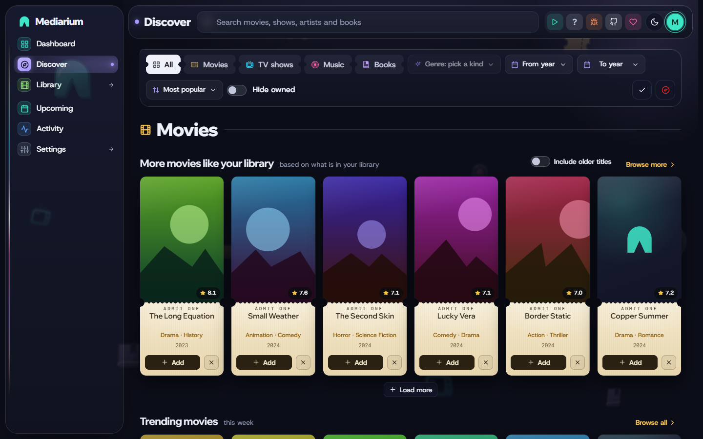
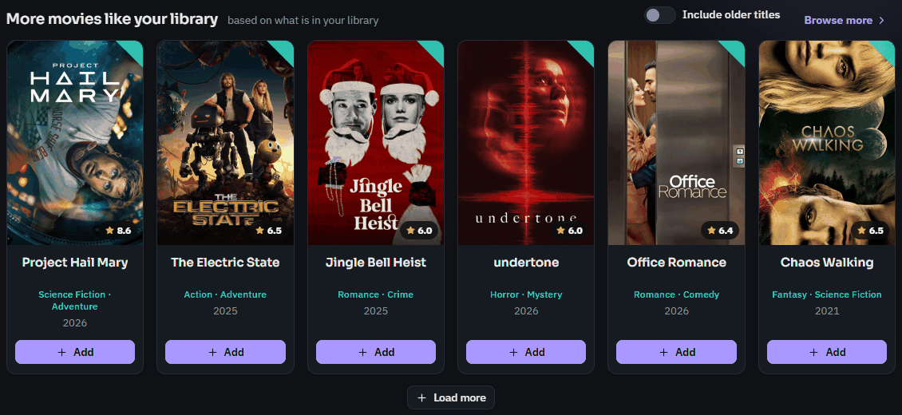

# Discover and adding titles

**Discover** is for when you don't know what to add. It has rails for what's trending, popular and coming soon, and a row of titles like the ones you already have. Every poster has an **Add** button. Titles you already have say so and open their page. **Browse all** and **Browse more** open a list on its own page, in pages of whole rows with **Previous**, page numbers and **Next**.

At the top, **All**, **Movies**, **TV shows**, (with the Music module on) **Music** and (with ebooks or audiobooks on) **Books** choose what you see. **All** has a section for each kind that is switched on, in that order: Movies, TV shows, Music, Books. The Books tab is described in [books.md](./books.md#finding-books-on-discover). Each section has its own title and line, and only holds its own kind. Every tab has the same row of filters: **Genre**, **From year**, **To year** and **Order** (Most popular, Highest rated, Newest first, Oldest first; music has no Highest rated), and on Music also **Type** (Albums, EPs, Singles). Picking one turns the rails into one filtered list. Genre needs a single kind, so it waits on **All**. **Clear filters** puts them back. The **Hide what I have** switch leaves out titles already in your library, and the choice is remembered in this browser. In a filtered list it reads on until the page is full of titles you don't have, so hiding a lot doesn't leave gaps; if everything that matches is already yours, it says so. The list button at the end of the row (**Import a Trakt list**, an icon on its own) takes the address of any public Trakt list and shows what's on it, with **Add** buttons. It uses the Trakt Client ID from **Settings > Library and files > Movie and show info**.

*Discover. The rows for movies and shows like your library come first.*

## More filters for movies and TV shows

The **Movies** and **TV shows** tabs have a **More filters** row under the filter bar. It is closed until you open it, and its header says how many of these filters are on. A link with one of them in it opens it by itself. They work together with genre, years and order, and **Clear filters** clears them too.

- **Original language** is the language the title was first made in: English, Korean, Japanese and the other common ones come first, then every other language by name. The names are shown in the language Mediarium is set to. It is not the same as the language Mediarium shows titles and summaries in (**Settings > Library and files > Movie and show info**): that one changes how a title is written on screen, this one decides which titles are listed. Chinese is Mandarin and Cantonese has its own entry.
- **Lowest rating** is **Rated 6+**, **7+** or **8+**. Titles with very few votes are left out (fewer than 100 for movies, 50 for shows), otherwise a title with one ten-star vote would come first.
- **Runtime** is **Under 90 min**, **90 to 120 min** or **Over 120 min**. For shows it is the length of an episode.

The list's heading says what is picked, for example *Shows in Korean from 2020 to 2026, rated 7+*. The choices live in the address (`language`, `minRating`, `runtime`), so a reload or a shared link shows the same list. They are only for the Movies and TV shows tabs, not for **All**, Music or Books.

For scripts: `GET /api/discover/browse?kind=movie|tv&language=ko&minRating=7&runtime=over120` takes the same choices. `language` is a two or three letter code in lower case, `minRating` is 6, 7, 8 or 9 and `runtime` is `under90`, `90to120` or `over120`. Anything else is answered with a 400 and an explanation.

## Hide what you already stream

Under the filters, **Streaming services** lets you pick the services you already pay for: Netflix, Prime Video, Disney+, Max (HBO), Apple TV+, Paramount+, Hulu and Peacock. With **Hide titles on my services** switched on, Discover leaves out every movie and show you can watch on those services in your country, so a service's own originals do not crowd the lists either. The switch is off to begin with, and it works on the All, Movies and TV shows tabs. Your picks and the switch are kept with your account, so they follow you to every browser and device, and each person on the server has their own. The open section's summary says what is being hidden. If an older version had remembered your pick in this browser, it is moved to your account the first time you open Discover (with sign-in switched off there is no account, and the browser keeps it).

Your country is the one used for release dates (see below). Titles that are not out yet are still shown, because no service lists them yet. Trending and Popular stay TMDB's own charts, in the same order: the titles on your services are taken out and the gaps are filled with the ones that follow, so the list is the normal list minus what you have. TMDB cannot filter those two charts itself, so Mediarium asks it where each title can be watched in your country, once per title, and remembers the answer for a few hours. A page of the list needs at most four pages of the chart, and the first time you open a list with the switch on it can take a moment longer than usual. If TMDB cannot say where a title is shown, the title stays in the list. The browse list, Upcoming and the filters use TMDB's own filter. "More like your library" is not filtered.

For scripts: add `hide=netflix,disney` to `GET /api/discover/browse` or `GET /api/discover/list`. The names are `netflix`, `prime`, `disney`, `max`, `apple`, `paramount`, `hulu` and `peacock`; anything else is answered with a 400. Your saved choice is `GET` and `PUT /api/auth/discover-services` with `{"services": ["netflix"], "on": true}`; the app asks for it itself, so `hide` is only needed when you call the lists directly.

## More like your library

This row asks the movie database what relates to your titles, merges the answers, and lists the best ones. It shows when your library has at least one movie or show and a movie database key is set (Settings > Library and files > Movie and show info).

*The movies row. Titles you already have are left out.*

- **Based on your library.** Each visit it picks up to 10 of your 40 most recently added movies (or shows), a different mix from day to day, and asks for the titles related to each.
- **Recent and popular come first.** A title scores higher the more recent and popular it is, and the more of your titles point to it. Titles with a poster come before titles without one.
- **Recent means the last 15 years.** Only titles from this year and the 15 years before it are listed, so a library of classics doesn't fill the row with films from the 1970s. Switch on **Include older titles** to see the rest. They come after newer ones of the same standing. The switch is remembered in this browser.
- **Nothing you already have is listed.** Once you add a title, its card turns into **In library** and it drops off the list the next time it loads.
- **Movies and shows apart.** With **All** selected, the Movies section has a row of movies and the TV shows section a row of shows. With **Movies** or **TV shows** selected there's one row. **Browse more** opens the full list for that kind, with its own Movies and TV shows buttons and the same **Include older titles** switch.

For scripts: `GET /api/discover/list?kind=movie|tv&list=similar&page=1&older=true` returns the same page shape as the other lists (`results`, `totalPages`, `totalResults`), at most 200 titles. `older=true` lifts the 15-year limit. `GET /api/discover/for-you` still returns the first 20 movies of the same ranking.

## Your Plex watchlist

Anyone can connect their own Plex account under **Plex watchlist** on **Settings > People and access > Linked services** (**Connect my Plex watchlist**, then approve it in the Plex window that opens). From then on:

- **What you add to your Plex watchlist, in any Plex app, comes to Mediarium by itself.** Mediarium checks every 20 minutes. Movies and shows are added and searched for straight away, the same as pressing **Add**. For an account that has to ask (**Add titles themselves** off), they become requests for an administrator instead, under **Activity > Requests**.
- **What was already on the list when you connected** isn't added in one go. It shows at the top of Discover as **Your Plex watchlist: movies** and **...: shows**, with the usual **Add** buttons.
- A title already in the library is left alone, and each title is handled once: taking it off the watchlist and putting it back doesn't add it again.
- An account that an administrator has turned off, or that is a read-only viewer, adds nothing from its watchlist. The card shows why.
- **Check now** looks straight away; switching off **Add what I add to my watchlist** stops it without disconnecting, and **Disconnect** forgets the Plex account.

Mediarium keeps your Plex sign-in encrypted and only uses it to read your watchlist. Watchlists live with your Plex account, not on a Plex server, so this works whether or not you connected a Plex server, and with Jellyfin or Emby too.

## The page of a title you don't have yet

Click a poster or title in Discover, a result in the search box at the top, or a result on the Search page, and a title you don't have opens its own page: a big poster, the title and year, the age rating, runtime, rating, genres, the tagline and the full summary, the trailers (Trailer 1, Trailer 2, Teaser and so on), links to the film's website, IMDb and TMDB, the director and writers (or the creators of a show), and the cast with their photos, each of them a link to that person's page (see People below). A show also lists its seasons with the number of episodes in each, and its network and the studios behind it (movies list their studios too). A movie also shows when it is in cinemas and when it comes out digitally, with how long that is from now when the date is still ahead; a date that has not been announced says so. The dates are the ones of your country. Pick it under **Settings > Library and files > Movie and show info > Country for release dates**; left on **Same as the info language**, it comes from the language you read titles in (German gives Germany, English gives the US). When your country lists no date, the US date is shown with (US) next to it, and when the US has none either it says Not announced. A date is never taken from any other country. All of it is fetched from TMDB when you open the page and kept for ten minutes. It has none of the parts that only make sense for something in your library (what happened, files, subtitles, better copies), and one big **Add to library** button that opens the Add dialog below. Titles you already have open their normal page.

**Trailers open in a pop-up.** A click on Trailer 1, Trailer 2 and so on plays it in a box over the page (from `youtube-nocookie.com`, and only once you pressed it); **Open on YouTube** in the box, or a Ctrl-click on the link, opens it on YouTube itself.

**Trailer behind the page.** A title page plays its first trailer by itself, muted (or with sound, see below), in place of the still picture (like a streaming service's title page), a moment after it has opened, across the whole width of the page behind the text. The picture fades back in as the trailer nears its end, and a **Sound on** button sits beside the trailer links. The video is loaded from YouTube (`youtube-nocookie.com`), so YouTube sees that you opened the page. An administrator can switch it off for everyone under **Settings > Library and files > Movie and show info > Trailers** (`trailerBackground` in `PUT /api/settings`, on until set to false). The switch below it, **Start the trailer with its sound on** (`trailerSound`, off until set to true), asks the browser to unmute it once it plays; browsers only allow that after you have clicked something on the page, and when it refuses the trailer carries on muted. Each browser can turn the trailer and its sound on or off for itself with the two small icon buttons next to the trailer links (a film strip and a speaker), which that browser remembers and which win over the server's choices. It stays off for anyone whose system asks for reduced motion or for data saving. If no trailer will play, a short note under the trailer links says why. The browser keeps a small log of what the player reported in its own storage (`mediarium-trailer-log`), for finding out why one doesn't start; it is never sent anywhere.

Search results (the box at the top, Discover and the Search page) list the newest year first. When two shows in the results share a name, each shows its country or year after the title, such as Shameless (UK). Results whose title starts with what you typed come before the rest, so a 2026 remake is above the 2022 film with the same name; releases from the same year keep the order the movie database gave them. Books are ordered the same way by year, and artists with the same name and score are listed with the newest first.

For scripts: `GET /api/tmdb/movies/{tmdbId}` and `GET /api/tmdb/tv/{tmdbId}` return all of this, and any account can read them. A movie carries `releaseDates` (`cinema` and `digital` as `YYYY-MM-DD`, `region`, and `cinemaRegion` or `digitalRegion`, which is only ever `US`, when a date came from the US because your country lists none), `directors`, a show `creators` and `seasonList` (`number`, `name`, `episodes`, `airDate`), and both `cast` (up to 30, in billing order, each with the person's `id`), `crew` (the directors and writers of a movie, the creators of a show, with `id` and `job`) and `trailers`.

## People

The cast, the directors, the writers and the creators on a title page are links. The **Cast** card shows the first twelve people with their photo, name and role, and **Show all** lists the rest. The same cast card also shows on the page of a movie or show you already have. Click a name, in the cast or in the **Starring**, **Director**, **Writer** and **Creator** lines at the top, and you get that person's page.

The person page shows their photo, name, when and where they were born (and when they died, if they did), a short biography that folds up when it is long, and links to IMDb and TMDB. Below that are the movies and the TV shows they worked on, as the same cards Discover uses: most popular first, newest first among equals. A title you have shows its state and opens your page for it; any other title has the usual **Add** button. When the person has worked in more than one way, **All**, **Acting**, **Directing** and **Writing** at the top narrow the list to one kind of work (the choice is kept in the address). A long list shows 60 titles at first, with **Show more** for the next 60.

The biography is in the language you picked under **Settings > Library and files > Movie and show info**; where TMDB has no biography in that language the English one is shown. A person without a photo gets their initial, and one without a biography simply has no biography. Everything on the page comes from TMDB and is kept for six hours.

For scripts: `GET /api/tmdb/people/{id}` (any account can read it) returns `name`, `biography`, `birthday`, `deathday`, `placeOfBirth`, `photoUrl`, `imdbId`, `workKinds`, and `movies` and `shows`, each a list of Discover items with `roles` (`acting`, `directing`, `writing` or `other`) and, for acting, the `character`.

## The Add dialog

**Add** on a title opens the Add dialog: the quality profile, what to monitor, where to download from, and whether to start searching now.

- **Monitoring.** A movie is **Monitored** (searched for and downloaded) unless you change it to **Not monitored**. For a show, **Which episodes to monitor** starts on **All episodes**. The other choices are **Only episodes that haven't aired yet** and **None**. For a show already in your library, the same three choices are on its page ([library.md](./library.md)). Untick **Start searching for it now** (**Start searching for missing episodes now** for a show) to skip the first search. The box is greyed out while no indexer is set up.
- **Starting choices.** If you always untick the same things, set them once in **Settings > Finding releases > Automation > When you add a title**: **Monitor new titles by default** and **Start searching when a title is added**. Both are on at first. They only decide what the dialog starts with, so you can still change them for each title. Requests from members and import lists use their own settings. In the API they are `library.add_monitored` and `library.add_search_now` (`addMonitored` and `addSearchNow` in `PUT /api/settings`).
- **Keep looking for better versions after it is downloaded.** Tick it and Mediarium swaps the title for a better release when your quality profile allows it. Left off, the title stays as first downloaded. The choice is remembered in this browser, and you can change it for a single title later, on its page, under **Better versions**.

For scripts: `POST /api/movies` and `POST /api/series` take `noUpgrade`. Left out, it's `true` (better versions off). Send `false` to look for better versions. A title added by grabbing a release from a search also starts with better versions off.

## Adding many titles, and Not interested

- **Select** (the tick button at the end of the filter row, next to the Trakt list button) turns Discover into a picking mode: each poster gets **Pick**, and a bar at the top counts what you picked. **Add N titles** adds them all with the usual defaults (monitored, the default quality profile, and a search straight away). **Done** leaves picking mode.
- The **x** next to **Add** on a poster means **Not interested**: that movie or show is never shown on Discover again. **Not interested (N)** at the top lists them, each with **Show again**. In picking mode, **Not interested** does the same for everything picked. The list is shared by everyone using this Mediarium, so only administrators and accounts that may add that kind of title themselves (without asking) can change it. Scripts: `GET /api/exclusions`, `POST /api/exclusions` with `{"kind": "movie", "tmdbId": 603, "title": "Night Harbour"}`, and `DELETE /api/exclusions/{kind}/{tmdbId}`.
