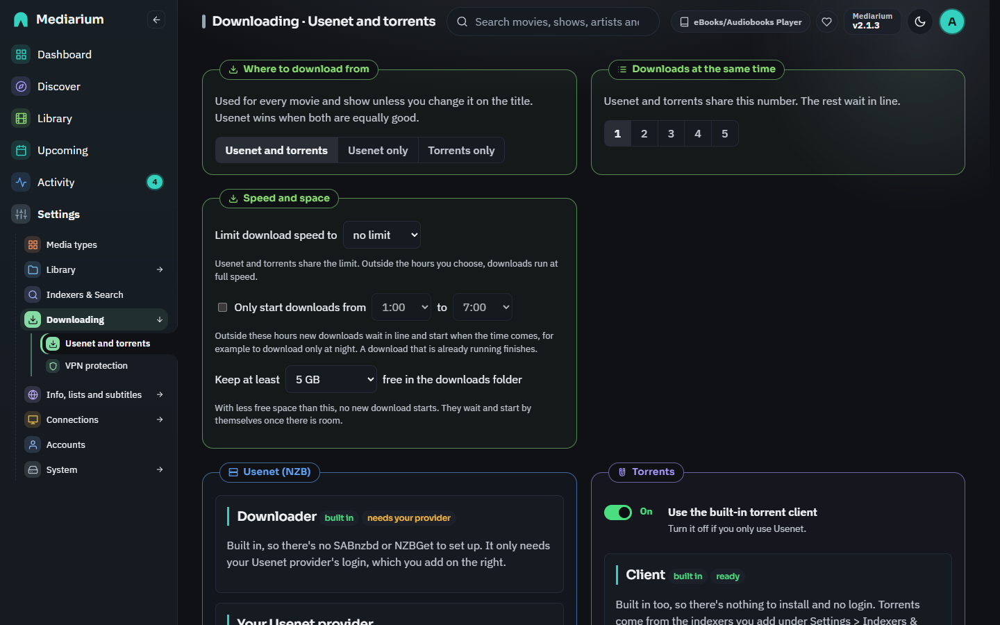
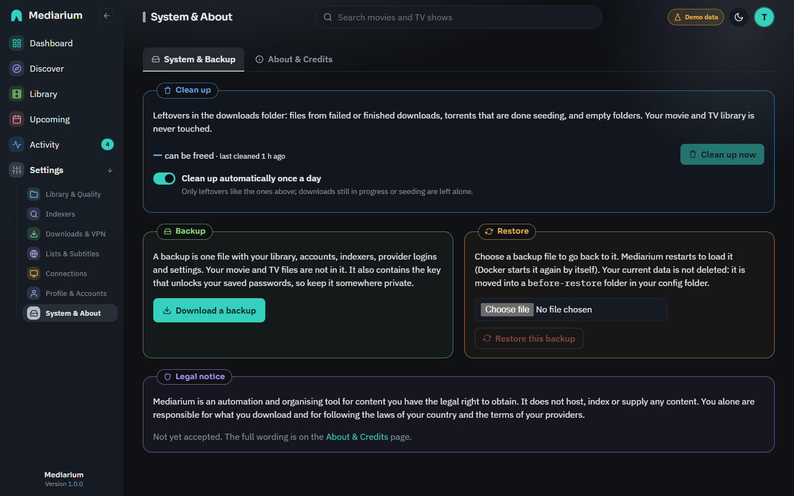

# Downloads

How Mediarium's built-in downloaders use your network and disk: the torrent port, seeding, debrid services and external download clients, what happens to downloaded files after they're imported, the clean-up, and what removing a title deletes.



*Settings > Downloading: the Usenet page (the built-in Usenet downloader, waiting for a provider here) and the Torrents page (the built-in torrent client).*

## The Downloading pages

Settings > Downloading has four pages: **Usenet**, **Torrents**, **VPN and proxy** and **Download rules**. The cards below are on **Download rules**, **Usenet** and **Torrents**. The settings in [Speed and space](#speed-and-space) and [Checks on releases](#checks-on-releases) are on Download rules (the age of Usenet posts is on the Usenet page), and you can [add a download by hand](activity.md#add-a-download-by-hand) from Activity.

- **Where to download from** (Download rules): **Usenet and torrents**, **Usenet only** or **Torrents only** for every movie and show. You can change it for a single title when you add it or on its page. When a Usenet release and a torrent release are equally good, Usenet wins. Choosing Usenet only also switches the torrent client off.
- **Downloads at the same time** (Download rules): how many downloads run together (1 to 500). See [below](#downloads-at-the-same-time-the-download-line).
- **Usenet (NZB)** (Usenet page): the built-in downloader needs only your provider's login. **Add your Usenet provider** takes the server address, port, username, password, number of connections and whether to use SSL. Press **Test connection** first. With SSL on, the server needs a certificate a public authority vouches for: a self-signed one is refused, and the test says so in plain words ("The server's certificate isn't trusted ..."), as it does for a certificate made out to another name or one that has expired. **Add server** (or **Save server**) works once the test has passed. Each server has **Test**, **Edit**, **Disable** and **Remove**. A second server (**Add a backup provider**) is used for articles your main one is missing. Priority 0 is the main provider, higher numbers are backups.
- **Torrents** (Torrents page): the switch **Use the built-in torrent client**, **Client settings** (listen port, seed ratio limit, seed time limit; press **Save**), **Stalled torrents**, **Torrent options** (the router port, new torrents in order, upload limit, categories), a **Debrid service** and **Use your own torrent client**. The Download clients tab in Activity shows the router port and links here.

## Torrent port (58264)

All torrents run in one built-in engine that listens on **port 58264, TCP and UDP**. The port is in the range never assigned to any service (49152 to 65535), so it's unlikely to clash with anything else, and it's easy to remember next to the web interface's 8264.

- **It's optional.** Torrents download without it, because Mediarium connects out to peers either way. Publishing the port lets other peers connect **to you** too. That finds more peers (faster downloads, fewer stalled torrents) and lets you seed properly.
- **Docker:** the compose files in this repository publish it for you:
  ```yaml
  ports:
    - "8264:8264"
    - "58264:58264/tcp"
    - "58264:58264/udp"
  ```
  With `docker run`, add `-p 58264:58264/tcp -p 58264:58264/udp`. Keep the same number on both sides of the colon.
- **Router:** for peers on the internet to reach you, the port has to be open on your router. Mediarium asks the router to do it with UPnP and then NAT-PMP, and the torrent client card says what came of it (see [Opening the port on your router](#opening-the-port-on-your-router)). If no router answers, forward port 58264 (TCP and UDP) to the machine running Mediarium yourself, as you would for any torrent client.
- **Changing it:** Settings > Downloading > Torrents > Client settings > Listen port (stored as `torrent.listen_port`). If you change it, publish the new number instead (for example `51413:51413/tcp` and `/udp`). `0` means 58264 (the box says "0 = the default, 58264"). Installs that had saved `0` (which used to mean "any port") now use 58264. A port you saved yourself is kept.
- **If the port is taken** by another program on the same machine, the engine falls back to a port the system picks and says so in the log. `GET /api/downloads/status` then reports the port in use as `torrent.activePort`.
- **Is it working?** The Client card says so in plain words: whether the port is open right now, and whether another peer has connected to you yet. The same facts are in `GET /api/downloads/status` (`torrent.listenPort`, `torrent.listening`, `torrent.activePort`, `torrent.activeTorrents`, `torrent.incomingSeen` and `torrent.lastIncomingAt`). The engine only listens while a torrent is downloading or seeding, and a peer only connects when it wants a torrent you have. So "not seen yet" right after starting is normal. If it still says that after a while of seeding, the port is probably not reachable: it isn't published, it isn't forwarded, or a firewall is blocking it.
- **While a VPN is connected** (Settings > Downloading > VPN and proxy; see [vpn.md](./vpn.md)), torrent traffic only goes out through the tunnel and nothing listens on the host at all, so no incoming connection is ever seen. That's expected, and the port card says "Not used while your VPN is on".

### UDP trackers and DHT

While a VPN is connected, **UDP trackers and DHT through the VPN** (Settings > Downloading > VPN and proxy, `vpn.discover_through_tunnel`) is off until you turn it on. The setup wizard offers the same switch, and after an update it is listed in What's new.

- **Off:** announces to `udp://` trackers and DHT queries are skipped. HTTP trackers still work, which is why a torrent that lists only UDP trackers stays at 0 B/s until the VPN is disconnected.
- **On:** those announces and DHT queries leave through the tunnel, so peers and trackers see the VPN address. The tracker and DHT names are looked up through the VPN's DNS, not on your home connection. The connection needs DNS servers (the same field as for indexers). If a name cannot be looked up that way, or the tunnel cannot open its UDP socket, nothing is sent from your home address.
- A download that has already started keeps the choice it started with until you retry it. uTP stays off, and nothing listens for incoming peers.
- A SOCKS or HTTP proxy cannot carry this UDP, so with only a proxy the trackers and DHT stay off.

The same rules are written out in [vpn.md](./vpn.md#udp-trackers-and-dht).

### When torrents are switched off

Torrents are on unless you switch them off (or choose **Usenet only**). While they are off, a torrent release can't be downloaded, and Mediarium says so before you try. A release list (**Choose a release**, or Search > Releases) that holds torrent releases starts with a line: *Torrents are switched off, so torrent releases can't be downloaded.* An administrator sees a **Switch on torrents** button next to it, which does the same as turning on **Download from torrents** on the Torrents page (and leaves **Usenet only**). Everyone else sees *Ask an administrator to switch torrents on.* After switching on, the line tells you to press the release's **Grab** button again.

If you grab a torrent release anyway, the message *Torrents are switched off. Switch them on in Settings > Downloading > Torrents to download torrent releases.* comes up with the same button (administrators get a **Grab now** button once torrents are on). A download that failed for this reason shows the same line in Activity, with the button, and the row's **Retry** works once torrents are on. A torrent release found on an IRC announce is skipped while torrents are off, and the announce log says why.

For scripts: that refusal is HTTP 409 with `{"error": "...", "code": "torrents_off"}`. `GET /api/modules` has `torrentsOn`, true when torrent releases can be downloaded at all (the built-in client, a debrid service or a download client).

## Controls of the built-in torrent client

These are for the built-in torrent client only. Torrents that go to a debrid service or a download client are steered there. Everything below is off, or the same as before, until you change it. The options for all torrents are on **Activity > Download clients**, in the torrent client card, under **Torrent client options**. The choices for one torrent are under **Details** on its row in Activity. Only administrators see them.

### Choosing files

A torrent often holds more than the film or episode you want: samples, notes, extras, or the other episodes of a season pack. Open **Details** on a torrent that is downloading and you get its list of files, each with a tick box, its size and how much is there. Untick a file and it is not downloaded. Tick it again and it is. You can do this while it downloads. At least one file has to stay ticked. Once the download is finished the list is only for reading.

- **Leave out samples and notes** is on by default (`torrent.skip_junk`). When a torrent is added, these are left out: sample clips (a short video called sample, or anything small in a folder called Sample), and `.nfo`, `.txt`, `.exe`, `.url` and `.lnk` files. A `.txt` file is kept in a book, where it can be the book. A file you tick yourself stays ticked. If everything in a torrent looked like junk, nothing is left out.
- **Only the wanted season of a pack** is off by default (`torrent.pack_only_wanted`). When it is on and Mediarium grabbed a pack for one season of a show, files that say they belong to another season (or to the specials) are left out, found by `S02E05` in the file name or a folder called `Season 2`. When it grabbed a single episode, other episodes of the pack are left out too. A file whose name says nothing about the season stays. If no video in the pack can be matched to the season, nothing is left out.
- Pieces that two files share are still downloaded, so a file you left out can be partly on disk. It is never imported.
- **Importing a partial pack works.** The files you left out are not imported. The episodes the pack did not deliver go back to wanted, as they do for any pack that is missing something.
- Your choice is kept while the download is paused or after a restart, and the seeding ratio counts against the size of what was downloaded.

### Download in order

**Download new torrents in order** (`torrent.sequential_default`, off by default) asks for the pieces from the first to the last, so a video can be played while it downloads. The first piece of every file and the last piece of the file being read are asked for early too, because many video files keep their index at the end. Each torrent has its own choice under Details: **Use the default**, **On** or **Off**. It is a little slower than the usual order, which favours the rarest pieces, and a torrent downloaded in order is harder on the peers that have it, so leave it off unless you want to preview.

### Speed limits

- **Per torrent:** under Details, **Download KB/s** and **Upload KB/s** limit one torrent. Empty means no limit of its own. The torrent is held back whenever it has taken more than its share, so its speed stays near the limit on average, but it can come in bursts and a limit below about 50 KB/s is rough.
- **Upload limit for the whole client:** **Upload limit (KB/s)** in the torrent client card (`torrent.upload_limit_kb`). Empty means no limit, which is the default. `0` switches uploading off completely: the built-in client stops sending data to anyone, while downloading keeps working. A fraction or a negative number is refused. Some trackers need you to share, and private trackers may ban accounts that don't seed, so use `0` with care. It is separate from the download limit in Settings. The hours you set for the download limit ("Only from ... to ...", see [Speed and space](#speed-and-space)) also decide when the upload limit applies.
- The limit of a torrent, the upload limit and the download limit all apply together, and the slowest wins.

### Categories and save folders

A category files torrents in a folder of their own. Under **Categories** in the torrent client card, add a name and, if you like, a folder name, then pick which category each kind of download gets: **Movies**, **TV shows**, **Music** and **Books**. With none picked (the default) torrents are saved in `incomplete/queue-N` as always.

- With a category, a torrent is saved in `incomplete/<folder>/queue-N`, inside the downloads working folder, for example `incomplete/movies/queue-12`. The folder is made when the first torrent needs it. A category without a folder name uses the working folder itself.
- A folder name is one plain name: no `/`, `\`, `:` or the like, and it can't start with a dot or with `queue-`. Two categories can't share a folder, and there can be 12 categories.
- The category is chosen when a torrent starts, and kept: changing the categories later never moves a download that is already running or paused.
- Activity shows the category next to the word torrent on each row, and under Details.
- The [clean-up](#clean-up) looks inside the category folders and removes a folder once nothing is left in it.

### Seeding rules for one indexer

Private trackers have their own rules. On **Settings > Indexers & Search**, a torrent indexer has **Seeding rules**: **Seed until ratio** and **or for hours**. A torrent from that indexer stops seeding at the first of the two that is reached. With an [external download client](#how-a-download-goes), the limits are sent to the client when the torrent is added and the client enforces them. An empty box follows the global limit (`torrent.seed_ratio_limit` and `torrent.seed_time_limit_h`). `0` means don't seed at all, even when the global limit would let it. To have no limit of that kind even when the global one has a limit, type `unlimited` (the API holds it as `-1`). A rule applies to torrents that start downloading after you save it. Mediarium remembers which indexer a release came from when it is grabbed, whether you picked it in a search or the feed check or a scheduled search did. A torrent that came from no indexer (a magnet link you pasted, or a search too old to remember), or from one without a rule, uses the global limit.

### Opening the port on your router

**Open the port on my router** (`torrent.port_mapping`, on by default, as the built-in client always did) asks the router to forward the listen port to this machine, so peers can connect to you. It tries UPnP first and NAT-PMP if no UPnP router answers. The torrent client card shows the answer next to **Router port**:

- **open:** "the router forwards port 58264 (UPnP)", or NAT-PMP. If the router gave another port, that one is shown.
- **not mapped:** no router opened the port. Forward it yourself if peers can't reach you.
- **not used:** the switch is off, or a VPN or proxy carries the torrent traffic (nothing listens on your home connection then).
- **checked when the first torrent starts:** the client only runs, and so only asks, while a torrent downloads or seeds.

The request is made when the client starts and the port is taken off the router when it stops. Routers answer UPnP and NAT-PMP only to machines on the same network, so inside Docker's default bridge network no router is usually found. Run the container with host networking if you want this, or forward the port yourself as described above. Switching the option off removes the mapping at once. `GET /api/downloads/torrent-options` returns the result as `portMapping` (`state`, `method`, `port`, `externalIp`).

**Let torrents use trackers on my own network** (`torrent.allow_local_addresses`, off by default) decides whether the trackers, web seeds and magnet addresses a torrent names may be on your home network or on the machine Mediarium runs on. A torrent can name any address, so by default these are refused (and so is a UDP tracker at such an address). Turn it on only if you run a tracker or web seed at home, over a LAN or Tailscale. It applies when Mediarium restarts. Peers are not affected: other computers on your network can still send and receive pieces. The answer from an HTTP tracker is also read only up to 1 MB, which is far more than a real tracker sends. `allowLocalAddresses` in `GET`/`PUT /api/downloads/torrent-options`.

### For scripts

Administrators only: `GET` and `PUT /api/downloads/torrent-options` (`sequentialDefault`, `skipJunk`, `packOnlyWanted`, `uploadLimitKB`, `portMapping`, `categories`, `categoryByKind`), `GET` and `PUT /api/queue/{id}/torrent` (`sequential` as `default`, `on` or `off`, `downLimitKB`, `upLimitKB`), `PUT /api/queue/{id}/torrent/files` (`skip`, the list of file paths to leave out), and `GET /api/indexers/seed-rules` with `PUT /api/indexers/{id}/seed-rules` (`ratio`, `hours`; `null` follows the global limit, `0` is don't seed, `-1` is no limit). In `torrent-options`, `uploadLimitKB` is `null` for no limit and `0` for no uploading; send `-1` to clear the limit.

## Usenet connections

Your Usenet provider lets each login open only so many connections at once, and your plan says how many. Mediarium keeps to the number you set on the server for all downloads together, so two downloads at once share it. A new server starts at 10. Raise it once you know your plan allows more.

If the provider says "too many connections" (usually because another program, like SABnzbd, uses the same login), Mediarium lowers the number for the rest of the session, waits a little and tries again, so the download carries on. After several minutes of being refused it stops, and the queue says: "Your Usenet provider says there are too many connections on this login. If another program (like SABnzbd) uses the same account, stop it or lower the number of connections here." The **Test** button says the same. The number it settled on is in the report from **Copy for support** (Settings > System > Logs and errors).

**Find the right number.** Under each Usenet provider in Settings > Downloading > Usenet, **Find the right number** opens connections to it one at a time, up to the number you set, until the provider says there are too many, then closes them again and tells you how many it let in. If that is fewer than you set, **Use N** sets it for you. If the provider refuses even the first connection, something else is holding the login (another program, or a Mediarium from a few minutes ago; providers take a while to notice a closed connection), and the message says so. It won't run while a download is using the server (`POST /api/usenet-servers/{id}/probe`, administrators only; answers `accepted`, `requested`, `refused` and a `message`).

When the provider keeps refusing connections, the dashboard's **Needs your attention** list also says so ("news.example.com allows fewer connections than you set", with a button to the test), for twelve hours after the last refusal.

Using SABnzbd or NZBGet instead? See [SABnzbd and NZBGet](#sabnzbd-and-nzbget).

Connections close when a download finishes, fails or is cancelled, and when you remove or switch off a server or change its address or login. Lowering the number of connections takes effect at once, even for a download that's running.

## What is checked when you save

Every field in Settings points out a mistake under the box when you leave it, or when you press the button, before anything is sent. The server checks the same things, so a script can't save a value the page would refuse.

- **Usenet servers:** the server is a bare host name or IP address (`news.example.com`, no `https://`, no port and no path), the port is 1 to 65535, connections are 1 to 100 and the priority is 0 to 99. A username and password go together.
- **Torrents:** the listen port is 0 (use the default) or 1 to 65535, the seed ratio is 0 to 1000 and the seed time is 0 to 87,600 hours. 0 means unlimited for both.
- **Downloads at the same time:** a whole number from 1 to 500.
- **VPN:** the endpoint is `host:port` with a port from 1 to 65535, the two keys are 44-character WireGuard keys, and the tunnel address is an IP address with an optional `/prefix`.
- **Folders:** each folder must be a full path, starting with `/`, a drive letter such as `D:\`, or a network path such as `\\server\share`. A custom movie file name must include the movie's title and an episode file name its season and episode; both use only known tokens and can't contain `/` or `\` (see [library.md](./library.md#file-names)).

Only what you change is checked, so a value an older version saved never stops you saving something else.

## Debrid services (Real-Debrid, TorBox, Premiumize)

Instead of downloading torrents here, Mediarium can hand them to a debrid service. The service downloads the torrent on its own servers, and Mediarium then downloads the finished files from it over https into the download's folder, where unpacking and import work as for any other download.

- **Set up:** Settings > Downloading > Torrents > **Debrid service**. Pick **Real-Debrid**, **TorBox** or **Premiumize**, paste your API key (Real-Debrid: real-debrid.com/apitoken; TorBox: torbox.app/settings; Premiumize: premiumize.me/account), press **Test** to see the account and when its premium ends, then **Save**. Most downloads need a premium account.
- **The built-in torrent client can stay off.** Torrent sites are still searched while a debrid service is set, and torrent releases go to the service. No torrent traffic leaves your home, nothing is seeded from here, and the VPN for torrents isn't needed for them. Seeding settings don't apply.
- **Progress:** the first half of the bar is the service downloading the torrent, the second half is Mediarium bringing the files home. A download that was paused or interrupted carries on where it stopped, also after a restart, without adding the torrent to the service again.
- **When the service gives up** (no one sharing it, a dead or harmful torrent), or nothing moves there for 6 hours, the release is blocklisted and, with automation on, the next-best one is tried, as with a stalled torrent.
- Samples, notes and (when that is set) other seasons of a pack are left out, as with the built-in client (see **Torrent options**). Before the files are brought home, Mediarium checks that the downloads folder has room for them and stops with a plain message when it doesn't.
- When the files are home, the torrent is removed from your account on the service, so it doesn't use up your slots.
- The service's API key is stored encrypted. Requests to the service go through the proxy set for indexers, if you have one (Settings > Downloading > VPN and proxy > Proxy).
- Mediarium never mounts anything or streams from the service: no special container permissions are needed.

### Premiumize

Premiumize works like the other two, with a few differences worth knowing.

- **Where to find the API key:** sign in at premiumize.me and open [premiumize.me/account](https://www.premiumize.me/account). The key is on that page. Paste it into the **API key** box. It is stored encrypted, like the other keys.
- **What the Test button does:** it asks Premiumize for your account (`/account/info`) and shows your customer number, the date your premium ends and how much of this month's fair-use limit is used. A wrong key is reported as such. A free account is accepted by the test, but Premiumize refuses most downloads on it.
- **Cached torrents are instant.** Premiumize keeps torrents other people already downloaded. When you grab one of those, Mediarium reads the file list straight away and starts bringing the files home, without adding anything to your account. Everything else becomes a normal transfer on your account, and the first half of the progress bar follows it.
- **Cached tags and ranking** work as for TorBox, see below.
- **Clean-up:** when the files are home, Mediarium deletes the transfer and the folder it made in your Premiumize cloud storage, so the finished torrent doesn't use up your space. Anything else in your cloud storage, and other transfers on the account, are never touched.
- **Limits and manners:** Premiumize has a monthly fair-use limit that every transfer counts against (the Test button shows how much is left). Mediarium asks for the list of your transfers at most once every 5 seconds, no matter how many downloads are waiting, and only while a torrent is waiting on Premiumize or the Activity page is open. If Premiumize answers "too many requests" (HTTP 429), Mediarium waits and tries again at the next check instead of giving up on the download.
- **When Premiumize gives up** (an error, a time-out, a banned torrent) the release is blocklisted with Premiumize's own message, as with the other services.
- **Private torrents** are your own call: some trackers forbid debrid services. Mediarium doesn't check.
- Requests go through the proxy set for indexers, if you have one, and only to premiumize.me, only while Premiumize is the chosen service.

### Releases that are already cached (TorBox and Premiumize)

TorBox and Premiumize keep torrents other people already downloaded. When you grab one of those, it is ready at once. They will tell Mediarium which torrents they have, so you can see them and have them preferred.

- **In the release list:** a green **Cached** tag on a release means TorBox or Premiumize (whichever you chose) already has it. Mediarium asks once per search, for the whole list, and remembers the answer for 5 minutes. A release with no tag is either not cached or not known: some indexers give no torrent hash, and a plain .torrent link is not downloaded just to find out.
- **In automatic searches:** among releases of the same quality, a cached one is picked before one that has to be downloaded first. The quality profile is applied first, so a release the profile would refuse is never picked for being cached, and a cached release of a lower quality never wins over a better one. The delay profile, size limits, blocklist and the order of your indexers and protocols work as before: a cached release is not treated specially there. Between two releases that score differently under the profile's preferred terms, the higher score still wins.
- **Settings > Downloading > Debrid service** (with TorBox or Premiumize chosen):
  - **Prefer releases TorBox already has** (or Premiumize) is on by default for both. Turn it off and Mediarium stops asking the service about torrents: no tags and no ranking, and no hashes are sent (`debrid.prefer_cached`).
  - **Accept a lower score for a cached release** is off by default. Turn it on and a cached release also wins over a higher-scoring one of the same quality (`debrid.cached_lower_score`). It still never wins over a better quality.
- **What is sent:** only the info hashes of the torrents in the results, to TorBox's `checkcached` call or Premiumize's `cache/check` call. Nothing else.
- **If the service is slow or unreachable,** the search carries on without the information, after waiting at most 5 seconds. Mediarium then leaves it alone for a minute before it asks again. A failed check never stops a search or a download.
- **Real-Debrid** has no cache check: it turned off its availability endpoint (`instantAvailability`) at the end of 2024, and its API documentation no longer lists it, so nothing is marked or preferred when Real-Debrid is the service.
- The tag shows in the release lists of movies, shows and books, and in the main search. Music release lists don't show it yet.

## Download clients (qBittorrent, Transmission, RDT-Client, Decypharr)

If you already run a torrent client, Mediarium can hand torrent releases to it instead of downloading them itself. It works with qBittorrent, with Transmission, and with programs that copy qBittorrent's web interface, such as RDT-Client and Decypharr. The client downloads the torrent into its own folder and can keep seeding it there. When it's done, Mediarium imports the files straight from that folder. It never moves or renames the client's files, and deletes them only when you stop or remove a download before it finished, or when you switch on removal after import (see [How a download goes](#how-a-download-goes)).

Torrent releases go to one place only: the built-in torrent client, a debrid service or a download client. Saving a download client turns the debrid service off, and saving a debrid service turns the download client off. The built-in torrent client can stay off: torrent sites are still searched while a download client is set.

**Set up:** Settings > Downloading > Torrents > **Use your own torrent client**. Pick the client, then fill in:

- **Address:** where you open its web page, for example `http://192.168.1.10:8080`. In Docker, use the client's container name if both are on the same network (`http://qbittorrent:8080`).
- **User name** and **Password:** the web login. Leave them empty if the client lets Mediarium in without one. The password is stored encrypted and never shown again.
- **Category:** torrents are added in this category (`mediarium` if you never set anything), so they're easy to find in the client. Each torrent also gets a tag like `mediarium-q12`, which is how Mediarium finds it again, with or without a category. You can clear this field: if you have filled in a category for some kinds and leave this one empty, a kind without its own category is added with **no category** at all. Only when this and all four kinds are empty is `mediarium` used.
- **Category for movies, TV shows, music and books:** optional. Fill one in to keep that kind of download in its own category (for example `movies` and `tv`), which is handy when the client moves finished files by category. An empty one uses the main category (or none, if you cleared that too, see above), so nothing changes if you leave them all empty. A torrent added earlier under the main category is still shown as Mediarium's. In Transmission the category is a label.

Press **Test** to check the address and login (it shows the client's version), then **Save**.

### qBittorrent

Use the address and login of qBittorrent's Web UI (Tools > Options > Web UI). Mediarium needs to see qBittorrent's download folder: mount the same folder into both containers. Mounting one parent folder (for example `/data`) into both, with the same path inside each, means no path mapping is needed and imports can use hardlinks instead of copies.

### Transmission

Pick **Transmission** and use the address of its Web UI, for example `http://192.168.1.10:9091` (in Docker, `http://transmission:9091`). Mediarium adds `/transmission/rpc` itself. If you set a user name and password in Transmission (`rpc-authentication-required`), enter them; otherwise leave them empty. Transmission needs to be **version 3.00 or newer**: Mediarium marks its torrents with **labels** (the category, and a tag like `mediarium-q12`), which older versions don't have. As with qBittorrent, mount the folder Transmission downloads to into the Mediarium container, and set the path mapping if the paths differ. If Transmission's `rpc-host-whitelist` is on, add Mediarium's address to it.

What Mediarium does with it: sends the magnet link or the torrent file, follows the progress, pauses, resumes and re-checks the torrent when you do in Activity (**Pause** on a download in the queue pauses the torrent in the client too, qBittorrent 4 and 5 alike, and **Resume** starts it again; a torrent you pause in the client yourself is left paused and isn't counted as stalled), and removes it after the import when you chose **Remove after import**. A tracker error in Transmission doesn't fail a download; a local error (disk full, files gone) does. I could only test this against a copy of Transmission's RPC, not a real Transmission, so please say how it goes.

### RDT-Client

RDT-Client sends torrents to Real-Debrid or another debrid service and downloads the finished files to its own folder. Add it with its address and login, and pick **RDT-Client**. If you set RDT-Client to download real files, nothing else is needed beyond the shared folder. If you use its symlink mode, set **Symlinks may point into** as for Decypharr below.

### Decypharr

Decypharr gives each finished torrent a folder of symlinks that point into its rclone mount of your debrid account. Mediarium refuses symlinks in downloads unless you say where they may point:

- Mount Decypharr's rclone mount into the Mediarium container at the **same path** Decypharr uses (for example `/mnt/remote`), and also into your media server's container, since the library gets links to it.
- Set **Symlinks may point into** to that mount, as Mediarium sees it (`/mnt/remote`).

A symlink is then imported as a new symlink to the same file, but only when the file it finally leads to is inside that folder. Links that lead anywhere else, through other links or `..`, are refused, and the download fails with a message saying so. Real files are imported the usual way.

### Path mapping

The client reports where it saved a torrent as it sees it. If it runs in another container or on another computer, that path can be different inside Mediarium. Fill in both fields:

- **The client's folder:** the folder as the client reports it, for example `/downloads`.
- **The same folder in Mediarium:** that folder as Mediarium sees it, for example `/data/torrents`.

A download the client saved at `/downloads/Movie.2024.1080p` is then looked for at `/data/torrents/Movie.2024.1080p`. Leave both empty when the paths are the same. When Mediarium can't see a finished download, it fails with a message that points here.

### How a download goes

- The magnet link or `.torrent` file is sent to the client. The progress bar follows the client's progress. Pausing in Activity leaves the torrent in the client; resuming picks it up again, also after a restart, without adding it twice. Stopping a download, or removing one that hasn't finished, takes the torrent out of the client too (see below).
- If the client says the torrent has an error, or nothing moves for 6 hours, the torrent is removed from the client with its files, the release is blocklisted and, with automation on, the next-best one is tried.
- When the torrent is done, the download's own folder (`incomplete/queue-N`) gets a link to each of the torrent's files. For a single-file torrent that's only that one file, never other files that sit next to it in the client's folder. Archives (RAR, ZIP, 7z) are unpacked into the download's own folder, not into the client's folder. Files are imported from the client's folder with a hardlink when possible, otherwise copied.
- Afterwards the download's own folder is cleaned up as usual. That removes only the links and what was unpacked, never the client's files.
- **When I stop or remove a download, remove it from the client too** is on by default (`downloadclient.remove_on_stop`, `removeOnStop` in `PUT /api/download-client`). When you stop a download in Activity, remove it from the list, remove its movie or show, or press **Blocklist & search again**, Mediarium also removes the torrent from the client, with what it downloaded, so you don't have to clean up there by hand. It only touches a torrent that Mediarium sent itself (it has the tag `mediarium-q12` for that download), and only one that hasn't finished downloading. A torrent that has finished stays and keeps seeding, a download that was already imported is never touched, and a torrent that was in the client before Mediarium sent it is left alone. **Blocklist & search again** removes the torrent even when it had finished, since that release is thrown away. Pausing never removes anything. If the client is down or no longer has the torrent, the download is removed from Mediarium anyway and nothing is shown; the reason goes in the log. Switch the option off to keep every torrent in the client when you stop or remove a download.
- **Remove from the client after import** is off by default, so the torrent keeps seeding as long as the client wants it to. Switch it on to have the torrent removed once it's in your library. Its files go with it, unless they are symlinks (the library's links still need them) or the torrent was already in the client before Mediarium sent it.
- **Seeding limits are sent to the client.** When Mediarium adds a torrent it also gives that torrent its seeding limits: the global ones (`torrent.seed_ratio_limit`, `torrent.seed_time_limit_h`) or, for a torrent from an indexer with [seeding rules](#seeding-rules-for-one-indexer), that indexer's. The client then enforces them itself. In qBittorrent they are the torrent's own share limits (ratio and seeding time in minutes), which you can see under the torrent's right-click menu, **Limit share ratio...**. Mediarium sends them in the add call and again with `setShareLimits` on the torrent's hash, so qBittorrent 4 and 5 both take them. A rule with only hours sends "no ratio limit" next to the time, so the time limit is enforced whatever ratio limit qBittorrent has itself. A kind that is empty is sent as "no limit"; with both empty Mediarium sends nothing and the client keeps its own defaults. A limit of `0` (don't seed) is sent as ratio `0`, so the client stops the torrent as soon as it has finished; what it does then (pause or remove) is its own setting. Transmission only gets the ratio, because it has no total seeding time (its idle limit is something different). RDT-Client, Decypharr and other programs that copy the qBittorrent API may ignore the limits; that never fails the download.
- **What happens when the limit is reached is the client's choice.** In qBittorrent that is a global setting, and Mediarium doesn't change it: to have qBittorrent remove the torrent (or pause it, or stop it) at the limit, set it in qBittorrent under Options > BitTorrent > Seeding Limits, **then** (pause, stop or remove torrent). This is separate from **Remove from the client after import**, which removes the torrent as soon as it is in your library, whatever its limits are. Limits are set when the torrent is added; changing a rule later doesn't change torrents already in the client.
- The VPN settings for the built-in torrent client don't apply: the client handles its own traffic.

## SABnzbd and NZBGet

Mediarium downloads from Usenet by itself and that stays the default. If you already run SABnzbd or NZBGet, you can have Mediarium hand Usenet releases to it instead. The downloader fetches, repairs and unpacks into its own folder, and when it is done Mediarium imports the files straight from that folder. It never moves or renames the downloader's files. They are only deleted when you stop or remove a download before it finished, or when you switch on removal after import (see below).

**Set up:** Settings > Downloading > Usenet > **Use SABnzbd or NZBGet** (the last card on the page). Pick the downloader, then fill in:

- **Address:** where you open its web page, for example `http://192.168.1.10:8080` for SABnzbd or `http://192.168.1.10:6789` for NZBGet. In Docker, use the container name if both are on the same network (`http://sabnzbd:8080`).
- **API key** (SABnzbd): in SABnzbd under Config > General. It is stored encrypted and never shown again.
- **User name** and **Password** (NZBGet): the `ControlUsername` and `ControlPassword` from NZBGet's settings (Security). Stored encrypted.
- **Category:** NZBs are added in this category (`mediarium` if you never set anything). It has to exist in the downloader already: in SABnzbd under Config > Categories, in NZBGet under Settings > Categories. That is also where its download folder is set. As with torrent clients, you can clear it when you fill in a category for some kinds: a kind without one then gets no category.
- **Category for movies, TV shows, music and books:** optional, to keep each kind in its own category and folder.
- **Priority:** low, normal, high or force, sent with every release.
- **Send Usenet releases to SABnzbd/NZBGet:** the switch that makes it the downloader. It is off until you turn it on, so you can save and test everything first. Off, or with no downloader chosen, the built-in downloader is used. Turning it on does not change what is already downloading.
- **Let it fetch the NZB file itself:** off by default. Mediarium then gets the NZB from the indexer, checks it (no programs or scripts in it, not the same NZB as an earlier download of the title, the other checks under [Checks on releases](#checks-on-releases)) and sends the file. On, only the link is sent, so the indexer's address, which holds your key, ends up in the downloader and Mediarium can't look at the file first. A release that only Mediarium can open (an indexer that needs its sign-in, or an NZB you uploaded) is always sent as a file.

Press **Test**. It says which part is wrong: that nothing answers at the address, that the API key or the login was refused, that the address is something else than SABnzbd or NZBGet, or that a category doesn't exist in the downloader (it names the category). On success it shows the downloader's version. Then **Save**.

The Usenet provider is then the downloader's business: Mediarium doesn't need a news server of its own while the switch is on, and the "No Usenet provider added" warning goes away.

### Path mapping

The downloader reports where it saved a finished download as it sees it. If it runs in another container or on another computer, that path can be different inside Mediarium. Fill in both fields, exactly as for a [torrent client](#path-mapping): **The downloader's folder** (for example `/downloads/complete`) and **The same folder in Mediarium** (for example `/data/usenet/complete`). Leave both empty when the paths are the same. Mounting one parent folder (for example `/data`) into both containers, with the same path inside each, needs no mapping and lets imports use hardlinks instead of copies. When Mediarium can't see a finished download, it fails with a message that points here.

### How a download goes

- The NZB is sent to the downloader with the category of its kind and your priority. Mediarium keeps the job's id in the download's own folder (`incomplete/queue-N`), so a restart or a retry picks the job up again instead of sending it twice.
- Mediarium asks every few seconds how it is doing. The progress bar follows the downloader's. Waiting, downloading, paused, "checking and unpacking" (repair and unpack) and done are shown the same way as for torrents, on the Queue tab and under Activity > Download clients.
- When the job is done, the download's own folder gets a link to each file in the downloader's folder, and the import goes on as for any download. Files are imported with a hardlink when possible, otherwise copied. Mediarium does not repair or unpack in the downloader's folder: the downloader already did.
- **If the downloader gives up** on a release (SABnzbd's history says Failed, NZBGet's says FAILURE or WARNING such as too many articles missing, a repair or unpack that failed, or a password), that is the release's fault: it goes on the [blocklist](#when-a-download-fails), the job is removed from the downloader with what it had, and with automation on the next-best release is tried, exactly as for a failure of the built-in downloader.
- The downloader's own trouble (a full disk, a folder it can't write to, NZBGet failing to move the files) is not held against the release. It is not blocklisted, the job stays in the downloader for you to look at, and the download fails with a message saying so. The same goes for a job deleted by hand in the downloader.
- **Pause** in Mediarium pauses the job in the downloader, and **Resume** starts it again. A download left paused in the downloader by hand keeps waiting there.
- **When I stop or remove a download, remove it from the downloader too** is on by default (`usenetclient.remove_on_stop`). Stopping, removing a download, removing its movie or show, or **Blocklist & search again** also removes the job from the downloader, with what it downloaded. It only touches a job that Mediarium sent and that hasn't finished. A finished job stays, and a download that was already imported is never touched.
- **Remove from the downloader after import** is off by default, so nothing is ever deleted there. Switch it on to have the job removed once it is in your library. SABnzbd deletes the finished files with it. NZBGet's API can only take the job out of its history, so its files stay in its folder unless NZBGet is set to clean up by itself.

Not supported: the downloader's own post-processing scripts are left to it, Mediarium doesn't change the downloader's settings, and the speed limit of Mediarium only applies to the built-in downloader. I could only test SABnzbd and NZBGet against copies of their web APIs, not the real programs, so please say how it goes.

Scripts (administrators): `GET` and `PUT /api/usenet-client` (the secrets are `apiKey` and `password`, write only), `POST /api/usenet-client/test`, `GET /api/usenet-client/jobs?scope=mine|all`, `POST /api/usenet-client/jobs/{id}/pause|resume|remove|remove-files`.

## Seeding

A finished torrent is imported straight away and keeps seeding in the background until its **seeding goal** is met: the seed ratio limit (`torrent.seed_ratio_limit`, uploaded divided by size, for example 2.0) or the seed time limit (`torrent.seed_time_limit_h`, hours), whichever comes first. A torrent indexer can have rules of its own, and a torrent from it follows those instead (see [Seeding rules for one indexer](#seeding-rules-for-one-indexer)). With both empty, a torrent seeds until Mediarium stops or torrents are switched off. Empty is the default, and it is what a `0` in an older version became when you updated, so nothing changed for you. A `0` in either box now means **don't seed**: the torrent is stopped as soon as it has downloaded and the files stay for the import (a hardlinked library file is not affected). Some trackers need you to share, and private trackers may ban accounts that don't seed. Seeding doesn't survive a restart. When the goal is met the torrent stops and its data is deleted from the downloads folder (see below).

## Downloads at the same time (the download line)

Downloads run in a line. **Downloads at the same time** (Settings > Downloading > Download rules, saved as `downloads.concurrent`) is a number from 1 to 500 and starts at **1**, the safest choice. Usenet and torrents share the number, so 1 means one download in total. A high number is for a [download client](#download-clients-qbittorrent-transmission-rdt-client-decypharr) such as qBittorrent, which can run a hundred torrents side by side the way it did for Radarr and Sonarr. The built-in downloaders keep their own limit however high the number is: built-in Usenet downloads run at most as many at once as your provider allows connections (never fewer than 5, never more than 50), and built-in torrents at most 20. The rest wait in line. With the built-in clients more downloads at once mostly share the same bandwidth anyway, so a handful is usually enough.

- **A download keeps its place for the whole trip:** downloading, repairing (PAR2), unpacking and moving into your library. When it's done, or fails, the next one in line starts. A failed download waits in Activity to retry and doesn't stop the line.
- **Releases that cannot be finished stop early:** Usenet posts lose articles over time. If articles are missing on all your servers and the release has no PAR2 repair files, or too few to rebuild what is gone, Mediarium stops at once instead of downloading the rest. The release goes on the blocklist and, when automation is on, the next-best release is tried. The reason shows in Activity and in Logs and errors as "Parts of a download are missing". A second Usenet provider from a different company often has the missing pieces.
- **Damaged articles are fetched again:** an article whose checksum doesn't match what it says was damaged on the way, so it is asked from your next Usenet server, and counts as missing when no server has a good copy.
- **One connection failing is not the end:** when a connection to your last (or only) Usenet server keeps failing while the others work, it waits a little and tries again. The download only fails when every connection to the server is failing.
- **An indexer limit doesn't blocklist anything:** when the indexer sends something other than an NZB file (its "request limit reached" answer, a sign-in or maintenance page), the download fails with that reason, but the release is not put on the blocklist and no other release is grabbed from it in a hurry. The indexer would most likely send the same page again, so the searches Mediarium makes by itself (the scheduled search, the RSS check, **Search now**, the search after adding a title, IRC announces) leave that release alone on that indexer for six hours, and the failed row in Activity says so. Choosing the release yourself, or pressing **Retry**, still works at any time. The "failed" notification for it goes out once a day at most, and Logs and errors files it as **An indexer sent a web page instead of the file** (`indexer.not_nzb`).
- **Unpacking big releases:** RAR volumes are read and the files written in pieces of 4 MB. That matters on network shares and on file systems that run in a separate program, such as Unraid's user shares or mergerfs, where every small read or write is a round trip: a 75 GB movie used to take hours there and now takes about as long as the disk needs to copy it. Files are unpacked straight into the download's own folder (as a temporary name, then renamed), so nothing is copied a second time. [Activity](activity.md) shows how much is unpacked while it runs. If an unpack takes more than a minute, the log says how far it is and how fast it goes (`unpack: still going`), and if nothing is written for two minutes it warns that the disk or share may be stuck (`unpack: nothing has been written for a while`).
- **Archives in folders:** a torrent or debrid download keeps its files in a folder of its own. RAR, ZIP and 7z files inside that folder (or any folder below it) are unpacked too, each one next to where it lies. A `Sample` folder is skipped. A file inside an archive can't be named like the files the app keeps for itself (`.mediarium-...`); an archive with such a name is refused.
- **Trouble on this machine isn't the release's fault:** when PAR2 repair or unpacking stops because the disk is full, a folder is read-only or not writable, or repair ran out of time, the release isn't blocklisted. The reason is shown and **Retry** tries again once it's fixed.
- **Obfuscated releases:** many releases are posted with random file names (`wFvDJHhDrbESDBLq.mkv`, `-Bz4tuzCT0GRU49jgjrQx.par2`). A file posted without a name in its subject (it would otherwise be saved as `file_1.bin`) is saved under the name in the article's own header when that one is readable or has a real extension such as `.rar`. Before repairing, Mediarium reads the real names from the PAR2 files, which also hold a fingerprint of the start of each file, and gives every matching file its real name back. Repair, unpacking and import then work as with any other release. par2 is also given every file in the download, so it finds the data and recovery files whatever they're called. When a release truly can't be repaired, the reason says how many recovery blocks are short.
- **Folders Mediarium can't write to are caught first:** before a download starts, Mediarium checks it may write to the folder the file will go in (or the closest folder above it that exists). If not, nothing is downloaded and the reason says which folder and why, instead of finding out after the whole download.
- **A torrent that's only seeding after it was imported doesn't hold a place.** The next download starts while it seeds.
- **Who goes first.** Everything a person starts (**Choose release**, **Search now**, adding a title with a search, a bulk search, **Retry**) goes before everything the automatic searches added. Inside each group it's first come, first served. [Activity](activity.md#the-download-line) shows the line as "Waiting in line", "Next in line", "3rd in line".
- **Paused and stopped downloads don't hold a place.** **Resume** puts a paused download back at the front of its group, and it starts when a place is free.
- **Changing the number.** Raising it starts waiting downloads at once. Lowering it never stops a running download. The running ones finish, and nothing new starts until fewer than the new number are running.
- **After a restart** the downloads that were waiting are still waiting and start about a minute after Mediarium starts. A download that was running comes back paused (see [Activity](activity.md#after-a-restart)).
- **Safe mode** (`MEDIARIUM_PAUSE_AUTOMATION`) starts nothing by itself. Waiting downloads come back paused, and a download you start yourself still runs. The download line and the speed schedule are still checked every minute, so a download you started outside the download hours begins when they do, and the speed limit follows its schedule.

### Newer releases first

Tick **Start newer releases first** (under **Downloads at the same time**) and, among the downloads Mediarium found by itself, the movie that came out most recently, or the episode that aired most recently, starts first. Older ones wait their turn. It is off by default: the line is first come, first served. What you started by hand, and what you moved to the front of the line, still go before everything else, and a download you resume goes back to the front of its group whatever its date. A download with no date (a season pack, an album, a book) counts as if it came out the day it was added, so it takes its turn instead of waiting behind every newer release that comes along. Stored as `downloads.newest_first`; scripts use `newestFirst` in `PUT /api/settings`.

### Resume after a restart

Tick **Resume interrupted downloads after a restart** (Settings > Downloading > Download rules; on by default) and downloads that were running when Mediarium stopped carry on by themselves when it starts again. See [Activity: after a restart](./activity.md#after-a-restart) for what is and isn't resumed.

### Limits on the automatic searches

The automatic search and the RSS check only add to the line, so a big library can't fill it in a minute. They add at most **ten downloads in any hour**, and none while **ten** downloads are already waiting or running. What's left waits for a later run, so it's slower, never lost. Downloads you start yourself are never held back and don't count toward these limits. The automatic loops also wait a minute after Mediarium starts, and then start one after another over the next few minutes so a restart is not a rush of work. To start with all of them switched off, see safe mode in the [troubleshooting section](./INSTALL.md#troubleshooting).

## Checks on releases

**Settings > Downloading > Download rules > Checks on releases** has four settings. Each saves the moment you change it.

### Usenet retention

Usenet providers only keep posts for a while (most between 1,000 and 5,000 days). **Leave out Usenet posts older than** takes the number of days your provider keeps them (it's on the provider's site). It is **off** (no limit) until you choose a number.

- The automatic searches, the RSS check and the search after adding a title skip a Usenet post older than that, using the date the indexer says it was posted. Their note in the title's activity says how many were left out: `older than your Usenet retention of 1000 days`.
- In the list of releases you get from **Choose release**, the post stays visible with a reason beside it, `Posted 1500 days ago, longer than your Usenet retention of 1000 days`. You can still grab it by hand, in case your provider keeps more than you set.
- A result without a post date is never judged. Torrents have no retention and are never left out.
- Stored as `downloads.retention_days` (0 = off, up to 10000); scripts use `usenetRetentionDays` in `PUT /api/settings`.

### Programs and scripts

Fake releases hide a program next to the video, or inside the archive, hoping someone opens it. **Reject releases that contain programs or scripts** is **on** unless you switch it off. These file endings count: `.exe .scr .pif .msi .msp .bat .cmd .lnk .vbs .vbe .js .jse .wsf .wsh .ps1 .psm1 .hta .cpl .jar .sh .reg .scf .inf .gadget .application .msc .dll`, and the archive types `.arj .lzh .zipx` that download tools can't open, which is why they are used to hide things. It follows what Sonarr and Radarr call executable and dangerous files, plus the other Windows and script endings those releases use. The list is shown under the switch. The last name counts, so `film.mkv.exe` is caught and `film.exe.mkv` is not. `.com` and `.url` are not on the list because honest releases come with files named after a web site.

Mediarium looks twice:

1. **Before anything is downloaded.** The file list of an NZB (or of a `.torrent` file) shows the names. If one of them is a program, nothing is fetched.
2. **After unpacking, before the import.** A release with random file names only shows what it holds once it's unpacked, and so does a program inside an archive. The whole working folder is looked through.

Either way the download fails with `the release contains programs or scripts (Player.exe), so Mediarium did not download it` (or `the unpacked download contains ...`), the release goes on the [blocklist](activity.md#when-a-release-turns-out-to-be-bad), and the search for another release starts as for any bad release. Logs and errors lists it as **A release held programs or scripts** (`download.unsafe_files`). Nothing in the unpacked folder is ever run.

With the switch off, the release is treated like any other. Stored as `downloads.reject_executables` (`0` = off); scripts use `rejectExecutables`.

### Password-protected downloads

Some releases are RAR, 7z or ZIP archives with a password. Mediarium reads the password the way NZBGet and SABnzbd do: from the NZB file itself (its `password` entry), or from the release name when it ends in `{{password}}`, for example `My.Movie.2024{{secret}}`. It is kept in the download's own folder until the download is imported, never shown in the activity or the logs. This works for RAR archives whose file names are hidden too (made with `rar -hp`), for older RAR4 archives and for sets of RAR volumes. If there is no password, the download fails with "archive is password protected"; if the password that came with it doesn't open the archive, it fails with "the password that came with it is wrong". Either way nothing is left half unpacked, and the release goes on the blocklist like any other bad release. A ZIP with a password is opened with the same `7z` tool that opens 7z archives, so it needs that tool (it is in the Docker image). While `7z` runs, the password is on its command line, so a program that can list the processes in the container can see it for that time.

### Skipping duplicates

**Skip a release that was already downloaded** is **off** until you switch it on. Like SABnzbd, Mediarium looks at what the NZB holds, not just what it is called. A download is skipped when, for the same movie, episode, album or book, there already is one in the queue or finished that is either

- **the same NZB:** it lists the same articles, whatever the release is called or which indexer it came from (Mediarium keeps a fingerprint of the sorted article ids, as SABnzbd does with its combined hash), or
- **the same release:** the same name, ignoring capitals, and the same size.

A few things don't count: a download that failed or was stopped (it never delivered anything, so trying again is not a second copy), a finished download whose file is no longer there (you deleted it, so downloading it again is what you want), and anything for another title. The name check happens just before the download starts, the NZB check as soon as the NZB has been read, before any article is fetched.

A skipped download appears in the queue as failed with `Skipped: "..." is already in the queue or downloaded.`, and Activity gets a `skipped` note with the same words. It is not a problem: nothing goes on the blocklist, nothing goes in Logs and errors, no other release is searched for, and the title keeps its state. Stored as `downloads.skip_duplicates` (`1` = on); scripts use `skipDuplicates`.

### Checking the articles first

**Check that the articles exist before downloading** is **off** until you switch it on. A Usenet post is split into thousands of articles, and a release that has lost a lot of them can't be finished. Without this check you only find out after downloading most of it, which can take an hour. With it, Mediarium asks your Usenet servers whether the articles are there before it fetches a single one. It uses the `STAT` command, which only answers yes or no and sends no data.

How it works:

- It doesn't ask about every article. It picks a sample spread over the whole NZB: about 3% of the articles, never fewer than 10 (or all of them in a tiny NZB) and never more than 100. The first and last article of every large file are always in it.
- It asks your servers in the order you set them. As soon as one server has an article, the servers after it aren't asked about that one. An article only counts as missing when none of them has it.
- It uses at most two connections per server, never more than you set for that server, and they come out of the same connection limit as downloads. The whole check stops after 30 seconds.
- From the sample it estimates how much of the release is missing and compares that with what the PAR2 files in the NZB can repair. If more is missing than they can rebuild, the download is stopped before it starts.

What you see:

- In the title's activity, a line such as `Checked 48 of 1612 articles: all found`, or `Checked 48 of 1612 articles: 9 not found, more than the PAR2 files can repair`.
- When it fails the download, the queue item says `Checked 48 articles; 9 of them are not on your Usenet servers`. The release goes on the [blocklist](activity.md#when-a-release-turns-out-to-be-bad), it is listed in Logs and errors as **Parts of a download are missing** (`usenet.articles_missing`), and the search for another release starts, as for any bad release.
- When some articles are missing but the PAR2 files can repair that much, the download goes ahead and the line says so.

When the check can't be made, Mediarium doesn't fail anything. It writes `Article check skipped: ...` with the reason in the activity and downloads as usual. That happens when a server doesn't understand `STAT`, refuses the login for it, is too slow, can't be reached, or when a backup server can't be asked about an article the first server lacks. A download that carries on from a partly downloaded folder isn't checked again.

Things to know:

- It's an estimate from a sample, not a count. A release that is slightly damaged can slip through, and the download still fails on its own later if it turns out worse. It is meant to catch the clearly dead ones early.
- It sends up to 100 requests per server for each release. Some providers count or limit these, which is why it is off by default. Leave it off if your provider complains.
- It is not SABnzbd's "Check before download", which asks about every article and is slow. This is the quick version.
- Stored as `downloads.precheck` (`1` = on); scripts use `usenetPrecheck` in `PUT /api/settings`.

## Stalled torrents

A torrent that gets no data at all for 2 hours counts as stalled: usually no one is sharing it any more. In a download client (qBittorrent and the like) or on a debrid service the wait is 6 hours. Mediarium stops it, puts the release on the blocklist and, when automation is on, looks for another release, the same as for a broken Usenet post. Activity shows the reason.

A magnet link first needs a peer to send the torrent's details (its file list). In the built-in client, a magnet whose details don't arrive within 10 minutes is treated the same way: dead, blocklisted, and the next release is tried. It no longer holds its place in the line for good.

**The reason says what was tried.** The message in Activity is not just "nobody answered". For example: "No metadata after 10 minutes: no peer sent the torrent's details (0 of 3 trackers answered, 1 peer found, 0 connected). The VPN was on and connected. Try the same torrent with the VPN off, to see if the VPN is the problem." It gives:

- how many of the torrent's trackers answered, how many peers were found and how many connected (a stalled torrent says the same, after its 2 hours or the time you chose);
- how the traffic left your computer: through the VPN (connected, or not answering), through your proxy, or with the VPN off;
- a hint that fits. "Try the same torrent with the VPN off" is only given when a VPN really was on. A link with no trackers at all says so: with a VPN or proxy DHT is off, so there was no way to find peers, and another release is the answer. If the VPN itself wasn't answering, it points to the **Test** button on the VPN page ([VPN protection](./vpn.md#is-traffic-really-flowing)).

With **Detailed logging** on (Settings > System > Logs and errors), the log also gets which trackers answered or failed (their host only), the peer counts and how far a magnet link got, one line a minute while it waits for its details and one every five minutes while it downloads.

Not every stop is the release's fault, and those never go on the blocklist: a disk that refuses the data (full, or not writable) stops the torrent at once with that reason, and when the VPN connection a torrent runs through is replaced or closed (another server chosen, or Disconnect pressed), the torrent is stopped with "the VPN connection changed". Press **Retry** to carry on through the current connection.

A torrent whose download finished but then failed (the import was refused, the folder isn't writable) stops seeding at once, so **Retry** can add it again. A torrent you take off the Activity list stops with it. If your own torrent client reports an error for a torrent (its disk is full or read-only, or its files were deleted), the release isn't blocklisted and the torrent stays in the client for you to look at.

The times can be changed under **Settings > Downloading > Torrents > Stalled torrents**, in **Give up on a torrent that gets no data for**: 1 hour to 72 hours, **never**, or the usual time. One choice covers the built-in client, download clients and debrid services (`torrentStallHours` in `PUT /api/settings`; `downloads.stall_hours`; absent or -1 is the usual time, 0 is never).

A torrent you want to give up on sooner can be dealt with by hand on **Activity > Download clients**: **Give up and search again** blocklists the release, removes the torrent and its files and searches for another.

## Speed and space

**Settings > Downloading > Download rules** has a **Speed, hours and free space** box:

- **Limit download speed to** caps Usenet, torrents and files brought home from a debrid service together (no limit by default; 1 to 100 MB/s). Tick **Only from ... to ...** to apply it only between two hours, for example from 8:00 to 23:00 so downloads run at full speed at night. The hours are server time and may cross midnight (22:00 to 6:00). Running downloads follow a change at once. The built-in torrent client has its own upload limit, which uses the same hours (see [Speed limits](#speed-limits)). Stored as `downloads.speed_limit_mb` and `downloads.speed_limit_hours` ("8-23"); scripts use `speedLimitMB` and `speedLimitHours` in `PUT /api/settings`.
- **Only start downloads from ... to ...** (off by default) sets the hours new downloads may start, for example from 1:00 to 7:00 to download only at night. Outside them, grabbed releases wait in line and start by themselves when the window opens; a download that is already running finishes. Server time, and it may cross midnight. Stored as `downloads.hours` ("1-7"); scripts use `downloadHours` in `PUT /api/settings` ("" for any time).
- **Keep at least ... free in the downloads folder** (5 GB by default, or no minimum; the drive of the [temporary download folder](#temporary-download-folder) when you use one): with less free space than that, no new download starts. Running downloads carry on, the rest wait in line and start by themselves once there is room, and Logs and errors says why ("Downloads are waiting: the disk is nearly full"), and so does each waiting row in Activity ("Downloads are waiting: only 52.4 MB free in the downloads folder, less than the 5 GB you asked to keep."). Stored as `downloads.min_free_gb`; scripts use `minFreeGB`.

## Speed schedule

For a limit that changes by day and hour, use **Settings > Downloading > Download rules > Speed schedule**. Each line has the days it counts for (all seven by default; press a day to leave it out), a start and an end hour, and a speed (or **no limit**). For example, a line for the weekday evenings at 2 MB/s while people watch, and a line for 0:00 to 7:00 with no limit.

- The first line that fits the moment sets the limit. When no line fits, the plain limit above is used.
- A line that goes past midnight (22:00 to 6:00) belongs to the day it starts on, so a Friday line also covers early Saturday.
- The same hour twice (for example 0:00 to 0:00) means the whole day.
- The schedule sets the download limit only. The upload limit of the built-in torrent client follows the plain limit's hours.
- The schedule is checked every minute, so a new hour's limit applies within a minute of the hour.
- Up to 14 lines. Hours are server time. Stored as `downloads.speed_schedule`; scripts and the [settings file](config-file.md) use `speedSchedule`, a list of `days` (0 is Sunday), `from`, `to` and `limitMB`.

## Pausing and stopping

Pause, resume or stop any download from **Activity**, Usenet or torrent, or pause and resume them all at once. A paused download keeps what it has downloaded and stays paused after a restart, even in safe mode. Stopping can delete the partly downloaded files, but only from the downloads folder. The details are on [the Activity page](activity.md#pause-resume-and-stop).

## Temporary download folder

By default everything a download needs while it is not finished (the parts being fetched, the PAR2 repair and the unpacked files) lives in `incomplete/queue-N` inside the downloads folder. If you have a fast drive, such as a cache drive on Unraid, you can do that work there instead and keep the downloads folder on your big, slower array. SABnzbd calls this the temporary download location.

Set it under **Settings > Downloading > Download rules > Temporary download folder** and press **Save**. Leave it empty and nothing changes. It is used for Usenet, the built-in torrent client and files brought home from a debrid service. An outside download client (qBittorrent, Transmission) keeps working in its own folders and is not affected.

- **What goes where:** new downloads work in `<temporary folder>/incomplete/queue-N`. When a download is finished and checked, the movie or episode goes into your library from there, exactly as it does from the downloads folder. If the temporary folder is on the same drive as the library it is hardlinked, otherwise it is copied over and then the work folder is deleted. The activity line says "copied over from the temporary download folder, which is on another drive" when that happened. A copy is written under a temporary name and only gets its real name once it is complete, so a half copy never shows up in your library, and a copy that comes out short is thrown away.
- **Free space:** the "keep at least ... free" rule (see [Speed and space](#speed-and-space)) looks at the temporary folder for new downloads. Before a finished download is copied to a library on another drive, the library's drive is checked too, and the import fails with a plain message if the file doesn't fit.
- **Changing it later:** a download that has already started stays in the folder it began in, also when you change or clear this setting, and keeps going from there after a restart or a pause. Only downloads that start afterwards use the new folder. Mediarium remembers the earlier folders so the clean-up and "remove a title" still find them.
- **What Mediarium touches in it:** only its own `incomplete` folder inside the folder you choose. Anything else you keep there is left alone.
- **When the folder is missing:** if the drive isn't mounted when a download should start, that download fails with a message saying so. It does not fall back to the downloads folder, because that would quietly fill the wrong disk.

The folder has to be a full path (starting with `/`) that exists and that Mediarium can write to. It can't be a symbolic link, the downloads folder, Mediarium's own settings folder or a library folder (or hold or sit inside one), and it can't be inside the downloads folder's own `incomplete` folder. You get a plain message when you save if something is wrong.

**In Docker** the folder must be mounted into the container by you, like the other folders, and you enter the path as the container sees it. On Unraid, add another path to the template, for example `/cache-downloads` pointing at a folder on your cache pool, then type `/cache-downloads` in the box. Create the folder on the host first.

Stored as `downloads.temp_dir` (earlier folders are kept in `downloads.temp_dir_previous`); scripts use `downloadsTempPath` in `PUT /api/settings` (`""` switches it off).

## What happens to downloaded files

Every download works in its own folder, `incomplete/queue-N` inside the downloads folder (or inside the [temporary download folder](#temporary-download-folder) when you set one). Once its files are in the library (hardlinked, or copied when a hardlink isn't possible) that folder isn't needed any more:

- **Usenet:** the folder is deleted straight after the import, including an import you finish later from a parked conflict ("Ask me each time": both **Overwrite** and **Skip** remove the download's folder).
- **Torrents:** the data is kept while the torrent seeds, and deleted once its seeding goal is met, provided the download has been imported. A hardlinked file in the library is a second name for the same data, so deleting the download's copy never touches the library file.
- **Failed downloads** keep their folder for a day, so you can retry them or look inside. After that the clean-up removes it. Stopped downloads whose partial files you chose to keep go the same way.
- **Paused downloads** keep their folder while they're paused, so you can resume them. See [Pause, resume and stop](activity.md#pause-resume-and-stop).

## Fake and cut-off downloads

Before a finished download is filed into the library, Mediarium reads the length of the video from its header and compares it with how long the movie or episode should be (the runtime TMDB gives). A video under half of that is a fake, a sample or a download that was cut off, so it is not imported. The download fails with a plain reason, for example "The file is only 1 min long, the episode is about 45 min. This looks like a fake or broken release.", its working folder is cleared, the release is blocklisted with the reason *incomplete file* and, with automation on, the next-best release is tried. In a season pack only the short files are left out. A file whose length can't be read is imported as before, and a title whose runtime is unknown is only refused when it is very short (a movie under 10 minutes, an episode under 3). The check is on by default; switch it off with **Check that the video is as long as the episode or movie** in Settings > Library > File names and importing (`import.check_duration`). Fakes that are already in your library are found with the **Looks incomplete** filter, see [Files that look incomplete](library.md#files-that-look-incomplete).

## Clean up

The clean-up is a card on **Settings > System > Server**.



*Settings > System > Server: the live Server card, then Restart and Clean up.*

The clean-up looks only inside the working folder (`<downloads>/incomplete`) and, when you use one, the `incomplete` folder inside the [temporary download folder](#temporary-download-folder) (also folders you used before). Leftovers there follow the same rules, and anything a download still uses is left alone. Paths in that folder are shown in full. It never deletes anything else in the downloads folder, or anything in the movie or TV library, even when a library folder sits inside the downloads folder. Symbolic links are removed as links and never followed, and paths that would lead outside (`../`, a linked folder) are refused.

It finds these, with the space each one frees (a file that's also hardlinked into the library frees nothing and counts as 0):

| Reason | What it is |
|---|---|
| `imported-leftover` | the folder of a download that was imported and isn't seeding any more (after a restart, for example, since seeding doesn't survive one) |
| `seeding-finished` | a torrent that has reached its seeding goal |
| `orphaned` | a folder or file no download owns any more, or a failed download's folder, unchanged for a day |
| `empty-folder` | a folder with no files in it |

Anything a download is still using (queued, downloading, importing, paused, seeding, or waiting for a conflict decision) is never touched.

- **Automatic:** runs once a day (`cleanup.auto`, on unless you switch it off).
- **Clean up now:** runs it straight away.
- **API:** `GET /api/system/cleanup` returns `{reclaimableBytes, items: [{path, sizeBytes, reason}], lastRunAt, auto, historyRetentionDays}` (`path` is relative to the downloads folder, for example `incomplete/queue-12`). `POST /api/system/cleanup` runs it and returns `{removedBytes, removed: [...], prunedQueueItems, prunedActivity, lastRunAt, errors}`. Both are for administrators only.

### History and activity

Each clean-up also drops finished (completed, failed or stopped) downloads from the queue history, and activity entries, older than **90 days** (`cleanup.history_retention_days`; `0` keeps them forever). Downloads still running, paused or waiting for a decision are never dropped. The Clean up card has the automatic switch and a box for the number of days (**Keep finished downloads and activity for … days**, press **Save**). Scripts can use `historyRetentionDays` in `PUT /api/settings` (`cleanupAuto` is the switch).

## When a download fails

Open **Settings > System > Logs and errors**. Every failed download is listed there with the movie or show it was for, what most likely happened (a full disk, a broken archive, a login your provider refused, missing parts) and what to try, with a button to the settings page that fixes it. "Too many connections" from your Usenet provider is listed there too, with a count. See [Logs and errors](logs-and-errors.md).

## Removing a movie or show

Removing a title from the library leaves nothing behind in the downloads folder. Its downloads are cancelled (a running Usenet download stops, a torrent stops downloading or seeding), their folders are deleted (including leftovers from failed downloads, also in the temporary download folder), and they leave the queue. A torrent that is still downloading in your own [download client](#how-a-download-goes) is removed from the client too, unless you switched that off there. The activity list keeps a line saying so.

**Also delete everything on disk** (`?deleteFiles=true`, unticked in the app, which shows the number of files and their size first) deletes the title's files too:

- **A movie in its own folder** (`Movie (Year)/`): the whole folder, with subtitles, `.nfo`, artwork and extras.
- **A show:** the show's folder with every season, subtitle, `.nfo` and artwork.
- **A file loose in the library folder, or in a folder shared with other titles:** only the video and the files named after it (`Movie (Year).en.srt`, `Movie (Year).nfo` and so on). Other titles' files are left alone. A folder counts as shared when another title in the library has a file in it, or when it holds a video named after something else.

### The recycle bin

Files removed this way are not deleted straight away. They move into a hidden folder, `.mediarium-trash`, inside the same library folder (the movie, TV or music folder they came from). Moving them is instant because they stay on the same disk. Media servers and Mediarium's own scans skip hidden folders, so nothing in the bin shows up anywhere.

- **Activity > Recycle bin** lists what is there, with its size and when it will be deleted for good. **Put back** returns the files to where they were; it refuses, and changes nothing, if something new is already in that place. Putting files back does not add the title to the library again: use **Import** in the Library, or add the title again. **Delete now** and **Empty the recycle bin** delete for good, after a confirmation.
- A removal that was cut short (the container was stopped while the files were moving) still shows up in the list, with the date taken from its name. It can't be put back, because there is no record of where its files came from, but **Delete now** and the daily clean-up remove it like any other.
- Files stay **7 days** by default. Change it under **Settings > System > Clean up** ("Keep removed titles' files in the recycle bin for"); 0 deletes removed files straight away, as before. The daily clean-up empties what is older. Stored as `library.trash_days`; scripts use `trashDays` in `PUT /api/settings`.
- If a move fails for any reason other than safety (for example the library folder spans two disks), the files are deleted as you asked and Activity says so.
- Scripts: `GET /api/trash`, `POST /api/trash/{kind}/{id}/restore`, `DELETE /api/trash/{kind}/{id}` and `DELETE /api/trash` (empty everything), for administrators. `kind` is `movies`, `tv` or `music`.

`GET /api/movies/{id}/disk-usage`, `GET /api/series/{id}/disk-usage` and `GET /api/music/artists/{id}/disk-usage` (administrators) answer `{files, bytes, trashDays}`: what that choice would delete from the library, so a script or the app can show it before asking.

The library folder itself is never deleted. A file that isn't inside the movie or TV folder, or is reached through a symbolic link leading out of it, is never deleted either. The removal is refused (409) and nothing is changed, so you can remove it by hand or remove the title without deleting files.
