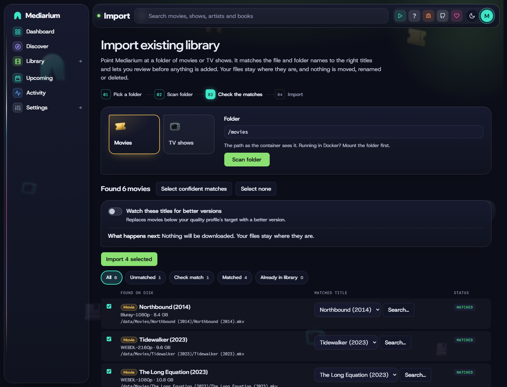
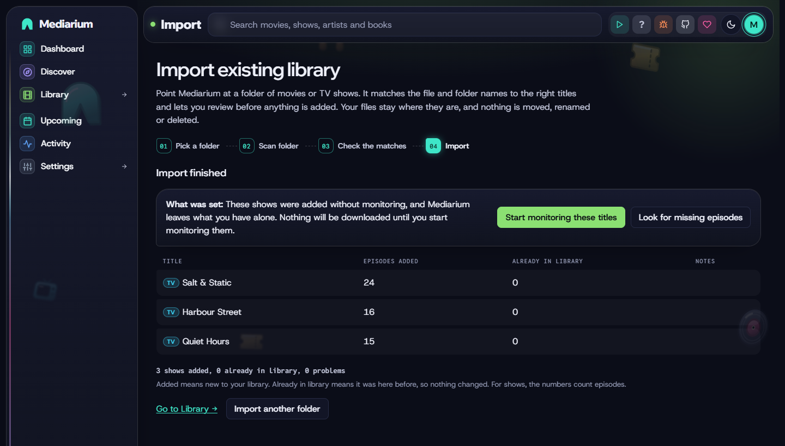

# Importing a library you already have

If your movies and shows are already in folders, Mediarium can find them and add them to its library **without moving, renaming or deleting anything**. Only an administrator can do this. Coming from Radarr or Sonarr? [migrate.md](./migrate.md) brings over more than files (indexers, quality profiles, monitoring). This page is for a plain folder of media.

Open **Library** and press **Import existing** (or **Import what you already have** when the library is empty). The button opens the import for the tab you're on: Movies or TV. The same page is at `/import`, and `/import?kind=tv` opens it on TV shows.

## The steps

1. **Scan.** Pick Movies or TV shows, check the folder (the path as the container sees it; with Docker the folder has to be mapped into the container first) and press **Scan folder**. Mediarium reads the file and folder names and looks each title up in the movie database. A movie can be `Night Harbour (2010)/Night Harbour.mkv` or a flat folder of release names. A show is read from its folder and from `S01E02` style numbers in the file names. A daily show (a talk show or the news) can be named by the day an episode aired instead, like `The Daily Show - 2024-01-15 - Guest.mkv` or `Show.2024.03.05.720p.WEB.mkv`: the file goes on the episode that aired that day. When most of a new show's files (at least three, and 60 percent or more) are named like that, and the movie database calls the show a talk show or news, or none of the files has a season and episode number, the show is added with the **Daily** numbering type so searching and importing keep working by date. A show that is already in your library, or one whose numbering type you changed, keeps its type. When the show lists several episodes on one day, a `Part 2` after the date says which; without it, or when the day isn't listed, the file is left out and the report says so. Episodes in a `Specials` folder (`S00E01`) count as season 0. Sample clips, extras folders and hidden files (such as the `._Movie.mkv` stubs macOS leaves on a drive) are skipped. Titles in any script work (Japanese, Chinese, Russian, Greek and so on): two different titles of the same year are kept apart, and accents are ignored when titles are compared.
2. **Review.** Every title shows what was found on disk and the match Mediarium picked, with a small **Movie** or **TV** tag so the two are easy to tell apart. When the choices include two shows with the same name, each gets its country or year after the title (Shameless (UK)), and a folder named `Shameless (UK)` is matched to the UK one (see [Shows with the same name](./library.md#shows-with-the-same-name)). Confident matches are ticked. A **Check match** row starts on the likeliest film: the same title and year first (a film's original title counts, so `La vita è bella (1997)` finds Life Is Beautiful), then the same year, so a folder named in another language or script still starts on the right film. Titles the movie database flags as adult never come before others. If a match is wrong, pick another from the list or press **Search...** and look it up by hand. Files Mediarium couldn't read are listed under the table. The buttons above the table show just one kind of row: **Unmatched**, **Check match**, **Matched** or **Already in library**, handy on a second pass over a big library.
3. **Choose what happens next** (see below), or just press **Import**.
4. **Confirm.** This answers in about a second, however many titles you chose. Every title is added to the library straight away with what the scan already knows: its name, year, the file, and the quality read from the file name. The titles show in the Library at once, with a "Getting details..." mark until their posters and summaries arrive.

*The review step for a movie folder. Confident matches are ticked.*

## How the quality is read

The quality (for example `WEBDL-1080p`) is read from each file name, for movies and for every episode of a show. When the file name doesn't say (`Show - S01E01 - Pilot.mkv`), Mediarium looks at the folders above it, nearest first: `Season 01 1080p`, then the show's folder such as `Show (2008) [1080p BluRay]`. A folder only fills in what the file name leaves out, so a file that says `720p` is never changed by its folder. A file with no quality anywhere in its path stays **Not stated** (it's `Unknown` in the API), and the search for better versions leaves it alone.

## Anime numbered by TheTVDB seasons

Sonarr counts some anime in far more seasons than the movie database does: One Piece is 23 seasons in Sonarr and one long season in the movie database. A file named `One Piece - S23E10 - 1100 - Title.mkv` has no season 23 episode 10 to go to. Mediarium reads the number counted from the first episode (the `1100`) from the file name, and also from names that only carry that number, such as `[Group] One Piece - 1100 [1080p].mkv`. For an anime it then puts the file on that episode of the show's own order, the same order **Episode numbering: Anime** uses. A new show that the movie database calls Japanese animation is set to Anime when it is imported. If TheXEM or the anime lists are already known for the show, the season and episode of a file without that number are placed through them too.

Files that carry only the TheTVDB season and episode, as Sonarr names them (`One Piece - S22E41 - Title.mkv` in a `Season 22` folder), are placed too, for a show set to Anime. In this order, and only when the answer is certain:

- The anime lists say where that TheTVDB season sits in the show (Jujutsu Kaisen's season 2 starts after the 24 episodes of season 1 in the movie database's single season).
- A season of the show whose episodes are one unbroken run that doesn't start at 1 counts from its first episode. A number past the end of the season is left out. This only holds when TheTVDB starts the season where the movie database does, so it stands down for a season where the titles in the file names say otherwise: TheTVDB starts One Piece's season 22 at episode 1086, three before the movie database's season 22 (1089 to 1155), and counting from 1089 would put every file three episodes too late.
- When the files themselves have seasons 1 to N, each one unbroken from episode 1, and together they are exactly as many episodes as the show has, each season takes the next stretch of the show's episodes in order.
- Last, the title in the file name. The part after `S22E41 - ` (without the extension, a language tag such as `.en`, or release tags in brackets) is compared with the episode titles of the show. It has to be exactly the same after ignoring capital letters and punctuation and reading `&` as `and`, it has to be the title of only one episode of the whole show, and no other file or rule may already have that episode or claim it by its title too. Nothing close is accepted: a title that differs by a word is left out. Generic titles such as `Episode 41` are never used.

A file never takes an episode that another file names for certain, and a title never moves a file that one of the rules above placed. The import's note says how many episodes were placed this way ("Placed 55 episodes by the TheTVDB season numbers." and "Placed 10 episodes by their titles."), and still lists what was left out and why, with the names of up to five of the files that were left out.

A season and episode that the show does list are always taken as the file says. When nothing says for certain which episode a file is, it is left out and the report's note tells you why: "Left out 55 episodes that the movie database doesn't list for this show" is followed by what to do, which is either to set the show's **Episode numbering** to **Anime** on its page and import the folder again, or to rename the files to the season and episode the show's page shows. Nothing is guessed. The same rule applies to a show's folder when you [move over from Sonarr](./migrate.md), and **Import a file by hand** places a file of an anime by the number in its name when the season and episode you typed do not exist.

## Files left out because TMDB counts differently

The movie database counts a double-length episode as one; TheTVDB counts it as two, and many file names follow TheTVDB (The Office season 4 is 14 episodes on TMDB and 19 on TheTVDB, so `S04E03-E04.mkv` has no match). When files are left out and you have saved a TheTVDB key, the report adds a line saying the show can be switched to **TheTVDB order** (the show page's **Episode order**, see [Episode order](library.md#episode-order)). Switch it and import the folder again; nothing is switched for you.

## What happens in the background

After you confirm, the server fills in the rest, a few titles at a time: poster, summary, genres and release date for movies, and the complete season and episode list for shows. Then the episodes found on disk are marked as downloaded.

- **You can leave the page.** A banner across the top of every page shows how far it is ("Importing your library: 4 of 25 shows. You can keep using Mediarium.") with a progress bar and a rough time left. **Import existing** picks the running import up again.
- **A restart doesn't lose it.** The titles still waiting are kept in the database, and the work carries on when Mediarium starts again.
- **A title that can't be looked up isn't lost.** If the movie database doesn't answer, the title is tried again a little later, then less and less often. The card and the report say why in plain words. Once it works, the details fill in and the problem goes away.
- **When it's done** the banner turns into "Import finished. 25 shows added, 0 problems." with a link to the report and a **Dismiss** button. It goes away after a week if you leave it. After a few imports in a row only the newest finished one of each kind (movies, TV) shows, with a line saying how many earlier ones also finished and a **Dismiss all** button, so the banners don't pile up over every page.
- **One import of each kind at a time.** While a movie import is running you can't start another movie import (a TV import is fine). The page says so.

## Nothing is downloaded by surprise

An import adds the titles **without monitoring** and set to **leave what you have alone**. Nothing is searched for or downloaded, whatever your quality profile says. Two switches on the review page change that, and the text under them says what will happen.

- **Watch these titles for new episodes and better versions** (for movies: **for better versions**). On, the titles are monitored and no longer left alone. A show picks up new episodes as they come out, and files below your quality profile's target can be replaced when the profile allows better versions. Off, Mediarium never replaces your files.
- **Also look for missing episodes** (shows only). On, the episodes of an imported show that aren't on your disk are wanted, so Mediarium searches for them and downloads them, and picks up new episodes as they come out. The show is monitored, but its files are only replaced if the first switch is on too. Off, missing episodes stay missing.

A show or movie that was in the library before the import keeps its monitoring. You can change a single title later on its page, under **Better versions**.

Automation starts looking after the details are in, because a show has no episode list until then.

### Start monitoring afterwards

The report has a box, **What was set**, that says what the import did. Once the import has finished it also has buttons:

- **Start monitoring these titles** monitors exactly the titles this import added (not the rest of your library) and turns "leave what I have alone" off for them, the same as switching the first option on before the import.
- **Look for missing episodes** (shows only) makes the missing episodes of those shows wanted.

Titles that were in the library before the import are left as they were. On a big import the titles are changed twenty at a time, so the rest of Mediarium can keep saving its own changes meanwhile. If the database was too busy to save it all, you are told so, and pressing the button again finishes the job. After a click the box shows the new state and the button goes away. The buttons need a finished import. While details are still coming in, the box says so.

## The report

The import page starts with the **What was set** box, then a table of every title with **Added**, **Already in library** and notes, and a total line under it, for example "188 movies added, 0 already in library, 0 problems". For shows the two columns count episodes. **Already in library** means the title was there before, so nothing changed. A show that was already in your library (from another folder, say) counts as already there in the total line and the banner, not as added, and the episodes the import found for it are still added and counted in its row. When two folders of the same import are the same film (`Amélie (2001)` and `Amelie.2001.FRENCH.mkv`), the biggest copy is used and the other row says "Same film as another folder in this import" with the path of the copy in use. A second copy found next to the one used is named in that movie's note and left where it is. A release whose group happens to be called `OTHER` or `SHORT` (`Movie.2010.720p.BluRay.x264-OTHER.mkv`) is read as the film, not as an extra. Importing the same folder twice is safe: what's already there is counted, not added again. A scan recognises files that are already in your library by where they are, so a title you matched by hand comes back as **Already in library** under the right name, not as unmatched, and that works for shows too.

*The report after a TV import.*

## Recently added

An imported title's **added date is the date of its file** (for a show, its newest episode file), so **Recently added** on the Library page follows when the files really arrived, not when you ran the import. If Mediarium can't read a file date it uses the time of the import.

## Where the numbers come from

Getting details takes one request to the movie database per movie, and one for the show plus one for each season of a show (the seasons are asked for at the same time). Mediarium works on five titles at once. Confirming never waits for these requests.

## For scripts

These are administrator endpoints. The full list is in [reference/api.md](./reference/api.md).

- `POST /api/library/scan` `{path, kind}` starts a scan (`409` when an import of that kind is running).
- `GET /api/library/scan/{id}` is the scan and its review rows.
- `POST /api/library/import` `{jobId, selections: [{key, tmdbId, title?, year?}], monitor?, noUpgrade?, monitorMissing?}` registers the titles and answers `{jobId, batchId}`. `monitor` (watch the titles) and `monitorMissing` (shows only) are `false` when left out. `noUpgrade` follows `monitor` when left out (`true` unless `monitor` is `true`).
- `GET /api/library/import/active` lists the scans waiting or running and the imports that are running or finished and not dismissed.
- `GET /api/library/import/batches/{id}` is one import's counts and its report rows, with `monitor`, `noUpgrade` and `monitorMissing` as they are now. `POST .../dismiss` closes its banner.
- `POST /api/library/import/batches/{id}/watch` `{watch?, missing?}` starts monitoring the titles that import added (`watch`) and/or makes the missing episodes of its shows wanted (`missing`, TV imports only). It answers `{movies, shows, message}`, `409` while the import is still getting details, `400` when neither is asked for. Titles that were already in the library are not touched.
- `PUT /api/movies/{id}/no-upgrade` and `PUT /api/series/{id}/no-upgrade` `{noUpgrade}` switch the search for better versions off or on for one title. Movies and shows also report `noUpgrade`, `detailsState` (`pending` or `problem` while an import is still getting details) and `detailsNote`.
