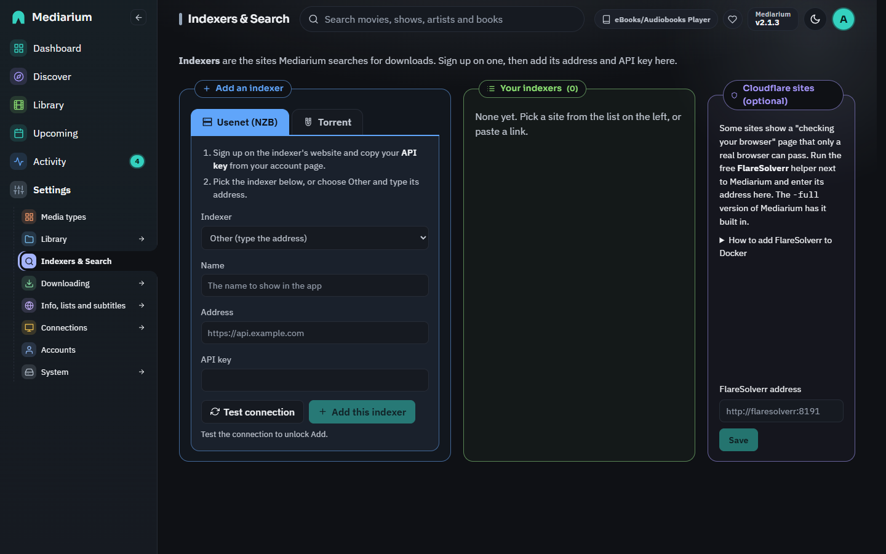

# Indexers & Search

Indexers are the sites Mediarium asks when it looks for releases. You'll find them under **Settings > Indexers & Search**. There are three kinds, and you can mix them. Every search goes to all enabled indexers at once, and the results come back as one list.

| Kind | What it is | You need |
|---|---|---|
| **Newznab** (Usenet) | The API almost every Usenet indexer offers. Results are NZB files, downloaded by the built-in Usenet client. | The indexer's address and your API key, plus a Usenet provider account (Settings > Downloading > Usenet). |
| **Torznab** (torrents) | The same API for torrent sites, offered by some trackers and by Prowlarr or Jackett if you already run them. | The Torznab address and API key. |
| **Sites from the definition list** (torrents) | Torrent sites without an API, driven by a community-maintained definition that describes how to search the site and read its pages. Prowlarr and Jackett use the same approach ("Cardigann"). It's built into Mediarium, so you don't need an extra container. | Nothing for public sites. Your login or browser cookie for private ones. |



*Settings > Indexers & Search: add an indexer on the left, your indexers in the middle (with Test, Edit, Disable and Remove) and the optional Cloudflare helper (FlareSolverr) card on the right. The addresses shown are examples.*

## Searching for a release by name

**Search > Search your indexers for a release** asks every indexer for a release name, the way you would on the indexer's own site (for example "Heat 1995 1080p"). The results list the quality, indexer, size and seeders; blocklisted releases are hidden unless you untick **Hide blocklisted releases**. **Download** works out the movie or show from the release name, adds it to your library if it isn't there yet, and downloads it as usual. Scripts: `GET /api/search?q=...` and `POST /api/search/grab`.

## How many releases a search reads

A Newznab or Torznab indexer answers a search a page at a time, and many of them give 50 or 60 releases on a page unless asked for more. Mediarium asks for 100 and, when the indexer says it has more for that search, reads on for up to two more pages (300 releases at most) in a search Mediarium starts by itself, and up to nine more (1,000 at most) when you open Choose a release. The pages after the first count against the indexer's daily limit like any other request. A title with a great many releases, such as a popular film, is therefore no longer cut short in Choose a release or in automatic searches. Sites from the definition list return what their own page shows.

**Searching with your own words.** Choose a release (for a movie, a season or an episode) has a **Search for other words** box above the list. Type what you want to look for, for example another title a release was posted under, and press **Search**. Mediarium sends exactly those words to your indexers and shows every answer, without leaving out releases that don't match the title. The download still goes to the movie, season or episode you opened, so it is imported as that title. Search with the box empty to get the usual list back.

## Priority, health and Test all

The list on this page is sorted by that number, lowest first, and by name when two are equal; with more than eight indexers a box above the list filters it by name. Each indexer card has a **Priority**, a number from 1 to 50 like in Prowlarr. A lower number is tried first and wins ties: 1 is the highest priority, 50 the lowest, and 25 is the default. Quality always comes first. Between two releases that are equally good, the one from the lower-numbered indexer is picked, then a Usenet release over a torrent. Indexers that used to be Preferred, Normal or Last resort became 10, 25 and 40. Scripts: `PUT /api/indexers/{id}/priority` with `{"priority": 10}`. The old words (`preferred`, `normal`, `last resort`) are still accepted and mean 10, 25 and 40; a plain 1, 2 or 3 now means exactly that number. So an API client or settings file that still sends the old values 1, 2 and 3 (for preferred, normal and last resort) now sets ranks 1 to 3 of 50, all near the top, and a 3 that used to mean last resort no longer does. Change those to 10, 25 and 40, or to the words.

Under the address, each card says how its last test went ("Last test passed 2 hours ago", or why it failed). **Test all** above the list tests every enabled indexer, one after another, and says which did not answer.

### Why some indexers are missing from a release list

A release list (**Choose a release**) starts with a line like *Searched 8 indexers: 2 had releases, 5 had nothing for this title, 1 did not answer.* Press it to see every indexer in a table: its type, what it found (*12 releases*, *Nothing found*, *Did not answer: daily limit used up*, *Skipped: does not list this kind of release*) and how long it took. Seeing only a few indexers in the **Any indexer** list is normal when the others simply have nothing for that title. A movie site has no shows, and a Usenet indexer may not carry a new or small release. An indexer that did not answer is marked with a warning sign, and the table says why. Two reasons come with a full sentence under the result, and the technical text on a line below it:

- *FlareSolverr isn't running or Mediarium can't reach it at http://127.0.0.1:8191. Start FlareSolverr, or set its address under Settings > Indexers & Search.* It shows the address Mediarium used (without any login in it). The site needs FlareSolverr to pass a Cloudflare check, and nothing answered at that address: start FlareSolverr, or fix the address ([Sites behind a Cloudflare check](#sites-behind-a-cloudflare-check)).
- *This site says the page is gone (HTTP 410). The site may have moved or closed. Check its address, or turn it off.* The site answered a search with "gone" (410) or "not found" (404). Sites move and close. Open the indexer, check its address against the site's own, or turn it off.

When a movie's list is empty, the line above it tells which of three things happened: an indexer did not answer (it is named), nothing was found (*Your indexers answered, but none of them has this yet*), or releases did come back but none of them fits the movie's title and year (*Your indexers answered with releases, but none of them fits this title and year*, followed by the names of a few of them). In the last case the movie in your library most likely has a different name or year from the releases, for example a re-release year or a title with the maker's name in front; compare those names with the movie's title and year on its page. A release that fits the title but is turned down by your quality profile or size limits is never left out: it stays in the list, marked with the reason. (Reported by Hoopes80 on GitHub, #121.)

The same sentences are used on the indexer card (after **Test**, with the technical text under it), in the pause reason and in the problem log, which keeps the technical text as the detail.


## When an indexer keeps failing

An indexer that is down, blocks you or limits your requests would otherwise slow every search and fill the Health page with the same error. After **3 failures in a row** (a site that cannot be reached, an HTTP 5xx error, a Cloudflare page, a refused key) Mediarium leaves it out of searches for a while: 5 minutes first, then 10, 20, 40 and so on, up to 6 hours. An indexer that says you made too many requests is paused at once, for as long as it asks with its `Retry-After` header (and at least 5 minutes, at most 6 hours).

While an indexer is paused:

- its card says "Paused until 14:20 after 3 failures in a row, because it could not be reached", and has a **Try again now** button;
- **Health** lists it as a warning;
- searches skip it without an error, and a release list that you open says which indexer was skipped.

The first answer that works clears the count, and so does **Try again now**, a **Test** that passes, or editing the indexer. When a pause ends, the next search asks the indexer again; if that fails too, the next pause is longer. The pauses are kept across restarts. A search that you cancel yourself is never counted as a failure.

Searches on one indexer are also spaced out, a second and a half apart (six seconds for one that recently said you made too many requests), so a search of the whole library never sends a burst. When so many searches are already lined up for an indexer that a new one would wait more than 10 minutes, the new one skips that indexer instead of waiting; this isn't counted as a failure. A movie or show with other titles in the languages you want ([Releases named in your language](./quality-profiles.md#releases-named-in-your-language)) is one more search for each title, at most four more for a movie and two for a season or episode, spaced the same way.

An indexer whose saved key or password can't be read (usually because the `secret.key` in `/config` is not the one that belongs to this database) is a different problem: Mediarium can't ask it at all. **Health** names it ("Mediarium can't read the saved key of ...: re-enter it"), the log says the same, and it is left out of searches while your other indexers keep working. Open it, enter the key again and save.

When the error on an indexer card (the pause reason, the last test or a test you just ran) is one that a newer version already fixed, and you run an older one, a line under it says "This is fixed in 3.2.1. Update Mediarium and press Try again." The list of known errors is in `web/src/knownFixes.ts`.

Health adds one line when your indexers as a group can't search. **No indexer is set up** only appears when you haven't added one. If they are all turned off, it says *All your indexers are turned off*. If you only have torrent indexers and torrents are off, it says so and links to the torrent settings. If every indexer that is turned on is failing (paused, or its last search or test failed), it says *None of your indexers works right now*. One indexer that still works is enough to hide it.

Scripts: `POST /api/indexers/{id}/resume` is **Try again now**; `GET /api/indexers` adds `failures`, `pausedUntil`, `pausedNote` and `pausedWhy` to a paused indexer.

## Minimum seeders

A torrent with few or no seeders can sit in the download client for days. Each torrent indexer card has a **Minimum seeders** box next to the priority. Put in a number such as 5 and Mediarium skips the releases from that indexer that have fewer seeders than that. 0 means off, which is how every indexer starts, and 1000 is the highest you can set. Each indexer has its own number, so a private tracker can be left at 0 while a public one asks for 5. The box saves when you leave it or press Enter.

- **What it covers.** Everything Mediarium grabs by itself: the scheduled searches for movies, shows, albums and books, the regular check for new releases, upgrades and replacing a file with a smaller one, and the hunt for season packs. A skipped release is counted in the note of the search ("3 with fewer seeders than the indexer's minimum") that shows on the item's activity.
- **What it does not skip.** A release whose indexer did not say how many seeders it has, a release your debrid service already has cached (see [Downloads](./downloads.md)), Usenet releases, and releases announced over IRC, which come without a seeder count.
- **Searching by hand.** The list still shows every release. One that is under the minimum gets a **Below minimum seeders** label, its seeders are dimmed, and it is never marked as the best match. You can still grab it yourself.
- **From Prowlarr.** When you import from Prowlarr, a minimum seeders number set on a torrent indexer there comes along.

Scripts: `GET /api/indexers` has `minSeeders`; `PUT /api/indexers/{id}` takes `minSeeders` (a whole number from 0 to 1000) and a search result has `belowMinSeeders` and `minSeeders` when it is under the minimum. In a settings file an indexer can have `minSeeders: 5`.

## Extra categories

Mediarium searches an indexer in the standard categories: 2000 for movies, 5000 for TV, 3000 for music, 7000 and 7020 for books and 3030 for audiobooks. Some indexers file releases under numbers of their own as well, such as 105000 for TV or 7120 for German ebooks, and a search for the standard number never finds those. **Edit** on a Newznab or Torznab indexer has an **Extra categories** part with a box for movies, TV, music, books and audiobooks. Type the extra numbers you want, separated by commas, for example `105000, 105010`, and **Save changes**. From then on those numbers are asked for together with the standard ones whenever that kind of media is searched on that indexer, in manual searches and in the automatic ones. Other indexers are not affected, and leaving a box empty keeps the standard search.

- **Finding the numbers.** **Show the categories this indexer lists** asks the indexer what it offers and puts the categories that fit each box under it. Click one to add its number. This is only a help: you can always type a number yourself, and an indexer that doesn't list its categories simply shows nothing.
- **What is accepted.** Whole numbers from 1 to 999999, up to 30 for each kind of media. Anything else is refused with a message under the box.
- **Sites from the definition list.** They get the numbers too when the site's definition lists the number among its categories, but the box is only on the Newznab and Torznab cards for now.
- **Language.** The numbers only change where Mediarium looks. A release found in an extra category is not treated as being in that language: the language of a release still comes from its name.

Scripts: `GET /api/indexers` has `extraCategories`, an object such as `{"tv": [105000], "books": [7120]}` (the kinds are `movies`, `tv`, `music`, `books` and `audiobooks`); `PUT /api/indexers/{id}` takes it too, and an empty object clears it. `GET /api/indexers/{id}/categories` lists what the indexer says it has. In a settings file an indexer can have `extraCategories`.

## Daily limits

Free indexers often allow only a few requests a day, 25 for example, and answer "Request limit reached" after that. Spacing searches apart does nothing against a daily count, so Mediarium counts the requests it makes to each indexer per day (UTC) and leaves the indexer alone before the day is used up.

- **Learning the limit.** When an indexer answers with something like `Request limit reached (26/25)` or `Request limit reached. Retry in 894 minutes.`, Mediarium remembers the limit (25) and when the requests are back: after the number of minutes the indexer gave, or after midnight UTC when it gave none. This is not counted as a failure, and the indexer is not paused for hours like one that keeps failing.
- **A limit that goes out of date.** A learned limit is trusted for a week and then forgotten until the indexer says it again. It is dropped at once when a search you start works after the count went past it (say the plan was upgraded). A limit below 5 is only believed when the indexer says it twice, numbers that make no sense are ignored, and a "retry in" wait is never taken for longer than 48 hours. Because of this the connection watch still checks an indexer that is only held back by an old learned limit.
- **Setting it yourself.** Edit the indexer and fill in **Requests per day**. A number you set wins over what the indexer reported. Leave it at 0 to use the limit the indexer reports, if it reports one; an indexer with no limit set and none learned is never held back.
- **What counts.** Every request Mediarium makes to the indexer: searches, feed reads, the Test button, the connection watch and fetching a release you grabbed. The card shows "12 of 25 requests today" once a limit is known. Requests made by other programs with the same key aren't seen, but the count catches up as soon as the indexer reports its own.
- **What happens at the limit.** Automatic searches, feed reads and connection checks stop two requests before the limit (so a search you start by hand still has room) and the card says "Daily limit of 25 reached. It is used again after midnight (UTC)." They start again by themselves when the day turns. A search you start yourself from a movie, show or album still asks the indexer, and warns you that it may be refused.

- **Checking for new releases (RSS).** The regular check for new releases reads each indexer's latest releases again and again, which would use up a small daily limit before the searches for specific titles run. For an indexer with a known limit (set or learned), that check uses at most about a third of the limit a day, spread over the day: with a limit of 25 that is about 8 reads, roughly every 3 hours (every 6 hours when movies and shows are both on, as each run asks twice). It also never uses the last 40% of the day's limit, which is kept for searches. The card says how often it checks, for example "New releases are checked about every 3 hours". With a limit of 1, or one too small to fit a run, only the searches look for new releases. Indexers with no limit are read on every run.

The connection watch ([Notifications](./notifications.md#connection-watch)) doesn't use up searches: see the page for what it asks.

Scripts: `GET /api/indexers` adds `requestsPerDay` (what you set), `dailyLimit` (the limit in use), `limitLearned`, `requestsToday`, `limitNote`, `rssEveryMinutes` and `rssNote`; `PUT /api/indexers/{id}` takes `requestsPerDay`. In a settings file an indexer can have `requestsPerDay: 25`.

## How each indexer is doing

**Settings > System > Statistics** has an **Indexers, last 30 days** card (administrators only): for each indexer the number of searches, how many failed, the share that worked, how many releases it returned and how many of its releases were grabbed, by hand or by Mediarium. A search skipped because of a pause is not counted. The counters are kept for 90 days. Script: `GET /api/stats/indexers`.

## Grabbing from IRC announcements

Trackers post every new release in an IRC channel seconds after it is uploaded. The **IRC announce** card under the indexers (Settings > Indexers & Search) can listen there and download a release you want right away, instead of waiting for the next RSS check. It only ever acts on movies and shows that are already in your library and wanted, with the usual quality rules, and it is off until you add a connection and switch it on. Setup, the templates, the test box and the limits are in [irc-announce.md](./irc-announce.md).

## Usenet or torrent?

- **Usenet**: you pay a Usenet provider for access and use an indexer to find NZBs. Downloads are a direct, encrypted connection to your provider. Nobody else sees what you fetch.
- **Torrents**: free, but you download from (and upload to) other people. Everyone in a swarm can see your IP address. Mediarium's built-in VPN (Settings > Downloading > VPN and proxy, see [vpn.md](./vpn.md)) can hide it. Torrents can be switched off in Settings, and torrent indexers are then skipped. The VPN can carry your indexer searches too ([Indexers through the VPN](./vpn.md#indexers-through-the-vpn)).

## Adding a Newznab or Torznab indexer

Under **Add an indexer** on Settings > Indexers & Search, choose the **Usenet (NZB)** or **Torrent** tab. For Usenet, pick your indexer from the list (or **Other** and type its address) and paste your API key. For a Torznab link, choose **Paste a Torznab link** on the Torrent tab, then paste the address and the API key. Press **Test connection**, then **Add this indexer** (it stays greyed out until the test has passed). The name is required, the address must start with `http://` or `https://` and name a server, and the API key can't contain spaces or line breaks. Mistakes are pointed out under the field, and the server refuses the same ones from a script.

**Indexers from Prowlarr or Jackett:** add each one with its own Torznab (or Newznab) feed address, not Prowlarr's main page. In Prowlarr, open the indexer and copy its feed address, which looks like `http://192.168.1.10:9696/5/api`, and use Prowlarr's API key (Settings > General). An address that gives back a web page instead of a feed is refused with a message saying so. To bring over all of them at once, use **Settings > System > Move from other apps** ([migrate.md](./migrate.md)). A few indexers are built into Prowlarr's own code rather than the shared definition list. Mediarium has its own definition for three of them (Toloka, IPTorrents and Knaben, see below); any other site like that can only be added through Prowlarr's feed address. Prowlarr also stays the fallback for IPTorrents: if the built-in one doesn't work for you, add IPTorrents in Prowlarr and give Mediarium its feed address.

Torznab download links can return a `.torrent` file or redirect to a magnet link. Mediarium accepts either, including ordinary web redirects before the magnet link.

If you added a torrent indexer on the **Usenet (NZB)** tab by mistake, Mediarium still tells torrents from NZB files by what the feed sends and downloads them as torrents. Still, add torrent sites on the **Torrent** tab: that's where the seeders, the VPN and the torrent client settings apply to them.

Each saved indexer has **Test**, **Edit**, **Disable** and **Remove**. **Edit** changes the name, address and API key, and a blank API key keeps the saved one. A failed test says what went wrong in plain words (address not found, connection refused, no answer in time, certificate problem, wrong API key, IP address not allowed). The key is never sent back to the browser. The indexer list only says whether one is saved (`hasApiKey`).

## Adding a site from the definition list

On the **Torrent** tab of Settings > Indexers & Search, **Pick a site from the list** opens a searchable list of sites, which you can narrow with **Public**, **Semi-private** and **Private**. Pick one, fill in what it asks for and press **Add** (the button carries the site's name). Then press **Test** on its card in **Your indexers**. Adding doesn't test it for you.

- **The list isn't part of Mediarium.** Mediarium ships no list of sites. The first time you open the list, your server downloads the community definitions (one archive from GitHub) and keeps a copy in `/config/indexer-definitions`. It refreshes that copy at most once a day when you open the list again, or when you press **Update list**. You choose which sites, if any, to add.
- **Built in: Toloka.to.** The Ukrainian tracker isn't in the community list (Prowlarr runs it from its own code), so Mediarium brings its own definition for it. It shows in the list like any other site: add your Toloka username and password, and optionally *Search freeleech only*. Toloka's titles carry the Ukrainian name, the original name and markers such as "Сезон 2, Серії 1-8 з 10"; Mediarium turns these into a normal release name (`Show S2E1-E8 (2023) WEB-DL 1080p`) so the right episodes are matched. If the community list ever adds Toloka, its version is used instead.
- **Built in: IPTorrents (new, needs a tester).** IPTorrents isn't in the community list either (Prowlarr and Jackett code it by hand and sign in with a browser cookie). Mediarium brings its own definition, which shows in the list as **IPTorrents** with a note that it is new. It was written from public descriptions of how the site's pages are laid out and has not been run against the real site yet, so it may need a fix. If you have an account, see [Trying the IPTorrents definition](#trying-the-iptorrents-definition) below. If it doesn't work for you, use IPTorrents through Prowlarr as before.
- **Built in: Knaben.** Knaben (knaben.org) is a public torrent search engine that collects results from many sites. It isn't in the community list (Prowlarr runs it from its own code), so Mediarium brings its own definition. It shows in the list as **Knaben**, needs no login, and searches through Knaben's public search service. Results come most-seeded first (up to 100 per search) with Knaben's own filters for risky and adult results switched on, and they come as magnet links. Knaben's categories are matched to movies, TV, anime, music, audiobooks, books, games and software; a result in a category Mediarium doesn't know is kept without one. Like every site on the list it follows your VPN setting and the waits between requests.
- **Public sites** usually need nothing: pick one and save. Some let you choose sorting or filters.
- **Private sites** need your account. Depending on the site, the form asks for a username and password (Mediarium signs in for you and signs in again when the site logs it out), an API key or passkey, or the **cookie** from your browser (for sites whose login has a CAPTCHA). To copy a cookie: sign in to the site in your browser, open the developer tools (F12), reload a page of the site, open the request in the Network tab and copy the whole `Cookie` request header. Some sites also want your browser's User-Agent; when a site has a **User-Agent** field, Mediarium sends what you type there with every request to that site. When the site signs you out, copy a fresh cookie.
- Passwords, cookies, API keys and passkeys are stored encrypted and never sent back to the browser. **Edit** on a site added from the list renames it and sets its requests per day (and, for a site on your own network, its address: see the next point). To change its login or cookie, remove the site and add it again.
- **Addresses**: sites often have several mirrors. The form lets you choose one of the addresses in the definition, and the first is used unless you pick another.
- **Sites that run on your own network** (BitMagnet, for example) list an address such as `http://127.0.0.1:3333` in their definition, which is only an example: the real server is wherever you run it. When every address in a definition is local (localhost, a name without a dot, or a private address such as `192.168.x.x`, `10.x.x.x` or `172.16.x.x` to `172.31.x.x`), the form shows an **Address** field, filled in with the first one. Type the address of your own server, for example `http://192.168.1.10:3333`, and change it later with **Edit**. It has to be an `http` or `https` address with a server name, up to 200 characters, with no user name or password in it and nothing after a `?` or `#`; the port is optional. Inside Docker, `127.0.0.1` is the Mediarium container itself, so a server on another machine (or on the Docker host) needs that machine's address. If **Test** gets *connection refused* on a `127.0.0.1` address, it says so. Sites on the public internet keep to the addresses in their definition.
- **Test** signs in (if needed), runs a search and reports how many releases came back. If a test fails, the dashboard shows it until a later test passes.
- Mediarium waits between requests to the same site (at least one second, longer if the definition asks, up to ten seconds) and keeps each site's sign-in between searches, so it doesn't hammer sites.

### Trying the IPTorrents definition

This definition is new and nobody has run it against the real site yet. If you have an IPTorrents account and a few minutes, please try it. Here is what to do.

**1. Set up your profile on IPTorrents.** In your profile settings on the site, set *Torrents per page* to 100, tick the option that shows the files count, and set the category column to icons (not text). Mediarium reads the result table by position and by the category icon links, so with other settings results can come back empty or in the wrong category. Wait a minute or two for the site to apply it.

**2. Copy your cookie.** Sign in to IPTorrents in your browser. Open the developer tools (F12), go to the *Network* tab, reload any page of the site, click the first request, and under *Request Headers* copy the whole value of `Cookie`. It looks like `uid=123456; pass=abcdef...`. Also copy the value of `User-Agent` from the same list. IPTorrents ties the cookie to the browser it was made in, so the two have to match.

**Keep the cookie secret.** It is your login: anyone who has it can use your account. Mediarium stores it encrypted and never shows it again, but don't paste it into a chat, a forum post or a bug report. When you sign out on the site, or it signs you out, the cookie stops working and you have to copy a fresh one.

**3. Add the site.** Settings > Indexers & Search > Torrent > *Pick a site from the list* > **IPTorrents**. Paste the cookie and the User-Agent. *Search freeleech only* limits results to freeleech torrents. *Sort results by* picks the order the site sends them in. If the main address is blocked where you live, the **Site address** list has mirror addresses of the site; use the one that works in your browser. Press **Add**, then **Test** on its card.

**4. What you should see.** *Test* signs in with the cookie (it looks for the sign-out link on the front page) and runs a search, then says how many releases came back. A search from Search > *Search your indexers for a release* should list releases with size, seeders and the right quality in the name, and **Download** should send a normal torrent to your client. Possible messages:

- *the cookie was not accepted*: the cookie is wrong, has expired, or was copied with the wrong User-Agent. Copy both again.
- *enter the cookie from your browser*: the cookie field is empty.
- *This site is behind a Cloudflare check*: IPTorrents showed a browser check. Set up FlareSolverr (see below) or copy a cookie that includes the Cloudflare part (`cf_clearance`).
- Test passes but searches find nothing, or sizes, seeders or dates are wrong or missing: the page layout is probably different from what the definition expects. That is what this test is for.

**5. What to send back.** Please open an issue on GitHub (or send a message) and say what you saw. If something is wrong, include one **anonymised** result row: in your browser, right-click a result row on the *Browse* page, choose *Inspect*, copy the `<tr>` element's HTML ("Copy outerHTML"), and paste it with these parts removed or replaced: the numbers after `uid=` and `pass=` (if they appear), your username, any `torrent_pass=` value in the download link, and any other personal text. The titles, sizes, seeder numbers and the layout of the cells are what matter. Also say whether the files-count option is on, and which address you used. Never send your cookie.

What the definition expects, for anyone checking it against the site: the search is `/t?<category id>=&q=<words>` (with `free=on` for freeleech only and `o=<sort>`); the results are in a table with the id `torrents`; the title is the link with class `hv`; the download link starts with `/download.php/`; size is the sixth cell; snatches, seeders and leechers are the last three cells; a `span` with class `free` marks freeleech torrents; the date is the text after the last `|` in the `sub` line, such as "3.2 hours ago". Paging is not used: you get the first page, which is why the profile asks for 100 per page. The categories are mapped to the usual movie, TV, audio, book, PC and console categories; the adult categories are left out.

### Adding your own definition file

For a site that isn't in the list, such as an indexer you run yourself that comes with a Cardigann definition file (`.yml`) for Prowlarr or Jackett, press **Add a definition file** under the list and pick the file.

- Mediarium checks the file before keeping it: it must be a readable definition of 1 MB at most, with an id made of letters, numbers, dots, dashes and underscores, at least one `http` or `https` address under `links`, and nothing the engine can't run. If something is wrong, it says what and keeps nothing.
- The file is kept in `/config/indexer-definitions-custom`, apart from the downloaded list, so refreshing the list never removes it. It isn't part of a Mediarium backup (that holds the settings database), so keep your own copy of the file: after restoring on a new server, add it again.
- It shows in the list on the Torrent tab with an **Added by you** badge. A Usenet definition shows there too, and is added as a Usenet indexer. Pick it and add it like any other site. Its **Site address** can be changed to any web address, such as `http://192.168.1.20:8080/` for a helper running on another computer at home.
- A file with the same id as a site in the community list takes its place, which is handy for trying a fix before the community list has it. Remove your file and the community version is back.
- **Definition files you added**, above the list, shows your files with a button to remove each. A file can't be removed while an indexer still uses it: remove the indexer first.
- To update a file, add the new version: it replaces the old one, and indexers using it pick up the change on their next search.

Only add files from people you trust. A definition decides which addresses Mediarium contacts and what it sends there, including the login you fill in for that site.

### What doesn't work (yet)

A few definitions use things the engine can't run. The list marks them as unsupported and says why. Today that's:

- logins that always show a CAPTCHA (use the cookie option if the site offers it);
- regular expressions with look-ahead or look-behind in the definition's extraction filters (in text clean-up replacements they're skipped, leaving the text unchanged);
- a small number of definitions with invalid selectors.

Sites change their pages. When a site changes before its definition is updated, searches from it fail or come back empty. A date the site writes differently from what its definition expects is read as any common date format instead, so it no longer fails the search. Refreshing the list picks up the fix once the community has made one.

## Sites behind a Cloudflare check

Many public sites sit behind Cloudflare, which sometimes shows a "checking your browser" page that only a real web browser can pass. Mediarium can't embed a browser. When a site shows that page you'll see:

> This site is behind a Cloudflare check. Set up FlareSolverr (see Settings > Indexers & Search) to use it.

[FlareSolverr](https://github.com/FlareSolverr/FlareSolverr) is a small helper that opens the page in a headless browser and hands back the cookies that let Mediarium in. Only sites that show the check use it. Everything else talks to sites directly.

**The simple way is the `-full` image** (`ghcr.io/rdborg/mediarium:latest-full`). The helper is built in and running, so there's nothing to add or type. Settings > Indexers & Search then shows "Built in and running". An address of your own saved there is used instead. The differences in size and memory are in [INSTALL.md](./INSTALL.md#optional-getting-past-cloudflare-checks). Cloudflare changes its checks now and then, so no site is guaranteed to keep working.

**Or add FlareSolverr yourself** as a separate container next to Mediarium in your compose file:

```yaml
services:
  flaresolverr:
    image: ghcr.io/flaresolverr/flaresolverr:latest
    container_name: flaresolverr
    restart: unless-stopped
    environment:
      - LOG_LEVEL=info
      - TZ=Etc/UTC
    # Only needed if Mediarium is not in the same compose file:
    # ports:
    #   - "8191:8191"
```

Then set its address in the **Cloudflare sites (optional)** section of Settings > Indexers & Search (stored as `flaresolverr.url`, `flareSolverrUrl` in `GET/PUT /api/settings`): `http://flaresolverr:8191` when both are in the same compose file, otherwise `http://<host>:8191`. With no address set, Cloudflare-protected sites fail with the message above. With an address that nothing answers on (FlareSolverr stopped, or the wrong host or port), the site's card, a release list and Health's pause reason say *FlareSolverr isn't running or Mediarium can't reach it at ...* with that address.

Cloudflare's clearance is tied to your IP address and the browser's User-Agent, so FlareSolverr should reach the internet the same way Mediarium does (same host, same VPN or none). The built-in helper of the `-full` image does while **Send indexer traffic through the VPN** is off, because it runs in the same container. With the switch on, Mediarium's own requests use the VPN but FlareSolverr's don't, which breaks that rule unless FlareSolverr is behind the same VPN.

Technical: the `-full` image sets `BUNDLED_FLARESOLVERR=1` and runs the helper on `127.0.0.1:8191`. `GET /api/flaresolverr/status` (administrators) reports `{bundled, configured, running, version}`, and the dashboard shows a warning if the built-in helper stops answering.

## Where the definitions come from, and their licence

The definitions are the community-maintained Cardigann YAML files from [github.com/Prowlarr/Indexers](https://github.com/Prowlarr/Indexers) (the current `definitions/v11` folder), many of them synced from [Jackett](https://github.com/Jackett/Jackett). At the time of writing the Prowlarr/Indexers repository publishes no licence file (GitHub reports none). Jackett is GPL-2.0. Mediarium, which is AGPL-3.0, doesn't include, modify or redistribute these files. Your own server downloads them from GitHub when you open the site list, and reads them as data. The engine that runs them is Mediarium's own code. Credit for the definitions goes to the Prowlarr and Jackett contributors.

## Responsible use

Mediarium doesn't include, recommend or endorse any site. You choose which indexers and sites to add, and you're responsible for using them, and what you download through them, in line with the law where you live and the rules of each site. See [LEGAL.md](./LEGAL.md).

## For developers

- Engine: `internal/indexers` (`cardigann*.go` for the engine, `definitions.go` for the download and cache, `cardigann_selector.go` for the CSS selector subset). Tests use local fixture sites only (`internal/indexers/testdata/cardigann`). Definitions shipped with Mediarium live in `internal/indexers/builtin` (`builtin.go` adds them to the downloaded list).
- To check the engine against a local copy of the real definitions: `MEDIARIUM_CARDIGANN_DEFS=/path/to/definitions/v11 go test ./internal/indexers -run Corpus -v`.
- API: `GET /api/indexer-definitions?refresh=1`, `POST /api/indexers` with `{definitionId, name, baseUrl?, settings}`, `PUT /api/indexers/{id}` with any of `{name, baseUrl, apiKey, protocol, enabled, settings}` (left out = unchanged; blank `apiKey` or secret setting = keep the saved one; `protocol` only for Newznab/Torznab), `POST /api/indexers/{id}/test`. See [reference/api.md](./reference/api.md).
- Result download links from definition-based sites look like `mediarium-indexer://<id>?link=...`. The grab pipeline resolves them through that indexer's session (login, details page, Cloudflare) when the download starts.

## FlareSolverr with the bundled compose file

The compose file in this repository has an optional `flaresolverr` service. Start it together with Mediarium:

```bash
docker compose --profile cloudflare up -d
```

Then enter `http://flaresolverr:8191` under Settings > Indexers & Search. The first request to a protected site can take up to a minute while FlareSolverr passes the check. Later requests reuse its cookies and are fast. The Test button on a site waits up to 100 seconds when FlareSolverr is set up, and shows "Solving the Cloudflare check" while it waits. If it still runs out, the message says how long it waited: check that FlareSolverr is running and has internet access, then try again.
