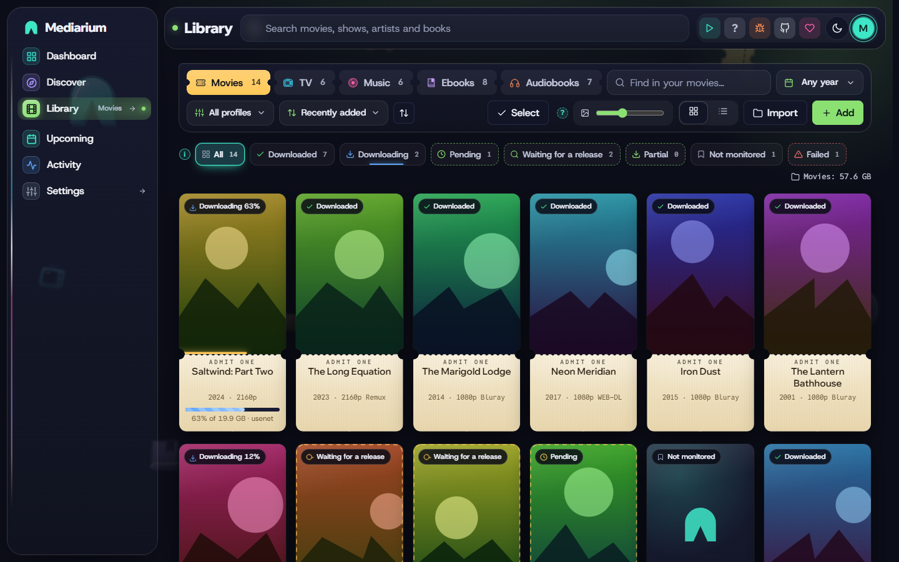
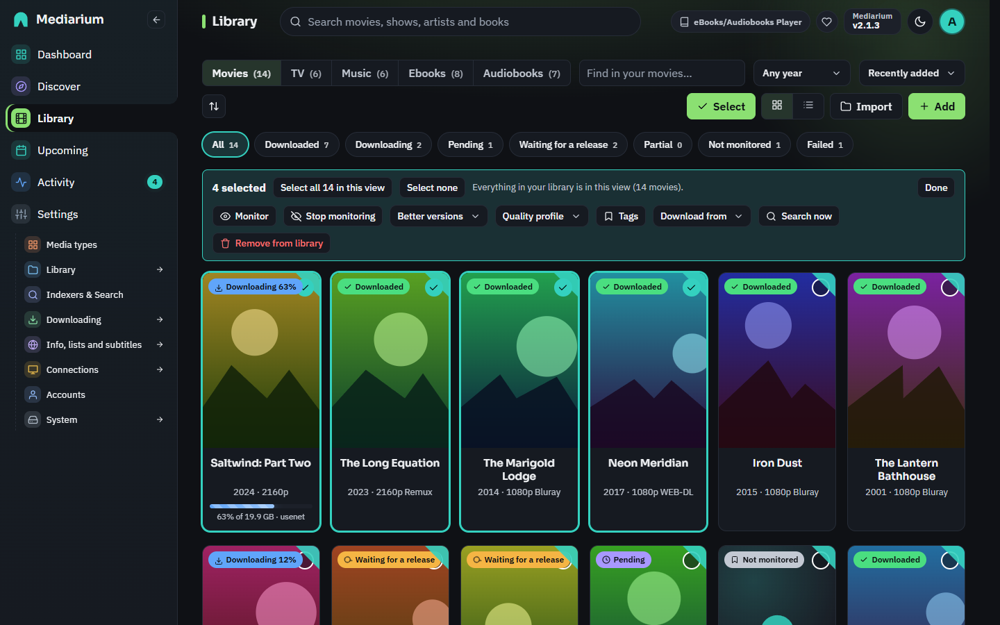

# The Library page

The Library shows what's in your library: a tab each for **Movies**, **TV**, **Music**, **Ebooks** and **Audiobooks** (only the kinds that are switched on, see [modules.md](./modules.md)). Every title is a poster or a row, with a status, and the things you do most are one click away: search for a release now, monitor or stop monitoring, open the page, and (for administrators) remove it. Above the list you can search by name, filter by genre, decade, status and what the files hold (codec, HDR, resolution, audio and subtitle languages, see [What is in your files](#what-is-in-your-files)), and sort. The list is sorted by **Recently added**, newest first, until you pick another sort. While the Movies or TV tab is still empty, a row of popular titles underneath gives you something to add straight away. The book tabs are described in [books.md](./books.md). To keep kids' films, 4K or anything else apart, use tags (below) rather than separate folders.

*The Library, Movies tab.*

To do the same thing to many titles at once, use **Select**.

## Finding your way

- **Status words.** Each title says where it is: **Downloaded**, **Downloading**, **Pending** (waiting its turn in the download line), **Waiting for a release** (monitored, and Mediarium checks regularly for one), **Partial** (some episodes are downloaded), **Not monitored** (in your library, but nothing is downloaded on its own) and **Failed**. The chips under the toolbar filter by these words and show how many titles each holds. A **Looks incomplete** chip joins them when some file is far too short (see [Files that look incomplete](#files-that-look-incomplete)).
- **Straight to a tab from the left menu.** Under **Library** in the left menu there is a line for each kind that is switched on (Movies, TV shows, Music, Ebooks, Audiobooks). Pressing one opens the Library on that tab, and the line of the tab you are on is highlighted. On a phone they are in the menu that slides in. The same addresses work as links: `/library?kind=movie`, `kind=tv`, `kind=music`, `kind=ebook` and `kind=audiobook`. A link to a kind that is switched off opens the first tab that is on.
- **Back brings the list back as it was.** The tab, the status chip, the search text, the genre, tag and decade live in the address (for example `/library?kind=tv&st=pending`), so pressing Back from a title returns to the same list with the same filters. Discover works the same way for its tab and filters.
- **The Downloading chip** only shows its moving blue line while something is really downloading.
- **Quality profile filter and sort.** On the Movies and TV tabs a **Quality profile** filter sits next to the genre and year filters. It lists the profiles your titles use, with how many titles use each, and shows only those titles. A title that follows the default counts under the profile that default is today. The same choice is in the **Sort** menu, and in the list view you can click the **Profile** column heading to sort by it (click again to reverse). The filter lives in the address like the others (`profile=` followed by the profile's number).
- **Clear filters.** When a search, chip, genre or year is narrowing the list, a **Clear filters** button appears beside the chips, and in the "Nothing matches these filters" message when nothing is left. It puts them all back.
- **Ended shows.** A show that has finished has a small grey **Ended** (or **Canceled**) ribbon in the corner of its poster, and a note beside its name in the list view. Its page says **Ended**, **Canceled**, **Continuing** or **Upcoming** next to the episode count. On the TV tab the **Ended** and **Continuing** chips show only those shows. The status comes from TMDB and is kept up to date in the background: a show that is still running is read again every day (a monitored one at every 12-hour refresh, so new episodes are found quickly), a show that has ended or was canceled once a week, with a short pause between shows. This includes shows that aren't monitored. **Refresh episodes** on a show's page reads its status again right away. A show shows no status until it has been read once. Scripts: `showStatus` on `GET /api/series` is `ended`, `canceled`, `continuing` or `upcoming`; the Sonarr style API has `status` and `ended` on each series.
- **Sort.** **Recently added**, **Title A–Z** (without a leading "The", "A" or "An", so The Matrix is under M), **Newest release** (release date, or the date a show started), **Largest on disk** (the movie's file, or all of a show's downloaded episodes) and **Status**.
- **Sort direction.** The button with the up-and-down arrows next to **Sort** reverses the order (oldest first, Z to A, smallest first). The sort and its direction are remembered in this browser.
- **Poster size.** In the grid, the slider next to the grid and list buttons makes the posters bigger or smaller. It is remembered in this browser (and hidden on small screens).
- **On a tablet the list stays beside the page.** On a screen between about 768 and 1180 pixels wide (an iPad upright or on its side, or a window that size) and tall enough to leave room, opening a film, show, artist or book from the Library keeps the list on the left and puts the page on the right. Picking another one only swaps the right side; the one that is open is outlined in the list. The address still points at the page, so refresh and Back work, and the list keeps its tab and filters. **Esc** (when you are not typing in a box and no pop-up is open) closes the right side and gives the list the whole width again. On a phone, and on a computer screen, nothing changes: the list and a page are separate pages. A film that you open from Discover, not from the Library, opens on its own.
- **Press `/`** anywhere (except while you type in a box) to jump to the search box at the top, and **Esc** to leave it.
- **Press Ctrl+K** (Cmd+K on a Mac) anywhere to go somewhere by name: type a few letters of a page or a settings page (`index` for Indexers & Search) and press Enter. Administrators can also pause or resume all downloads and hold the background searches for an hour from there. The titles in your library that match turn up in the list as you type, whatever you remember of a name: the start of any word is enough (`star w` finds Star Wars), accents don't matter, and a translated title finds the film too. It covers films, shows, books, artists and albums. Anything else you type is searched for.
- **The search box also finds settings.** Type `folders` or `temp folder` and a **Settings** group appears with the page or the setting, for example **Library › Folders** or **Temporary download folder** under Download rules. Pick one to open the page; it scrolls to the card and lights it up for a moment. Accents and capitals don't matter, and a small typo is forgiven. You only see the pages your account may open. The group lists the best three matches under the titles (when what you typed is a setting's name it comes first), with a **Show all** row when there are more. When settings match, **All | Media | Settings** tabs appear at the top of the popup: pick **Media** once if you never want settings in there, and the choice is remembered in this browser.

## Looking at the files on your disk again

If you delete or rename files outside Mediarium, its list doesn't know until you tell it. **Rescan files** (on a show's page, and on a movie's page) looks at every downloaded file of that title: a file that is still there is fine, a file that was renamed (for example `.mp4` to `.mkv`) is found under its new name, and a file that is gone makes its episode or movie **wanted** again. The media servers are asked to scan the folder afterwards. Administrators only.

On a show's page, **Rescan files** also reads the show's own folder (the one its episodes are in, or the one Mediarium would use for it) and picks up video files you put there by hand. Each file is matched to an episode the way **Import existing** reads names: `S01E05`, the number counted from the first episode for an anime (`[Group] Show - 105`), or the air date for a daily show (`Show.2026.10.17.1080p.mkv`). A matched file becomes that episode's file where it lies: nothing is moved, renamed or deleted, no download is started, and whether the episode is wanted stays as it was. The message says "Found 3 episodes you added yourself". Files that match no episode are not guessed: the message lists their names (up to ten) so you can rename them. An episode that already has its own file keeps it, a file that belongs to another movie or show is never taken, and a link that leads out of your library folders is not followed. If the folder is shared with other shows, a file is only given to this show when the title in its name is the show's own (its title, its other names, or the title of a file it already has); a file named for another show stays where it is and is listed with the ones that matched nothing. A name with no title at all, such as `S01E02.mkv`, is fine when it sits in the show's own folder or a season folder. A smaller file for two episodes is no longer dropped just because a bigger file for the first of them is already attached to an episode. The button is there for a show with no files yet too.

A movie that has **no file yet** gets one too. On a wanted movie's page, **Rescan files** looks in the movie's folder (the one Mediarium would put it in, such as `Movies/The Matrix (1999)`, or the one folder in your movies folder whose name reads like the movie and names the same year, when the movie has one) and, if you put a video file there by hand, adds the biggest one as the movie's file, where it lies. Trailers, extras, samples and files that belong to another movie are left out, and nothing is moved, renamed or deleted. The message says what happened: "Found movie.mkv and added it", or "No video file found in" and the folder it looked in. A movie that is being downloaded is left alone, and so is a second copy while no folder for second copies is set (Mediarium says so instead of looking in the main title's folder). It is for administrators, like the rest of the button.

A rescan won't believe that everything is gone when the library folder itself is empty or missing (a drive that isn't plugged in): those files are left alone and the message says so. The same goes for a file it can't check (the disk gives an error, or two files with the same name and different extensions are there): it is skipped, never marked missing. **Refresh episodes** is a different thing: it only reloads the episode list from TMDB. Scripts: `POST /api/movies/{id}/rescan` and `POST /api/series/{id}/rescan` answer with `found`, `renamed`, `missing` and `skipped`; for a show also `addedEpisodes` (episodes that took a file you added by hand), `notMatched` (up to ten file names that matched no episode) and `notMatchedTotal`. For a movie with no file the answer also has `added` (the file name it was given), `looked` (the folder it searched when there was nothing) or `busy` (a download of the movie is running).

## What is in your files

Mediarium looks inside the video files of your library and writes down what they hold: the container, the length, the video (codec, picture size, 8 or 10 bit, SDR, HDR10, HDR10+, Dolby Vision or HLG, frame rate), every audio track (codec, channels, language, and a note when it is Dolby Atmos) and every subtitle track (language, kind, forced). It reads the real tracks of the file, not the words in its name.

- **On the pages.** A movie's page and each downloaded episode in a show's page show a short line of chips, for example `HEVC 10-bit HDR10`, `2160p`, `TrueHD 7.1 Atmos`, `EN, DE audio` and `EN, NL subs`. Point at a chip to see every track with its language and name. Nothing is shown for a file that has not been read yet.
- **In the Library.** The filter row has video codec, HDR, resolution, audio language, **missing audio language**, audio codec, subtitle language and **missing subtitles** (titles with no subtitles in the language you pick, neither inside the video nor as a subtitle file next to it such as `Movie.nl.srt`). They add up with each other and with the other filters, and they live in the address like the rest, so you can bookmark a view such as "4K films without a German track". For a show, each filter looks at all its downloaded episodes together: it matches when any episode has the codec or language. Titles whose files have not been read yet match none of them, and a note above the status chips says how far the reading has got.
- **When files are read.** A file is read right after it is imported, when you press **Rescan files** (or an app such as Tdarr asks for a rescan), and the file changed, and by a slow background job for everything that was already in the library. The job works a few minutes at a time, waits out the quiet time, and takes one file after the other with a short rest between them, so a big library is read over hours rather than in a burst and the pages stay quick. It never reads a title that is still downloading, a file that was changed in the last two minutes, or a file in a library folder that is not there (a network drive that is not connected). A file with the same size and time as last time is not read again; every week the job checks the saved files for changes.
- **How much is read.** Only the file's headers: the track list of an MKV or WebM, and the movie box of an MP4, M4V or MOV. Never the picture or the sound, with a limit on the bytes read and the time taken, so a damaged or odd file cannot slow the app down. It needs no extra program in the container. Other containers (AVI, TS, WMV...) are noted by their extension only and show no chips.
- **What it cannot tell.** The container does not say whether a track is Dolby Atmos, so that is shown only when the track says so (its name, or the E-AC-3 header in an MP4). HDR10+ is found by looking for its metadata in the first moments of the video of an HDR10 file, so a file that only has it later reads as HDR10. DTS-HD and DTS:X are told by the track name where the container only says DTS. A bit depth the file does not state is left out.
- **For scripts.** `GET /api/library/file-details` answers `{done, total}`, the files read and the files there are. A movie (`GET /api/movies/{id}` and `GET /api/title/{tmdbId}`) and each episode of `GET /api/series/{id}` carry `fileInfo` (container, duration, `video`, `audio`, `subtitles`, `resolution`). The two lists carry a short `media` for filtering (`videoCodecs`, `hdr`, `resolutions`, `audioCodecs`, `audioLangs`, `subLangs`; `subLangs` includes the subtitle files next to the video, named like `Movie.nl.srt`). The Radarr and Sonarr style API (see [other-apps.md](./other-apps.md)) has `mediaInfo` on movie and episode files: `videoCodec`, `videoBitDepth`, `videoDynamicRangeType`, `videoFps`, `resolution`, `audioCodec`, `audioChannels`, `audioLanguages` and `subtitles` (languages as three-letter codes joined by `/`, such as `eng/ger`) and `runTime`. The assistant tool `library_search` ([mcp.md](./mcp.md)) can filter by `audio_language`, `missing_subtitle_language`, `video_codec` and `incomplete`.

This only describes the files. Nothing is imported, replaced or upgraded because of it.

## Files that look incomplete

A fake, a sample or a download that was cut off can pass every check on names and sizes and still hold one minute of video. Mediarium compares the length it read from each file (see above) with how long the movie or episode should be, which is the runtime TMDB gives (kept for a few months, asked again when TMDB had none). A file under **half** of that runtime looks incomplete. When TMDB has no runtime, only a movie under 10 minutes or an episode under 3 minutes counts. Titles whose runtime is under 12 minutes, and the specials of a show (season 0), are never judged by their runtime, and a file whose length can't be read is never judged at all.

- **New downloads.** Before a download is imported the same check runs, so a fake never gets into the library: the download fails with a plain reason ("The file is only 1 min long, the episode is about 45 min. This looks like a fake or broken release."), the release is blocklisted with the reason *incomplete file*, the bad files are cleared away and Mediarium tries the next release. In a season pack only the short files are left out (a line in the show's Activity says which); the pack is blocklisted when none of its files is long enough. Turn it off with **Check that the video is as long as the episode or movie** in Settings > Library > File names and importing; it is on by default. The Logs and errors page lists it as `import.incomplete_file`.
- **Files you already have.** The **Looks incomplete** chip under the toolbar lists the movies and shows with such a file (`/library?st=incomplete`), and the count shows how many. Open a movie or an episode and a warning chip says **Only 1 min long**; point at it to see the length it should have. This works from the details the background job has read, so on a big library it fills in over time. The runtimes come from TMDB, so it needs the TMDB key.
- **Delete this file and search again.** Administrators get this button next to the warning chip. After you confirm, the file goes to the recycle bin (or is deleted if the bin is off), the release it came from is blocklisted when Mediarium knows it, and the title is searched for again. In the Library, press **Select**, pick the **Looks incomplete** chip, **Select all**, and use **Delete incomplete files and search again**: it reaches only the selected titles that have such a file, shows the number of files, and asks first. A show stands for all its incomplete episodes. At most 25 searches are started at once; the automatic search does the rest. Each file is checked again on the server, so one that is fine by then, or lies outside your library folders, is never touched.
- **For scripts.** The movie and show lists carry `shortFile` (`minutes`, `expected`) on a movie and `shortFiles` (a count) on a show; a movie's page and each episode of `GET /api/series/{id}` carry `shortFile`. `POST /api/library/incomplete/redo` (administrators) takes `{"movieIds": [], "seriesIds": [], "episodeIds": []}` and answers `{files, titles, searching, skipped}`. The setting is `checkDuration` in `GET /api/settings`, key `import.check_duration`. The assistant tool `library_search` ([mcp.md](./mcp.md)) has an `incomplete` filter.

## Where a title's files are

Only administrators see where files lie on the server: everyone else sees a title's file by name only (`Heat (1995).mkv`), not its folder, and the folder choice in the Add dialog lists the folders by name (`movies`, `kids`) instead of by path.

On a movie's page and on a show's page, administrators see a line **Folder for its files** with the full folder and a **Copy** button. It is where you put files by hand. For a movie it is the folder its file is in; when it has no file yet, it is the folder Mediarium would create for it (such as `/movies/The Matrix (1999)`), or the one folder in your movies folder that is named like the movie. For a show it is the show folder above the season folders where its episodes are, or the one Mediarium would create (such as `/tv/Show Name (2008)`). A title kept in another folder, or a second copy, shows the folder it really uses.

The path is the one Mediarium sees inside its container. With Docker it can differ from the path on your computer or NAS: the volume mapping in your compose file says which host folder is behind it (for example `/mnt/media/movies:/movies` makes `/movies/The Matrix (1999)` the folder `/mnt/media/movies/The Matrix (1999)` on the host). Put a video file there and press **Rescan files** on the movie's page to add it to the movie. For episodes you pasted in by hand, use **Import existing** on the Library page.

### When a drive isn't connected

If a library folder lives on a network drive and the drive isn't connected (a NAS that is off, a share that didn't mount after a restart), the folder is an empty one on the machine's own disk. Importing into it would fill that disk, and the files would seem to vanish the moment the drive comes back. Mediarium refuses to write there:

- Before it imports, moves or renames anything under a library folder, it checks that the folder is there. If it can't be found, the import fails with a plain message, nothing is written, and the dashboard's Health list says which folder it is.
- Once a library folder is known to be the real one, Mediarium keeps a small hidden file named `.mediarium-root` in it. It is put there when you choose the folder in Settings > Library > Folders, and for a folder that already holds files the first time Mediarium imports into it. A folder that has been seen with the file and then loses it is treated as disconnected: imports and moves into it wait (the download stays where it is, and you can retry it from Activity once the drive is back), and Health says so.
- A folder that never got the file keeps working as before. If you delete the file on purpose, or move to a new drive, put an empty file named `.mediarium-root` into the folder, or choose the folder again in Settings.
- A folder Mediarium knows to be on the container's own disk (not mapped from the host) never gets the file, so it can't be mistaken for a connected drive.
- If the folder is the right one (you put a new drive or volume at the same path, moved the library, or a tool tidied up hidden files), an administrator does not need a shell: the failed import in Activity, and the folder in Settings > Library > Folders, show a **This is the right folder: create the marker** button. It explains the risk first and makes the file only when the folder exists, can be written to and is mapped from the host. When Mediarium has titles recorded under the folder but none of their folders is there, it is most likely the drive that is missing, so the button asks you to tick that you know the drive is connected. Afterwards **Retry the failed imports** retries the downloads that were refused for that folder. The action is written to Activity.
- A folder that cannot be read at that moment (a network drive that stumbled) is reported as "could not be read just now", not as having lost its file, and nothing is written into it either.

### When you renamed a file or a folder

If you renamed or moved files yourself and the title now shows as missing, you can point it at the new place. Next to the **Folder for its files** line (administrators only):

- **Locate the file** on a movie's page opens a small browser of your library folders. Click through the folders and pick the video file, and the movie gets that file and counts as downloaded. **Look in a different folder** in the same window reads a folder you pick instead and gives the movie the biggest video in it (trailers, extras and samples don't count). The file has to be inside one of your movie or TV folders, has to be a real video file, and can't already belong to another title (a movie, or an episode of a show). The same goes for the files **Look in a different folder** finds: ones that belong to another title, or that are links leading out of your library, are skipped. A movie that is being downloaded is left alone. The quality is read again from the new file's name (and its folders): a name that doesn't say leaves the movie **Not stated** rather than keeping the old file's quality. If the folder Mediarium remembers for a title is gone, the browser opens at the nearest folder above it.
- **Change folder** on a show's page lets you pick the show's new folder, inside one of your TV folders. Mediarium reads the episode files in it the same way **Import existing** reads a show folder (season and episode in the name, and for an anime also the number counted from the first episode), attaches the files it can place to the episodes the show has, and tells you how many it found, for example "Found 22 of 24 episodes in /tv/New Folder. 2 are still missing." Files it couldn't place are counted in the message. An episode whose old file is gone takes the file from the new folder; an episode whose old file is still there, and every episode the new folder has no file for, stays as it is. A show doesn't keep a folder of its own: it lives where its episodes' files are, so the folder shown on the page follows the files that were attached. Files that already belong to a movie or to an episode of another show, and files that are links leading out of your library folders, are left out and counted with the ones it could not place. When two files in the folder are the same episode, the bigger one is used. A show that is being downloaded right now is left alone: wait for the downloads or cancel them first. If nothing in the folder can be placed, nothing changes.

Neither button moves, renames or deletes anything, and the browser only shows your library folders and the downloads folder (never anything outside them, and a link that leads out of them is not followed). Scripts: `GET /api/library/browse?path=`, `POST /api/movies/{id}/locate-file`, `POST /api/movies/{id}/locate-folder` and `POST /api/series/{id}/change-folder`, each taking a full `path`.

## Finding the missing episodes of one season

A show with many seasons doesn't have to be searched all at once. **Find missing** in a season's header searches your indexers right now for that season's missing episodes only, and downloads what it finds. The rest of the show is left alone, and the search keeps to the same indexer limits and pacing as any other search. **Find missing episodes** at the top of the show page does the whole show. Scripts: `POST /api/series/{id}/search-now` with `{"season": 2}`.

## Search for the complete series

A show that has finished, like The Office or The Mentalist, is often easiest to get as packs. **Search for the complete series** at the top of the show page does that in one click. A running show with more than one season has the button too.

If you want to pick the pack yourself, **Choose a release for the whole series** (next to it, for a show with more than one season) lists the releases that hold several seasons or the whole show, such as *Complete Series* or *S01-S09*. A pack of one season, an episode and releases of other shows are left out. Grabbing one starts it like any release you pick by hand.

It works in two steps:

1. It looks for a season pack of every monitored season that still has missing episodes. A season where something is downloading already is left alone, and so are the specials.
2. If some of those seasons have no pack of their own, it searches for one pack of the whole series: a release called "Complete Series", "Complete Collection", "All Seasons", "S01-S09" or "Seasons 1-9". It takes that pack only when it covers every season that is wanted, is for this show, and fits the quality profile. It is then downloaded instead of the single season packs, so nothing is downloaded twice.

If no whole-series pack fits but some seasons have a pack, those season packs are downloaded and the message says which seasons got nothing. **Find missing episodes** can then look for the rest one episode at a time.

Everything else works as in any search you start yourself: the blocklist, the downloader choice of the show, the indexer limits, the size limits and a profile that never downloads season packs (in that case there is nothing to search for, and the message says so). The profile's largest size and the size table are meant for one season, so for a pack of several seasons they are applied per season: a 90 GB pack of nine seasons counts as 10 GB a season. The delay profile does not hold a search you start by hand.

The show's history (Activity on the show page) says what was searched, which pack was taken, and, when nothing was taken, how many releases were found and why none was acceptable. A show made outside the English-speaking world gets the usual hint that many indexers carry mostly English releases.

A pack of several seasons is filed season by season: every file goes to the episode its own name says, into `Season 01`, `Season 02` and so on. Files whose names don't say which episode they are can't be placed and are left out. Scripts: `POST /api/series/{id}/search-complete`, which answers with `{"grabbed": 1, "message": "..."}` like `search-now`.

## Deleting a file and keeping the title

To get a better or smaller version of something you already have, delete the file and let Mediarium look again, without removing the title:

- **A movie:** **Delete file** on its page.
- **One episode:** **Delete file** on the episode's row (open the season first).
- **A whole season:** **Delete files** in the season's header.

Administrators only. The files (and the subtitles and artwork named after them) go to the recycle bin, or are deleted if the bin is switched off (Settings > System, in the clean-up card). The movie or the episodes become **wanted** again, and stay monitored if they were, so the next search can fill them. A file that holds two episodes is deleted once and both come back as wanted. Nothing outside your library folders is ever touched. Scripts: `DELETE /api/movies/{id}/file`, `DELETE /api/episodes/{id}/file` and `DELETE /api/series/{id}/seasons/{season}/files` (each answers with how many files went and how many episodes are wanted again; `409` when there's nothing downloaded to delete).

A season pack you pick yourself for a season that is fully downloaded is no longer refused with "no episodes to fill": it goes through **If a file already exists** like any import. With the default, it replaces a file only when the pack is a better quality and the show may be upgraded. To replace worse or equal files, set **If a file already exists** to overwrite, or delete the season's files first.

## Selecting many titles

**Select** is for administrators. Members see the Library without it.

*Five movies selected. The bar stays in view while you scroll.*

1. Press **Select** in the toolbar. A tick circle appears on every poster and a tick box on every row of the list view.
2. Tick titles by clicking them. Hold **Shift** and click to tick everything between the last one you ticked and this one. In the list view the box in the header ticks everything in the view.
3. The bar at the top of the page stays in view while you scroll. It says how many are selected ("12 selected") and has:
   - **Select all N in this view** and **Select none**. "This view" is what's showing after your search, genre, year and status filters. The Library isn't split into pages, so that's all of them at once. A line beside the buttons says what that reaches: "Everything in your library is in this view (64 movies)." or, with a filter on, "Filters are on: this view has 7 of the 300 shows in your library."
   - The actions below.
   - **Done**, which leaves select mode and clears the ticks.

Actions only reach titles you can see. If you tick ten titles and then type in the search box, the bar counts, and the actions change, only the ticked titles that still match. Clear the search and the others are still ticked.

On a phone the bar takes one row and the actions fold away behind an **Actions** button.

## What you can do to the selection

| Action | What it does |
|---|---|
| **Monitor** / **Stop monitoring** | Turns automatic searching on or off. Stopping also removes downloads that were only waiting for these titles. |
| **Better versions** | **Look for better versions** lets Mediarium swap a download for a better one, if the title's quality profile allows upgrades. **Leave what I have alone** stops that for these titles, whatever their profile says, and removes waiting downloads that would have replaced a file. A release you pick yourself under **Choose a release** can still replace the file of a title that is left alone: Mediarium asks first, and only that title is affected. |
| **Quality profile** | Gives them a profile, or the default. |
| **Download from** | Usenet only, torrents only, both, or the choice in Settings. |
| **Move to folder** | Appears once you have more than one movie or TV folder. Sends the next files of the selected titles to the folder you pick, or moves the files that are already there as well. See [Moving titles to another folder](#moving-titles-to-another-folder). |
| **Search now** | Looks for releases of the selected titles that are **monitored and missing something**. A confirmation says how many will be searched, for example "42 of the 64 selected are monitored and missing something". At most **25 titles** are searched per press, and the rest are left to the automatic search. The search runs in the background, one title after another, and the result is written to Activity ("Searched for 25 titles and started 3 downloads."). Only one such search runs at a time. Movies that aren't out yet are skipped. |
| **Replace with smaller** | Movies tab only. For movies you gave a lower quality profile: looks for a smaller release that the profile accepts, downloads it, and only then removes the big file. A confirmation names the titles and how much space their files take. At most **25 movies** per press, one after another in the background, with the result in Activity. A file that has no suitable replacement stays. See [Moving a title to a lower profile](quality-profiles.md#moving-a-title-to-a-lower-profile). |
| **Remove from library** | Takes them out of the library. See below. |

Every action says how it went. When all went well you get a short message such as **Done: 12 updated.** If some couldn't be done, a note stays on the page with the reason for each ("Alpha: It isn't in your library any more.") until you dismiss it, and the message says how many worked: "Done: 10 updated. 2 titles could not be changed."

### Removing many titles

Removing shows a question with the names of the titles and the number. Downloads running for them are cancelled and their working files in the downloads folder are deleted, whatever you choose.

**Files in your library are only deleted if you tick "Also delete the files of all N from the disk".** That goes for one title or many. When you remove a single title, the box shows how many files and how much space they take in your library (for example "3 files, 11.0 GB"). They go to the recycle bin first (**Activity > Recycle bin**) and are deleted for good after 7 days, so a slip can be undone with **Put back** (see [Removing a movie or show](downloads.md#the-recycle-bin)). When you tick it, a red line repeats how many titles are affected. A title whose files lie outside your library folder is never touched. It's left in place, and the note says why. The others carry on.

Every removal writes a line to **Activity** that says what happened to the files, for one title and for many alike: "Night Harbour removed from library. Its files were deleted (4 files, 1 folder)." or "Night Harbour removed from library. Its files were kept (1 file)." A title with no file on disk says "It had no files on disk."

## Tags

Tags are your own words for sorting a library that lives in one folder: **Kids**, **4K**, **Christmas**, **Dad's films**, anything. They are the way to keep kids' films or 4K copies apart without separate folders.

- **On a title's page**, under the controls: type a tag and press Enter (or a comma). Tags already in use are suggested as you type. Press × on a tag to take it off.
- **When adding** a movie or show, the add window has a **Tags** box, so a title can be tagged Kids from the start.
- **On many titles at once**: in **Select** mode, **Tags** adds a tag to every chosen title, or removes one of the tags they have.
- **Filter by tag**: the Library's **Tag** filter (shown once a tag is in use) lists only the titles with that tag. Cards show their tags under the title.
- Up to 20 tags per title, 30 characters each. Case doesn't matter: "kids" joins an existing "Kids".
- **On your media server** every tag becomes a collection of the same name: in Plex the title's collection field, in Jellyfin and Emby a collection (box set) named after the tag. So a "Kids" tag gives a Kids collection to browse, or to share with a child's account. A title that isn't on the server yet gets its tags a few minutes after it's downloaded. Taking a tag off takes the title out of that collection. Collections you made yourself on the server are never touched. See [media-servers.md](./media-servers.md#tags-as-collections).
- Tags live in Mediarium's database and go when the title is removed.

## Anime and daily shows

Most TV releases name episodes by season (`Show.S02E05`). Two kinds of show don't:

- **Anime** counts episodes from the very first one: `[Group] Long Voyage - 1085 (1080p)`, `Show E105`, or a batch `Show - 01-12`. A batch that holds every episode of a season counts as that season's pack, so the season pack search takes it.
- **Daily shows** (talk shows, news) go by the day: `The.Evening.Desk.2024.03.15`.

A show's page has **Episode numbering**: *Seasons (S01E05)*, *Anime (episode 105)* or *Daily (by air date)*. Mediarium sets it when the show is added, also when it comes from a library import or from Sonarr, which passes on its own setting (Japanese animation is Anime; talk shows and news are Daily), and you can change it. Later anime seasons named like "Show S2 - 05" are read as that season's episode, and a recap such as "Show - 12.5" is not taken for episode 12. For an Anime show, episode 105 is found by counting the show's episodes season by season from the first one (specials left out); for a Daily show, by matching the air date. Searches then also look for "Show 105" or "Show 2024 03 15", and releases and downloaded files named that way are matched to the right episode. A release that does carry a season marker is always taken as it says.

Some daily shows air two episodes on the same day. Then the words after the date pick the episode: `Show.2024.05.13.Mara.Quinn.1080p` goes to the episode whose title names Mara Quinn, and `Part 2` or `Pt2` to the second episode of that day. When the name gives nothing to tell them apart, the release is left unmatched rather than filling the wrong episode; use Choose a release on the episode for those.

The counting follows TMDB's seasons. When a show's seasons on TMDB are split differently from how a fansub group counts, an episode can come out a few places off; Choose a release on the episode always works as a fallback. Scripts: `seriesType` on a show, and `PUT /api/series/{id}/type` with `{"type": "standard" | "anime" | "daily"}`.

### The anime library

Anime shows normally sit with your other shows. Switch on **Anime** under **Settings > Media types** and they get a library of their own inside TV:

- **Their own tab.** The Library gets an **Anime** tab after TV, and the left menu a line for it. The TV tab shows the other shows. A show counts as anime when its **Episode numbering** is *Anime*; change that on the show's page to move it from one tab to the other.
- **Their own folder.** Under the module cards, **The anime library** has an **Anime folder**. An anime show added from then on goes there instead of the TV folder (unless you pick another folder when you add it). It has to be a folder of its own, not inside the TV folder. A show already in your library stays where it is; use **Move to another folder** on it to move its files. The anime folder counts as one of your TV folders everywhere else (Health, rescans, moving), also while the module is off, so its shows keep their folder.
- **Anime films.** **Anime films folder** is where a new anime film goes: one TMDB lists as animation and made in Japanese. It goes there when it is added without a folder of its own choosing (from Add, a followed collection, a grab or an app such as Overseerr), and counts as one of your movie folders everywhere else. Left empty, anime films go where your other movies go.
- **Their own quality profile.** **Quality profile for anime** is what an anime show gets when it is added with the profile left on *Default*. Each show can still have its own. To prefer some fansub groups, open that profile and use **Add anime groups** under its preferred terms (see [Anime release groups](./quality-profiles.md#anime-release-groups)).
- **Their own file names.** **Anime episode names** is the file name format for anime episodes. It takes the same tokens as other episodes, plus `{Absolute:000}`, the number counted from the very first episode (specials left out), the way anime releases count. **Use names with the absolute number** fills in `{Series Title} - S{Season:00}E{Episode:00} - {Absolute:000} - {Episode Title} [{Quality}]`, which Plex, Jellyfin and Emby read by season and episode. Left empty, anime are named like your other shows. **Rename files** applies a new format to the files already there.

Everything else is the same as for any show: the searches, the absolute numbering, TheXEM and the anime lists, Choose a release and the downloads. Switching the module off puts anime back on the TV tab and nothing is moved or deleted. Scripts: `GET`/`PUT /api/settings/anime` with `path`, `moviesPath`, `episodeFormat` and `profileId`; the module is `anime` in `GET`/`PUT /api/modules`; the settings are `modules.anime`, `library.anime_path`, `library.anime_movies_path`, `library.anime_episode_format` and `library.default_profile_id_anime`.

### Scene and anime numbering

Release names don't always count a show's episodes the way TMDB does. Scene releases follow TheXEM's numbering, so a show TMDB calls `S02E01` can be released as `S01E21`. Anime groups count from the first episode of a season or of a part of one: `[Group] Long Voyage Season 3 Part 2 - 05` is the fifth episode of that part, which is episode 17 of season 3 on TMDB. Mediarium reads how a show is numbered from three free services and uses it to match release names, to search under the names releases use, and to import downloaded files:

- **TheXEM** ([thexem.info](https://thexem.info)) lists, for shows that have scene numbering, which episode each scene season, episode and absolute number stands for. Sonarr uses the same data.
- **The anime lists** ([Fribb/anime-lists](https://github.com/Fribb/anime-lists), built from the Anime-Lists project and the anime-offline-database) pair every AniDB entry of an anime with its AniList and MyAnimeList ids, the TMDB season it sits in and where its episode 1 falls in that season.
- **AniList** ([anilist.co](https://anilist.co)) gives each entry's names: the romaji title, the English one and the synonyms.

A show's page shows what was found in the **Anime numbering and links** card (**Scene numbering** on a show that isn't an anime): links to the show's AniList, AniDB and MyAnimeList pages, what TheXEM has, the entries in the anime lists with the season each sits in and which episode of that season its first episode is, and the other names the show goes by. **Refresh mapping** reads it all again.

What it changes:

- A name with a season and episodes is read as scene numbering when TheXEM has those episodes. The name is mapped only when every episode in it is found, and a scene season pack only when the whole scene season is one season of the show. Anything TheXEM doesn't list stays as the name says.
- A name that ends its title with a number, `Show Season 3 Part 2 - 05`, goes to the entry its title names (a title that two entries share names neither), but only when that episode exists in the show: episode 11 of a part with ten episodes is not made up.
- A bare number, `Show - 14`, is looked up by the scene absolute number or by the show's own absolute number, when that names exactly one episode; otherwise it is counted from the show's first episode, as before.
- The show's other names count as the show's name when a release is matched to it, so `[Group] Shingeki no Kyojin - 05` is taken for *Attack on Titan*. A name with no Latin letters is never matched.
- Searches add the names releases use: the scene numbering (`Show S01E21`), the entry's name with the number inside the entry (`Show Season 3 Part 2 05`), and the first alias with the absolute number. At most four extra searches are added for an episode.

When it runs: when an anime is added or refreshed, and again after a week, Mediarium reads the numbering of shows whose type is **Anime**, and when a show's type is changed to Anime. Shows of other types aren't looked up until you press **Refresh mapping** on their page (then the mapping applies to them too). Switch the automatic lookups off with **Look up how anime and scene releases number their episodes** under **Settings > Info, lists and subtitles > Movie and show info**; what was found stays and the button still works. Nothing changes for a show until a lookup finds something.

Being polite to the services: requests to each service are at least a second apart (two seconds for AniList), TheXEM's list of mapped shows is kept for a week and only shows on it are asked about, the anime list (about 6 MB) is saved in the config folder and, once it is a day old, checked with an ETag (a press of the button checks at once), AniList is asked once per show with all its entries at once and the names are kept for a month, and every request says it is Mediarium. When a service can't be reached, what was found before is kept, the card says so in plain words, and it is tried again the next day; nothing else in the app waits for it.

Limits: the services follow TheTVDB's numbering for scene episodes, which matches TMDB for nearly every show but not all. A show whose TMDB seasons are split differently from TheTVDB's can still come out a few episodes off for scene names; **Choose a release** on the episode always works. An anime entry that the lists have no TMDB season for (a long show kept as one entry) gives ids and names but doesn't number episodes. A scene mapping reads a release as scene numbered first, so a release that really uses the show's own numbering for an episode TheXEM also lists under another number is taken as scene; that is how Sonarr behaves too.

Scripts: `GET /api/series/{id}/numbering` answers with `anilist`, `anidb`, `mal` and their `...Url` links, `sceneState` (`mapped`, `none`, `offline` or empty when never looked up), `sceneRows`, `sceneDiffers`, `listsState`, `entries` (`anidb`, `anilist`, `mal`, `type`, `season`, `offset`, `name`), `names`, `note` and `checkedAt`. `POST /api/series/{id}/numbering/refresh` reads it again now (accounts with the Manage permission). The setting is `numbering.lookup` (`numberingLookup` in `GET`/`PUT /api/settings`).

## When the numbering is different

Sometimes the files and releases count a show's seasons and episodes in a way the movie database does not. A regional show can be listed there as a new entry, "Season 1", while its files and releases call the first episode `S15E01` because it is really in its fifteenth season. Or a season is split in two on TMDB while releases number straight on (the first episode of TMDB's season 2 is `S01E13` in the file names). The automatic numbering above only knows what TheXEM and the anime lists say, so for shows like these you can tell Mediarium yourself.

On the show's page, open **Custom numbering and names** in the numbering card (**Scene numbering**, or **Anime numbering and links** for an anime). It is folded by default and its header shows how many rules and names are set. Administrators and accounts with the Manage permission can change it.

**Rules.** Each row says how one stretch of the library's numbering is called in names:

- **Library season** is the season as the show's page shows it (TMDB's).
- **Release season** is what files and releases call it.
- **Episode offset** is added to a library episode number to get the release's: library S02E01 is release S01E13 with an offset of 12. Leave it at 0 when only the season differs.
- **First episode** and **Last episode** limit the rule to some library episodes. Leave both empty for the whole season. `Library S01 E1 to 8 = release S15 E1 to 8` is a rule for season 1 with the last episode set to 8.

To make the common rule in one go, type the season the releases use under **This show's releases use season** and press **Make the rule**. For a show with several seasons you can tick **Count the later seasons on from it**, which gives season 2 the next release season and so on.

Under the table the section shows what the first rules do, for example `Library S01E01 = release S15E01` and `File S15E01.mkv in the folder is found as library S01E01`. **Save** stores the rules. **Save and rescan** stores them and runs **Rescan files**, and the message under the buttons says what the rescan found.

What the rules change, and only for that show:

- **Files.** A video file in the show's folder named `S15E01.mkv` is given to library S01E01 by **Rescan files**, when a download is imported, and in **Import a file by hand** (pick the season and episode the file's name carries and it goes to the library episode they stand for). Your rules are tried before TheXEM and the anime lists. A file no rule covers is read as before.
- **Releases.** A release for `S15E01` counts as library S01E01 in the results of a search, in the automatic search, in the "why not picked" reasons, in IRC announce decisions and when a release is compared with the file an episode has already. A season pack `Show S15` counts as library season 1. A release that spans two library seasons because of the rules (an episode range that crosses the split) is not mapped, and a pack of several seasons is never taken for one.
- **Searches.** The title is searched with the release numbering as well (`Show S15E01`), and each extra name too. At most four extra searches are added for an episode or season.
- **Names kept by the library.** Nothing about the library's own numbering changes: the folders and file names Mediarium makes for the show stay `Season 01` and `S01E01`. Only the recognising changes.

Rules are checked when you save them. The seasons must be numbers from 1 up, the library season must exist in the show, a first episode cannot come after the last, and an offset may not give an episode below 1 in the releases. Two rules may not cover the same library episodes, and two rules may not make one release episode mean two library episodes. At most 24 rules are kept.

**Extra search names.** Add the other names releases use for the show, for example a transliterated title when TMDB's is in another alphabet. Each name is used by searches next to the title (and counts, with the TheXEM and anime aliases, as the show's name when a release is matched to it), and by **Rescan files** when a file name carries one of them. Names need at least 3 letters, and at most 12 are kept.

**Link a file to this episode.** On an episode's row, administrators have a **Link a file** button. It opens the file picker over your library folders (the show's folder is shown first), and the file you pick becomes that episode's file where it lies, marked downloaded. Nothing is moved, renamed or deleted. A file outside your library folders is refused, and so is a file that already belongs to another episode or movie. To bring in a file from outside your library, use **Import a file by hand**.

Scripts: `GET /api/series/{id}/numbering/custom` answers with `rules` (`librarySeason`, `releaseSeason`, `offset`, `from`, `to`) and `names`; `PUT` with the same body replaces them (accounts with the Manage permission; the answer is the cleaned list, or 400 with a plain reason). `POST /api/episodes/{id}/locate-file` with `{"path": "..."}` links a file to an episode (administrators). A show's second copies use the main show's rules and names.

## Air times and the calendar

TMDB only knows the day an episode airs, not the hour, so two shows that both air on Monday evening, one in the UK at 9 pm and one in the US at 9 pm Pacific time, would both sit on Monday. Mediarium asks [TVmaze](https://www.tvmaze.com) for the exact time of each episode and shows it in your own time zone: for someone in the UK the US show moves to Tuesday at 05:00.

- **Where it shows.** The month and list views of the calendar, the Coming up tile on the dashboard and the Next episode fact on a show's page put an episode on the day it airs for you and print the time (24-hour). An episode TVmaze has no time for stays on its date, just as before. Nothing is ever guessed from the country or the network.
- **Your time zone.** The calendar uses your device's zone. Under the calendar, **Show times in** lets you pick UTC or another zone instead; the choice is kept in that browser only and changes nothing on the server.
- **The calendar feed.** The private `.ics` address writes a timed event (in UTC, one hour long, so your calendar app shows it in its own zone) for an episode with a known time and an all-day event for the rest.
- **Wanted and automatic search.** An episode whose date has come but whose exact time is still more than three hours away is not counted as missing and is not searched for. Without a known time the date decides, as before.
- **How times are found.** When a show is refreshed (daily, and with the **Refresh** button), Mediarium looks the show up on TVmaze once, by its TheTVDB id, then its IMDb id, then by name and year, and remembers the answer. It reads the show's episode list once per refresh, and matches episodes by season and number. A time is only stored when TVmaze's day is the same as TMDB's or one day away, so a wrong match never moves an episode. A show that has ended is read once, and a show TVmaze does not know is tried again after a week. If TVmaze can't be reached the refresh carries on and tries again next time.
- **What is sent.** Only the show's TheTVDB or IMDb id, or its name and year, and Mediarium's name and version. Nothing about you, your library as a whole or your server. Requests are limited to 20 every 10 seconds and go through the same proxy or VPN settings as the other lookups.
- **Switching it off.** **Settings > Metadata > Air times > Look up air times on TVmaze** (on by default). Off means TVmaze is never contacted; times already found stay until the show's dates change.

The data comes from TVmaze under the [CC BY-SA 4.0](https://creativecommons.org/licenses/by-sa/4.0/) licence, and the calendar says so ("Air times from TVmaze"). For scripts: `GET /api/calendar` and the episodes of `GET /api/series/{id}` carry `airAt` (RFC 3339, UTC) next to the date when a time is known; in the Sonarr-style API `airDateUtc` uses it, and `tvMazeId` is the show's TVmaze id. The setting is `metadata.tvmaze_air_times` (`tvmazeAirTimes` in `GET`/`PUT /api/settings`).

## TheTVDB as a second source

A show's seasons and episodes come from TMDB, so a show is only as complete as its TMDB page. A few pages are missing a lot: Formula 1 has one episode on TMDB while [TheTVDB](https://thetvdb.com) has every season. With your own TheTVDB key, Mediarium can fill those in.

- **Turning it on.** **Settings > Info, lists and subtitles > TheTVDB (shows)**: make a key on thetvdb.com (Dashboard, API keys), paste it and press **Save**. A user key also needs your subscriber PIN. Mediarium checks the key with TheTVDB first and keeps it encrypted. Saving it turns on **Fill in shows from TheTVDB**; the switch turns it off again without removing the key. Off, and without a key, which is how Mediarium starts, TheTVDB is never asked.
- **When it happens.** When a show is added and each time it is refreshed (daily, and with the **Refresh** button). Mediarium reads the show's episodes on TheTVDB by its TheTVDB id and adds what TMDB doesn't list.
- **Only where both count the same way.** A season TMDB has is compared with TheTVDB's: when the episodes both list mostly aired on the same days, the episodes missing from TMDB's season are added. A season TMDB doesn't have at all is added when TMDB's page is nearly empty (three episodes or fewer), or when every season both have agrees. A show the two number differently is left as TMDB has it, so you never get each episode twice. Specials and anime are never filled, since the two often split those in different ways.
- **TMDB wins.** An episode TMDB has keeps TMDB's title, date and summary. Once TMDB adds an episode itself, it simply carries on from there.
- **Monitoring.** Episodes added this way are monitored like any new episode of a monitored show. For a show with decades of seasons, switch monitoring off for the old ones you don't want before a search runs.
- **What is sent.** Only the show's TheTVDB id and your key. Nothing about you or your library.

For scripts: `GET /api/settings/thetvdb` answers `{"set": true, "fill": true}`; `PUT` takes `key` (and `pin`), `fill`, or `remove: true`. The settings are `metadata.tvdb_api_key`, `metadata.tvdb_pin` and `metadata.tvdb_fill`. Metadata provided by TheTVDB.

## Scores from IMDb, Rotten Tomatoes and Metacritic

TMDB's score (the star) is always shown. With a free key from [OMDb](https://www.omdbapi.com), film and show pages also show the IMDb score, the Rotten Tomatoes critics score and the Metascore, and the cards on Discover (also the "more like this" rows on a film's page) show the Rotten Tomatoes score (or IMDb's when there is none).

- **Getting a key.** Open [omdbapi.com/apikey.aspx](https://www.omdbapi.com/apikey.aspx), pick **FREE**, fill in your email and send. OMDb emails you the key with a link to activate it: open that link first, or the key doesn't work.
- **Turning it on.** **Settings > Info, lists and subtitles > Scores from IMDb, Rotten Tomatoes and Metacritic**: paste the key and press **Save**. Mediarium checks it with OMDb first. **Remove the key** turns the scores off again.
- **How many lookups.** A free key allows 1,000 a day. Scores are kept for a week, also "OMDb doesn't know this title", so a page you open again costs nothing. A film or show page asks when you open it. Discover cards show the scores already kept and look up the ones they don't have in the background, one every few seconds and at most 400 a day, so browsing never uses up the key. When the key has used its day, nothing more is asked until the next day (UTC).
- **What is sent.** Only the title's IMDb id and your key. Nothing about you or your library.

For scripts: `GET /api/scores/{movie|tv}/{tmdbId}?imdb=tt...` answers `{"set": true, "scores": {"imdb": 8.7, "imdbVotes": 2100000, "rottenTomatoes": 83, "metacritic": 73}}`; `GET`/`PUT /api/settings/omdb` with `key` or `remove: true`. The setting is `metadata.omdb_api_key`.

## Only monitoring new episodes of a show you already have

If you delete old episodes as you watch them and don't want them downloaded again, open the show's page and use **Which episodes to monitor** next to the Monitored switch. It has the same three choices as when you add a show:

- **All episodes** monitors every episode (specials are left alone, see below).
- **Only episodes that haven't aired yet** stops monitoring every episode that has already aired and keeps the ones that haven't, or that have no air date yet. The show stays monitored, so new episodes that turn up later are monitored too.
- **None** stops monitoring every episode.

When episodes would stop being monitored, a confirmation says how many, for example "This stops monitoring 214 episodes that have already aired. Nothing is deleted." Only the monitoring changes: your files stay where they are, nothing is searched for and no download is started. Episodes that already have a file are treated like any other. You can still switch single episodes or seasons on again by hand.

Scripts: `POST /api/series/{id}/monitor-mode` with `{"mode": "all"}`, `"future"` or `"none"` answers with how many episodes stopped (`stopped`) and started (`started`) being monitored. Add `"dryRun": true` to only count.

### Does "All episodes" download what I already have?

No. Monitoring an episode only means Mediarium looks after it. It searches for episodes that have no file yet, and for new ones as they air. An episode that already has a file isn't downloaded again just because it is monitored, so "All episodes" is the right choice for a big show where a few episodes are missing.

The one exception is upgrades. If the show's quality profile has **Keep looking for better versions** on and a file is below the profile's cutoff, Mediarium may replace it with a better release. To stop that for a show, use **Leave what I have alone** (Library > Select > Better versions), or switch the setting off in the profile.

### What a show is monitoring

A small tag next to the show's name says what is being looked for, and the Monitored switch repeats it with the counts. It reads one of:

- **Monitoring: all episodes**
- **Monitoring: new episodes only** (the show is on, but no episode is ticked, so only episodes that turn up later are monitored)
- **Monitoring: only episodes that haven't aired yet**
- **Monitoring: season 2 only** (or **seasons 1, 3 only**), when whole seasons are ticked and the rest isn't
- **Monitoring: some episodes**, when it is a mix, with "Episodes monitored: 12 of 40" next to the switch
- **Not monitoring**, when the show is switched off

Specials are left out of the counts. The tag is worked out from what is ticked on the page, nothing extra is stored.

A show counts as monitored when its Monitored switch is on, and the switch is the first thing automation, the Wanted lists, the Library and the Sonarr style API (`monitored`) look at. So choosing **Only episodes that haven't aired yet** when you add a show (also through the Sonarr style API's add options) leaves the switch on. Ticking an episode or a season on a show that was switched off switches the show on again too. When Mediarium starts it also repairs shows that were left switched off after being set to **Only episodes that haven't aired yet**: a show whose switch is off, that has monitored episodes that haven't aired and none that have, and has aired episodes that aren't monitored. A show you switched off yourself keeps its episodes ticked, so it doesn't look like that and is left alone.

## Disk space

A show's page shows **Size on disk** among the facts at the top, and each season's header shows what that season's files take (the grey tag next to the count, for example 38.4 GB). A movie's page shows the size of its file in the same place. The Library has a **Largest on disk** sort, and the line at the end of the status chips adds up the tab you are on (**Movies: 1.4 TB** or **Shows: 2.4 TB**); with a filter on it says **Shown: 310.2 GB of 2.4 TB**. The sizes are what the files weigh on the disk now, read when you open the page and kept for a short while, so a big library stays quick.

## Seasons on a show's page

By default the show's page opens with only the season that needs attention (the latest with missing episodes, or else the latest). **Seasons on this page**, above the episodes, changes that for this browser: **Collapsed** (every season folded), **Latest season open** (the default) or **All open**. **Open all** and **Close all** next to it change the page right away. The choice is remembered in this browser only.

## Specials

When TMDB drops or renumbers an episode (two parts merged, a placeholder removed), the daily refresh removes the old entry if it is still missing and has no file. An episode that has a file, or is being downloaded, is never removed. If TMDB sends a list that looks wrong (empty, or less than half of what you have), nothing is removed.

A show's specials (TMDB's season 0: behind-the-scenes episodes, Christmas specials, OVAs) are listed on its page as **Specials**, below the other seasons. They start **unmonitored** and don't count towards how much of the show you have until you ask for them. Switching a whole show on or off, or searching the whole show, leaves them alone. Shows already in your library pick up their specials at the next refresh.

To get a special, tick its box: from then on it's looked for like any other episode. **Choose a release** on a special looks for it straight away, ticked or not. Specials are looked for one at a time, never as a pack, and in two ways:

- **By number**, `Show S00E05`, the way most TV releases name them.
- **By title**, `Show The Winter Visitor`, because many are posted under their own name with no number at all. A release counts as the special when every telling word of the special's title comes after the show's name (the show's own words and little words like "the" or "special" don't count). A one-word title has to be at least six letters long, so a release isn't taken for a special by chance. When two specials fit equally well, the one whose whole title appears in order wins; otherwise the release is left alone. A dated release counts when exactly one special aired that day.

A downloaded special goes in the show's `Season 00` folder as `Show - S00E05 - Title`, which Plex, Jellyfin, Emby and Kodi all read as a special. Scripts: `GET /api/series/{id}/search?season=0&episode=5` searches for one special; `POST /api/series/{id}/search-now` with `{"season": 0, "episode": 5}` grabs it, and with `{"season": 0}` grabs every monitored special that's missing.

## Shows with the same name

Some names belong to more than one show: Shameless (US and UK), The Office (US and UK), Top Gear, Doctor Who (1963 and 2005). Mediarium keeps the country each show comes from (the first one TMDB lists for it) and uses it to keep the two apart.

- **A release with a country tag** (`Shameless.UK.S02E03`, `Shameless (US) S01E01`, `The Office US`) only goes to a show from that country. UK and GB are the same, and so are US and USA. A show whose country isn't known yet takes a `US` tag, and any other tag only when the release also carries the show's year.
- **A release without a tag**, when two shows of that name are in your library, goes to the American one, or to the one you added first if neither is American, never to both. A show that is being searched for (monitored) always comes before one that isn't: if the American show is unmonitored and the British one is monitored, the British one gets the untagged releases. The American-then-first-added rule only decides between shows that are all monitored, or all unmonitored. The show that gives way still gets releases tagged for its country, and releases that carry its own year. This applies to the automatic searches, the RSS feeds and IRC announces. The search results you open yourself on a show's page list every release of that name, tagged or not, so you can still pick one by hand; only a release tagged for another country is left out. Same-name shows that come from the same country are told apart by their year, as before.
- **In the app**, when two shows in a list share a name, the second part is added to the title: **Shameless (UK)**, or the year when the countries don't tell them apart. This is used in the library, on the show's page, in search results and in the import review. A name only one show has stays as it is.
- **The country** is read the next time a show is refreshed, or by a background job for shows added before (a few every hour). Until then a show behaves as it did before.
- **Importing an existing library:** a folder called `Shameless (UK)` or `Shameless UK` is matched to the UK show. A folder without a tag that fits two shows is left for you to pick.

## Second copies (two qualities of one title)

A movie or show can be kept twice, in two qualities: a 4K copy for the big screen next to the 1080p one for phones and laptops, for example. It's off until you choose where second copies go.

1. Under **Settings > Library > Folders**, fill in **Folder for second copies of movies** and/or **of shows**, for example `/movies-4k` and `/tv-4k`. It has to be a folder of its own, not the movies or TV folder or one inside it, so a copy can never land on the main file. In Docker, map it like the other folders. Add it to Plex, Jellyfin or Emby as its own library.
2. On a movie's or show's page, **Second copies** has **Add a second copy**: pick the quality profile it should follow (4K & over is offered first) and press the button. Mediarium starts looking for it straight away.

A second copy is a title of its own that happens to share the main one's details:

- It follows its own quality profile, is looked for and upgraded on its own, and has its own downloads. Upgrades, fallbacks and "better versions" work as on any title.
- A movie's copy gets one file in the copies folder, named the same way as the main one. A show's copy gets the same episodes as the main show, monitored as they are on the main show, and new episodes arrive in both. Its page (**Open** in the Second copies box) has a note pointing back to the main show.
- The Library lists the title once, with "+1 copy" under its poster. The Wanted list and Activity show copies as "Second copy".
- **Remove** in the Second copies box deletes the copy and its files and leaves the main title alone. Removing the main title removes its copies too, with their files when you ask for the files to go.
- You can add one copy per quality profile, other than the profile the main title uses.

Scripts: `GET /api/movies/{id}/copies` and `GET /api/series/{id}/copies` list a title's copies; `POST` to the same address with `{"profileId": 4}` adds one. A copy is then a movie or show like any other, so search, grab, search-now, monitoring and `DELETE /api/movies/{id}` all work with the copy's id. The folders are the settings `library.movie_copies_path` and `library.tv_copies_path` (`movieCopiesPath` and `tvCopiesPath` in `PUT /api/settings`; an empty value switches second copies off for new titles).

## More than one folder per kind

Each kind of media has a main library folder (Settings > Library > Folders), plus the optional folders for [second copies](#second-copies-two-qualities-of-one-title). Under **More folders for other titles (optional)** on the same page you can add **more movie folders** and **more TV folders**: another drive, or a folder kept apart for kids' films, documentaries or concerts. Each movie or show is kept in one folder:

- When there is more than one folder, the Add dialog has **Keep it in**. It starts on the folder named under the list by **New movies go to** (or **New shows go to**): the main folder, one of the extra folders, or **the folder with the most room**, which looks at the free space each time a title is added, so two drives fill up side by side. Titles added without a choice (a Plex watchlist, an import list, a request, a followed collection, the Radarr and Sonarr compatible API) go to that folder too. The folder is decided when the title is added and stays with it: changing the rule later doesn't move anything, and changing a title's own folder asks first (see [Moving a title to another folder](#moving-a-title-to-another-folder)).
- The Dashboard's **Connected folders** has a card for every movie and TV folder, with what each one holds and how much room is left, and "new titles go here" on the one in use. The Server card's storage figure counts each drive once.
- A movie's or show's own page has the same choice, next to the quality profile (administrators). When the title has files, changing it asks what to do with them: [move them to the new folder or leave them where they are](#moving-a-title-to-another-folder). A title with no files just gets the new folder.
- Importing, renaming, the recycle bin, the disk space checks, Statistics, the health check and the Radarr and Sonarr compatible root folder list all know about the extra folders. The folders have to be separate from each other and from the main ones, not inside one another.
- Add every folder to Plex, Jellyfin or Emby as a library of its own.
- Scripts: `moviesExtraPaths` and `tvExtraPaths` in `PUT /api/settings` (the whole list, sent as it should be saved), and `moviesNewFolder` and `tvNewFolder` for where new titles go (`""` the main folder, an extra folder's path, or `"most-room"`); `rootPath` in `POST /api/movies` and `POST /api/series` (left out: where new titles go); `PUT /api/movies/{id}/folder` and `PUT /api/series/{id}/folder` with `{"rootPath": "/usb/movies"}`; `GET /api/library/folders` lists what can be chosen (any account) and says under `newTitles` where a title added now goes (`folder`, and `mostRoom` when that is the rule): administrators get the full paths, everyone else gets a label for each folder (its name, with a number after it when two folders have the same name), and a label is accepted wherever a folder is chosen (`rootPath`). A title's `rootPath` is shown to members as that label too. The Radarr and Sonarr compatible API honours `rootFolderPath` when a movie or show is added. The settings keys are `library.movies_extra_paths`, `library.tv_extra_paths`, `library.movies_new_folder` and `library.tv_new_folder`.

### Moving a title to another folder

Say you keep films, cartoons and documentaries in separate folders (and as separate libraries in Plex): when you change **Keep it in** on a movie's or show's page and the title has files, a window asks what to do before anything is saved. You choose between:

- **Move the files to the new folder** (the first choice). The window says what will happen: from where to where, how many files and how much space, whether it is the same drive (instant) or another one (each file is copied and checked first, with a rough time), and anything that is in the way.
- **Leave them where they are.** Only the next files go to the new folder, as before. Nothing is touched on disk.

If you close the window, nothing changes and the title stays in its old folder. A title with no files on disk just gets the new folder, without a question. Only administrators can do this.

The move runs in the background, one at a time, with its progress in the same window. When it is done, **Activity** has a line such as "Moved The Long Equation from /movies to /movies/cartoons (1 file, 4.2 GB)". Just before it starts, Mediarium looks at the title again: a download or import that began in the meantime, or a file that changed, stops the move before anything is touched, and the title is listed with the reason. The same goes for a title that is downloading when you ask.

### Moving titles to another folder

To change the folder of many titles at once, tick them in **Select** mode and pick **Move to folder** (it shows up once you have more than one folder; pick movies or shows, not both, since each has its own folders). At most 50 titles go in one move, so it stays easy to follow; do the rest afterwards. You choose between two things:

- **Only use this folder for new files.** The files already in your library stay where they are. This is instant.
- **Also move the files that are already there.** Mediarium first shows what would happen: how many titles can be moved, how many files and how much space, and which titles will be left alone and why. Then you press **Move the files** and it works in the background; the progress is in the same window and the move carries on if you close it.

How the files are moved:

- A movie that has a folder of its own moves with everything in that folder (subtitles, the NFO and artwork, extras). A show moves with its whole folder. A movie that shares its folder with others only moves its video and the files named after it.
- The folder keeps its name and its place below the library folder, so `Heat (1995)` in `/movies` becomes `Heat (1995)` in `/movies2`. Nothing is renamed; use [Renaming existing files](#renaming-existing-files) for that.
- **On the same drive** a move is a rename: instant, and done completely or not at all.
- **To another drive** each file is copied, read back and compared with the original, and only then is the original removed. The copy is built next to its final place under a hidden name and only takes its real name once everything is in it, so Plex, Jellyfin or Emby never see half a movie. If the drive runs out of room, a file can't be written or you press **Stop**, the copy is deleted again and the original was never touched.
- **Nothing is overwritten.** If something with the same name is already in the new folder, that title is left exactly as it was and listed with the reason. The same goes for a title that is downloading right now, a second copy (those stay in the folder for second copies), a title whose files are not inside one of your library folders, and anything that is reached through a link.
- Mediarium saves the new places (including the subtitles it keeps track of) in one step, and only then removes the originals. If saving fails, the move is undone.
- Your media servers are told about the new place and rescan it. Add the new folder to them as a library if you haven't.
- A library file that is a hard link to a seeding torrent is moved, and the torrent's own file stays where it is. On the same drive a rename keeps the link. When it is a copy to another drive the link cannot be kept, so the new file takes up space on its own until the torrent is removed; the preview tells you how many files this affects.
- The records are saved in one step: the title's file or episode files, the subtitles Mediarium keeps track of, what was read from the video files (codec, tracks) and the folder the title belongs to. If saving fails, the files are put back exactly as they were and the title is listed as left alone, with the reason.
- The old folder is removed only when it is empty and inside a library folder. The library folder itself is never removed.
- Links inside a title's folder are never followed: a link that leads out of your library is not copied, moved or changed, and on another drive a title that contains a link is left alone.
- Only one move runs at a time.

Scripts (administrators): `POST /api/library/bulk/folder` with `{"items": [...], "rootPath": "/movies2"}` changes only where new files go. `POST /api/library/move-files/preview` takes the same body and answers what a move would do; `POST /api/library/move-files` starts it (`202`); `GET /api/library/move-files/status` follows it and `POST /api/library/move-files/cancel` stops it.

Tags (above) still sort a library inside one folder. To see how full the disk is, the folder boxes show the free space, and Settings > System shows storage.

## Collections

Some films belong to a series on TMDB: a trilogy, a franchise. A movie's page shows the collection it is part of, with every film in it and which ones are in your library. Films you don't have are dimmed.

- **Add the whole collection** (administrators) adds the films that are missing. You choose the quality profile, the folder (when you have more than one) and whether they are monitored, and whether to start searching straight away. Films that aren't out yet are added too and wait until they are. Films you already have are left alone.
- **Also add new films in this collection** is a switch on the same card, and a tick box in the add window. It is off by default. When it is on, Mediarium looks at the collection every few hours and adds any film that joined it **after** you turned it on, with the profile and folder you chose then. The films the collection has when you switch it on are not added by this, so a film you left out on purpose stays out. A film on your Not interested list is not added. Turn the switch off to stop.
- **Add the rest while adding a film.** When you add a film that belongs to a collection, the add window has a tick box, **Add the other films of this collection too** (administrators). When it is ticked, the other films are added right after the film, with the same quality profile, folder, monitoring and search choice you picked for it, and a message says how many were added. It works like **Add the whole collection** above and leaves films you already have alone.
- **Library filter.** On the Movies tab a **Collection** filter lists the collections that have a film in your library and shows only those films.
- Mediarium finds out which collection a film belongs to when you add it. Films that were already in your library are looked up in the background, a batch every 20 minutes, so a big library fills in over a few hours.
- Only administrators can add collections or follow them; everyone can see them. A second copy shares the collection of its main film.

Scripts: `GET /api/collections` lists the collections that have a film in the library with the library ids of those films; `GET /api/collections/{id}` is one collection with its films and your follow choice (any account). `POST /api/collections/{id}/add` takes `{"profileId", "rootPath", "monitored", "sources", "searchNow", "tmdbIds", "follow"}` and `PUT /api/collections/{id}/follow` takes `{"follow", "profileId", "rootPath", "monitored"}` (administrators). The movie details (`GET /api/tmdb/movies/{tmdbId}`) carry `collection` when the film is in one.

## File permissions

**Settings > Library > Folders > File permissions** sets the permissions of the files and folders Mediarium creates in your library: imported movies, episodes, music and books, the folders made for them, subtitles it downloads, covers, and the [NFO and artwork files](./media-servers.md#nfo-and-artwork-files). It is useful when another app or user also needs to write there, for example `664` and `775` so your group can.

- The boxes take three octal digits, like `644` for files and `755` for folders. The preview under each box shows them the way `ls` does (`rw-r--r--`).
- **Both empty is the default** and changes nothing: new files get whatever the container's umask leaves (see `UMASK` in [INSTALL.md](./INSTALL.md#puid-pgid-and-tz)), as before.
- A mode you set is applied with `chmod` after the file or folder is made, so it does not depend on the umask. It is only applied to what Mediarium creates, never to a folder that was already there, and never to a link.
- The owner has to keep access: files need `6` or `7` in the first digit and folders `7`, or Mediarium couldn't manage what it made. Setuid, setgid and sticky bits are not supported.
- **A mode that anyone on the machine can write to** (the last digit is 2, 3, 6 or 7, like `666` or `777`) is not saved unless you tick **I understand, save it anyway**, and a warning explains why. `664` and `775` are the usual choice when a group needs to write.
- A file that is **hard linked** from your downloads folder (the usual way Mediarium imports on the same drive) is the same file in both places, so changing its mode changes it for both. A download client that seeds the file sees the new mode too. If the mode can't be set (a network share that doesn't allow it, or a file owned by someone else), a warning goes to the log and the import goes on.
- A change applies from the next file on. Files that are already there are not changed.

Scripts: `GET /api/settings/file-permissions` and `PUT /api/settings/file-permissions` with `{"fileMode": "664", "folderMode": "775", "confirmWorldWritable": false}` (administrators). The settings are `library.file_mode` and `library.folder_mode`.

## File names

**Settings > Library > File names and importing** picks how imported files are named. Plex, Jellyfin / Emby, Kodi and Simple each name movies and episodes the way that media player likes. **Custom** lets you write your own. The page shows a preview of a made-up movie and episode as you type.

### Keep the original file names

Tick **Keep the original file names** if you'd rather not have files renamed. Files keep the name they came with. Folders are still named after the movie or show, so media servers find them. A movie lands in `/movies/Example Movie (2024)/Example.Movie.2024.1080p.BluRay-GROUP.mkv`, and an episode in `/tv/Example Show (2023)/Season 01/` under its own file name. In a season pack, each episode keeps its own file name.

- Subtitles that come with the release get the same name as the video, with the language added (`Example.Movie.2024.1080p.BluRay-GROUP.en.srt`).
- Characters that aren't allowed in file names are still removed or replaced, as set under **Illegal characters in names**.
- If a file with that name is already in the folder, **If a file already exists** decides what happens, the same as for any other import.
- Some Usenet posts come with random names, like `a8f7d6e5c4b3.mkv`, or names too short to mean anything, like `abc.mkv`. A movie, or an episode that was downloaded on its own, is then saved under the **name of the release** (`Example.Show.S01E02.1080p.WEB-DL-GRP.mkv`), keeping the video's real extension. If the release's name is random too, the naming preset names the file. In a season pack, or a file that holds several episodes, the release's name can't say which episode a file is, so the preset names those files. You never end up with a library full of gibberish.
- When a file's name is replaced like this, **Activity** says so (for example "the file inside was named at random, so it was saved under the release name"), so you can tell why a file isn't under its own name. Subtitles that came with the release follow the video's final name.
- **Rename existing files** renames nothing while this is on.
- The preset still matters: it names files with random names when the release's name can't be used, and Custom formats can use `{Original Filename}` to put the original name inside a name of your own.

The switch is off unless you turn it on. In the settings file and with `PUT /api/settings` it is `keepOriginalNames` (`true` or `false`); the stored setting is `library.keep_original_names`.

### Custom formats

With **Custom** you can:

- **Start from** a ready-made format (Plex, Jellyfin / Emby, Kodi, *Detailed, like Radarr and Sonarr*, or *Plex with editions*) and change it.
- **Start from a TRaSH recommended format.** *TRaSH recommended* is the file name from the [TRaSH Guides' naming guide](https://trash-guides.info/Radarr/Radarr-recommended-naming-scheme/) for Radarr and Sonarr, for movies and for episodes. Three more add a TMDb id for a media server: *TRaSH recommended, Plex with TMDb id*, *Emby with TMDb id* and *Jellyfin with TMDb id*. For example `The Movie Title (2010) - {Ultimate Extended Edition} [3D][Bluray-2160p Proper][EAC3 Atmos][DV HDR10][x265]-RlsGrp`, and `The Series Title (2010) - S01E01 - Episode Title [WEBDL-1080p Proper][DTS][x264]-RlsGrp` for an episode. They are only choices in the list: nothing changes until you pick one and save. What is left out, because Mediarium can't write it: the audio channels (`5.1`), the bit depth and subtitle languages, the names of matched custom formats, the IMDb id (Mediarium has no IMDb id for a title, so the IMDb variants aren't offered), the absolute episode number of the anime format and the air-date form for daily shows (an episode file is always named with its season and episode). The folder names are set separately, under **Folders** below.
- **Paste the format you already use in Radarr or Sonarr.** Mediarium understands their token names, so `{Movie CleanTitle} ({Release Year}) - {Custom Formats}{ - Edition Tags}` works as it is.
- **Click a token** in the list next to the boxes to add it where the cursor is.

There is one box for movies and one for episodes. An episode name needs `{Season}` and `{Episode}`, also for daily shows (two episodes can air on the same day), so two episodes never get the same name. A file that holds more than one episode (`S01E01E02`) is named for all of them: `{Episode:00}` becomes `01-E02` and `{Episode Title}` joins the titles with ` + `, so the Plex style gives `Show - S01E01-E02 - Pilot + Second`. A movie name needs its title. A format you wrote while another style was picked is checked when you switch to **Custom**.

A format can be up to 500 characters long, which is room for TRaSH's longest ones. The name of the file that comes out is cut to a safe length when it is too long for the disk, as before.

**Folders.** A new movie or show gets a folder of its own, named `Title (Year)` unless you say otherwise. With **Custom**, the boxes **Movie folder** and **Show folder** (under **Folders start from**) set that name, with the same tokens as the file names, but only the ones about the title itself: the title, the year and the ids (no quality, edition or release group, which change from one file to the next). A show's season folders (`Season 01`) stay as they are. Leave a box empty, or pick **Mediarium default**, for the usual name. The ready-made choices are *Mediarium default*, *TRaSH recommended* (`Movie Title (2010)`, `Series Title (2010)`) and the TMDb id versions for Plex (`{tmdb-12345}`), Emby (`[tmdb-12345]`) and Jellyfin (`[tmdbid-12345]`). TRaSH puts the TVDB or IMDb id there; Mediarium knows the TMDb id of every title, so that is the id used. The preview under the file name boxes shows the whole path, folder included.

- The folder format is for **new** titles. A movie or show that already has files keeps the folder they are in: a new episode, an upgrade or a manual import goes next to the files it already has, and while a folder format is set, **Rename existing files** (below) renames files inside their folder and never moves them to another one. Without a folder format everything works as before.
- The folder formats only count while the style is **Custom**. A format saved while another style is picked is kept as a draft and checked when you switch.
- Scripts: the formats are `movieFolderFormat` and `seriesFolderFormat` in `PUT /api/settings` (the settings `library.movie_folder_format` and `library.series_folder_format`). `GET /api/settings/naming-tokens` also lists `folderSchemes`, and `GET /api/settings/naming-preview` takes `folder=...` to preview with a folder format.

A title with no name gets a folder and file called `tmdb-` and its TMDB number, and dots or spaces at the start of a name are left out, since a name starting with a dot is hidden.

**Tokens.** Names aren't case sensitive, and `{Movie.CleanTitle}` or `{Movie_CleanTitle}` puts a dot or underscore between the words.

| Group | Tokens |
|---|---|
| Movie | `{Movie Title}`, `{Movie CleanTitle}`, `{Movie TitleThe}`, `{Movie CleanTitleThe}`, `{Movie TitleFirstCharacter}`, `{Release Year}`, `{Movie Year}`, `{Year}`, `{Edition Tags}` |
| Show and episode | `{Series Title}`, `{Series CleanTitle}`, `{Series TitleYear}`, `{Series CleanTitleYear}`, `{Series TitleThe}`, `{Season}`, `{Episode}`, `{Episode Title}`, `{Episode CleanTitle}`, `{Air-Date}` |
| Ids | `{TmdbId}`, `{ImdbId}`, `{TvdbId}` |
| Quality | `{Quality Full}` (for example `Bluray-1080p Proper`), `{Quality Title}`, `{Quality Proper}`, `{Quality}`, `{Source}` |
| Media info | `{MediaInfo Simple}`, `{MediaInfo Full}`, `{MediaInfo VideoCodec}`, `{MediaInfo AudioCodec}`, `{MediaInfo AudioLanguages}`, `{MediaInfo VideoDynamicRange}`, `{MediaInfo VideoDynamicRangeType}`, `{MediaInfo 3D}`, `{Codec}` |
| Release | `{Release Group}`, `{Custom Formats}`, `{Original Title}`, `{Original Filename}` |

`{Original Filename}` is the name the file came with, without its folder or extension: `Example.Movie.2024.1080p.BluRay-GROUP`. `{Original Title}` is the name of the whole release, which for a season pack is the pack's name rather than the episode file's. `{Movie Title} ({Year}) - {Original Filename}` gives `Example Movie (2024) - Example.Movie.2024.1080p.BluRay-GROUP.mkv`.

**Text around a token.** Anything inside the braces next to the token name is only written when the token has a value. `{ - Edition Tags}` adds " - Extended" for an extended cut and nothing otherwise; `{[Quality Full]}` adds the brackets only with a quality. For Plex's edition tag, `{edition-{Edition Tags}}` gives `{edition-Extended}`.

**Numbers.** `{Season:00}` pads to two digits (`S01`), `{Episode:000}` to three.

**What Mediarium doesn't know yet.** The media info comes from the release name, not from reading the file, so audio channels, bit depth and subtitle languages are left out (those tokens are accepted and write nothing). Mediarium doesn't have custom formats yet, so `{Custom Formats}` holds the edition; when the format also has `{Edition Tags}`, the edition is written once. `{Preferred Words}` is accepted and writes nothing.

Scripts: `GET /api/settings/naming-tokens` lists the tokens and ready-made formats, and `GET /api/settings/naming-preview?kind=movie|tv&format=...` returns the preview and, for a format with a mistake, what's wrong in `problem`; add `&keep=1` to see the name a file keeps with **Keep the original file names**. The formats are saved as `movieNameFormat` and `episodeNameFormat` with `PUT /api/settings`.

## Renaming existing files

Files keep the name they had when they arrived. After you change the naming preset (Settings > Library > File names and importing), **Rename existing files** on the same page lists every movie and episode whose name would change, as "old name → new name". Untick any you want to leave alone and press **Rename**. Subtitles, `.nfo` and artwork named after a video move with it, empty folders left behind are removed, and your media server is told. A file is never moved outside the library folder or onto another file; those are listed as not renamed. While **Keep the original file names** is on, nothing is renamed and the card says so. Scripts: `GET /api/rename?kind=movie|tv` (the preview) and `POST /api/rename` with `{"items": [{"kind": "movie", "id": 12}]}`.

## Statistics

**See statistics** under the dashboard's cards, or **Settings > System > Statistics**, opens the Statistics page (`/settings/statistics`; the old `/stats` address still lands there): how many movies, shows, episodes and albums you have and how many are downloaded, how much space the library takes, the number of titles at each quality (with their size), and how many downloads finished or failed each month, with how much came from Usenet. The download numbers (grabbed, finished, failed, their sizes, the Usenet share, the months) are counted as downloads happen and kept apart from the history, so **Clear finished** on Activity, or the history running out after 90 days, does not change them. They start from what the history held when this was added. An administrator can start them again from zero with **Reset statistics** under the months (after a question); the library, the history and the files are not touched. Scripts: `GET /api/stats/library` (the download numbers are `totals` and `months`) and, for administrators, `POST /api/stats/reset`.

**Over time** shows how the library grew: its size, the number of movies and shows, and the downloads that finished each week, for the last 3 months, a year or everything. Hover over a chart (or touch it) to read a day's value; **Show as a table** lists the numbers. Mediarium writes down one small snapshot of the library a day, kept for good, so these charts go back further than the download history. Days before the first snapshot are filled in from when titles were added and from the download history that's still kept; the library's size is only known from the first snapshot on. Scripts: `GET /api/stats/history` (`?days=90` for the last 90 days).

With **What's been watched** on (Settings > Media servers, see [media-servers.md](./media-servers.md#whats-been-watched)), the page also has **What gets watched**: how many of the movies and episodes you have were played, how much space the never-played ones take, the most watched titles and the ones watched lately. It counts what your media servers last said, so it is as fresh as the last read.

## Music

The Music tab has the same **Select** mode for artists, with **Follow**, **Stop following**, **Quality profile** (the music profiles) and **Remove from library**. Removing asks the same way and keeps the album folders unless you tick the box.

## For scripts

Tags: `GET /api/tags` lists them with how many movies and shows have each; `PUT /api/movies/{id}/tags` and `PUT /api/series/{id}/tags` take `{"tags": ["Kids", "4K"]}` and replace the title's tags; `PUT /api/library/bulk/tags` takes `{"items": [...], "add": [...], "remove": [...]}` (administrators). Movies and shows carry `"tags"` in their JSON.

All of these are for administrators. A title is `{"kind": "movie" | "tv", "id": n}`. Each request changes all its titles in one database transaction, so a failure part way changes nothing. A title that's not in the library (any more) is skipped and reported, and the rest are changed. Up to 5000 titles per request.

| Request | Body | Notes |
|---|---|---|
| `PUT /api/library/bulk/monitored` | `{items, monitored}` | |
| `PUT /api/library/bulk/no-upgrade` | `{items, noUpgrade}` | `true` leaves the titles alone; `false` looks for better versions again |
| `PUT /api/library/bulk/profile` | `{items, profileId}` | `0` is the default profile; an unknown profile is refused (`400`) and nothing changes |
| `PUT /api/library/bulk/sources` | `{items, sources}` | `""` (default), `usenet`, `torrent` or `both` |
| `POST /api/library/bulk/search-now` | `{items}` | answers `202` at once; `{searching, leftOut, limit, skipped, failed, message}` |
| `POST /api/library/bulk/remove` | `{items, deleteFiles}` | `deleteFiles` is `false` when left out |
| `PUT /api/music/bulk/follow` | `{ids, monitored}` | artists |
| `PUT /api/music/bulk/profile` | `{ids, profileId}` | artists; `0` is the default music profile |
| `POST /api/music/bulk/remove` | `{ids, deleteFiles}` | artists |

Every answer except search-now is `{updated, failed: [{kind, id, title?, reason}], message}`.

## Big lists

`GET /api/movies` and `GET /api/series` are the two biggest answers, and the Library page asks for them every few seconds while a download is moving, and every 10 seconds when nothing is (and only for the tab that is shown; the Music and Books tabs read their lists once for the numbers on the tabs, then only while they are open). They're sent compressed (gzip) when the client accepts it, and carry an `ETag`. A client that sends it back in `If-None-Match` gets `304 Not Modified` with no body while nothing has changed. These two answers are marked `Cache-Control: private, no-cache` (the browser may keep a copy but has to ask first). The books, artists, Wanted, calendar, dashboard, Activity and download lists work the same way. Every other answer in the API is `no-store`. Other JSON answers over 1 KB (a show with a thousand episodes, an artist or album page, search results) are also sent gzip-compressed when the client accepts it, which cuts them to a tenth or less; unlike the lists above they are not revalidated with an `ETag`.

Discover marks the titles you already own with `GET /api/library/owned`: one small answer with each movie's and show's `id`, `tmdbId`, `status` (or episode counts), `monitored`, plus one `queue` line per title and download status (`movieId`, `seriesId`, `status`, `progressPct`). It is far smaller than the movie list, the show list and the queue together, carries an `ETag` (a poll that finds nothing changed gets `304`) and shows the same to every signed-in account. Discover's own rails read the same kept list instead of the whole library, and the page asks for it every 30 seconds (15 while a download moves). `GET /api/queue/count` answers `active`, `queued`, `downloading` and `importing` for the number next to Activity in the menu; `active` is the length of `GET /api/queue?active=1`. The file-details counter on the Library page stops asking once every file has been read.

Add `?brief=1` to `GET /api/movies`, `GET /api/series` and `GET /api/books` to leave out each title's `overview` (a book's `description`). That is most of the answer for a big library, and the Library page doesn't need it. Without it the answers are as they were. The Library reads only the list of the tab that is open; the numbers on the other tabs come from `GET /api/library/counts` (`{"movies": 5237, "shows": 536}`). The shows' episode totals and file sizes in `GET /api/series` are worked out once and kept until a title changes (at most 30 seconds), so opening the TV tab again on a big library is quick. `GET /api/queue?active=1` lists only the downloads that are waiting, downloading or importing, which is what the number next to Activity in the menu counts.

The Library page itself only draws the posters (or rows) near the screen, however long the list is, so a library of thousands of titles opens quickly and scrolls the same as a short one. Select all, search and the filters still work on the whole list.

The interactive release lists (`GET /api/movies/{id}/search`, `GET /api/series/{id}/search` and `POST /api/music/albums/{id}/search`) answer with a plain list. With `?detail=1` they answer `{results, sources, unanswered: [{name, message}], warnings, searched}`, which also says how many indexers were asked and which of them didn't answer. `searched` has one entry for every indexer the search had to do with: `{indexerId, name, kind: "torrent" | "usenet", status: "found" | "empty" | "failed" | "skipped", count, ms, code, reason}`. `count` is how many releases of that indexer are in the list, `ms` how long it took, and `code` (`timeout`, `daily_limit`, `rate_limited`, `auth`, `unreachable`, `error`, `vpn`, `paused`, `disabled` or `no_category`) and `reason` say why a `failed` or `skipped` indexer gave nothing.
