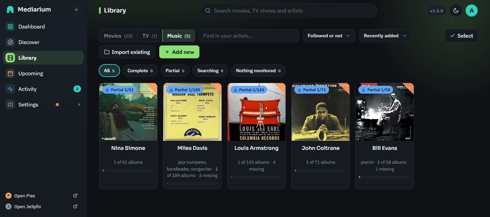
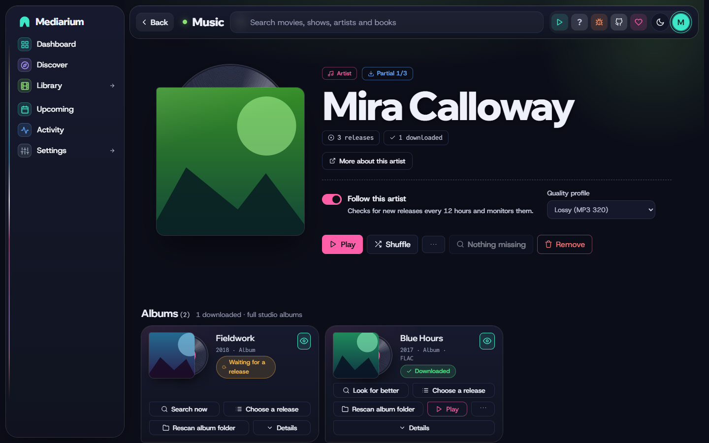
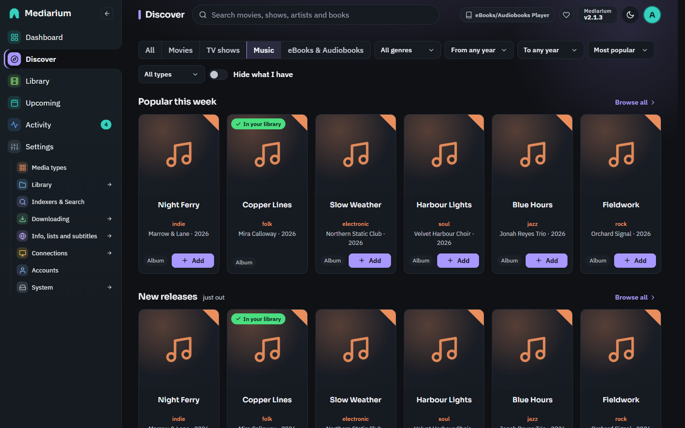

# Music

Mediarium can look after a music collection: artists, their albums and the tracks on them. It finds them with the same indexers, and downloads them with the same Usenet and torrent downloaders, as your movies and shows. Music is a module you switch on. Until you do, nothing about music appears or runs.

## Switching it on

1. Decide where your music lives. Inside the container this is `/music`. With the recommended single `/data` folder (see [INSTALL.md](./INSTALL.md)), add this line to the `environment` section of your compose file so music sits beside your movies and TV and finished downloads can be hardlinked:

   ```yaml
         - MUSIC_DIR=/data/music
   ```

   Or map a folder of its own, for example `- /volume1/music:/music` (no `MUSIC_DIR` line is needed while the right side stays `/music`). The compose file in the install guide has both as commented lines you can switch on. On a NAS, create the folder first, or Docker stops with `Bind mount failed ... does not exist`. The folder is only used once the module is on.
2. As an administrator, open **Settings > Media types** and switch on **Music** (see [modules.md](./modules.md)). Then you can change the music folder on the **Folders** page (Settings > Library). The value in Settings wins over `MUSIC_DIR`.

In the first-run setup wizard, choosing Music on the **Media types** step adds a music box to the **Library paths** step. It starts from `MUSIC_DIR`. If nothing is mapped at `/music` but your movies and TV share a parent folder such as `/data`, it suggests a folder inside it (for example `/data/Music`). If the folder isn't mapped at all, it shows the exact compose line to add.

Switching it off again hides the music pages and stops automatic album searches. Nothing is deleted: your artists, albums and files stay, and downloads already running finish.

For scripts: `PUT /api/settings` with `{"musicEnabled": true, "musicPath": "/data/music"}` switches it on, `PUT /api/modules` with `{"music": true}` does the same, `GET /api/modules` tells every signed-in account which modules are on, and while the module is off every `/api/music/...` request answers 404 `{"error": "The music module is switched off. ..."}`.

## In the app

With the module on, music shows up next to movies and TV. Basic users can browse, add artists and grab releases. The buttons that delete things or change settings are for administrators.



*Library, Music tab: your artists, with how many of their albums you have.*



*An artist page: the summary, the follow switch and quality profile, and the albums with their status.*



*Discover, Music tab: the same filter row as Movies and TV shows, and the rails of popular and new albums.*

- **Library, Music tab** (`/library?kind=music`): your artists as cards with a coloured corner, how many albums you have and how many are missing. Find an artist by name, filter by followed or not, sort by name, date added or most albums missing, and use the chips for Complete, Partial, Waiting for a release or Nothing monitored. **Add new** opens the artist search, **Import existing** starts the collection scan (administrators). Administrators can also use **Select** to follow, stop following, set the quality profile of or remove several artists at once (see [library.md](./library.md)). A kind that's switched off has no tab. If your last-used tab was switched off, the first tab that's on opens.
- **Artist page** (`/music/artist/{id}`): the artist with a summary (releases, downloaded, missing, the quality profile in use, monitored) and their **Albums**, **EPs** and **Singles** as cards. Each card shows the cover, year, quality, what it's doing (Waiting for a release, Downloading with a progress bar, Downloaded, Not monitored) and:
  - an eye button to monitor or stop monitoring the album,
  - **Search now** (or **Look for better** once downloaded),
  - **Choose a release**, the list of releases found, with the quality and the reason automation would skip a release, or a "fallback" label when only a fallback profile accepts it. Grabbing is always allowed,
  - **Details**, which opens the album across the page: **Tracks** (each track with "in library" or "missing"), **Releases**, **What happened** (the album's own activity log, newest first) and **Files** (everything in the album's folder, see below).

  The page refreshes every few seconds while it's open. **Search for N missing albums** searches every monitored album that's missing. Administrators can **Remove** the artist (the "Also delete everything on disk" option is unticked, and shows how many files and how much space the albums take) and change two things right in the summary: **Follow this artist** (whether releases that come out later are picked up, see "Following an artist") and the artist's **Quality profile** (Default, or one of the music profiles). Basic users see both as labels. The cover on the page is the artist's picture (the cover of their first album that has one). When there's none, a music note takes its place.
- **Discover, Music** (`/discover?kind=music`, and inside **All** while Music is on): it has the same row of filters as the Movies and TV shows tabs. To look for an artist by name, use the search box at the top of the page. Below the filters are the rails **Popular this week**, **New releases**, **Coming soon** (albums with a release date still ahead) and **Popular artists**. An album card shows the cover, title, artist, year, whether it's an album, EP or single, and an **Add** button. Artists show how many listens they have. Something already in your library says **In your library** and opens its artist page. Each rail has **Load more** and **Browse all**, which opens the whole list on its own page with pages to step through, a time choice for the popular lists (this week, month, year, all time) and the same filters. The filters are **Genre** (Rock also finds punk rock and hard rock), **From year**, **To year**, **Order** (Most popular, Newest first, Oldest first) and **Type** (Albums, EPs, Singles). Once you pick one, the rails give way to one list of everything that matches, taken from the most played albums of all time, in pages of whole rows. **Hide what I have** leaves out what is already in your library. If a list can't be shown right now, the rail says so instead of staying empty.

  **Add** opens the "Add <artist>" dialog (the same one the header search uses, see "Adding an artist"): **Follow all albums**, **Only future albums** or **Only this album** (for an album; the artist is added but nothing else is monitored), the quality profile, and whether to start searching now. For an artist already in the library, adding an album only switches that album on.
- **Header search**: with music on, the search box at the top also lists matching **Artists** under the movies and shows, each with Add or Open when already in the library. Add opens the same "Add <artist>" dialog as Discover: the choice of what to follow, **Quality profile** and a tick box to start searching now.
- **Album files**: the **Files** tab lists what's in the album's folder (songs, cover, notes) with sizes and dates. **Play** on a song opens a small player in front of the page. **View** shows the cover or a text file. Playing is direct, so it depends on your browser: MP3 and AAC/M4A play everywhere, FLAC in current browsers and Apple Lossless only in Safari. If your browser can't play a file, the player says so. The file itself is untouched.
- **Calendar**: with music on, albums with a release date show up on the Upcoming calendar with their cover in a pink sleeve with the record peeking out (and a "Music" entry in the legend). Clicking one opens the album on its artist page.
- **Settings > Library > Quality > Music** (administrators): all music profiles as cards with their formats, where they stop upgrading (highlighted), fallback and how many artists use them. **New profile** and **Edit** open the same kind of editor as for movies, scrolled into view with the cursor in the name (name, accepted qualities, the quality at which upgrading stops, upgrades on or off, and the fallback order, which you drag). **Make default** sets the profile artists without one of their own use. **Delete** asks first, and a profile that's the default or that artists use is refused with the reason.
- **Upcoming, Wanted**: with more than one kind of media on, chips (All, Movies, TV shows, Music, each with its own icon) filter the list. Albums that are monitored, released and missing (or below the profile's cutoff, under Upgrades) are listed as "Artist – Album" with the cover, the profile and the last search result on hover, a **Search now** button and a link that opens the album on its artist page. The counts on the Missing and Upgrades tabs include albums.
- **Activity**: album downloads appear in the queue like movie downloads, titled "Artist – Album" with the cover and an orange edge, and with the same retry, blocklist-and-search-again and remove buttons. A failed one opens the album from the arrow. Albums still waiting for a release join the "Waiting for a release" list. Recently added and recently downloaded albums on the dashboard open their album too.
- **When MusicBrainz is busy**: to import an album Mediarium needs its track list from MusicBrainz, which now and then answers "busy" (or doesn't answer) for a while. Mediarium asks again with longer and longer pauses (2 seconds, 5, 15, 45 and 2 minutes), never faster than one request a second. If it still gets no answer, the download does not fail and is not downloaded again: the row in Activity says **Waiting for MusicBrainz** with "MusicBrainz is busy. Mediarium will try again later.", the files stay where they are, and the import is tried again every 15 minutes for up to a day. **Retry now** on the row tries the import at once. If MusicBrainz is still not answering after a day, the row fails with a message saying the files are kept, and **Retry** then runs only the import again, from the same files, without downloading. A restart of Mediarium pauses a waiting row like any other download in progress: **Resume** it.
- **Import my music collection** (`/music/import`, administrators): press **Start scanning** and follow the progress bar (it reads the folder, then looks each album up in the music database, one a second). Then you get a summary (added, already in your library, not matched, with a problem) and two lists side by side: what was added (each opens its artist) and what wasn't matched, with the reason and the folder. Scanning again is safe. You can leave the page while it runs: it shows the scan again when you come back, and **Stop the scan** ends it.

## Adding an artist

Search for the artist by name. A short description ("jazz", "UK rock band") tells artists with the same name apart. When you add one, Mediarium lists its **albums, EPs and singles**. Live albums, compilations, remixes, soundtracks and DJ mixes are left out unless you change that (see [Choosing what to show](#choosing-what-to-show)), so by default the list is the artist's own studio releases.

### Searching by album or song

On the **Music** tab of the search page there is one box. Type an artist, an album, a song or a mix such as "Gul Anuv Jain", and the answer is one list with artists, albums and songs together, best match first. Each card has a chip that says **Artist**, **Album** or **Song**. The buttons **All** (the default), **Artists**, **Albums** and **Songs** above the list show only one kind. A song is found by its own title ("Cornfield Chase" finds the song and its album *Interstellar*).

#### One search for music

How the list is ordered:

- The words can be in any order and in the title or the artist, so "Gul Anuv Jain" finds the song *Gul* by Anuv Jain, and "jain anuv" finds the artist Anuv Jain. Capitals and accents do not matter, and a word a letter or two off ("Jian") still counts, a little less than the right spelling.
- An exact name comes before a name that only starts with what you typed, and that before names with more words around it. "(Deluxe Edition)" and other brackets are not counted as extra words.
- Studio albums come before EPs, and those before singles. Compilations, remixes, live albums and bootlegs are pushed down, unless you typed "live" yourself.
- A film or show name leads to its soundtrack: "Interstellar" puts *Interstellar (Original Motion Picture Soundtrack)* above singles and bands that share the name.
- A song that sits on several releases is one card, on its studio album (or its soundtrack). A song that is on many releases counts as better known.
- The score the music database gives each match is part of the order too.

The three searches run at the same time. If one of them cannot answer (the music database is slow or busy), the other two still show, with a note that some results may be missing. The same words typed again give the same list straight away, and when a search fails Mediarium tries it once more before it shows an error.

**Add** on an artist or an album opens the same dialog as everywhere else (**Only this album** is picked for an album). A soundtrack or compilation that isn't one of the artist's own albums is added to that artist all the same, as a wanted album.

#### Adding just one song

A song card has two buttons: **Add the whole album** and **Add only this song**. Mediarium works in albums, so a song is added by adding its album, and the artist if you don't have them yet. With **Add only this song**:

- The album is searched for and downloaded as a whole, like any album. Nothing about the search or the quality profile changes.
- Only the song you picked is **wanted**. When the download is imported, the track with that name (capitals, accents and brackets such as "(Remastered)" or "(feat. ...)" don't matter) is put in your music folder and the other tracks are left out: they stay in the download folder and are cleaned up with it. The album is then **downloaded** and is not listed as missing anything.
- If no track on the album has the song's name (the music database spells it differently), nothing is left out and the whole album is imported, so you are never left with nothing. The album's log says how many tracks are wanted.
- If the release you pick has no file for that song, it is treated like any release that doesn't match the album: it is blocklisted and the next one is tried.
- The **Tracks** tab of the album says "Added for one song" and shows **not wanted** on the other tracks. Press **not wanted** on a track to want it after all, or **Want the whole album** to bring all of them back, then use **Search for missing tracks** to download what is missing.
- The song buttons are for an album you don't have yet. For an artist you already have, only that album and that song are added.

Every album that is added in the usual way, and every album you already have, keeps all tracks wanted. A request from an account that has to ask carries the song along, and the request reads "Artist – Album (only “Song”)".

Scripts: `GET /api/music/search?type=all&q=` answers `{items: [{kind, rank, name, mbid, title, artistName, artistMbid, type, releaseDate, coverUrl, inLibrary, artistId, albumId, song, soundtrack, ...}], note}` with `kind` artist, album or song (for a song, `title` is its album and `mbid` the album's id). `type=album` and `type=song` answer as before, and the search without `type` still answers the plain list of artists (#143, SanketBaraiya). `POST /api/music/artists` takes `song` with `albumMbid`; `POST /api/music/artists/{id}/albums` takes `song`; `PUT /api/music/albums/{id}/monitored` takes `song` (an empty one wants every track again); `PUT /api/music/tracks/{id}/monitored` switches one track.

The Add dialog is the same everywhere you can add an artist (Discover and the header search), with these choices:

| Choice | What is monitored |
|---|---|
| **Follow all albums** (default) | every album, EP and single, and new releases as they come out |
| **Only future albums** | releases that are not out yet (and new ones, once they are found) |
| **Just add the artist** | nothing: the artist is listed, you pick albums yourself |
| **Only this album** (when you add from an album) | that one album; nothing else is monitored |

You can switch any album on or off later. Only albums that are monitored and already released are searched for automatically, and each album has its own switch. Basic users can add artists and albums and grab releases just like movies. Removing an artist is for administrators.

Adding a large discography can take a few seconds, because the music database allows only about one lookup a second. Mediarium remembers answers for a few hours. Where the data comes from is listed under [Sources](#sources).

## Choosing what to show

By default an artist's page lists albums, EPs and singles, and leaves out every release that has a secondary type (live, remix, compilation and so on). You can change that for the whole library under **Settings > Quality**, in the card **Music: what to show**, and for one artist on its own page. Changes are saved as you make them.

- **Release types to show**: Albums, EPs and Singles. At least one has to stay on.
- **Kinds to hide**: Live, Remix, Compilation, DJ-mix, Soundtrack, Demo, Mixtape/Street, Spokenword, Interview, Audiobook, Audio drama and Other (any kind the music database adds later). A release is hidden when any of its kinds is ticked. Everything is ticked by default, which is what Mediarium always did. Untick **Live** and live albums are listed.
- **Hide bootleg-only releases**: off by default. The music database has no status for a release group itself, only for the releases inside it, so a group that only exists as a bootleg (an unofficial recording) is listed like any other album. With this on, Mediarium asks about each group once (a single request for an official release, a second one only when there is none) and leaves out the groups whose releases are all bootlegs, promotions or pseudo-releases. A group with no release at all (an announced album) is kept. The questions go out one a second in the background, so the page opens at once and releases that have not been checked yet stay visible until they have. The answers are kept in the database for about six months. Each release it has to check costs one or two requests, so a long discography takes a few minutes the first time.
- **Official studio releases only** is a one-click preset: albums only, every kind hidden, bootleg-only releases hidden. **Back to the defaults** undoes it.

The choice decides what **following an artist** adds: a new artist gets the releases that pass, and the 12-hourly check only adds new releases that pass. It never removes or unmonitors an album that is already in the library, whatever you change. If you widen the choice (say you allow EPs), the next check adds the EPs that were left out before, and saving an artist's own choice starts that check at once.

On an artist's page, administrators see chips **Show: Albums EPs Singles** and a folded **More filters** with the same checkboxes as the settings card and **Use the library setting** (the default for every artist). Under them a line says what the choice leaves out of the artist's page on the music database, for example "3 hidden: 2 live, 1 bootleg". **Show them** lists those releases for this visit, and **Add to library** adds one by hand. The same choice also applies to the albums you already have: an album in your library that the choice leaves out and that has no files yet is left out of the list, and a second line says so ("3 in your library are hidden by this filter") with its own **Show them** / **Hide them again** button. An album with files always stays in the list. This only changes what the page shows: a filter never deletes, unmonitors or changes an album, so showing a type again brings its albums straight back. Nothing is hidden without being counted.

## How albums are found

Mediarium searches your indexers for **"Artist Album"** in the audio categories (3000 audio, 3010 MP3, 3040 lossless, 3050 other). For every result it reads the release name: artist, album, year, format (FLAC, ALAC, MP3, AAC), bitrate (320, V0, 256, 192), bit depth (16 or 24 bit) and source (WEB, CD, vinyl). Both common styles are understood:

- `Artist - Album (2020) [FLAC 24bit-96kHz]`
- `Artist_Name-Album_Title-(CAT001)-WEB-2020-GROUP`

A release is skipped when it's another artist or another album, a discography or collection instead of one album, dated before the album came out (a later year is fine: that's a reissue or remaster), blocklisted, or of a quality the album's profile doesn't take. The album's page shows every result with these reasons (interactive search), and its activity log records each automatic search: how many releases were found, how many were acceptable, why the others weren't, and which one was picked.

Wanted albums are searched on the same schedule as movies and shows (see [Automatic searching](./quality-profiles.md#automatic-searching)), at most 25 albums per run. A longer wanted list is worked through over the next runs.

### Following an artist

An artist is either **followed** or not (`monitored` on the artist). Following decides one thing: whether releases that come out **later** are picked up. Every 12 hours (while the music module is on) Mediarium checks the releases of each followed artist again. A new album is added and monitored, so it's searched for as soon as it's out, and an announced album that now has a release date gets it. Unfollowing an artist stops that. **It never changes the monitored switch of any album already listed.** Those keep deciding, one by one, what is searched for, so an unfollowed artist's monitored albums are still wanted.

Administrators change it, and the quality profile, with `PUT /api/music/artists/{id}` and `{monitored?: bool, profileId?: number, filter?: {types, hideSecondary, hideBootlegs}, useLibraryFilter?: bool}` (`profileId` 0 puts the artist back on the default profile; a field left out changes nothing). `filter` is this artist's own choice of what to list and add (see [Choosing what to show](#choosing-what-to-show)) and `useLibraryFilter: true` takes it back. The answer is the artist with its albums, like `GET /api/music/artists/{id}`.

## Quality

Music has its own quality ladder, worst to best: **MP3-192, MP3-256, AAC-256, MP3-320/V0, FLAC, FLAC 24bit**. ALAC counts as FLAC. A release name that says nothing about the format is "Unknown" and isn't taken automatically. An MP3 release that names no bitrate counts as MP3-192. Once files are on disk their quality is read from the files themselves (see below), not from the release name.

Two profiles are built in:

| Profile | Takes | Stops upgrading at |
|---|---|---|
| **Lossy (MP3 320)** (default) | MP3 320/V0, AAC 256 | MP3-320/V0 |
| **Lossless (FLAC)** | FLAC, FLAC 24bit; falls back to *Lossy* when no lossless release exists | FLAC |

Upgrades start off on both, so an album is downloaded once and left alone. "Stops upgrading at" is where a profile stops if you switch upgrades on (Settings > Library > Quality > Music, *Keep looking for better versions after it is downloaded*). An album that's only there because of a fallback profile is still replaced when a release the main profile accepts appears, with upgrades on or off.

MP3 is the default because it's the most common format. With the Lossless profile, an album that's only available as MP3 320 is downloaded as MP3 (a fallback), and replaced as soon as a FLAC release turns up. New installs start with this order. Profiles and the default you already chose are not changed, and they keep the upgrade setting they were saved with. 24-bit FLAC is taken when it's the best release found, but not hunted for: those files are several times larger.

## Where files go

After the download is repaired and unpacked (as for movies), Mediarium finds the audio files (`.flac`, `.mp3`, `.m4a`, `.aac`, `.ogg`, `.opus`, `.alac`), matches them to the album's tracklist from the metadata service, and places them like this:

```
<music folder>/<Artist>/<Album> (<Year>)/01 - Title.flac        one disc
<music folder>/<Artist>/<Album> (<Year>)/2-01 - Title.flac      albums with several discs
```

Plex, Jellyfin and Navidrome all read this layout. Files are hardlinked from the downloads folder when both are on the same disk (no extra space), otherwise copied. `cover.jpg` and `folder.jpg` (or `.png`, or `.webp`) are kept beside the tracks. Other files (`.nfo`, `.log`, `.cue`) aren't copied.

Files are matched by disc and track number first (from the file name, or a `CD1`/`Disc 2` folder), then by title, then by number alone. If none of a release's files can be matched, the release is blocklisted as bad and the next-best one is tried, as for movies. Tracks the release doesn't have, and extra files it has, are listed in the album's activity. When an album is upgraded (MP3 to FLAC), the old files are removed once the new ones are in place.

### Your own profiles

Administrators can make, change and delete music profiles, and choose which one is the default (used by artists that have none of their own; the built-in Lossy (MP3 320) until you change it). A profile has a name, the qualities it accepts, a **cutoff** (once an album reaches it, it's no longer searched for upgrades), whether upgrades are allowed at all, and an optional **fallback chain**: other profiles tried, in order, when nothing a profile accepts can be found. The rules are those of the movie and TV profiles: the name is unique, at least one quality is picked, the cutoff must be one of them, and a profile that's the default or that an artist uses can't be deleted (the answer says which). Only a profile's own fallback list is followed.

`POST /api/music/profiles`, `PUT /api/music/profiles/{id}` and `DELETE /api/music/profiles/{id}` take and return `{id, name, allowed[], cutoff, upgradeAllowed, fallback[], default, inUse}` (`GET /api/music/tiers` lists the qualities to pick from, worst to best). The default is chosen with `musicDefaultProfileId` in `PUT /api/settings` (stored as `music.default_profile_id`).

### Tags and real quality

Mediarium reads the tags inside audio files (ID3, Vorbis comments, MP4) with the [dhowden/tag](https://github.com/dhowden/tag) library: title, artist, album artist, album, track and disc number, year and whether a picture is embedded. **It only reads. Your files and their tags are never rewritten.** After a download the tags identify each file first (track and disc number, title), then the file and folder names fill in what the tags lack.

The quality of the files is read from their headers, so it's what the files are and not what the release was called:

| Format | How it is rated |
|---|---|
| FLAC | 16 bit is **FLAC**, 24 bit is **FLAC 24bit** |
| Apple Lossless (`.m4a`) | the same, from the bit depth stored in the file |
| MP3, constant bitrate | 320 kbit/s is **MP3-320/V0**, 256 is **MP3-256**, less is **MP3-192** |
| MP3, variable bitrate | by the average bitrate: about 220 kbit/s and up (LAME V0 averages 220 to 260) is **MP3-320/V0**, 190 and up **MP3-256**, less **MP3-192** |
| AAC (`.m4a`, `.aac`) | 224 kbit/s and up is **AAC-256**, less ranks with the lowest MP3 |
| Ogg Vorbis and Opus | a rough guide from the average bitrate, on the MP3 steps |

An album is rated by its weakest file, so one MP3 among FLAC files makes it MP3. A file whose header can't be read is left out of the count. When none can be read the album is **Unknown**, which automation never upgrades.

## Files and playing tracks

`GET /api/music/albums/{id}/files` (any account) lists the files in an album's folder like the movie and show file listings: `{folder, files: [{path, size, modified, kind, main, trackId}]}`. `folder` is relative to the music folder (never the full path on the server), `kind` is `audio`, `image`, `nfo`, `subtitle` or `other`, and a track's file has `main: true` and its `trackId`. An album that isn't on disk yet has an empty listing.

`GET /api/files/stream?album={id}&path=<relative path>` sends one of those files as it is, with range support so a browser can seek, and an audio file with its own type: `audio/flac`, `audio/mpeg` (MP3), `audio/mp4` (M4A, ALAC), `audio/aac`, `audio/ogg` and `audio/opus`. The cover and text files preview as they do for movies, and everything else is refused. Every answer keeps the `nosniff`, `Content-Security-Policy: sandbox` and inline `Content-Disposition` headers. Only files inside the album's folder, which must lie inside the music folder, can be reached: no `../`, no absolute paths, no symbolic links leading out. Whether a browser can play a format is up to the browser (MP3 and AAC/M4A play everywhere, FLAC in current browsers, ALAC only in Safari). Playing is refused while the music module is off.

## Playing music in Mediarium

On an artist page, **Play** on a downloaded album starts it from the first track, and the play button next to a track starts the album from there. The button next to the volume (**Open the player in its own window**) moves the music to a small window of its own, like the audiobook player: the cover, the controls and the queue, which carries on from where it was. **Back to the app** in that window gives the music back to the bar. Starting something new in the app takes over from the window. If nothing opens, allow pop-ups for the site. **Play** and **Shuffle** at the top of the page queue everything of that artist that is in your library, newest album first, and every artist card in the music Library has a **Play** button too. A bar appears at the bottom of the window with the cover, the title, previous and next, a seek bar, shuffle, repeat (the whole queue, or one track), a volume slider and a close button. The music keeps playing while you move to other pages, and the media keys, headphone buttons and lock screen work too (the browser decides how much of that it shows). The volume is remembered in your browser.

Which formats play is up to the browser, as described above. When a track can't be played, the bar says so and moves on to the next one after a couple of seconds.

`GET /api/music/tracks/{id}/play` (any account) sends a track's file with range support, so seeking works. It answers 404 for a track that isn't on disk, and only files inside the music folder can be reached.

## Queue, playlists, lyrics and scrobbling

Besides play, previous, next, seek, shuffle, repeat and the volume, the player bar has a **Queue** button, a **Lyrics** button and a **Player settings** button. Each opens a panel above the bar.

### The queue

The **Queue** button opens the list of what is coming. The track that is playing is highlighted. Click a track to play it, drag a track by its dots to move it (or use the arrows on the right, which also work on a phone), and press the cross to remove it. **Clear** removes everything except the track that is playing.

The **...** menu on a track, an album or an artist has **Play next** (right after the track that is playing) and **Add to queue** (at the end). **Save as playlist** in the queue panel puts the whole queue on a playlist.

The queue is kept on the device you use, in the browser's own storage, so a reload or a new visit brings it back, paused, at the place you left it. It is not shared between your devices. If the music module is switched off the kept queue is dropped.

### Playlists

Open **Library > Music > Playlists** (`/music/playlists`). A playlist belongs to the account that made it and is private by default. Switch on **Share with everyone** and everyone on the server can see and play it, but only you can change or delete it.

- **New playlist** makes an empty one. From the **...** menu on a track, an album or an artist, **Add to playlist** puts it on an existing list or on a new one. An album adds the tracks you have, in track order. For an artist the menu says **Add top tracks to a playlist**: up to 20 of their tracks, the most played first (the order comes from ListenBrainz and only tracks you own are used). When ListenBrainz can't be reached, or knows none of them, you get their tracks from the newest album on.
- On a playlist you can play it, shuffle it, add it to the queue, rename it, drag tracks into another order, remove tracks, and delete the list. A track you don't have a file for yet stays on the list, greyed out, and is skipped when playing. The same track can be on a list more than once. A list holds up to 5000 tracks.
- If an album is removed from the library, its tracks leave the playlists. Deleting an account deletes its playlists.

### Lyrics

The **Lyrics** button shows the words of the song. If they come with times, the line being sung is highlighted and follows the song, and a click on a line jumps to it. Without times you get the plain words. Mediarium looks in this order:

1. A `.lrc` file with the same name as the audio file, next to it (`01 - Song.flac` and `01 - Song.lrc`).
2. The lyrics written in the file's tags (ID3 lyrics, Vorbis `LYRICS`, `UNSYNCEDLYRICS` or `SYNCEDLYRICS`, MP4 lyrics). Text that has `[mm:ss.xx]` times counts as synced.
3. [LRCLIB](https://lrclib.net), a free lyrics service. Mediarium sends it the title, artist, album and length of the track, and says who it is in the User-Agent. The answer is kept in the database, so a track is asked about once; a track it had nothing for is asked again after 30 days. If the service can't be reached, nothing is remembered and the next look tries again.

Synced lyrics win over plain ones: if a file only has plain words and LRCLIB has them with times, you get the timed version. Your files are only read, never changed.

An administrator can stop the online lookup in the player's settings (**Settings** tab of the player panel, **Look up lyrics online**). It is on until then, and it only happens when someone opens the lyrics of a track that has none of its own. `GET /api/music/player-settings` (any account) and `PUT /api/music/player-settings` with `{"lyricsOnline": false}` (administrators) do the same.

### Crossfade, gapless and ReplayGain

These are in the **Settings** tab of the player panel and are kept on the device, in the browser.

- **Gapless.** While a track plays, the next one is already loaded in a second audio element, and the player starts it just before the first one ends. A gap of a few milliseconds is possible. Seeking, skipping and loading a new track work as always.
- **Crossfade** (0 to 12 seconds, off by default). The end of one track fades out while the next fades in. Tracks of the same album follow each other without a fade, because live albums and mixes are made to run on. A short track never gives up more than 40% of itself. Skipping with a button is always a clean cut.
- **Even out the volume (ReplayGain)**: off, by track or by album, off by default. The player reads the `REPLAYGAIN_TRACK_GAIN`, `REPLAYGAIN_ALBUM_GAIN` and the peak tags (and Opus `R128_*` tags) and turns the track up or down to match. A track is never turned up so far that it would clip: if the loudest sample would pass full scale, the boost is held back, and a boost is refused altogether when the file has no peak tag. A file without the tags plays as it is, and "by album" uses the track gain for a file that only has that. Mediarium doesn't measure or write these tags.

Crossfade and ReplayGain use the browser's Web Audio. It is only switched on when one of them is. Playing with both off is the plain audio element, as before. **Safari on iPhone and iPad:** it ignores the volume of an audio element and has had bugs where Web Audio goes quiet when the screen is locked, so on those devices crossfade and ReplayGain may stop working while locked, and the volume slider is hidden (use the buttons on the side). With both off, playback behaves as it always has. Gapless also needs the page's code to run when a track ends, which a locked iPhone does not always allow. The lock screen and headphone controls (previous, next, play, pause, seek) work through the media session as before.

`GET /api/music/tracks/{id}/gain` (any account that may play) answers `{trackGain, trackPeak, albumGain, albumPeak}` in dB and as a plain number, with `null` for what the file doesn't have.

### Sending your plays to ListenBrainz

Each account can send what it plays to its own [ListenBrainz](https://listenbrainz.org) account. In **Settings > Profile > ListenBrainz** copy your user token from listenbrainz.org/settings, paste it and press **Connect**. Mediarium asks ListenBrainz whether the token is good before keeping it. It is stored encrypted, belongs to your account, is never shown again and never written to the log. **Send my plays to ListenBrainz** switches sending on and off without losing the token, and **Disconnect** forgets it.

- When a track starts, ListenBrainz is told what is playing now.
- A track counts as a listen once you have heard half of it or four minutes, whichever is less (seeking ahead doesn't count as listening). It is sent with the time it started.
- Mediarium looks the track up in its own library, so the title, artist, album, length, track number and the MusicBrainz ids of the artist and album come from there.
- If ListenBrainz can't be reached, or asks for fewer requests, the plays are kept (up to 500 per account) and sent together, oldest first, with the next one. If it stops accepting the token, sending is switched off and the profile says why until you paste the token again.

Last.fm isn't supported.

`GET`, `PUT` and `DELETE /api/music/listenbrainz` read, change and remove your own connection (`{token?, enabled?}`; the answer is `{connected, user?, enabled, lastError?, submitted, pending}` and never has the token). `POST /api/music/listenbrainz/playing` with `{trackId}` and `POST /api/music/listenbrainz/listen` with `{trackId, listenedAt}` (Unix seconds) are what the player calls.

## Dashboard

`GET /api/dashboard` (any account) has a `library.music` block, `{artists, albums, downloaded, missing}`, counted from your library whether or not the music module is switched on (zeros when there's nothing). `missing` counts albums that are neither downloaded nor downloading. The other fields are unchanged.

## Calendar

Albums appear on the calendar (`GET /api/calendar`, entries with `kind: "album"`) while the music module is on: monitored albums that come out within the same window as episodes, 30 days back and 120 days ahead. Only albums with a full release date can be placed on a day, so an album that's only dated to a year isn't shown. An entry is `{kind: "album", id, albumId, artistId, title: "Artist — Album", subtitle: "Album"|"EP"|"Single", releaseDate, status}`. Movies and episodes are unchanged.

## Media servers

After an album is imported, Plex, Jellyfin and Emby are asked to scan its folder, with the same short wait, path mapping and settings as for movies and shows ([media-servers.md](./media-servers.md)). Albums found by scanning an existing folder aren't announced, because the files were already there. Point your media server's music library at the same folder as Mediarium's music folder.

## Discover

The Music option on Discover also lists what's popular, what came out lately and what's coming. The lists come from a free public service that needs no account or key. They're kept in memory for an hour, so many people can open the page without asking again. Every account can use them, and like every music route they answer 404 while the module is off.

`GET /api/music/discover` takes:

| Query | Values | Meaning |
|---|---|---|
| `list` | `popular` (default), `new`, `upcoming` | `popular`: the most listened-to releases over `range`. `new`: released in the last 14 days, newest first. `upcoming`: dated after today, up to 90 days ahead, soonest first. |
| `type` | `all` (default), `album`, `ep`, `single` | Only that kind of release. Live albums, compilations, remixes and other odd releases are left out, as they are when an artist is added. |
| `range` | `week` (default), `month`, `year`, `all_time` | Only for `popular`. |
| `genre` | a genre name, case-insensitive | Only releases with a tag that is that genre or a kind of it (`rock` finds `punk rock`). A list whose releases carry no tags at all cannot be filtered, so the genre is then ignored. |
| `yearFrom`, `yearTo` | a four digit year | Only releases from that year on, and up to that year. A release with no known date is left out when either is given. |
| `sort` | `popular` (default), `newest`, `oldest` | `popular` keeps the order of the list. The other two order by release date; releases with no date come last. |
| `page`, `pageSize` | 1.., 24 (at most 100) | Paging. |

It answers `{page, totalPages, items, note?}` where each item is `{mbid, title, type, artistName, artistMbid, releaseDate, genres, coverUrl, inLibrary, artistId?, albumId?}`. `mbid` is the release group id, `type` is `album`, `ep` or `single`, `genres` is a list of up to four names (empty when there are none), and `releaseDate` is `YYYY-MM-DD` (or a shorter date, or empty, when only that is known). `inLibrary` is true when that album is already in your library (then `albumId` and `artistId` are set and `coverUrl` is the album's own cover). `artistId` alone means you have the artist but not that release. `totalPages` is at least 1, and a page past the end has no items. If the lists can't be reached the answer is still 200 with `items: []` and `note: "The list is not available right now. Try again later."`.

`GET /api/music/discover/artists?range=week|month|year|all_time&page=&pageSize=` lists the most listened-to artists as `{page, totalPages, items: [{mbid, name, listenCount, inLibrary, artistId?, coverUrl?}], note?}` (`coverUrl` is only there for artists you have). Add one with `POST /api/music/artists` and its `mbid`.

Covers on these lists never come from an outside host. `coverUrl` is `/api/music/covers/release-group/{mbid}` (any account), which fetches the front cover of that release group once, keeps it in the `music-covers` folder and serves it like the album covers below. A release group without cover art answers a plain 404.

### The page of an album you don't have yet

A card on the Music tab of Discover opens a page of its own: the cover, the artist, the year and genres, the full tracklist with lengths, and an **Add to library** button (**Add early** for an album that isn't out yet). An album already in your library opens at its place on the artist page instead. The tracklist and genres come from the music database; if it can't be reached, the page says the tracklist isn't available right now and **Add** still works. For scripts: `GET /api/music/preview/{mbid}` (any account; `mbid` is the release group id) answers the card's fields plus `tracks: [{disc, position, title, lengthMs?}]`. The covers of a Discover page are fetched in the background as soon as the list is built, a few at a time, so they are usually ready before the page asks for them.

## Cover art

Covers are the 500 pixel front cover of the album, fetched **once** per album and kept in the `music-covers` folder inside your config folder, so the app never loads images from an outside site and your browser only talks to Mediarium. `GET /api/music/albums/{id}/cover` and `GET /api/music/artists/{id}/cover` (any account) serve the image with cache headers so browsers keep it for a day, and with an `ETag`, so a browser that asks again gets a short "not modified" answer. An artist's picture is the cover of its first album that has one.

### Thumbnails

The artist and album grids don't need a 500 pixel cover (or a 3000 pixel scan from your album folder), so they ask for a small one: add `?size=thumb` to any cover address, for example `/api/music/artists/12/cover?size=thumb`. Mediarium makes a JPEG of at most 256 by 256 pixels at quality 70 (a few kilobytes) the first time it is asked, keeps it in the same `music-covers` folder as `thumb-<hash>.img` and serves that from then on. Browsers keep a thumbnail for three days and ask again with its `ETag`. Without `?size=thumb` you still get the full picture, and a picture that can't be shrunk is sent as it is. A thumbnail is made from the picture it belongs to, so when you replace a `cover.jpg` the new thumbnail follows by itself, and the cover files in your album folders are never touched. There is no setting for this: thumbnails cost a few kilobytes each and are only made for covers that are shown.

Looking for and shrinking covers is kept gentle on large libraries:

- Many requests for the same cover (or the same artist) share one download. At most four downloads from the archive or resizes run at the same time, the rest wait their turn. A download carries on even when the browser has already moved on, so the cover is there next time.
- An artist whose albums have no cover is remembered for three hours (and an album or artist without a cover tells the browser not to ask again for half an hour). A cover that is found is remembered for ten minutes. When the archive can't be reached, the answer is kept for a minute only and the cover is tried again after that. Importing an album forgets what was remembered for its artist.
- A cover already in an album folder is found with one look at the folder, not one per file name.
- The cache keeps up to 20,000 covers and 60,000 thumbnails, the oldest first. The small "no cover" notes aren't counted and expire after a day. A cover that is in use is marked as used every few days, so the ones you look at stay.

To clear the thumbnails (they come back by themselves), delete the files starting with `thumb-` in the `music-covers` folder. To start over completely, delete the whole `music-covers` folder: covers are fetched again as they are shown. Nothing in your music folders is touched.

If there's no cover the answer is a plain 404, and Mediarium doesn't look again for a day.

When an album is imported after a download and its folder has no `cover.jpg`, `folder.jpg` or `cover.png`, the cover is saved there as `cover.jpg` (`cover.png` for a PNG) so Plex, Jellyfin and Navidrome show it too. **An existing cover is never replaced**, and a cover file already in the album folder is also what the cover routes serve. Scanning an existing collection writes nothing into your folders.

## Importing an existing collection

If your music is already in the music folder as `Artist/Album/tracks` (a year in the album folder name helps: `Album (1997)`, `1997 - Album`), an administrator can have Mediarium find it. `POST /api/music/import/scan` reads the folder in the background, looks every artist and album up in the music database by name (and year), and registers what matches **where it is**. No file is moved, renamed or changed.

- A matched artist is added to the library with its albums, EPs and singles. Only the albums found in your folder are monitored, so nothing else starts downloading.
- A matched album is marked downloaded, its folder recorded and each track linked to its file.
- The tags of the files say who and what an album is (the artist, album and year most of its files agree on), so a folder with a wrong or odd name is still found. The folder names are used when the files have no tags, and as a second try when the tags find nothing in the music database.
- The quality is read from the files (see "Tags and real quality"). It's **Unknown** only when no file's header can be read. Automation leaves an Unknown album alone, so it's never swapped for a better release behind your back. Choose the album and search by hand if you want an upgrade.
- What doesn't match is reported, with the reason: no artist of that name in the music database, no album of that name among the artist's albums, or audio files loose in an artist folder (put them in an album folder).
- Scanning again is safe: albums already registered are reported as "already in your library".
- When an album, an EP and a single share a name and a year (AC/DC "Back in Black", Roxette "Joyride"), the folder goes to the album, or to the single when it holds only one or two audio files. A folder that an older version linked to the single is moved to the album by scanning again, and the single goes back to wanted.
- A damaged file can't hold the scan up. Reading one file's tags stops after 5 seconds or 16 MB, and the file is then matched by its name. The album gets a note saying how many files that happened to (a truncated or zero-filled FLAC is the usual cause), and the log names each file.
- The scan keeps running when you leave the page. Coming back shows it again, with the folder it's on now. **Stop the scan** ends it; what it had already added stays in your library. A scan that makes no progress for 10 minutes is replaced when you start a new one.

`GET /api/music/import/scan/{id}` answers `{id, root, phase: "scanning"|"matching"|"done"|"failed"|"stopped", done, total, current, summary: {artists, albums, imported, already, unmatched, failed}, results: [{artist, album, folder, files, status: "imported"|"already"|"unmatched"|"failed", message, note, artistId, albumId, quality, tracks}], error?}`. `GET /api/music/import/scan` answers the latest scan the same way (`{"id": ""}` when none has run since the server started), and `DELETE /api/music/import/scan/{id}` stops a running one. Starting a scan while one is running returns the running one.

## Rescanning an album's folder and deleting a file

The import above skips albums that are already in your library. When you change an album's folder by hand (you copy in the tracks that are missing, replace a damaged file, or remove one), press **Rescan album folder** on the album's card (administrators only). Mediarium reads the audio files in the album's folder again and matches them to the album's tracks the same way the import and a download do: by the tags, the track numbers and the titles. Then:

- A track that now has a file is linked to it, where the file lies. Nothing is moved, renamed or deleted.
- A track whose file is gone from the folder loses its link.
- The album's quality is read from the files again (the lowest one among them), and the album's status follows: **downloaded** while at least one track has a file, **missing** (wanted again, if it is monitored) when no audio file is left.
- Files that fit no track are counted and left alone.

The card then says how many tracks have a file, which ones are missing, and the quality. If the album is still incomplete and monitored, it says so and offers **Search for missing tracks**, which searches right away and accepts any release your profile allows, not only an upgrade over what is there. An album that isn't monitored says that Mediarium won't look for the rest. Automatic searches don't go looking for albums that are only partly there, so use that button, or **Choose a release**, when you want the rest.

In the album's **Files** tab, **Delete file** (administrators only) asks first and then removes that one file from the album's folder. It goes to the recycle bin when that is on, and is deleted otherwise. Only a file inside the album's folder, which must lie inside the music folder, can be removed: no `../`, no absolute paths, no link leading out. The track that used the file loses its link, the album's quality and status are worked out again (the album is wanted again when no audio file is left), and the card says what is left. A file can't be deleted while its album is downloading.

`POST /api/music/albums/{id}/rescan` and `DELETE /api/music/albums/{id}/files?path=<relative path>` (both administrators only) answer with `{status, quality, folder, files, tracks, matched, linked, dropped, extra, complete, missingTitles, monitored}`; the deletion also has `deleted` (the path) and `trashed`. `matched` is the number of tracks with a file, `linked` how many of them this rescan linked, `dropped` how many links it removed because the file is gone, `extra` the files that fit no track, and `missingTitles` the first 25 tracks without a file. A rescan of an album that is downloading answers 409.

## Removing an artist

Removing an artist (administrators) always cancels its downloads and deletes their files in the downloads folder. With **Delete files** its album folders in the music folder go too, and the artist folder once it's empty. Nothing outside the music folder is ever deleted.

## Sources

Album, artist and release information, cover art and the popular and new-release lists on Discover all come from free public music services. They ask apps to make at most one request per second and to say who they are, and Mediarium does both. Lyrics are looked up on [LRCLIB](https://lrclib.net) (see "Lyrics"), and ListenBrainz also receives your plays if you connect it. The services are named and credited on the **About and credits** page in the app and in [LEGAL.md](./LEGAL.md).

## API

| Method | Path | Body / query | Answer |
|---|---|---|---|
| GET | `/api/music/search?q=` | | `[{mbid, name, sortName, disambiguation, type, country, score, artistId}]` (`artistId` 0 when not added); `&type=all` answers `{items, note}` with artists, albums and songs ranked together |
| GET | `/api/music/discover?list=&type=&range=&genre=&yearFrom=&yearTo=&sort=&page=&pageSize=` | see "Discover" | `{page, totalPages, items: [{mbid, title, type, artistName, artistMbid, releaseDate, genres, coverUrl, inLibrary, artistId?, albumId?}], note?}` |
| GET | `/api/music/discover/artists?range=&page=&pageSize=` | | `{page, totalPages, items: [{mbid, name, listenCount, inLibrary, artistId?, coverUrl?}], note?}` |
| GET | `/api/music/covers/release-group/{mbid}` | | the front cover of a release group (JPEG or PNG), or a plain 404 |
| GET | `/api/music/profiles` | | `[{id, name, allowed[], cutoff, upgradeAllowed, fallback[], default, inUse}]` |
| GET | `/api/music/tiers` | | `["Unknown", "MP3-192", ..., "FLAC 24bit"]` |
| POST | `/api/music/profiles` | `{name, allowed[], cutoff, upgradeAllowed, fallback[]}` | 201 profile; admin only |
| PUT | `/api/music/profiles/{id}` | same (a missing `fallback` keeps the chain) | the profile; admin only |
| DELETE | `/api/music/profiles/{id}` | | 409 when it is the default or in use; admin only |
| POST | `/api/music/artists` | `{mbid, monitor?: "all"\|"future"\|"none", profileId?, searchNow?}` | 201 artist with `albums` |
| GET | `/api/music/artists` | | `[artist]` |
| GET | `/api/music/artists/{id}` | | artist with `albums` |
| PUT | `/api/music/artists/{id}` | `{monitored?, profileId?, filter?, useLibraryFilter?}` | the artist with `albums`; admin only |
| GET | `/api/music/artists/{id}/discography` | | what the artist's filter leaves out: `{filter, hidden: [{mbid, title, type, releaseDate, secondaryTypes, hiddenBy}], library: [{albumId, mbid, hiddenBy}], counts: {reason: n}, checking}`. `hidden` and `counts` are releases that are not in the library; `library` names the albums that are, which the page leaves out of its list because they have no files (an album with files is never named); `hiddenBy` is `album`, `ep`, `single`, a kind (`live`, `remix`, ...) or `bootleg`; `checking` counts releases the bootleg test has not looked at yet |
| POST | `/api/music/artists/{id}/albums` | `{mbid}` | 201 album: adds one release the filter left out, monitored; needs the manage permission |
| GET | `/api/music/filters` | | `{filter: {types, hideSecondary, hideBootlegs}, defaults, studio, secondaryTypes: [{key, name}]}` |
| PUT | `/api/music/filters` | `{types, hideSecondary, hideBootlegs}` | the same as GET; admin only |
| DELETE | `/api/music/artists/{id}?deleteFiles=true` | | admin only |
| GET | `/api/music/albums/{id}` | | album with `artistName` and `tracks` |
| PUT | `/api/music/albums/{id}/monitored` | `{monitored}` | |
| POST | `/api/music/albums/{id}/rescan` | | `{status, quality, folder, files, tracks, matched, linked, dropped, extra, complete, missingTitles, monitored}`; admin only |
| DELETE | `/api/music/albums/{id}/files?path=` | | the same, plus `deleted` and `trashed`; admin only |
| POST | `/api/music/albums/{id}/search` | | `[release]` with `rejections` |
| POST | `/api/music/albums/{id}/grab` | `{releaseTitle, downloadUrl, sizeBytes, protocol?}` | 202 `{queueId}` |
| POST | `/api/music/albums/{id}/search-now` | | `{grabbed, message}` |
| GET | `/api/music/albums/{id}/files` | | `{folder, files: [{path, size, modified, kind, main, trackId?}]}` |
| GET | `/api/files/stream?album={id}&path=` | | one file of the album, with ranges (audio types as above) |
| GET | `/api/music/albums/{id}/cover` | | the cover image (JPEG or PNG), or a plain 404 |
| GET | `/api/music/artists/{id}/cover` | | a picture for the artist (its first album cover), or a plain 404 |
| GET | `/api/music/albums/{id}/events` | | `[{at, kind, message, level}]` |
| GET | `/api/music/wanted?kind=missing\|cutoff` | | `[album + {artistName, profileName, cutoff, lastSearch, lastSearchAt}]` |
| GET | `/api/music/playlists` | | `[{id, name, shared, mine, owner, trackCount, durationMs, albumIds[], updatedAt}]`: your lists, then the ones shared with everyone |
| POST | `/api/music/playlists` | `{name, shared?, trackIds?, albumId?, artistId?}` | 201 playlist with `tracks` (`albumId` adds the album, `artistId` the artist's top tracks) |
| GET | `/api/music/playlists/{id}` | | playlist with `tracks: [{entryId, trackId, title, artist, artistId, album, albumId, lengthMs, hasFile}]`; 404 for a private list of someone else |
| PUT | `/api/music/playlists/{id}` | `{name?, shared?}` | the playlist; owner only |
| DELETE | `/api/music/playlists/{id}` | | 204; owner only |
| POST | `/api/music/playlists/{id}/tracks` | `{trackIds?, albumId?, artistId?}` | `{added, playlist}`; owner only |
| DELETE | `/api/music/playlists/{id}/tracks/{entryId}` | | the playlist; owner only |
| PUT | `/api/music/playlists/{id}/order` | `{entryIds: [...]}` every entry once, in the new order | the playlist; owner only |
| GET | `/api/music/tracks/{id}/lyrics` | | `{source: "sidecar"\|"file"\|"lrclib"\|"", synced, plain, instrumental, online}` |
| GET | `/api/music/tracks/{id}/gain` | | `{trackGain, trackPeak, albumGain, albumPeak}` (dB; `null` when missing) |
| GET | `/api/music/player-settings` | | `{lyricsOnline}` |
| PUT | `/api/music/player-settings` | `{lyricsOnline}` | administrators only |
| GET | `/api/music/listenbrainz` | | `{connected, user?, enabled, lastError?, submitted, pending}` for your account |
| PUT | `/api/music/listenbrainz` | `{token?, enabled?}` | the same; a token is checked with ListenBrainz first |
| DELETE | `/api/music/listenbrainz` | | 204; forgets the token and any unsent plays |
| POST | `/api/music/listenbrainz/playing` | `{trackId}` | `{sent}` |
| POST | `/api/music/listenbrainz/listen` | `{trackId, listenedAt}` | `{sent, submitted, pending}` |

An artist is `{id, mbid, name, sortName, disambiguation, monitored, monitorNew, profileId, profileName, addedAt, addedBy, albumCount, monitoredCount, downloadedCount, coverUrl, imageUrl}` (and, on `GET /api/music/artists/{id}`, `filter: {types, hideSecondary, hideBootlegs, useLibrary}`); an album `{id, artistId, mbid, title, type, releaseDate, year, monitored, status, quality, path, coverUrl, coverArchiveUrl}`; a track `{id, disc, position, title, lengthMs, hasFile, filePath, monitored}` (`monitored` is false for a track that is not wanted; `GET /api/music/albums/{id}` also has `onlySong`). A release in the interactive search carries what its name says (`artist, album, year, format, bitrate, bitDepth, source, discography, quality`) beside the usual `title, indexerName, protocol, downloadUrl, sizeBytes, publishDate, seeders, peers, blocklisted, rejections, acceptedBy`. `coverUrl` (and, on artists, `imageUrl`, the same address) point at the cover routes above. `coverArchiveUrl` is the address of the original picture at the cover-art service. Album downloads appear in `GET /api/queue` with `albumId` and the title "Artist – Album".
