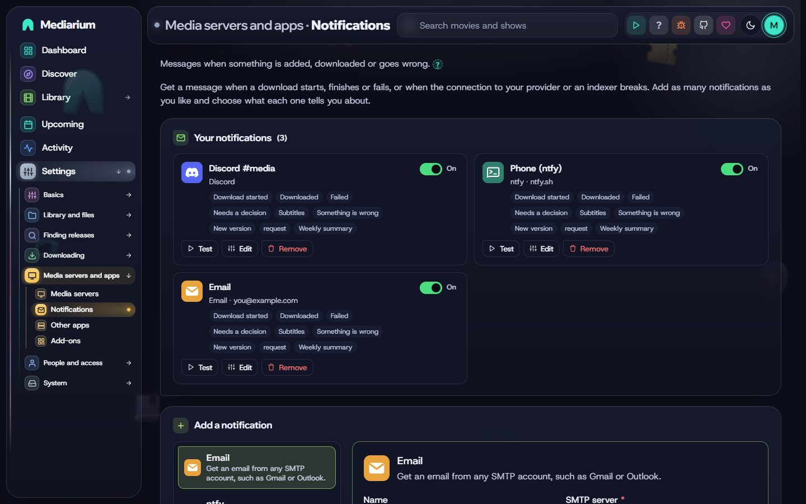

# Notifications

Notifications tell you when something happens: a download started or finished, a download failed, Mediarium needs a decision, a subtitle arrived, a connection to your Usenet provider or an indexer broke, a download client went down or came back, an error was added to Logs and errors, or a new version of Mediarium is out. Administrators set them up under **Settings > Media servers and apps > Notifications**.

## The page

- **Your notifications** at the top lists everything you have set up, one card each: the logo, its name, where it goes, and what it tells you about. Every card has an **on/off switch** (off keeps the settings but sends nothing), **Test** (sends a test message right now), **Edit** and **Remove**. With no notifications yet, the section says so and suggests ntfy, which needs no account.
- **Add a notification** below it has the list of ways to be notified on the left and the form for the one you picked on the right. On a phone the list becomes a row you slide sideways. What you type in one method is kept while you look at the others (a small dot marks the ones you started), until you press **Add**.



*Settings > Media servers and apps > Notifications: the notifications you have set up, each with its switch, Test, Edit and Remove, and the ways to add another below.*

## Ways to be notified

| Method | What it needs |
|---|---|
| Email | The outgoing (SMTP) server of your email account, a login if it needs one, a "from" and a "to" address. Gmail and Outlook need an app password. The **From name** box sets the name emails show as coming from (Mediarium unless you change it). |
| ntfy | A topic name, nothing else. Free push messages to your phone; use your own ntfy server if you have one. |
| Gotify | The address of your Gotify server and an application token. |
| Pushover | Your user key and an application token from pushover.net. |
| Slack | An incoming-webhook address from a Slack app. |
| Discord | A webhook address from a channel's Integrations settings. |
| Telegram | A bot token from @BotFather and the chat ID. |
| Matrix | The address of your Matrix server, the ID of a room, and an access token for an account that is in that room. See [Matrix](#matrix). |
| Home Assistant | The address of Home Assistant and a long-lived access token (for a notify service), or a webhook ID (to start an automation). See [Home Assistant](#home-assistant). |
| Apprise | The address of an Apprise API server, and either the service addresses to send to or the key of a configuration saved on that server. See [Apprise](#apprise). |
| Push to this device | Notifications straight to the phone or computer you're using, from the browser itself. No app or account needed. See [Push to this device](#push-to-this-device). |
| Webhook | Any address; Mediarium sends it a small JSON message, for your own automations. You can write your own JSON body with `{{event}}`, `{{title}}`, `{{message}}`, `{{at}}` and the release details listed [below](#what-a-message-looks-like). |

### Matrix

Mediarium posts into one room as an account you choose. A separate account for it is tidiest.

1. Make the account (or use your own) and join it to the room.
2. **Access token:** in Element, Settings > Help & About > Advanced > Access Token. Anyone who has it can act as that account, so treat it like a password. Mediarium stores it encrypted and never shows it again.
3. **Room ID:** in the room's settings, Advanced, copy the internal room ID. It starts with `!`, like `!abcdefg:example.org`. A room alias that starts with `#` does not work.
4. **Homeserver address:** the server your account lives on, for example `https://matrix.org`.

Messages are sent as normal text with the details in bold, so your phone makes a sound for them (a "notice" would stay silent with the usual settings). Mediarium does not do end-to-end encryption, so in an encrypted room its messages show up marked as not encrypted. A room without encryption is the simplest choice.

### Home Assistant

There are two ways, and you fill in only one of them:

- **A notify service.** Create a **long-lived access token** at the bottom of your profile page in Home Assistant and paste it in. **Notify service** is the name after `notify.` in Developer tools > Actions, for example `mobile_app_your_phone`. Leave it as `notify` to use `notify.notify`. Mediarium sends the subject as the title and the details as the message.
- **A webhook.** Leave the token empty and give a **Webhook ID**. Mediarium posts to `/api/webhook/<id>` with the event, title, message, time and (when there is one) the link and poster, as JSON. In your automation use a Webhook trigger with the same ID and read `trigger.json`. Webhook triggers only accept requests from your local network unless you changed that on the trigger.

If both are filled in, the webhook is used. The webhook ID and the token are stored encrypted. Use the address you open Home Assistant at, for example `http://homeassistant.local:8123`.

### Apprise

[Apprise](https://github.com/caronc/apprise-api) is a small server that can send a message to dozens of services (Teams, Signal, Mastodon, SMS gateways and many more). Mediarium talks to its API; Apprise does the rest.

- **Apprise API address:** where your Apprise API server runs, for example `http://apprise:8000`. If it asks for a login, fill in the username and password too.
- **Either** the **Service addresses**: one or more Apprise addresses such as `discord://webhook_id/token`, separated by commas. They contain tokens, so they are stored encrypted. Mediarium sends them with every message (Apprise's "stateless" mode). **Or** the **Configuration key** of a configuration you saved on the Apprise server; then the services come from there. Use one or the other, not both. Saved values can't be cleared by leaving a box empty, so to switch from addresses to a key (or back), remove the notification and add it again.
- **Tag:** optional. Only the services with this tag get the message.

If Apprise cannot reach one of its services it answers with an error (424) and the test says so; the details are in the Apprise log.

All three go through Mediarium's usual address check, like the other methods. They also have the **Send a test** log and the choice of events.

## Adding one

1. Choose the method on the left.
2. Fill in the fields. Each has a short explanation underneath, required ones are marked with a star, and mistakes (an address without `http://`, an email address without an `@`, a port that is not a number) are pointed out as you type.
3. Choose **when** it should tell you: download started, downloaded, failed, needs a decision, subtitles, something is wrong, a new version of Mediarium. There is also **Weekly summary**, which is described [below](#weekly-summary), **Download client down** and **Download client back**, described [below](#download-client-down-and-back), and **TRaSH Guides sync applied**, described [below](#trash-guides-sync-applied). The default is downloaded, failed, something is wrong and a new version. The download client events and the TRaSH Guides event are never on unless you tick them, and notifications you made before they existed do not get them.
4. Press **Send a test** and check your device, then **Add**. Add works without a test, but a test finds a wrong address or password before you rely on it.

### The test log

**Send a test** shows a dark log box under the form, for every method, with a line for each step and the time it happened, for example:

```
14:05:01.113  Connecting to smtp.example.com:587
14:05:01.290  Connected
14:05:01.291  Starting a secure connection
14:05:01.402  Secure connection started (TLS 1.3)
14:05:01.403  Signing in as name
14:05:01.655  Sign-in refused: wrong username or password (535)
```

The last line is the result: `Done: accepted by the server`, or the reason it failed, such as `Could not connect: connection refused`, `Refused: wrong token, key or password (401)` or `Not found: check the address, topic or chat (404)`. **Copy** puts the whole log on your clipboard. Passwords, tokens and the secret part of a webhook address are never in it. The friendly one-line result stays above it. The same log appears when you press **Test** on a notification you already set up. Scripts get the lines as `steps` (`time`, `text`, `ok`) in the answer of `POST /api/notifications/test`.

## What a message looks like

Every message has a clear subject and the same details, made from one template, so an email, a Discord message and a phone push say the same thing:

| Event | Subject |
|---|---|
| Downloaded | `Night Harbour (1997) is ready to watch` (an album: `is ready to listen to`) |
| Download started | `Downloading Night Harbour (1997)` |
| Failed | `Download failed: Night Harbour (1997)` |
| Needs a decision | `Needs your decision: Night Harbour (1997)` |
| Subtitles | `Subtitles added: Night Harbour (1997)` |
| Something is wrong | `Mediarium needs attention: your Usenet login was refused` |
| New version | `Mediarium 2.1.0 is available` |
| Test | `Mediarium test message` |

Under the subject is one sentence and a small table: title, year, quality, size, where it was saved (or the reason it failed, or the release name) and the time.

The "download started" and "ready to watch" messages also say what Mediarium knows about the release, one row each and only when it is known: the **release group**, the **indexer** it came from, the **custom format score** (only when the quality profile has custom formats, written with its sign, like `+1750`) and the **custom formats** it matched, the five that count most. A movie or show you downloaded before this existed shows the same on its "ready to watch" message, because it is worked out from the release name and the profile as they are now.

When subtitles are switched on, the "ready to watch" message also has a **Subtitles** row that says where they stand at the moment of the import: `Already there (en, nl)` when the wanted languages were found next to the video or inside it (or came with the download), `Already there (en), nl still missing`, or `None yet, searching for en` when automatic downloading is on and Mediarium is about to look. With automatic downloading off it says `None yet, not downloaded`. The row is left out when subtitles are off. It shows what was there when the file arrived; a subtitle that Mediarium then downloads still sends its own **Subtitles** message, if you chose that event. For a season pack the row covers all its episodes.

- **Email** is a formatted page with the Mediarium name on the brand colour, the poster, the table and an **Open in Mediarium** button, plus a plain-text version of the same message for mail programs that don't show pages. It loads nothing but the poster picture from TMDB: no tracking pictures, scripts or fonts. A message about a problem uses a warmer colour under the header.
- **Discord** gets an embed with the poster as a thumbnail and a field per detail. **Slack** gets a header, the sentence, the details in two columns and a button. **Telegram** gets bold text and a link. **ntfy** gets a title, a priority, an emoji tag for the event, and the title's page as the tap action. **Gotify**, **Pushover** and webhooks get the same subject and details in their own format.
- A webhook keeps `event`, `title`, `message` and `at`, and adds `customFormatScore` (a number), `customFormats` (a list of names), `releaseGroup`, `indexer` and `size` (in bytes), each only when it is known, and adds `details` (a list of `label` and `value`), and `link`, `poster` and, on a "downloaded" message while subtitles are on, `subtitles` (the same words as the Subtitles row) when there are any. `title` is now the subject and `message` the sentence with the details, one per line. A custom JSON body sees the same `{{title}}` and `{{message}}`, and also `{{subtitles}}`, `{{customFormatScore}}`, `{{customFormats}}` (names separated by commas), `{{releaseGroup}}`, `{{indexer}}`, `{{size}}` (bytes) and `{{sizeText}}` (like `4.2 GB`), all empty when there is nothing to say. Put them inside quotes, as in `{"score": "{{customFormatScore}}"}`.

### Download client down and back

Tick **Download client down** and **Download client back** on a notification to hear when a download client stops answering and when it answers again. This covers the torrent client you connected (qBittorrent, Transmission, Deluge...), the Usenet downloader you connected (SABnzbd or NZBGet) and the built-in Usenet downloader. There is no extra checking: Mediarium notices when the requests it already makes to the client (while a download runs, and when you have the Activity page open) fail.

- A client is down after three failed checks in a row that stretch over at least a minute, so a restart does not count. Message: `qBittorrent can't be reached: connection refused.`
- When it answers again, you get one message: `qBittorrent is reachable again after 12 minutes.` You only get "back" for an outage you were told about.
- One message for one outage, and a new "down" message waits until ten minutes have passed since the last message about that client, so a client that keeps flapping does not fill your phone.
- A client that answers but refuses the login or the category is not counted as down. The Health list and the download itself already say that.
- "Down" is sent straight away even in quiet hours, "back" waits for the quiet hours to end like the other everyday messages.
- Both are off for every notification that exists today. The built-in torrent downloader has no separate program to be down, so it sends neither.


### TRaSH Guides sync applied

Tick **TRaSH Guides sync applied** to hear when the update of your TRaSH custom formats changed something (see [Keeping the TRaSH formats up to date](quality-profiles.md#keeping-the-trash-formats-up-to-date)). It covers the automatic daily or weekly update and the **Update from TRaSH** button.

- You get one message per update that changed at least one format, for example: `2 custom formats updated from the TRaSH Guides.` with the rows **Custom formats** (the first five names, then `and 3 more`), **Profile scores** (`4 scores changed in 2 profiles`, only when a score moved) and **Started by** (the automatic update, or the button).
- When the guides had nothing new, nothing is sent, unless you tick **Also tell me when nothing changed** under the event (it shows up once the event is ticked, and it applies to every notification that listens for the event). Then you get `TRaSH Guides checked: nothing needed updating.` after each check.
- When a check fails (GitHub could not be reached, for example), you always get `TRaSH Guides check failed: <reason>.`, with or without that box.
- The size limits from the TRaSH Guides are not applied automatically, so they never appear here.
- It is a normal everyday message: quiet hours hold it back until they end.
- A webhook gets the usual `event` (`trashsync`), `title`, `message` and `details`, and `customFormats` with the names of the formats that changed (up to ten). The custom body placeholder `{{customFormats}}` has them too.
- It is off for every notification that exists today and for new ones until you tick it.


### The link

**Quiet hours** on the same page hold everyday messages (downloading, ready to watch, subtitles, a new version) between two hours, for example from 23:00 to 7:00; they arrive together when the quiet hours end. Problems (a failed download, a broken connection, a decision to make) are always sent straight away. Waiting messages are kept in memory, so a restart during the quiet hours drops them. The hours are server time. Stored as `notify.quiet_hours` ("23-7"); scripts use `notifyQuietHours` in `PUT /api/settings`. A season pack already sends one message, not one per episode.

**Link in messages** on the same page holds the address you open Mediarium at, for example `https://mediarium.example.com`. Saved by itself. With it, messages get the **Open in Mediarium** button, and the footer of an email links to this page. Without it, messages carry no link. Scripts use `publicUrl` in `PUT /api/settings`, stored as `server.public_url`.

**What is checked.** Web addresses must start with `http://` or `https://` and name a server. The email server is a bare host name (`smtp.gmail.com`, no `http://` and no port), the port is a number from 1 to 65535, and every From and Send to address must look like `name@example.com`. Email needs a username and password together, or neither. Tokens and keys can't contain spaces or line breaks, and a Telegram chat ID is a number (groups start with a minus sign) or an `@channel` name. The page says what is wrong under the field, and the server refuses the same mistakes if you use the API directly.

## Push to this device

Push sends notifications to a phone or computer through its own browser, like a regular app does. Nothing is installed and no account is needed.

1. Open Mediarium **on the device** that should get the notifications, at its secure address (https). Browsers only allow push on secure pages, or at `localhost` on the server itself. If you open Mediarium at `http://192.168.x.x:8264`, put it behind a reverse proxy with https first.
2. **iPhone and iPad** (iOS 16.4 or later): tap Share > **Add to Home Screen**, then open Mediarium from the new icon. Push only works from there, not in Safari itself.
3. Go to Settings > Media servers and apps > Notifications, choose **Push to this device**, press **Allow notifications on this device** and allow it when the browser asks. The name is filled in with the kind of device, such as "iPhone"; change it if you like.
4. Pick when it should tell you, press **Send a test**, then **Add**.

Do this on each device you want notified: each one is its own entry in the list. Tapping a notification opens Mediarium at that title when **Link in messages** is set, otherwise at the dashboard.

The messages are encrypted for that device alone before they leave your server. The browser maker's push service (Google, Apple, Mozilla or Microsoft) passes them on but can't read them. Your server signs them with its own key (made the first time Mediarium starts, kept encrypted with the other settings), so no one else can send to your devices.

If a device stops getting them, for example after you removed the Home Screen icon or switched notifications off in its settings, the next message fails with "this device isn't subscribed any more". Remove it from the list and allow notifications on the device again.

## Weekly summary

Once a week, Mediarium can send one short message with the week in it: how many downloads arrived (movies, shows, albums, books), how many failed, how many subtitles were added, how many movies and episodes are still missing and how many downloads are waiting in the line. Zero counts are left out, and a quiet week says so in one line.

It is off until you choose a day. On the Notifications page, under **Weekly summary**, pick the day and the hour (server time). The summary goes to the targets that have **Weekly summary** ticked, so tick it on the ones you want it on (it is not ticked on the ones you already have). **Send one now** sends it straight away, so you can see what it looks like; that one doesn't count, so the scheduled one still comes on its day. It is sent once a week even if Mediarium was restarted. Stored as `notify.digest_day` (0 is Sunday) and `notify.digest_hour`; scripts use `digestDay` (-1 for none) and `digestHour` in `PUT /api/settings`, and `POST /api/notifications/digest` sends one now.

## Changing or removing one

**Edit** opens the same form filled in. Passwords, tokens, keys, webhook addresses and ntfy topics are stored encrypted and are never shown again: their fields say "Saved. Leave empty to keep it." so you don't need to type them again to keep them. **Save changes** saves your edits, and a test from the edit form uses what is in the form.

## Connection watch

Every half hour Mediarium checks that your Usenet provider and indexers still accept your login. Usenet providers are logged into every time. Indexers are asked far less often, because many free ones allow only a few requests a day: an indexer is skipped when a search or feed read has worked since the last check, is asked at most once every 6 hours, and is asked with the small capabilities question that indexers answer, not with a search. An indexer that has used up its daily limit isn't asked at all ([Daily limits](./indexers.md#daily-limits)). The **Test** button on an indexer in Settings still does a real search, and **Check now** asks every indexer straight away. If one stops working it notifies you once, and again when it recovers; turn on **Something is wrong** on a notification to get these. **Check now** runs it straight away. The box **Check every … minutes** changes how often (5 or more; 0 turns the checks off), and you press **Save**. Scripts use `monitorIntervalMinutes` in `PUT /api/settings`, stored as `monitor.interval_minutes`.

## Errors

Turn on **Tell me when an error happens** at the bottom of **Settings > System > Logs and errors** to get a message, through the notifications that have **Something is wrong** ticked, whenever a new error is added to that page. Warnings are not sent. It is off by default. See [Logs and errors](logs-and-errors.md#messages-about-errors).

## New versions

Once a day (see [INSTALL.md](./INSTALL.md#knowing-when-there-is-a-new-version)) Mediarium checks whether a newer release is out. When one is, it sends one message for that version to every notification that has **New version** ticked, and no more for the same version. Notifications you made before this existed do not have it ticked: edit them to add it.

## For scripts

`GET /api/notifications`, `POST /api/notifications`, `PUT /api/notifications/{id}` (also used by the on/off switch), `DELETE /api/notifications/{id}`, `POST /api/notifications/test` (send the form as it stands, or just `{id}` for a saved one), `GET /api/notifications/types` (the methods and their fields) and `GET /api/notifications/events` (the events you can choose) are listed in [reference/api.md](./reference/api.md). All are administrator-only.
