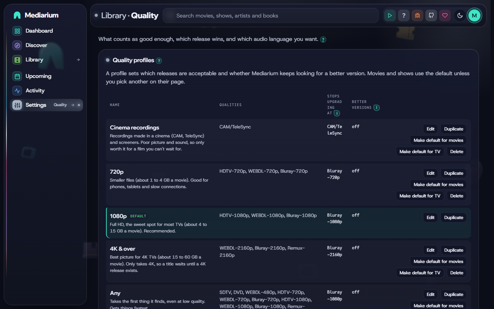
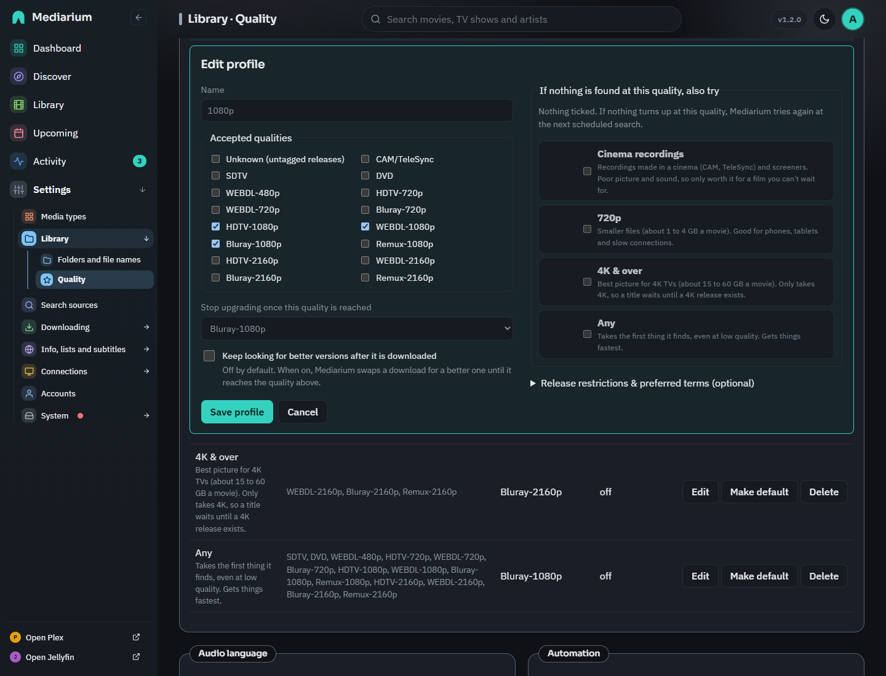

# Quality profiles

A quality profile decides which releases Mediarium may download for a movie or show, and when it stops looking for something better. Every title uses the **default profile** unless you give it one of its own. Change the default with **Make default for movies** on Settings > Library > Quality (or `PUT /api/settings` with `defaultProfileId`), and a single title's profile from its page.

Shows can have a default of their own. Press **Make default for TV** on a profile (or send `defaultTvProfileId` in `PUT /api/settings`) and every show with no profile of its own uses that one, while movies keep the movie default. Until you set one, shows use the same default as movies, so nothing changes for you. **Use the movie default for TV** (or `defaultTvProfileId: 0`) puts it back. The add-title window, a title's profile picker and the Library list all show the default that fits the title. A profile that is the default for movies or for TV can't be deleted.

A profile has:

- **Accepted qualities**: the quality tiers it accepts, such as `WEBDL-1080p` or `Bluray-2160p`. A release in any other tier is skipped.
- **Stop upgrading once this quality is reached** (the *cutoff*): once a title has a file at or above this tier, Mediarium stops searching for upgrades.
- Optionally your own **Quality order and groups**: rank the qualities your way and put several in a group that counts as one rank (see [Quality order and groups](#quality-order-and-groups) below). Without it the usual order is used.
- **Keep looking for better versions after it is downloaded** (shown as *Better versions* in the list, `upgradeAllowed` in the API): a title with a file below the cutoff keeps being searched for a better allowed release. Left off, the first acceptable release is kept. A new profile starts with it off.
- Optional **Release restrictions & preferred terms**: words a release name must contain at least one of, words it must not contain any of, and preferred words with a score. One term per line, matched anywhere in the release name, ignoring capitals, with dots and dashes counting as spaces.
- Optional fallback profiles (**If nothing is found at this quality, also try**): other profiles to try, in order, when nothing found is acceptable to this one (see below).
- **Skip bad releases** (`skipBadReleases`), on unless you switch it off: leaves out releases nobody wants to watch at home, so you get good downloads without any extra setup. These are whole Blu-ray discs (BDMV, BD50, "COMPLETE BLURAY"), 3D releases (SBS, OU, MVC), upscaled copies, subtitles burned into the picture (HC, HARDSUB, KORSUB) and groups known for poor re-encodes (YIFY/YTS, aXXo and a few others). Between two releases of the same quality it also prefers a group's fixed release (PROPER, REPACK). A release left out says why in interactive search, for example "is a 3D release, which "Skip bad releases" leaves out", and you can still grab it by hand.
- **Never download season packs** (`noSeasonPacks`): whole-season releases are skipped, so TV episodes are fetched one by one even when a full season is out. Off by default.
- Optional **Custom format scores**: a score for each custom format, a minimum score and an upgrade-until score (see [Custom formats](#custom-formats) below). They're hidden until you switch on **Show advanced options**.



*Settings > Library > Quality: the profiles come first, each with its qualities, where it stops upgrading, and Edit, Make default and Delete. The default profile's fallback order sits below the list.*



*Edit on a profile opens this form above the list.*

## Moving a title to a lower profile

Giving a title a lower profile (say 4K down to 1080p) changes what Mediarium accepts from now on. It does not touch the file you already have, and it never searches for a smaller one by itself: a 4K file on a 1080p profile counts as above the cutoff, so it is simply left alone. This is the same as in Radarr and Sonarr.

To shrink a movie you already have, use **Replace with a smaller version** on its page (or on a selection in the Library, see [Selecting many titles](library.md#selecting-many-titles)):

1. Give the movie the profile you want, for example 1080p.
2. Press **Replace with a smaller version**. A question names the file you have and its size.
3. Mediarium searches your indexers for the best release that the movie's current profile accepts, that is not a higher quality than your file, and that is at least a tenth smaller. If it finds one it downloads it like any other release.
4. Only when the new file is downloaded and in your library is the old file removed. If nothing suitable is found, or the download fails, your old file stays and the movie stays downloaded. Nothing is deleted first.

The new file goes through the usual import, so **If a file already exists** (Settings > Library > File names and importing) is respected for the name of the new file. If the movie's file changed while the download was running, nothing is removed. For TV shows there is no such button yet: change the profile and the episodes that are already below it are looked for again, but a file above the profile is left alone.

The same thing through the API: `POST /api/movies/{id}/replace-smaller` for one movie, and `POST /api/library/bulk/replace-smaller` with `{"items": [{"kind": "movie", "id": 1}]}` for a selection (administrators, at most 25 at a time).

## The built-in presets

Mediarium comes with five presets, loosely based on the [TRaSH Guides](https://trash-guides.info/) recommendations. All five start with better versions off, so a title is downloaded once and then left alone. The cutoff in the table is where a profile stops if you switch better versions on. They're listed from lowest to best, with Any last.

| Preset | Allowed qualities | Cutoff | Good for |
|---|---|---|---|
| **Cinema recordings** | CAM/TeleSync only | CAM/TeleSync | a film that is still only in cinemas |
| **720p** | HDTV-720p, WEBDL-720p, Bluray-720p | Bluray-720p | small screens, little storage or slow connections |
| **1080p** (default) | HDTV-1080p, WEBDL-1080p, Bluray-1080p | Bluray-1080p | most people |
| **4K & over** | WEBDL-2160p, Bluray-2160p, Remux-2160p | Bluray-2160p | 4K screens with plenty of storage |
| **Any** | every recognised tier, from SDTV and DVD up to Remux-2160p | Bluray-1080p | getting *something* for rare or old titles |

Good to know:

- **Each resolution preset takes only its own resolution.** 1080p never settles for 720p and 4K & over never settles for 1080p. A title with no release at that resolution waits until one appears. Use **Any** (or your own profile) for titles that may never get one.
- **1080p** doesn't include **Remux-1080p**. A remux is an untouched copy of the disc, often 20 to 40 GB per movie, several times the size of a Bluray encode that looks the same on most screens. For remuxes, make your own profile.
- **4K & over** has a Bluray-2160p cutoff, so a 4K remux is downloaded only when it's the best release found, not hunted as an upgrade.
- **Any** stops upgrading at Bluray-1080p, so a title isn't chased all the way to a 4K remux. Releases whose name carries no recognisable quality aren't accepted.
- **Cinema recordings and screeners** (CAM, HDCAM, TeleSync/TS/HDTS, Telecine/TC, screeners, R5, and the same with Rip on the end, like HDCAMRip or HDTSRip) are their own quality, **CAM/TeleSync**, even when the name also says 1080p. Only the **Cinema recordings** preset accepts them, and it accepts nothing else, so a new film with only such copies waits for a proper release. Because some cinema recordings are named like a normal WEB-DL, Mediarium also doesn't search for a film automatically while it is only in cinemas: it waits for the digital or disc date TMDB lists, or 90 days after the cinema date when there is none (the title's history says which). Films from before the last five months aren't affected, a profile that ticks CAM/TeleSync isn't held, and **Search now** or picking a release by hand always works. In the release list of a film that is still before its digital or disc release, every release gets the note that it may be a recording made in a cinema even though its name says WEB-DL (a name can't be trusted before that date). Tick CAM/TeleSync in your own profile if you want them.
- **Cinema recordings** works best as a fallback (see below). A film that's still only in cinemas gets a recording now, and a proper release replaces it as soon as one appears.

The presets are ordinary profiles. Edit, rename or delete them (except the current default), or make your own from scratch.

**Changing a title's profile to a higher one.** When a movie's or show's file isn't one of the new profile's qualities and sits below its cutoff (a 1080p movie put on **4K & over**), Mediarium takes that as "I want this quality": it switches on looking for better versions for that title and searches straight away, even when the profile itself has better versions off. The page says it's searching. This also happens when you change the profile of many titles at once from the Library. A file that is better than the new profile (a 4K file put on 1080p) is kept; nothing is swapped for a worse release. `PUT /api/movies/{id}/profile` and `PUT /api/series/{id}/profile` answer `{"searching": true}` when a search started.

**Edit** opens the form right under the profile you pressed it on, scrolls it into view and puts the cursor in the name. **New profile** opens the form under the list the same way. On a wide screen the form has two columns: the name, qualities, cutoff and better versions on the left, the fallback order and the release restrictions on the right.

A profile needs a name of up to 60 characters, at least one accepted quality, and a cutoff that is one of the accepted qualities. Each restriction box takes at most 50 terms of up to 60 characters, and a term can't contain `|`. A preferred term is written as `term = score` with a whole-number score between -10,000 and 10,000. The page points these out as you type and the server refuses the same mistakes.

### How preferred terms add up

Every preferred term a release name contains adds its score, so the order of the lines doesn't matter. With `x265-FuN = 100` and `x265 = 50`, a release named `...x265-FuN` matches both terms and scores 150, and one named `...x265.AAC-2BA` matches only the second and scores 50, whichever line comes first. The score is only compared after two things that come before it: the language you prefer and the quality. A release that fits your language better, or sits in a higher quality, wins whatever its score, and a torrent with no seeders is left for last. The details row of a release in interactive search tells you which of these decided (see below).

## Anime release groups

For anime, the release group often matters more than the source. The same episode comes out from several groups within hours, and they differ in how fast they are, how they encode and which languages they keep. A profile's **preferred terms** are the way to say which you like: a release whose name contains the term gets its score added, and between releases of the same quality the higher score wins. Group names in square brackets work as they are, so `SubsPlease` matches `[SubsPlease] Show - 05 (1080p)`.

Under **Release restrictions & preferred terms**, **Add anime groups** adds a few well-known groups to start from, each on its own line:

```
SubsPlease = 40
EMBER = 30
Judas = 30
Erai-raws = 20
Dual Audio = 20
```

It leaves a term alone that is already in the box (with whatever score you gave it), so pressing it twice changes nothing. The numbers are only a start. Change them to suit you, add the groups you trust, and give a group you want to avoid a negative score, such as `SomeGroup = -100`. For a list of groups ranked by what they release, see the anime pages of the [TRaSH Guides](https://trash-guides.info/Sonarr/sonarr-setup-quality-profiles-anime/) and [SeaDex](https://releases.moe).

Tips for an anime profile:

- Make a profile of its own (accept the same qualities as the **1080p** preset) and give it to your anime shows from their pages, so the group scores don't touch your other shows.
- Words like `Dual Audio` or `Multi-Subs` work as preferred terms too. To rule something out altogether, put it under **Must not contain any of**.
- Anime names often carry no `S01E05`. A show whose type is **Anime** is matched by episode number, and [scene and anime numbering](library.md#scene-and-anime-numbering) finds releases named by the part of a season.

## Release size

Two size rules keep fakes and oversized releases out, with nothing to fill in:

- **Fakes are skipped.** A release far too small for the quality it claims (a "1080p Bluray" movie of 40 MB, a 4K remux of 2 GB) is never picked by an automatic search. The minimums are built in, per quality, for a whole movie and for each TV episode (a season pack counts as at least three episodes). A release whose size the indexer doesn't report is not held back.

  Short shows are handled: when an episode's runtime is known from TMDB and is under 30 minutes, the minimum for one episode shrinks in step with it (the built-in value times the runtime over 30 minutes, never under 15 MB). A 5 minute episode of WEB-DL 1080p then needs about 25 MB instead of 150 MB. Movies and longer episodes are checked as before. If a show still has real releases that are skipped, or you keep small encodes on purpose, switch the check off.
- **Largest download (GB)** in a profile skips anything bigger. Leave it empty for no limit (the default). Handy on a small disk or a slow line. Scripts use `maxSizeGB` on `/api/profiles` (0 = no limit).

You can still pick any release by hand from a title's release list.

The built-in minimum has a switch: **Settings > Library > Quality > Size limits > Built-in minimum size check**. It is on by default. Off, automatic searches no longer skip a release for being too small for its quality, and the release list stops showing "smaller than a real ... release is likely to be". The profile's largest size and the size table are not affected. In the API, `GET` and `PUT /api/quality/min-size-check` with `{"enabled": false}`; the setting is `search.min_size_check`.

### Size limits per quality

**Settings > Library > Quality > Size limits** is a table with a smallest and a largest size for every quality, one table for **Movies** and one for **TV** (the two tabs above it, each with its own switch, **Reset to defaults** and **Apply TRaSH sizes**), in the same way that Radarr and Sonarr each have their own. A movie release is judged by the Movies table and an episode or season pack by the TV table. The card can be folded away; the line next to its arrow says where the limits are on.

Each table has a smallest and a largest size for every quality, in **megabytes for each minute** of the film or episode, like the quality definitions in Radarr and Sonarr. A 2-hour film at 4 MB a minute is about 0.5 GB. The right-hand column shows what the numbers mean for a film of 100 minutes.

- The switch **Use these size limits** is off at first and the table then does nothing.
- Leave **Largest** empty for no upper limit. The defaults are Sonarr's: for example 4 to 130 MB a minute for WEBDL-1080p, 35 or more for a remux, with no upper limit for remuxes and for most 2160p.
- A film's length comes from TMDB (100 minutes when TMDB can't say), and an episode's length too (45 minutes). A release with two episodes counts both. A season pack is only checked against the smallest size, as its number of episodes isn't known.
- A release that doesn't say its size always passes.
- Automatic searches skip a release outside its limits. In a title's release list, the release is marked "too large for WEBDL-1080p: 410.0 MB a minute, the largest is 130 MB a minute", and you can still pick it by hand.
- The table, the built-in minimums above and a profile's **Largest download** all apply: a release has to pass every one, so the tightest wins. The release list now also names a release that is smaller than the built-in minimum or larger than the profile's limit.
- **Reset to defaults** puts every number back (the switch stays as it is).
- **Apply TRaSH sizes** next to the switch fills the table with the sizes the [TRaSH Guides](https://trash-guides.info/) recommend. On the **Movies** tab choose the list **Movies**, **Movies, streaming (SQP)**, **Movies, 4K (SQP)** or **Anime movies** (Radarr's lists); on the **TV** tab, **Series** or **Anime series** (Sonarr's lists). The sizes are read from GitHub the same way the custom formats are (kept for six hours), and an unreachable GitHub gives a clear message. The card then names each quality that changed ("WEBDL-1080p 4 to 130 -> 12.5 and up"); nothing is saved until you press **Save**. How the numbers carry over:
  - TRaSH gives a smallest, a preferred and a largest size per quality, in MB a minute. The smallest and largest go into the table; the preferred size has no place here and is left out.
  - A largest size at the end of TRaSH's scale (1000 or more, which is how they write "no limit") becomes an empty **Largest**.
  - WEBRip counts as WEBDL, "Bluray-1080p Remux" as Remux-1080p. Qualities Mediarium has no row for (Bluray-480p, Bluray-576p) are named and skipped.
  - A quality TRaSH gives no size for (for example CAM/TeleSync) keeps the numbers it has.
  - A list only changes the table of its own tab, so the movie sizes never change the TV checks and the other way round. The switch **Use these size limits** is not touched: if it is off, the card says so.

Scripts: `GET /api/quality/size-limits/trash/{list}` answers what a TRaSH list would put in the table (`radarr-movie`, `radarr-sqp-streaming`, `radarr-sqp-uhd`, `radarr-anime`, `sonarr-series` or `sonarr-anime`) without saving anything, as `{rows: [{quality, min, max}], skipped: [...]}`. The answer also says which table it is for (`kind`: `movie` for Radarr's lists, `tv` for Sonarr's). `GET /api/quality/size-limits`, `PUT /api/quality/size-limits` with `{"enabled": true, "rows": [{"quality": "WEBDL-1080p", "min": 4, "max": 130}]}` and `POST /api/quality/size-limits/reset` all take `?kind=movie` (the default) or `?kind=tv`. The saved tables are the settings `quality.size_limits` (movies) and `quality.size_limits_tv`. Before 3.3 there was one table for both: on upgrade the TV table starts as a copy of the table you had, so no check changes until you edit one of them.

**Duplicate** next to a profile opens a copy of it ("1080p copy") to change and save as a new profile.

## Automatic searching

The **Automation** card on **Settings > Library > Automatic searching** has one switch, **Automatic searching and downloading** (`automation.enabled`, or `automationEnabled` in `PUT /api/settings`). When it's off, Mediarium doesn't search by itself for missing titles, new releases or upgrades. **Search now** and grabbing a release by hand still work.

Under the switch are two numbers:

- **Look for missing items every … hours** is how often Mediarium searches for everything that's missing or could be upgraded. Whole hours from 1 to 168, starting at 6 (`automation.hunt_interval_hours`, or `huntIntervalHours` in `PUT /api/settings`).
- **Check for new releases every … minutes** is how often it looks at the newest releases of each indexer and matches them against what you're waiting for. From 5 to 1440 minutes, starting at 15 (`automation.release_check_minutes`, or `releaseCheckMinutes`).

A new number is used from the next wait on, with no restart. A number outside these limits is refused and the old one stays.

Each scheduled search handles a limited number of titles so a big library doesn't use up an indexer's searches for the day in one go: 50 movies, 25 show searches, 25 albums and 10 books. The next run carries on where this one stopped (movies, books and albums) or starts with the shows that were searched for longest ago, so every title gets its turn. Inside a show, the episodes not searched for yet (or longest ago) come first, so a show with more missing episodes than one run can search gets through all of them over a few runs. A film whose name brings more releases than a search reads ("Dune", "Halloween") is searched again with its year, so its own releases are not lost among those of other films with the same name. The check for new releases still looks at everything. When every indexer is paused or at its daily limit, a scheduled search is skipped and nothing is written to the titles' activity.

When a torrent indexer says a release has no seeders, Mediarium only picks it when nothing alive is left, and between two otherwise equal torrents it takes the one with more seeders. A release whose seeders the indexer doesn't say is treated as normal.

**Quiet for a while** is under the numbers: **1 hour**, **4 hours** or **Until morning** (8:00 in your browser's time) holds the heavy background work, the searches, library and show refreshes, the subtitle sweep, picture fetching, list and watchlist checks, so a small server isn't busy while a film plays or a game is running. A search that comes due during the quiet time isn't lost: it waits and runs when the quiet time is over. Downloads that are running or waiting, imports, backups and anything you start yourself carry on. **Back to normal** ends it. It's kept in `automation.quiet_until` (a restart doesn't end it early); scripts use `GET` and `PUT /api/automation/quiet` (`{"minutes": 60}`, `0` to end it, 4320 at most).

Two switches, both off at first, decide what happens to monitoring once something is in:

- **Stop monitoring a movie once it's downloaded** (`library.unmonitor_downloaded`, or `unmonitorDownloaded`). The movie is no longer searched for, not even for a better version, so a file you delete isn't fetched again. Switch monitoring back on from the movie's page.
- **Stop monitoring a show once it has ended and every episode is in** (`library.unmonitor_finished_shows`, or `unmonitorFinished`). A show TMDB lists as ended or cancelled stops being monitored when every monitored episode (specials aside) is downloaded. It's checked when the show's details are refreshed, which happens daily, and straight after each import. A show that's still running stays monitored, so new episodes keep coming.

Activity notes each title that stops being monitored this way.

### Season packs once a season has ended

While a season is still airing, its episodes are fetched one by one as they come out. **Prefer season packs once a season has ended** (`library.season_packs`, or `seasonPacks`; off at first) changes what happens after the finale. Once every episode of a season has aired, and the last one aired at least two days ago, the hunt looks for a season pack of that season before it goes back to single episodes. It does this when:

- some of the season's monitored episodes are still missing, or
- the episodes you have are below the profile's cutoff and better versions are switched on, so a better pack would be an upgrade.

A pack is only taken when it is the same quality or better than the episodes already there. A pack that is worse than the best file you have for the season is never taken, and a pack never replaces a better file with a worse one. Everything else works as for any search: the blocklist, the indexer limits, the size limits, the audio language rules and a profile that never downloads season packs all still apply. If the pack fills the missing episodes and is better than the files you had, the old files are replaced the way any upgrade replaces them, after the new ones are in place.

A season is left alone when one of its episodes is downloading already (that may be the pack itself), when a season pack was taken for it before, or when it was searched for less than a week ago. A search that finds no pack is remembered, and the season is looked at again a week later. After six searches in a row that found nothing, the season is left alone until an episode is added to it, you change the season pack setting (in Settings or on the show), or 60 days have passed since the last search. Meanwhile the missing episodes are fetched one by one as usual. Activity notes each search with "Season 2 has ended: looking for a season pack".

A season that has nothing in it yet (every episode has aired and none is downloaded) follows the same choice: with packs preferred, the hunt looks for one pack of the whole season first. With **Episode by episode**, whether it is the default or the show's own choice, that season is fetched one episode at a time, and no pack is taken by an automatic search.

A show can choose for itself under **Season packs** on its page: **Default** follows the switch above, **Prefer packs once a season has ended** or **Episode by episode** decides for that show. Searches you start by hand, and the RSS check, never wait for or look for a pack this way.

## Wait for a better protocol

The **Wait for a better protocol** card on **Settings > Library > Automatic searching** works like a delay profile in Radarr and Sonarr. Mediarium's own searches can hold back a release for a number of minutes, so a copy from the protocol you like better has time to appear. For example: prefer Usenet, wait 120 minutes for torrents, and a torrent that was posted 30 minutes ago waits another 90 minutes. If a Usenet copy turns up meanwhile, that one is taken.

- **Preferred protocol**: between two equally good releases this one wins. Usenet is the default.
- **Wait for Usenet releases** and **Wait for torrent releases**, in minutes (0 to 43,200, which is 30 days). 0 means no wait, and both at 0 (the default) means nothing is delayed.
- **Don't wait for the best quality**: a release of the preferred protocol that is the best quality the title's profile allows is taken at once.
- The wait counts from when the indexer says the release was posted. When it doesn't say, it counts from when Mediarium first saw the release. A release that is already older than the wait (a search for an old film) is never held.
- Only searches Mediarium starts by itself wait: the regular search for missing titles, the check for new releases and upgrades. **Search now**, a search on adding a title, and any release you pick yourself are never delayed. The search after adding a show, changing its profile or blocklisting one of its releases only looks for episodes that are monitored, so adding a show with "future episodes only" doesn't fetch the old ones.
- A held release shows on the **Wanted** page and on the title's page as "Waiting for a better protocol until 14:20", and the title's activity log has a line for it. About a minute after the wait ends, Mediarium searches that title again and takes the best release there is. That follow-up search counts as an automatic one, so it also waits while the limit of 10 automatic downloads an hour is reached, and it is kept for later when every indexer is paused. A title that is removed, or that gets a release grabbed or downloaded, is forgotten, and a title that is already downloaded only holds back releases that would be a real upgrade.

Scripts: `GET` and `PUT /api/search/delay` with `{"preferredProtocol": "usenet", "usenetMinutes": 0, "torrentMinutes": 120, "bypassIfHighestQuality": true}`, and `GET /api/search/waiting` for what is held now. The profile is the setting `search.delay_profile`. It applies to movies and shows; music and books are not delayed.

## Audio language

**Settings > Library > Quality > Audio language** lists the languages you want to hear, best first (`quality.language`, or `qualityLanguage` in `PUT /api/settings`: names separated by commas, such as `Spanish,English`). English is the starting value. It applies to every profile. The switch under the list, **Only take releases in these languages**, is `quality.language_only` (`qualityLanguageOnly` in `GET` and `PUT /api/settings`, `true` or `false`, off by default; the settings file has it too).

With more than one language, a release is taken when it suits any of them, and one that suits an earlier language is chosen over one that only suits a later language. A release with two or more audio tracks counts when one of its languages is on your list.

How a release with several audio languages ranks depends on how many languages you listed. With **one** language, a release that names only that language is preferred over a multi-language one (`MULTi`, `DUAL` or `DL`). With **several** languages, such as `German,English`, a multi-language release that has the first language is preferred over a plain release in that language, because it also carries the others, which you said you want. A German scene release tagged `DL` (dual language), such as `German.DL.1080p` or `German.BDRip.DL`, counts as German plus the original language, wherever `DL` sits in the name. `WEB-DL` is a source, not a language tag. When Mediarium explains why another release won, it says "The best match names your languages better." in this case.

Add **Original language of the title** to the list and Mediarium puts each film's or show's own language there (Japanese for an anime, Korean for a Korean drama), as TMDB lists it. A title whose original language TMDB doesn't give just uses the other languages on your list.
Mediarium reads the language tags in a release name (`ITA`, `ITALIAN`, `GER`, `GERMAN`, `FR`, `FRENCH`, `TRUEFRENCH`, `VFF`, `ESP`, `SPANISH`, `RUS`, `ENG`, `HRV` and `CROATIAN`, `SRB` and `SERBIAN`, `BOSNIAN`, `SLOVENIAN`, `BUL` and `BULGARIAN`, `MULTi`, `DUAL`, `German.DL` and more). Tags are only read after the title, so a film called "The Italian Job" isn't taken for an Italian release. A release with no language tag is taken to be English. Subtitle tags such as `VOSTFR` and `SUBBED` don't change the audio language.

| The release is | With English wanted, automatic search and RSS |
|---|---|
| untagged, or `ENG` | **Taken first.** |
| the wanted language and another, such as `iTA-ENG`, or `MULTi` naming the wanted language | Taken only when there's no plain release. |
| `MULTi` or `DUAL` with no language named, or `German.DL` | Taken only when there's nothing better than that, after `iTA-ENG`. |
| clearly one other language, such as `ITALIAN`, `GERMAN` or `TRUEFRENCH` | **Never taken.** It counts as not acceptable, like a quality the profile doesn't allow. |

The language comes before the quality when Mediarium ranks acceptable releases, so a plain English 1080p WEB-DL is chosen over an `iTA-ENG` Bluray. Upgrades follow the same rule, and a fallback profile judges the language the same way. Pick Italian and releases tagged `ITA` are taken first, plain untagged releases (taken to be English) come after them, and releases only in another language are still skipped.

### Only take releases in these languages

When English isn't the language you want, the table above still lets an untagged release, a release tagged English only, and a `MULTi` or `DUAL` release with no language named through as a last choice. That is why someone who wants German can still end up with an English release when no German one turns up. The switch **Only take releases in these languages** (under the list of languages) closes that gap. It is off by default, so nothing changes until you turn it on.

With it on, a release has to say it is in one of your languages:

| The release is | German wanted, switch on |
|---|---|
| tagged `GERMAN`, or `German.DL` | Taken, and ranked as before. |
| `MULTi` naming German, such as `MULTi.GERMAN.ENG` | Taken. |
| untagged (taken to be English) | **Never taken.** Taken as before when English is also on your list. |
| tagged `ENG` only | **Never taken**, unless English is on your list. |
| `MULTi` or `DUAL` that doesn't name German | **Never taken.** |
| clearly another language, such as `ITALIAN` | **Never taken**, as before. |

With English on your list (for example `German,English`), untagged and `ENG` releases count as English and are taken, but a bare `MULTi` or `DUAL` release is still skipped, because it doesn't say which languages it has. **Original language of the title** works as before: the title's own language counts as a wanted language, and a title whose original language isn't known just uses the other languages on your list. If the list is empty or holds only an unknown original language, every release is accepted, as without the switch.

The switch applies everywhere the language is judged: automatic and scheduled searches, the RSS sync, IRC announces, upgrades, and the fallback profiles, for movies and shows. In the release list a release it skips is marked with the reason in plain words ("Untagged release, taken to be English, not German"; "Multi-language release that doesn't name German"), and **Grab** still works, because a release you pick by hand is always allowed.

A film made in another language (a Korean or a French film, say) is usually released with its own language as the audio. Put **Original language of the title** on the list, below the language you like for everything else, and those films are found in their own language.
A release tagged `HDRip` (or `HD-Rip`) is a re-encode of a TV capture or some other source that isn't a clean web or disc copy. It counts as an HDTV quality (HDTV-1080p, HDTV-720p), so a profile that only allows WEB-DL or Bluray leaves it out. A name that says `HDRip` and also `WEB-DL` or `BluRay` is read as the web or disc copy.

The release list (**Choose a release** or **Find and download**) can be sorted by clicking a column name: once for the natural order (biggest, best or highest first, A to Z for names), again to reverse it, a third time to go back to the order Mediarium gave. Above the list, **Find in these releases** narrows it by words in the name, and **Any indexer** and **Any quality** by indexer and resolution (the indexer list has every indexer that was asked, with the number of releases it gave, so one with nothing is greyed out and one that did not answer has a warning sign); **Close** puts the card away. The subtitle search results sort the same way (release, source, rating, fit).

In a title's release list a **Language** column shows what each release says ("Italian + English", "Multi"). A release that automation would skip for its language is marked with the reason ("Italian audio, not English"), and **Grab** still works, because a release you pick by hand is always allowed. The release list in `GET /api/movies/{id}/search`, `GET /api/series/{id}/search` and `GET /api/search` has `language` and `languageFit` (`ok`, `mixed` or `other`) for each release.

### Releases named in your language

A film or show made or released in another country is often posted under its local title. A German release of "The Lord of the Rings: The Fellowship of the Ring" is called something like `Der Herr der Ringe 2001 German ...`, and a search for the English title never finds it. So when your audio language list names a language besides English, Mediarium also looks for each title under the names TMDB lists for that language and country, plus the title's original name (when it is written in Latin letters, or is in a language on your list).

- It keeps at most four other titles for each movie or show, and leaves out any that are the same as the English title once capital letters, punctuation, accents and a leading "The" are ignored. Names too short to tell apart from other things are left out: in Latin letters a name needs four letters ("Es" and "Eis" don't count).
- **The searches** (**Search now** and the release list of a movie or show) ask your indexers for the English title first and then once for each other title, and show the releases together, each listed once. The automatic search is easier on your indexers: it tries the other titles only when the English title found nothing it would take, and at most two of them. A show is searched under at most two other titles for each season or episode, and the automatic search again only when the main title found nothing for it. These extra searches go through the same spacing as every other search, a second and a half apart on one indexer, so they don't cause "too many requests". An indexer that has just said so is left out of the rest.
- **The matching** takes a release as the movie or show when its name is the English title or one of that title's own other titles. The year and season rules stay as they were, and for a movie that has a year, a release named by another title has to show that year too (a release with no year in its name is taken for the English title only). Only the other titles of the title being searched count: a German title that happens to be another film's English title doesn't pull that film's releases in. For a movie, a release also counts when it shows the movie's year and its name is the movie's title with a maker's name in front, like `Tim.Burtons.The.Nightmare.Before.Christmas.1993` for The Nightmare Before Christmas (the word next to the title has to be a possessive such as Burtons or Disneys).
- A title with umlauts or a sharp s (`Sams im Glück`) is also kept in the spelling that writes them out (`Sams im Glueck`: ä, ö, ü become ae, oe, ue and ß becomes ss), right after it. Release groups use both, and an indexer does not always treat them as the same. The extra spelling is one more of the other titles, so it counts in the same limits. The title's own name gets it too, first in line and whatever languages you want, which matters when the info language makes that name German. A release written either way already matched.
- In the release list, a release found under one of the other titles says "Matched on the title ..." under its name.
- The titles are read from TMDB when a movie or show is searched for the first time after you choose a language (or in the background, a few at a time), and again when a show is refreshed or after 30 days. If you change the audio languages they are picked again. With only English wanted, none are kept and nothing extra is searched.

Over the API, `GET /api/movies/{id}/search` and `GET /api/series/{id}/search` give `matchedTitle` for a release named by one of the other titles.

## Quality order and groups

By default Mediarium ranks qualities in one fixed order, from the worst to the best: SDTV, DVD, the 720p ones, the 1080p ones and so on, with Remux at the top of each resolution. That is fine for most people. If you want it your way, a profile can have its own **quality order**, like the quality list in Radarr and Sonarr.

Open a profile with **Edit** (it is under **Show advanced options**, see [Getting formats](#getting-formats)) and unfold **Quality order and groups**. It is folded away until you want it, and its head tells you what is in it ("14 qualities, 3 groups"). Press **Customise order and groups** and the plain list of tick boxes is replaced by a list of the qualities, best at the top:

- **Accept** a quality with its tick box. Qualities you leave out sit under the accepted ones. The number in front of an accepted row is its rank.
- **Move** a row by dragging its handle, with the up and down arrows at the end of the row, or from the keyboard: focus the handle and press the up or down arrow key. The arrows work by touch too.
- **Group** qualities so they count as one rank. Tick **Pick** on two or more accepted rows and press **Group selected**. Give the group a name (it starts with the qualities in it). The qualities of a group are equal: none is an upgrade over another, so a title with a file from the group is not replaced by another file of the same group. Between them Mediarium still takes the better one by the usual order, then by score, when it has to choose. **Ungroup** breaks a group up again, and the small cross on a quality in a group takes just that one out.
- **Use TRaSH layout** puts the qualities back in the usual order and names the web qualities WEB 2160p, WEB 1080p and so on, as in the TRaSH guides. Mediarium does not tell WEBRip from WEB-DL: they are already one quality, `WEBDL-1080p` and so on, so there is nothing to combine there. **Treat web and TV as equal** goes a step further and makes one group of the web and the HDTV quality of each resolution.
- **Reset to default order** drops the custom order and goes back to the plain list. The qualities you accepted stay accepted.

The cutoff ("Stop upgrading once this quality is reached") then picks a row of the list: a quality, or a whole group. A title with a file in that row or in any row above it stops being searched for upgrades. Everything else works from the same order: which release an automatic search picks, which release the search list marks as the best match (and why another one is not), whether a release is an upgrade, which titles show up as below the cutoff, and the delay profile's wait for the best quality.

A release in a quality the order does not list is not accepted, as before. A file you already have in a quality the order does not list counts as just above the listed quality that comes next below it in the usual order, so a 4K file on a 1080p profile is still left alone.

A profile without a custom order behaves exactly as it always did. Importing a profile from the TRaSH Guides sets a custom order only when the guide's profile groups qualities or ranks them differently from the usual order.

Over the API, `qualityOrder` in `GET/POST /api/quality-profiles` and `PUT /api/quality-profiles/{id}` is the list, best first: each item is `{"tiers": ["Bluray-1080p"]}` for one quality or `{"name": "WEB 1080p", "tiers": ["WEBDL-1080p", "HDTV-1080p"]}` for a group. When it is set it decides `allowed` (every quality in the list), and `cutoff` has to be one of them. `[]` goes back to the usual order, and an update that leaves `qualityOrder` out keeps the saved one. The Radarr and Sonarr compatible `/qualityprofile` answers show a group the way those apps do: an item with a `name`, an `id` (from 1001) and its qualities in `items`, with `cutoff` set to the group's id when the cutoff is a group. The MCP tool `profiles_list` lists the order as `quality_order`, a group as "Name: quality + quality". In the [config file](config-file.md), `qualityOrder` is a field of `qualityProfiles`.

## Fallback profiles

A profile can name other profiles to fall back on, in order. Every profile starts with none, and you choose them per profile. Over the API that's `fallback` in `GET/POST /api/quality-profiles` and `PUT /api/quality-profiles/{id}`: an ordered list of profile ids. Ids that don't exist, and the profile's own id, are ignored, and an update that leaves `fallback` out keeps the saved list. Deleting a profile removes it from every fallback list.

When an automatic search (the scheduled search, the new-releases check, **Search now**, the search after adding a title, the retry after a bad release) finds releases for a title with **nothing downloaded yet**:

1. The results are judged against the title's own profile first. If any is acceptable, the best of those is grabbed, as always.
2. Only if none is acceptable are the same results judged against each fallback profile, in order. The best release of the first fallback that accepts anything is grabbed. Each fallback uses its own allowed qualities and release restrictions, and a fallback's own fallbacks aren't followed.

The title keeps its own profile. A file that came from a fallback (its quality is outside the title's profile but allowed by one of its fallbacks) is always searched for a replacement, even when upgrades are off, and any release the title's own profile accepts replaces it, whatever the cutoff. Upgrades for a file the title's own profile already accepts never use a fallback.

For example, a **1080p** profile with **Cinema recordings** as its fallback downloads a TeleSync copy of a film that's still only in cinemas, then replaces it with the first 1080p release.

The activity list says when a fallback was used ("nothing matched the "1080p" profile, so ... was downloaded with the fallback profile "Cinema recordings". It will be replaced when a "1080p" release appears."). In the release list of a title's interactive search, each result has `acceptedBy` (`{profileId, profileName, fallback}`, left out when no profile accepts it), and a release only a fallback accepts is explained as "allowed only as a fallback (...)".

## Custom formats

The **Custom formats** card, the **Size limits** card and the **Music** card on the Quality page are folded away until you open them (the arrow at the right of the bar), so the page doesn't run long. Each shows a short summary while folded ("5 formats", "On for movies"), and Mediarium remembers which ones you opened, in your browser. The Custom formats card opens by itself when you import or change a format in it.

A custom format spots something in a release name: HDR, Dolby Vision, a codec, a streaming service, a release group, a remux, an edition. Each quality profile gives the formats it cares about a score. A release's **format score** is the total of the scores of every format it matches. Formats work the way they do in Radarr and Sonarr, so formats from either, and from the [TRaSH Guides](https://trash-guides.info/), work unchanged, including their patterns.

What the score does:

- Between releases of the same quality, the higher score wins. Preferred terms still count and are added to it. The order is the same in automatic searches and when Mediarium picks a release for an upgrade: first the language, then the quality (a higher quality always beats a higher score), then the score, and only then the usual tie-breaks (Usenet before torrents, a cached torrent, more seeders).
- A release scoring below the profile's **Minimum score** is skipped. With the TRaSH scores, a big negative score (often -10000) keeps a release out completely.
- With **Keep looking for better versions** on, a file whose release scores below the profile's **Upgrade until score** is replaced by a release of the same or better quality that scores higher. 0 means scores never cause an upgrade. Mediarium remembers the release each file came from from this version on. A file imported earlier has no known release, so it's never replaced for its score alone.

### Getting formats

Custom formats are an advanced option: most people don't need them, because the quality and **Skip bad releases** already get good downloads. To see them, switch on **Show advanced options** in the **Advanced** card at the bottom of Settings > Library > Quality (`ui.show_advanced`, or `showAdvanced` in `PUT /api/settings`). Until it's set, it's on when you already have custom formats. Switching it off only hides them: formats a profile scores keep counting.

The **Custom formats** card then has four tabs:

- **Your formats** lists what you have, whether each is for movies or TV, how many conditions it has and which profiles score it. **Rename** and **Delete** are here. Deleting a format also takes its score out of every profile.
- **From the TRaSH Guides** reads the guides' formats and ready-made profiles from GitHub (kept for six hours). Pick **Movies (Radarr)** or **TV (Sonarr)**. Then either:
  - **Create profile** on a ready-made profile. This makes a new quality profile with its qualities, cutoff, formats, scores, minimum score and upgrade-until score. A name you already use gets "(2)" added. Your own profiles are never changed.
  - Tick formats and press **Add**. Under **Give them TRaSH's default score in** the profile your movies (or, for TV, your shows) use by default is already chosen, so the formats arrive with the score the guides give them. Every format shows that score in the list; a format you already have that scores 0 (or something else) in the chosen profile although the guides score it is marked with the profile's score (for example "0 in 1080p"). Choose **Don't score them** to add the formats without a score: they then count in no profile until you give them one. A format the guides score 0 is added to the profile with a score of 0: it shows in the profile's **Custom format scores** list, counts for nothing, and is there for you to raise. A format the profile already has is never added a second time: it is skipped and keeps the score it has (the format itself is still refreshed from the guides, which the message calls "updated"). Tick **Replace the score if the profile already has the format** to give it the guides' score instead. When it is done, the message says per profile what happened, for example "1080p: 3 added, Already in the profile (skipped): 2." (`POST /api/trash-guides/{app}/formats` takes `replaceScores` and answers with `profile`: `{profileId, name, added, alreadyThere, replaced, removed}`.)
  Importing a format again updates it. Qualities Mediarium doesn't have (Raw-HD, BR-DISK) are left out, and WEBRip and WEBDL count as one quality.
- **Paste JSON** takes one format or a list, as the **Export** button of a Radarr or Sonarr custom format, their API or a TRaSH file writes it. A format with the same name replaces the one you have.
- **Test a release** shows which formats a release name matches, its quality and, with a profile chosen, its score and whether that profile would take it.

Then open a profile with **Edit** and set the scores under **Custom format scores**. Interactive search shows each release's score in a **Score** column, with a small arrow after it. The number is the whole score the pick uses: the formats it matched, the preferred terms it matched and, for a PROPER or REPACK while **Skip bad releases** is on, its small bonus, all added up. It is the same as the total at the bottom of the details row, and the column sorts by it. A profile that has preferred terms but no custom formats gets the column too. The arrow opens a details row under the release (it works with the keyboard and by touch, no hovering): each format and each preferred term the release matched with the score your profile gives it (+100, -50), the total, the profile's minimum score and the score upgrades stop at, and in plain words every reason an automatic search would skip the release or rank it lower: a quality or language the profile doesn't take, a size outside the limits, a score under the minimum, a release already blocklisted, fewer seeders than the indexer's minimum, or a file you already have that is as good. A release that nothing speaks against but that wasn't taken also gets **Why it was not the best match**, which names the step that decided: your preferred language, a higher quality (for example Bluray-1080p against WEBDL-1080p), a cached release your settings put first, a higher score (with the matched terms and formats of both releases, for example "350 against 150"), a torrent with no seeders, or, between two equal releases, the indexer's priority, the protocol, a cached copy or the number of seeders. **Show why** above the list opens the details of every release at once, and Mediarium remembers that choice in your browser. You can still grab any release by hand. In the API, a release of the interactive search (`GET /api/movies/{id}/search`, `/api/series/{id}/search`) carries `score` (the whole score, left out when the profile scores nothing), `fixScore` (the PROPER/REPACK bonus), `formatScore` (the formats' part), `formats` (a list of `{name, score}`), `terms` (the preferred terms it matched, a list of `{term, score}`), `minScore`, `upgradeUntil` and `reasons` (a list of `{kind, text}`; the kind `notBest` is the explanation of why another release was the best match, not a reason to skip this one). When the title's profile scores formats, the list starts with the **Best match** (the release an automatic search would take from this list, not one the list marks as skipped) and then goes by score, highest first; the other columns can be clicked to sort as before, and a third click on a column goes back to this order.

### Giving many formats a score at once

- **In the Custom formats card**, tick formats in **Your formats** (the box in the header ticks all), press **Add to profiles...**, tick one or more profiles and choose **TRaSH's score for each** or **The same score for all** with a score you type. A format the profile already has is skipped and keeps its score, unless you tick **Replace the score if the profile already has the format**; a typed 0 takes the format out of the profile. The message lists each profile on its own: how many formats were added, how many were already there (skipped), how many scores were replaced and how many formats were taken out (`POST /api/custom-formats/assign` takes `replaceScores` and answers with `changes`, one `{profileId, name, added, alreadyThere, replaced, removed}` per profile). Formats that came from the guides get the score the guides give them now (read from GitHub, or the last one Mediarium saw if GitHub can't be reached), a score of 0 included: the format is added with 0. A format that didn't come from the guides is left alone and named afterwards.
- **On a profile's edit form**, under **Custom format scores** (folded away at first, with the number of formats scored next to it; it opens by itself when you add formats or when a score has a mistake), **Add formats** opens a list of the formats the profile doesn't score yet. Tick some, choose TRaSH's score or one typed score, and they appear in the form with their scores. Formats the profile already scores are not in that list (when there are none left, it says every custom format is already in the profile), so none can be added twice. Nothing is saved until you press **Save profile**.
- **A score of 0 is a score.** A format in the list with 0 stays in the profile (and in `formatScores` in the API); it changes no release's score. Only an empty box leaves a format out. To take a format out of the profile, press the bin button at the end of its row (**Remove ... from this profile**), then **Save profile**.

Scores given from the Custom formats card (an import into a profile, or **Add to profiles...**) are saved straight away and show up in the profile's form, also when the form is already open: it picks up the new scores and keeps anything you typed in it.

### Keeping the TRaSH formats up to date

The TRaSH Guides change now and then: a pattern is fixed, a new release group is added, a score moves. Mediarium remembers which formats came from the guides (through the TRaSH tab or an earlier import) and what score the guides gave them. At the top of the Custom formats card:

- **Update from TRaSH** reads the guides and first shows what would change ("3 formats changed: ..."), with the profiles whose score would follow. Press **Update** to apply it.
- **Keep TRaSH formats up to date** (off by default) does the same by itself. Next to the switch, **Check** lets you choose **Every day** (the default) or **Every week**. It reads GitHub once per period; if that fails it tries again a few hours later. It only exists when you have formats from the guides.

Every check, from the button or from the switch, leaves a result in three places: a box on the card ("Checked the TRaSH Guides: 3 formats updated, 12 already up to date, 2 profile scores changed", or "nothing to update"), a line in Activity, and a line in the server log (so `docker logs` shows it too). Under the switch the card says when the guides were **last checked** and, while the switch is on, about when the **next check** is due. If GitHub can't be reached, the box says so.

To hear about it without opening the page, tick **TRaSH Guides sync applied** on a [notification](notifications.md#trash-guides-sync-applied). It sends one message when a check changed something, from the switch or from the button, and a message when a check failed. A check that changed nothing is quiet, unless you tick **Also tell me when nothing changed** under the event. The size limits are not updated by themselves (**Apply TRaSH sizes** is a button you press and save), so they are not part of it.

What an update changes: the conditions of the formats that came from the guides, and a profile's score for such a format **only when that score is still the one TRaSH gave last time**. A score you changed yourself stays as you set it. Formats you pasted or made yourself are never touched, and neither is a format's name. A format the guides no longer list stays as it is. A profile made with **Create profile** from a TRaSH profile that uses a score set other than the default keeps its own scores, because they aren't the default ones. Formats that were added before Mediarium remembered TRaSH's score get their conditions updated but no score is changed for them until the guides change a score again.

A language condition set to **Original** (Radarr's and Sonarr's "Original", used by several TRaSH formats) means the language the film or show was made in, as TMDB lists it. It matches a release in that language, and its "not" form (negate) matches a release in another one. When TMDB doesn't give the original language, neither form matches. Conditions Mediarium understands: release title, release group, edition, source, resolution, quality modifier, language, release type (single episode, multi-episode, season pack) and size. Indexer flags (such as freeleech) aren't passed on by the indexers, so a condition on them never matches, and the format says so.

### For scripts

| Endpoint | What it does |
|---|---|
| `GET /api/custom-formats` | Lists the formats with their conditions and the profiles that score them. |
| `POST /api/custom-formats` | `{json, app}` imports pasted JSON; `app` is `radarr` or `sonarr`. |
| `PUT /api/custom-formats/{id}` | `{name}` renames a format. |
| `DELETE /api/custom-formats/{id}` | Deletes a format and its scores. |
| `POST /api/custom-formats/test` | `{title, profileId}` tests a release name. |
| `GET /api/trash-guides/{app}` | The TRaSH formats and profiles for `radarr` or `sonarr`. |
| `POST /api/trash-guides/{app}/formats` | `{trashIds, profileId}` imports formats, scored in the profile when one is given. |
| `POST /api/custom-formats/assign` | `{formatIds, profileIds, mode, score}` gives formats a score in several profiles. `mode` is `trash` (each format's TRaSH score) or `score` (the typed `score` for all; 0 removes the format from the profile). Answers `{profiles, scored, unscored}`. |
| `POST /api/custom-formats/default-scores` | `{formatIds}` answers the TRaSH score of each format the guides score. |
| `GET /api/custom-formats/trash-update` | Lists what an update from the guides would change, without changing anything. |
| `POST /api/custom-formats/trash-update` | Updates the formats that came from the guides and answers what changed. |
| `POST /api/trash-guides/{app}/profiles` | `{trashId}` creates a profile from a TRaSH one. |

In `POST /api/quality-profiles` and `PUT /api/quality-profiles/{id}` the scores are `formatScores` (a list of `{formatId, score}`), with `minFormatScore`, `cutoffFormatScore` and `noSeasonPacks`. An update that leaves any of them out keeps the saved value. Search results carry `formatScore` and `formats` when the title's profile scores formats, and `best: true` on the one release an automatic search would take. The automatic update is `trashFormatsAuto` in `PUT /api/settings` (`formats.trash_auto_update`), and how often it runs is `trashFormatsEveryDays`, 1 (every day) or 7 (every week), stored as `formats.trash_every_days`. `GET /api/custom-formats/trash-update/status` answers `{last, next}`: what the last check found and about when the next one is due.

## Music profiles

With the music module on, **Settings > Library > Quality** ends with a **Music** section. It lists the music profiles: the formats each one takes (MP3-192 up to FLAC 24bit, worst to best), the format where it stops upgrading (highlighted), what it falls back to, and how many artists use it. Administrators can create, edit and delete music profiles there, drag the fallback order and choose the default for artists without a profile of their own. The rules are the ones above: a unique name, at least one quality, a cutoff among the accepted qualities. A profile that's the default or in use can't be deleted. The built-in default is **Lossy (MP3 320)**, which falls back to **Lossless (FLAC)**. Choose an artist's profile when adding it, or later on the artist's page. See [music.md](./music.md#quality).
